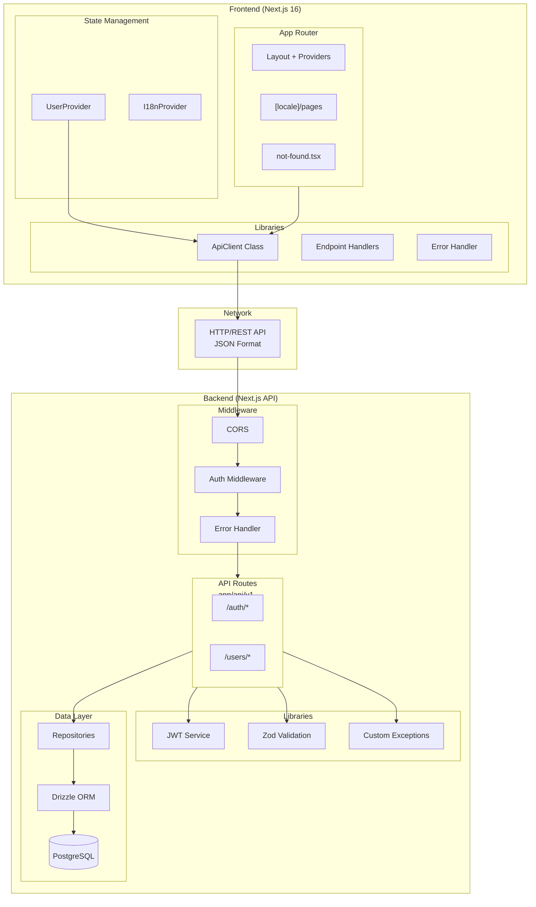
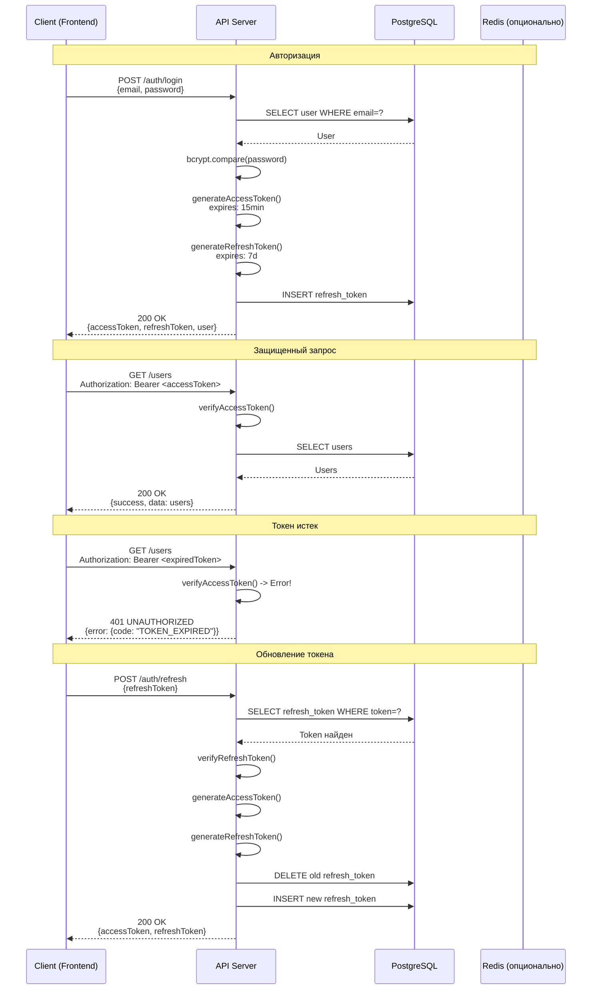
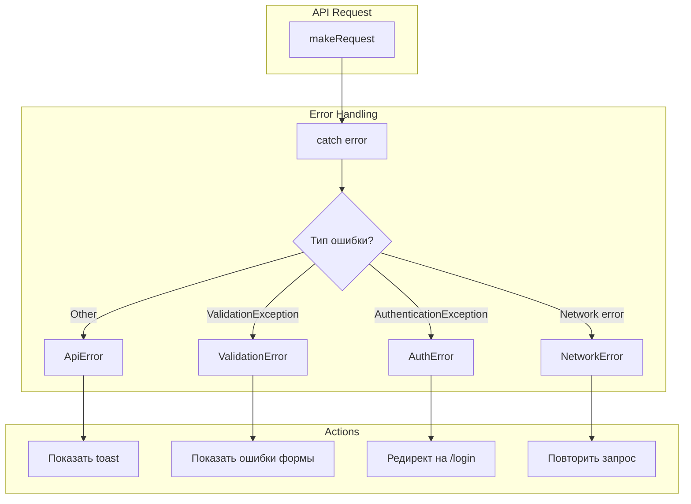

# API Contract - Единый формат взаимодействия

## Общая архитектура системы



## Единый формат API ответов

### Успешный ответ (200-299)

```typescript
interface ApiSuccessResponse<T> {
  success: true;
  data: T;
  meta: {
    timestamp: string;      // ISO 8601 формат
    requestId: string;      // UUID v4
    page?: number;          // для пагинации
    limit?: number;         // для пагинации
    total?: number;         // для пагинации
  };
}
```

**Пример:**
```json
{
  "success": true,
  "data": {
    "id": 1,
    "email": "user@example.com",
    "name": "John Doe",
    "role": "user"
  },
  "meta": {
    "timestamp": "2024-01-15T10:30:00.000Z",
    "requestId": "550e8400-e29b-41d4-a716-446655440000"
  }
}
```

### Ответ с ошибкой (400-599)

```typescript
interface ApiErrorResponse {
  success: false;
  error: {
    code: string;           // машиночитаемый код ошибки
    message: string;        // человекочитаемое сообщение
    details?: Record<string, string[]>;  // детали валидации
  };
  meta: {
    timestamp: string;
    requestId: string;
  };
}
```

**Пример валидации (400):**
```json
{
  "success": false,
  "error": {
    "code": "VALIDATION_ERROR",
    "message": "Validation failed",
    "details": {
      "email": ["Email is required", "Invalid email format"],
      "password": ["Password must be at least 8 characters"]
    }
  },
  "meta": {
    "timestamp": "2024-01-15T10:30:00.000Z",
    "requestId": "550e8400-e29b-41d4-a716-446655440001"
  }
}
```

**Пример аутентификации (401):**
```json
{
  "success": false,
  "error": {
    "code": "UNAUTHORIZED",
    "message": "Invalid or expired token"
  },
  "meta": {
    "timestamp": "2024-01-15T10:30:00.000Z",
    "requestId": "550e8400-e29b-41d4-a716-446655440002"
  }
}
```

## HTTP Status Codes

| Code | Использование |
|------|---------------|
| 200 | Успешный GET, PUT, PATCH |
| 201 | Успешное создание (POST) |
| 204 | Успешное удаление (DELETE) без тела |
| 400 | Ошибка валидации (ValidationException) |
| 401 | Не авторизован (AuthenticationException) |
| 403 | Нет доступа (AuthorizationException) |
| 404 | Ресурс не найден (NotFoundException) |
| 409 | Конфликт данных (ConflictException) |
| 422 | Ошибка бизнес-логики |
| 429 | Слишком много запросов (Rate Limit) |
| 500 | Внутренняя ошибка сервера |

## Error Codes (машиночитаемые коды)

| Code | HTTP Status | Описание |
|------|-------------|----------|
| `VALIDATION_ERROR` | 400 | Ошибка валидации входных данных |
| `BAD_REQUEST` | 400 | Некорректный запрос |
| `UNAUTHORIZED` | 401 | Требуется авторизация |
| `TOKEN_EXPIRED` | 401 | Токен истек |
| `INVALID_TOKEN` | 401 | Невалидный токен |
| `FORBIDDEN` | 403 | Недостаточно прав |
| `NOT_FOUND` | 404 | Ресурс не найден |
| `USER_NOT_FOUND` | 404 | Пользователь не найден |
| `CONFLICT` | 409 | Конфликт данных (дубликат) |
| `EMAIL_EXISTS` | 409 | Email уже существует |
| `INTERNAL_ERROR` | 500 | Внутренняя ошибка сервера |

## API Endpoints

### Authentication

| Method | Endpoint | Описание | Auth Required |
|--------|----------|----------|---------------|
| POST | `/api/v1/auth/register` | Регистрация | No |
| POST | `/api/v1/auth/login` | Логин | No |
| POST | `/api/v1/auth/refresh` | Обновление токена | No |
| POST | `/api/v1/auth/logout` | Выход | Yes |
| GET | `/api/v1/auth/me` | Текущий пользователь | Yes |

### Users

| Method | Endpoint | Описание | Auth Required |
|--------|----------|----------|---------------|
| GET | `/api/v1/users` | Список пользователей | Yes |
| GET | `/api/v1/users/:id` | Пользователь по ID | Yes |
| PUT | `/api/v1/users/:id` | Обновление пользователя | Yes |
| DELETE | `/api/v1/users/:id` | Удаление пользователя | Yes |

## JWT Token Flow



## Frontend Error Handling Strategy



## CORS Configuration

```typescript
// next.config.ts для Server
const corsHeaders = {
  'Access-Control-Allow-Origin': process.env.ALLOWED_ORIGINS || '*',
  'Access-Control-Allow-Methods': 'GET, POST, PUT, DELETE, PATCH, OPTIONS',
  'Access-Control-Allow-Headers': 'Content-Type, Authorization, X-Request-ID',
  'Access-Control-Allow-Credentials': 'true',
  'Access-Control-Max-Age': '86400',
};
```

## Headers

### Request Headers

```
Content-Type: application/json
Authorization: Bearer <jwt_token>
X-Request-ID: <uuid>                    // опционально, для трассировки
Accept-Language: ru, en                // для i18n
```

### Response Headers

```
Content-Type: application/json
X-Request-ID: <uuid>                   // ID запроса из meta
X-RateLimit-Limit: 100
X-RateLimit-Remaining: 99
```
