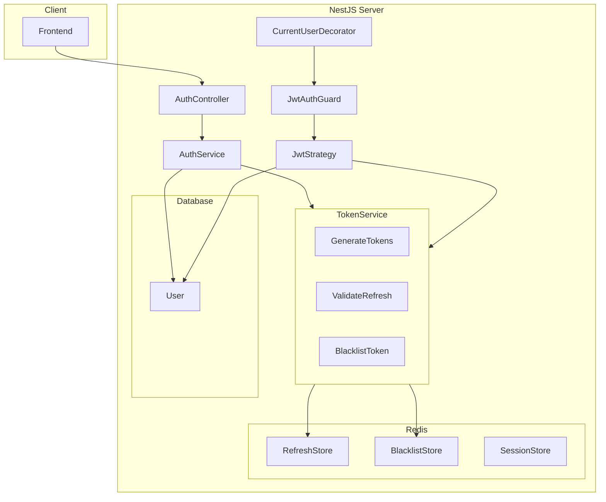
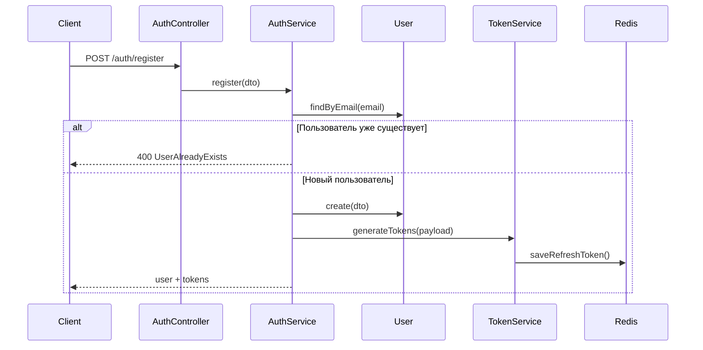
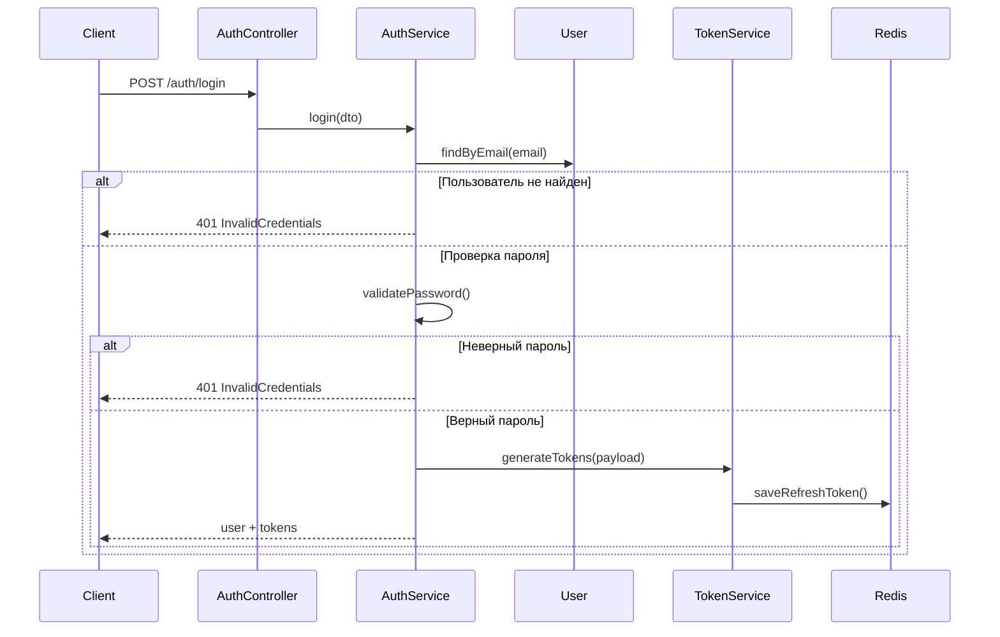
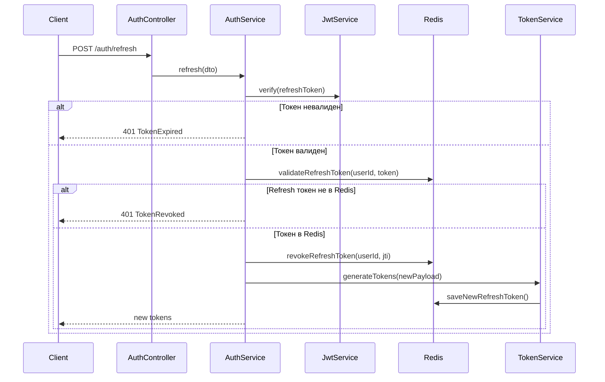

# Архитектура модуля аутентификации

## Обзор

Модуль аутентификации обеспечивает полный цикл работы с пользователями:
- Регистрация с валидацией
- Вход с выдачей токенов
- Обновление токенов с ротацией
- Выход с возможностью завершения всех сессий
- Получение данных текущего пользователя

Токены хранятся в Redis для быстрого доступа и возможности инвалидации.

## Компоненты системы



## Структура модуля

```
server/src/auth/
├── auth.module.ts           # Основной модуль
├── auth.controller.ts       # REST эндпоинты
├── auth.service.ts          # Бизнес-логика
├── dto/
│   ├── login.dto.ts         # DTO входа
│   ├── register.dto.ts      # DTO регистрации
│   ├── refresh.dto.ts       # DTO обновления токенов
│   └── auth-response.dto.ts # DTO ответа
├── strategies/
│   ├── jwt.strategy.ts      # JWT стратегия
│   └── jwt-refresh.strategy.ts # Refresh стратегия
├── guards/
│   ├── jwt-auth.guard.ts    # Guard для access токена
│   ├── jwt-refresh.guard.ts # Guard для refresh токена
│   └── roles.guard.ts       # Guard для проверки ролей
├── decorators/
│   ├── current-user.decorator.ts  # Decorator для получения user
│   ├── current-user-id.decorator.ts # Decorator для получения userId
│   └── roles.decorator.ts    # Decorator для указания ролей
└── exceptions/
    ├── invalid-credentials.exception.ts
    ├── token-expired.exception.ts
    └── user-already-exists.exception.ts
```

## Redis структура данных

### Ключи и TTL

| Ключ | Описание | TTL |
|------|----------|-----|
| `refresh:{userId}` | Refresh токен пользователя | 7 дней |
| `refresh:{userId}:{tokenId}` | Уникальный refresh токен (ротация) | 7 дней |
| `blacklist:{token}` | Blacklist access токена | Время до истечения |
| `session:{userId}:{deviceId}` | Информация о сессии | 7 дней |
| `tokens:{userId}:count` | Количество активных токенов | 7 дней |

### Структура refresh токена с ротацией

При ротации используем `jti` (JWT ID) для уникальной идентификации токена:

```json
{
  "sub": "123",
  "email": "user@example.com",
  "role": "user",
  "jti": "unique-token-id-abc123",
  "type": "refresh"
}
```

## API эндпоинты

### Публичные эндпоинты

#### POST /auth/register
Регистрация нового пользователя.

**Request:**
```typescript
{
  email: string;        // required, valid email
  password: string;     // required, min 8 chars
  name: string;         // required
  locale?: string;      // optional, default "ru"
}
```

**Response (201):**
```typescript
{
  user: {
    id: number;
    email: string;
    name: string;
    role: string;
    locale: string;
  };
  accessToken: string;
  refreshToken: string;
}
```

#### POST /auth/login
Вход пользователя.

**Request:**
```typescript
{
  email: string;
  password: string;
}
```

**Response (200):**
```typescript
{
  user: {
    id: number;
    email: string;
    name: string;
    role: string;
    locale: string;
  };
  accessToken: string;
  refreshToken: string;
}
```

#### POST /auth/refresh
Обновление токенов с ротацией.

**Request:**
```typescript
{
  refreshToken: string;
}
```

**Response (200):**
```typescript
{
  accessToken: string;
  refreshToken: string;
}
```

### Защищённые эндпоинты

#### POST /auth/logout
Выход с текущего устройства.

**Headers:** `Authorization: Bearer {accessToken}`

**Response (200):**
```typescript
{
  message: "Logged out successfully";
}
```

#### POST /auth/logout-all
Выход со всех устройств.

**Headers:** `Authorization: Bearer {accessToken}`

**Response (200):**
```typescript
{
  message: "Logged out from all devices";
}
```

#### GET /auth/me
Получение данных текущего пользователя.

**Headers:** `Authorization: Bearer {accessToken}`

**Response (200):**
```typescript
{
  id: number;
  email: string;
  name: string;
  role: string;
  locale: string;
  avatar_url: string | null;
  created_at: Date;
}
```

## Guard и Decorator использование

### JwtAuthGuard

Использование в контроллере:

```typescript
@Controller('orders')
export class OrdersController {
  @Post()
  @UseGuards(JwtAuthGuard)
  createOrder(@CurrentUser() user: User) {
    // user содержит данные текущего пользователя
    return this.orderService.create(user.id, ...);
  }
  
  @Get()
  @UseGuards(JwtAuthGuard)
  getOrders(@CurrentUserId() userId: number) {
    return this.orderService.findByUser(userId);
  }
}
```

### Roles Guard

Дополнительный guard для проверки роли пользователя:

```typescript
// Определение ролей
import { UserRole } from '../db/models/user.model';

// Пример использования - только ADMIN может создавать продукты
@Controller('products')
export class ProductsController {
  @Post()
  @UseGuards(JwtAuthGuard, RolesGuard)
  @Roles(UserRole.ADMIN)
  createProduct(@CurrentUser() user: User, @Body() dto: CreateProductDto) {
    return this.productService.create(dto);
  }
  
  // USER и ADMIN могут просматривать
  @Get()
  @UseGuards(JwtAuthGuard, RolesGuard)
  @Roles(UserRole.USER, UserRole.ADMIN)
  getProducts() {
    return this.productService.findAll();
  }
}
```

### CurrentUser Decorator

```typescript
// Получить полного пользователя
@Get('profile')
@UseGuards(JwtAuthGuard)
getProfile(@CurrentUser() user: User) {
  return user;
}

// Получить только ID пользователя
@Get('orders')
@UseGuards(JwtAuthGuard)
getOrders(@CurrentUserId() userId: number) {
  return this.orderService.findByUser(userId);
}
```

### Optional Auth (без guard)

Если нужно получить пользователя если он авторизован, но не обязательно:

```typescript
@Get('products')
getProducts(@Req() req: Request) {
  const user = req.user; // может быть null
  return this.productService.findAll(user?.id);
}
```

## Auth Flow диаграммы

### Регистрация



### Вход



### Обновление токенов (ротация)



## Конфигурация

### .env расширение

```env
# Auth
JWT_SECRET=your_super_secret_jwt_key_change_in_production
JWT_EXPIRES_IN=15m
JWT_REFRESH_SECRET=your_super_secret_refresh_key_change_in_production
JWT_REFRESH_EXPIRES_IN=7d

# Redis
REDIS_HOST=localhost
REDIS_PORT=6379
```

## Примеры интеграции

### Защита контроллера

```typescript
@Controller('cart')
export class CartController {
  constructor(private readonly cartService: CartService) {}

  @Get()
  @UseGuards(JwtAuthGuard)
  getCart(@CurrentUserId() userId: number) {
    return this.cartService.getByUserId(userId);
  }

  @Post('items')
  @UseGuards(JwtAuthGuard)
  addItem(
    @CurrentUser() user: User,
    @Body() dto: AddCartItemDto,
  ) {
    return this.cartService.addItem(user.id, dto);
  }
}
```

### Публичный контроллер с опциональной авторизацией

```typescript
@Controller('products')
export class ProductsController {
  constructor(private readonly productService: ProductService) {}

  @Get()
  getProducts(@Req() req: Request) {
    const userId = req.user?.['sub'];
    return this.productService.findAll({ userId });
  }
}
```

## Существующий TokenService расширение

Текущий [`TokenService`](server/src/token/token.service.ts:8) необходимо расширить:

1. Добавить генерацию `jti` для refresh токенов
2. Поддержка множественных refresh токенов (ротация)
3. Методы для управления сессиями
4. Интеграция с User репозиторием

## Тестирование

### Unit тесты
- AuthService: register, login, refresh, logout
- TokenService: generate, validate, revoke
- JwtStrategy: validate

### E2E тесты
- Регистрация с валидными/невалидными данными
- Вход с верными/неверными credentials
- Обновление токенов
- Выход с одного и всех устройств
- Защищённые роуты без токена
