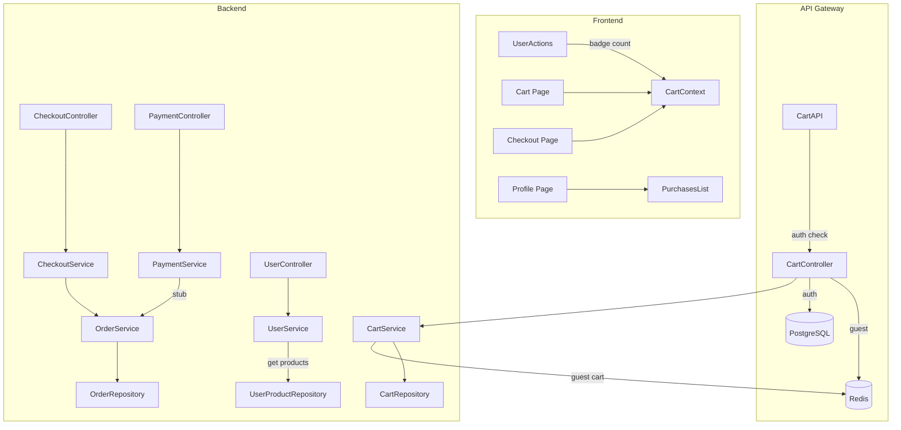

# План: Корзина и отображение покупок в профиле

## Обзор

Реализация полноценной системы корзины и покупок с поддержкой авторизованных пользователей и гостей.

## Этапы реализации

### Этап 1: Корзина

#### 1.1 Серверная часть (NestJS)

**Модуль Cart:**
- [`server/src/cart/cart.module.ts`](server/src/cart/cart.module.ts) - создать модуль
- [`server/src/cart/cart.controller.ts`](server/src/cart/cart.controller.ts) - REST API контроллер
- [`server/src/cart/cart.service.ts`](server/src/cart/cart.service.ts) - бизнес-логика
- [`server/src/cart/repositories/cart-item.repository.ts`](server/src/cart/repositories/cart-item.repository.ts) - уже существует

**API Endpoints:**

| Метод | Путь | Описание |
|-------|------|----------|
| GET | `/cart` | Получить корзину пользователя/гостя |
| POST | `/cart/items` | Добавить товар в корзину |
| PATCH | `/cart/items/:id` | Изменить количество товара |
| DELETE | `/cart/items/:id` | Удалить товар из корзины |
| DELETE | `/cart` | Очистить корзину |
| GET | `/cart/count` | Получить количество товаров (для badge) |

**Логика:**
- Для авторизованных: хранить в БД (`cart_items` таблица)
- Для гостей: хранить в Redis с ключом `guest_cart:{session_id}`

**Redis структура для гостей:**
```
Key: guest_cart:{session_id}
Value: JSON array [{ productLicenseId: number, quantity: number }]
TTL: 30 минут
```

#### 1.2 Клиентская часть (Next.js)

**Компоненты:**
- [`front/src/context/cart/CartContext.tsx`](front/src/context/cart/CartContext.tsx) - создать контекст корзины
- [`front/src/lib/api-cart.ts`](front/src/lib/api-cart.ts) - API клиент для корзины

**Обновления:**
- [`front/src/components/UserActions.tsx`](front/src/components/UserActions.tsx:61) - изменить badge с static 0 на динамическое значение из контекста

**Страница корзины:**
- [`front/src/app/[lang]/cart/page.tsx`](front/src/app/[lang]/cart/page.tsx) - создать страницу корзины

---

### Этап 2: Оформление заказа

#### 2.1 Серверная часть

**Модуль Order:**
- [`server/src/order/order.module.ts`](server/src/order/order.module.ts) - создать модуль
- [`server/src/order/order.controller.ts`](server/src/order/order.controller.ts) - REST API контроллер
- [`server/src/order/order.service.ts`](server/src/order/order.service.ts) - бизнес-логика

**Модуль Checkout (новый):**
- [`server/src/checkout/checkout.module.ts`](server/src/checkout/checkout.module.ts) - создать модуль оформления
- [`server/src/checkout/checkout.controller.ts`](server/src/checkout/checkout.controller.ts)
- [`server/src/checkout/checkout.service.ts`](server/src/checkout/checkout.service.ts)

**API Endpoints:**

| Метод | Путь | Описание |
|-------|------|----------|
| POST | `/checkout` | Создать заказ из корзины |
| GET | `/orders` | Получить список заказов пользователя |
| GET | `/orders/:id` | Получить конкретный заказ |

**Логика оформления:**
1. Валидация корзины
2. Создание заказа (`orders` таблица)
3. Создание элементов заказа (`order_items` таблица)
4. Очистка корзины
5. TTL в Redis для гостевой корзины - 30 минут

**Промежуточные данные в Redis:**
```
Key: checkout_session:{order_id}
Value: JSON { items, total, guestEmail, status }
TTL: 30 минут
```

#### 2.2 Клиентская часть

**Страницы:**
- [`front/src/app/[lang]/checkout/page.tsx`](front/src/app/[lang]/checkout/page.tsx) - страница оформления
- [`front/src/app/[lang]/checkout/success/page.tsx`](front/src/app/[lang]/checkout/success/page.tsx) - успешное оформление

**Компоненты:**
- [`front/src/components/checkout/CartSummary.tsx`](front/src/components/checkout/CartSummary.tsx) - итоги корзины
- [`front/src/components/checkout/GuestForm.tsx`](front/src/components/checkout/GuestForm.tsx) - форма для гостей (email)
- [`front/src/components/checkout/OrderForm.tsx`](front/src/components/checkout/OrderForm.tsx) - форма оформления

---

### Этап 3: Оплата (заглушка)

#### 3.1 Серверная часть

**Модуль Payment (заглушка):**
- [`server/src/payment/payment.module.ts`](server/src/payment/payment.module.ts) - создать модуль
- [`server/src/payment/payment.controller.ts`](server/src/payment/payment.controller.ts)
- [`server/src/payment/payment.service.ts`](server/src/payment/payment.service.ts)

**API Endpoints:**

| Метод | Путь | Описание |
|-------|------|----------|
| POST | `/payment/process` | Обработать платеж (заглушка) |
| GET | `/payment/status/:orderId` | Статус платежа |

**Логика заглушки:**
- При вызове `/payment/process` сразу возвращать success
- Обновлять статус заказа на "paid"
- Переходить к этапу завершения

#### 3.2 Клиентская часть

**Компоненты:**
- [`front/src/components/payment/PaymentStub.tsx`](front/src/components/payment/PaymentStub.tsx) - компонент заглушки
- [`front/src/app/[lang]/payment/page.tsx`](front/src/app/[lang]/payment/page.tsx) - страница оплаты

---

### Этап 4: Добавление покупки в профиль

#### 4.1 Серверная часть

**Логика при успешной оплате:**
1. Создать записи в таблице `user_products`
2. Привязать к пользователю (или создать временный аккаунт для гостя)
3. Отправить email с подтверждением (см. план email-сервиса)

**Методы в UserService:**
- [`server/src/user/user.service.ts`](server/src/user/user.service.ts) - добавить метод `getUserProducts(userId)`
- [`server/src/user/user.controller.ts`](server/src/user/user.controller.ts) - добавить эндпоинт `/users/me/products`

**API Endpoints:**

| Метод | Путь | Описание |
|-------|------|----------|
| GET | `/users/me/products` | Получить купленные товары пользователя |

#### 4.2 Клиентская часть

**Обновления профиля:**
- [`front/src/app/[lang]/profile/page.tsx`](front/src/app/[lang]/profile/page.tsx) - добавить секцию "Мои покупки"

**Компоненты:**
- [`front/src/components/profile/PurchasesList.tsx`](front/src/components/profile/PurchasesList.tsx) - список покупок
- [`front/src/components/profile/PurchaseItem.tsx`](front/src/components/profile/PurchaseItem.tsx) - элемент покупки

**Типы данных:**
- [`front/src/types/purchase/purchase.types.ts`](front/src/types/purchase/purchase.types.ts) - создать типы

---

## Диаграмма потока данных



---

## Зависимости

### Серверные пакеты
- `@nestjs/cache-manager` - для работы с Redis
- `cache-manager` - кэширование

### Клиентские изменения
- Добавить `CartContext` в providers
- Обновить `UserActions` для динамического badge

---

## Схема базы данных (существующая)

```sql
-- Cart Items (авторизованные пользователи)
CREATE TABLE cart_items (
  id SERIAL PRIMARY KEY,
  user_id INT NOT NULL,
  product_license_id INT NOT NULL,
  created_at TIMESTAMP DEFAULT NOW(),
  FOREIGN KEY (user_id) REFERENCES users(id),
  FOREIGN KEY (product_license_id) REFERENCES product_licenses(id)
);

-- Orders
CREATE TABLE orders (
  id SERIAL PRIMARY KEY,
  user_id INT,
  guest_email VARCHAR(255),
  total_amount DECIMAL(10,2) NOT NULL,
  discount_amount DECIMAL(10,2) DEFAULT 0,
  status VARCHAR(20) DEFAULT 'pending',
  promo_code_id INT,
  created_at TIMESTAMP DEFAULT NOW(),
  updated_at TIMESTAMP DEFAULT NOW()
);

-- Order Items
CREATE TABLE order_items (
  id SERIAL PRIMARY KEY,
  order_id INT NOT NULL,
  product_license_id INT NOT NULL,
  price DECIMAL(10,2) NOT NULL,
  FOREIGN KEY (order_id) REFERENCES orders(id),
  FOREIGN KEY (product_license_id) REFERENCES product_licenses(id)
);

-- User Products (купленные товары)
CREATE TABLE user_products (
  id SERIAL PRIMARY KEY,
  user_id INT NOT NULL,
  product_license_id INT NOT NULL,
  order_id INT NOT NULL,
  purchased_at TIMESTAMP DEFAULT NOW()
);
```

---

## Следующие шаги

1. **Этап 1 (Корзина)**: Начать с серверной части - создать CartModule, CartController, CartService
2. Затем клиентская часть - CartContext, обновить UserActions
3. **Этап 2 (Оформление)**: CheckoutModule, страницы checkout
4. **Этап 3 (Оплата)**: PaymentModule-заглушка
5. **Этап 4 (Профиль)**: Добавить секцию покупок в профиль

---

*Связанный план: [Email Service Plan](email-service-plan.md)*