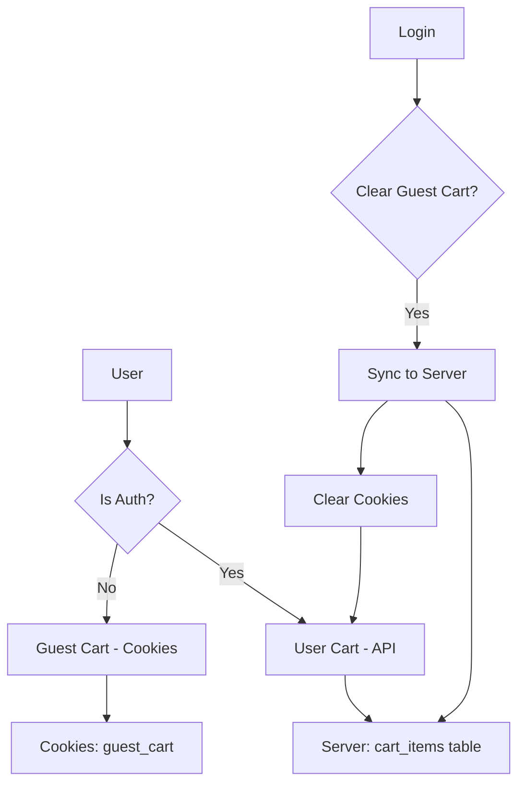

# Архитектура CartContext с поддержкой гостевой корзины

## Текущее состояние

### Серверная часть
- [`server/src/cart/cart.controller.ts`](server/src/cart/cart.controller.ts) - защищён JwtAuthGuard, требует авторизации
- [`server/src/cart/cart.service.ts`](server/src/cart/cart.service.ts) - работает только с userId из токена
- [`server/src/db/models/cart-item.model.ts`](server/src/db/models/cart-item.model.ts) - модель с полями: id, user_id, product_license_id, quantity, created_at

### Клиентская часть
- [`front/src/context/cart/CartContext.tsx`](front/src/context/cart/CartContext.tsx) - работает только для авторизованных, очищает корзину для гостей
- [`front/src/lib/api-cart.ts`](front/src/lib/api-cart.ts) - API клиент

## Проблема

Текущая реализация:
1. **Для гостей**: корзина просто очищается (`setItems([])`), функционал недоступен
2. **Для авторизованных**: работает через БД, но требует JWT токен

## Требуемое решение

### 1. Гостевая корзина (куки)
- Хранить корзину в куках браузера
- Идентификатор гостя: `guest_cart_id` (UUID)
- Формат данных в куках:
```typescript
interface GuestCartItem {
  productLicenseId: number;
  quantity: number;
}

interface GuestCart {
  id: string; // UUID
  items: GuestCartItem[];
}
```

### 2. API эндпоинты для гостей
Без защиты JWT:

```
GET    /cart/guest          - Получить гостевую корзину (по cookie)
POST   /cart/guest/items    - Добавить товар в гостевую корзину
PATCH  /cart/guest/items/:id - Изменить количество
DELETE /cart/guest/items/:id - Удалить товар
DELETE /cart/guest          - Очистить корзину

POST   /cart/sync           - Синхронизировать гостевую корзину с пользовательской при входе
```

### 3. Синхронизация при входе
1. При логине пользователя:
   - Отправить гостевую корзину на сервер
   - Сервер объединяет с пользовательской (суммирует quantity для одинаковых productLicenseId)
   - Очистить гостевую корзину в куках
   - Обновить контекст

### 4. Архитектура Frontend



## План реализации

### Этап 1: Сервер - API для гостевой корзины

1. **Модифицировать CartController** - добавить эндпоинты без JwtAuthGuard:
   - `GET /cart/guest` - получить гостевую корзину
   - `POST /cart/guest/items` - добавить товар
   - `PATCH /cart/guest/items/:id` - изменить количество
   - `DELETE /cart/guest/items/:id` - удалить товар
   - `DELETE /cart/guest` - очистить

2. **Создать GuestCartService** - сервис для работы с гостевой корзиной:
   - Хранение в памяти (Map) или Redis
   - Ключ: guestId (из cookie)
   - TTL: 30 дней

3. **Создать эндпоинт синхронизации**:
   - `POST /cart/sync` - принимает guestCartItems, добавляет к авторизованному пользователю

### Этап 2: Frontend - CartContext

1. **Модифицировать CartContext**:
   - Добавить генерацию/чтение guestCartId из cookies
   - Определять тип корзины: isGuest = !isAuthenticated
   - Для гостей: использовать API `/cart/guest/*`
   - Для авторизованных: использовать API `/cart/*`

2. **Добавить синхронизацию**:
   - При входе: вызвать `/cart/sync` с гостевой корзиной
   - После синхронизации: очистить куки, обновить контекст

3. **Обновление UI**:
   - Использовать React Context для автоматического обновления
   - Добавить useEffect для отслеживания изменений isAuthenticated

### Этап 3: API клиент

1. **Модифицировать api-cart.ts**:
   - Добавить методы для гостевой корзины
   - Добавить метод syncCart(guestCartItems)

## Детали реализации

### Сервер: CartController

```typescript
@Controller('cart')
export class CartController {
  // ... существующие методы с JwtAuthGuard

  // Гостевая корзина - без guard
  @Get('guest')
  getGuestCart(@Cookie('guest_cart_id') guestId: string) {
    return this.cartService.getGuestCart(guestId);
  }

  @Post('guest/items')
  addGuestItem(
    @Cookie('guest_cart_id') guestId: string,
    @Body() dto: AddCartItemDto,
  ) {
    return this.cartService.addGuestItem(guestId, dto);
  }

  // ... другие guest endpoints

  // Синхронизация
  @Post('sync')
  @UseGuards(JwtAuthGuard)
  syncCart(
    @CurrentUserId() userId: number,
    @Body() guestItems: GuestCartItemDto[],
  ) {
    return this.cartService.syncCart(userId, guestItems);
  }
}
```

### Frontend: CartContext (обновлённый)

```typescript
// Типы
interface CartState {
  items: CartItem[];
  count: number;
  isGuest: boolean;
  guestCartId: string | null;
}

function CartProvider({ children }) {
  const { isAuthenticated } = useAuth();
  const [guestCartId, setGuestCartId] = useState<string | null>(null);
  
  // Определить тип корзины
  const isGuest = !isAuthenticated;
  
  // Инициализация guestCartId
  useEffect(() => {
    if (!isAuthenticated) {
      let id = Cookies.get('guest_cart_id');
      if (!id) {
        id = generateUUID();
        Cookies.set('guest_cart_id', id, { expires: 30 });
      }
      setGuestCartId(id);
    }
  }, [isAuthenticated]);
  
  // Синхронизация при входе
  useEffect(() => {
    if (isAuthenticated && guestCartId) {
      syncGuestCart();
    }
  }, [isAuthenticated]);
  
  // Методы API зависят от isGuest
  const api = isAuthenticated ? userCartApi : guestCartApi;
}
```

## Файлы для модификации

### Сервер
- [`server/src/cart/cart.controller.ts`](server/src/cart/cart.controller.ts) - добавить guest endpoints
- [`server/src/cart/cart.service.ts`](server/src/cart/cart.service.ts) - добавить guest логику
- [`server/src/cart/guest-cart.service.ts`](server/src/cart/guest-cart.service.ts) - создать (или встроить в cart.service)
- [`server/src/cart/dto/sync-cart.dto.ts`](server/src/cart/dto/sync-cart.dto.ts) - создать

### Клиент
- [`front/src/context/cart/CartContext.tsx`](front/src/context/cart/CartContext.tsx) - переработать
- [`front/src/lib/api-cart.ts`](front/src/lib/api-cart.ts) - добавить guest методы
- [`front/src/types/cart/cart.types.ts`](front/src/types/cart/cart.types.ts) - обновить типы

## Куки настройки

```typescript
// Frontend
const CART_COOKIE_NAME = 'guest_cart';
const CART_COOKIE_EXPIRY = 30; // дней

// Настройки куки
{
  path: '/',
  sameSite: 'strict',
  expires: CART_COOKIE_EXPIRY,
  // secure: true // для production
}
```
