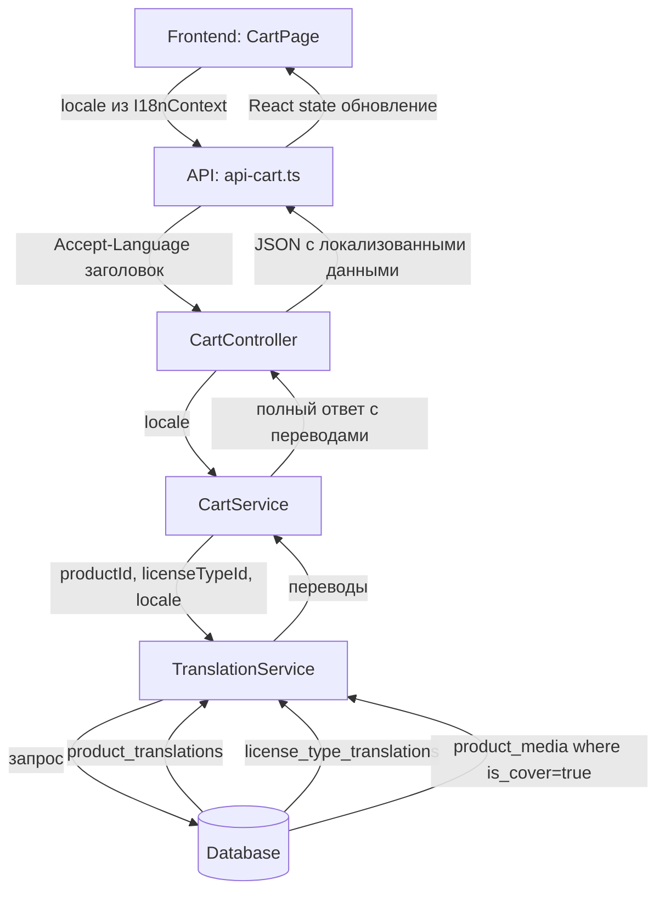

# План рефакторинга корзины

## Анализ текущего состояния

### Проблемы текущей реализации:
1. **Нет локализации** - CartService не использует таблицы переводов (product_translations, license_type_translations)
2. **Quantity всегда 1** - но логика позволяет добавлять больше, нужно убрать
3. **Нет изображения с isCover** - нужно получать главное изображение товара
4. **licenseType.name пустой** - стоит TODO в коде (строка 372 в cart.service.ts)
5. **Нет единого сервиса переводов** - каждый сервис (product, category, license-type) работает с переводами отдельно

### Текущая передача locale:
- Фронтенд: I18nContext хранит locale в cookie и использует для UI
- При API запросах locale НЕ передается на сервер
- Сервер не получает информацию о языке пользователя

---

## Задачи

### 1. Создание TranslationService (единый сервис переводов)

**Файл:** `server/src/translation/translation.service.ts`

```typescript
// Методы сервиса:
// - getProductTranslation(productId: number, locale: string): Promise<{name: string, description?: string, shortDescription?: string}>
// - getLicenseTypeTranslation(licenseTypeId: number, locale: string): Promise<{name: string, description?: string}>
// - getProductCoverImage(productId: number): Promise<string | null>
```

**Зависимости:**
- ProductTranslation модель
- LicenseTypeTranslation модель
- ProductMedia модель

### 2. Изменение CartService

**Методы для изменения:**
- `getCart(userId: number)` - добавить locale параметр
- `addItem(userId: number, dto)` - добавить locale параметр
- `formatCartItem()` - использовать TranslationService для получения имени продукта и лицензии
- `getGuestCart()` - добавить locale параметр

**Изменения в формате ответа:**
```typescript
interface CartItemResponse {
  id: number;
  productId: number;
  licenseTypeId: number;
  // quantity УДАЛЕН - всегда 1
  product: {
    id: number;
    name: string; // из product_translations
    price: number; // из product_license (цена выбранной лицензии)
    slug: string;
    coverImage: string | null; // изображение с is_cover = true
  };
  licenseType: {
    id: number;
    name: string; // из license_type_translations
  };
}
```

### 3. Изменение CartController

**Добавить заголовок для locale:**
- Принимать `Accept-Language` или `x-locale` заголовок
- Передавать в CartService

### 4. Изменение Frontend

**API клиент (api-cart.ts):**
- Добавить заголовок `Accept-Language` к запросам корзины

**CartContext:**
- Передавать locale из I18nContext в API вызовы

**CartItem компонент:**
- Убрать кнопки изменения количества (+/-)
- Убрать отображение quantity
- Использовать coverImage для изображения

**CartPage:**
- Убрать вызов updateQuantity
- Изменить подсчет total (без умножения на quantity)

### 5. Изменение логики добавления в корзину

**Текущая логика:** При добавлении того же product+licenseType увеличивается quantity
**Новая логика:** 
- Если такой product + licenseTypeId уже есть в корзине - НЕ добавлять (или обновить)
- Пользователь может добавить тот же продукт с ДРУГОЙ лицензией как отдельный item

---

## Mermaid диаграмма потока данных



---

## Файлы для изменения

### Backend (server/src):
1. **Создать:** `translation/translation.module.ts`
2. **Создать:** `translation/translation.service.ts`
3. **Изменить:** `cart/cart.service.ts` - добавить locale, использовать TranslationService
4. **Изменить:** `cart/cart.controller.ts` - принимать заголовок locale
5. **Изменить:** `cart/dto/add-cart-item.dto.ts` - убрать quantity
6. **Изменить:** `db/models/cart-item.model.ts` - убрать поле quantity (или оставить =1 по умолчанию)
7. **Изменить:** `cart/repositories/cart-item.repository.ts` - обновить методы при необходимости

### Frontend (front/src):
1. **Изменить:** `lib/api-cart.ts` - добавить Accept-Language заголовок
2. **Изменить:** `context/cart/CartContext.tsx` - передавать locale
3. **Изменить:** `components/cart/CartItem.tsx` - убрать controls количества
4. **Изменить:** `app/[lang]/cart/page.tsx` - убрать логику quantity
5. **Изменить:** `types/cart/cart.types.ts` - обновить типы

---

## Последовательность реализации

1. **Backend - TranslationService**
   - Создать модуль и сервис
   - Реализовать методы getProductTranslation, getLicenseTypeTranslation, getProductCoverImage

2. **Backend - CartService**
   - Обновить формат ответа
   - Интегрировать TranslationService
   - Убрать логику quantity

3. **Backend - CartController**
   - Добавить прием locale из заголовка

4. **Backend - DTO and Models**
   - Обновить AddCartItemDto
   - Обновить CartItem модель

5. **Frontend - API**
   - Обновить api-cart.ts

6. **Frontend - Components**
   - Обновить CartContext
   - Обновить CartItem
   - Обновить CartPage

---

## Важные замечания

1. **Согласованность locale:**
   - `product_translations.language` = 'ru' | 'en' (enum Language)
   - `license_type_translations.locale` = 'ru' | 'en' (строка)
   - TranslationService должен учитывать это различие

2. **Guest cart:**
   - Гостевая корзина хранится в памяти сервера
   - При синхронизации с пользовательской корзиной тоже нужно передавать locale

3. **Обратная совместимость:**
   - Поле quantity в базе можно оставить для совместимости, но игнорировать при чтении
   - Или сделать миграцию для удаления неиспользуемого поля
