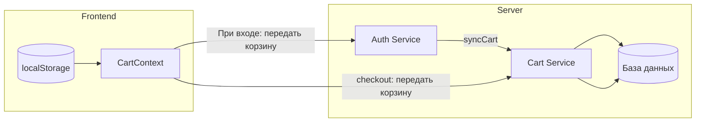

# План оптимизации синхронизации корзины (v2)

## Изменение подхода

**Убрать хранение гостевой корзины на сервере!**

Гостевая корзина будет храниться **только на фронте** (localStorage). При входе или оформлении заказа фронт передаёт данные корзины на сервер.

## Новый поток данных



## Что нужно сделать

### 1. Frontend: Хранить корзину в localStorage

**Файл**: `front/src/context/cart/CartContext.tsx`

```typescript
// Вместо Cookies использовать localStorage
const CART_KEY = 'guest_cart';

function getLocalCart(): CartItem[] {
  if (typeof window === 'undefined') return [];
  const data = localStorage.getItem(CART_KEY);
  return data ? JSON.parse(data) : [];
}

function setLocalCart(items: CartItem[]): void {
  localStorage.setItem(CART_KEY, JSON.stringify(items));
}

function clearLocalCart(): void {
  localStorage.removeItem(CART_KEY);
}
```

### 2. Frontend: Передавать корзину при верификации

**Файл**: `front/src/app/[lang]/checkout/page.tsx`

```typescript
const handleVerifyCode = async () => {
  // Передаём корзину из контекста
  const response = await checkoutVerificationApi.verifyAndLogin(
    guestEmail, 
    verificationCode,
    items  // Текущая корзина
  );
};
```

### 3. Frontend: Передавать корзину при обычном входе

**Файл**: `front/src/context/auth/AuthContext.tsx`

```typescript
const login = async (email: string, password: string) => {
  const { user, accessToken, refreshToken } = await loginUser(email, password);
  // ... установка токенов
  
  // Синхронизировать корзину
  const { getLocalCart } = useCart(); // или как-то иначе получить
  const cartItems = getLocalCart();
  if (cartItems.length > 0) {
    await cartApi.syncCart(cartItems);
    clearLocalCart();
  }
};
```

### 4. Сервер: Принимать корзину при верификации

**Файл**: `server/src/auth/auth.service.ts`

```typescript
async verifyCodeAndLogin(email: string, code: string, cartItems?: CartItemDto[]) {
  // Создаём пользователя
  const user = await this.verifyCode(email, code);
  
  // Если передана корзина — добавляем товары
  if (cartItems && cartItems.length > 0) {
    await this.cartService.syncCart(user.id, cartItems);
  }
  
  // Генерируем токены
  return this.generateTokens(user);
}
```

### 5. Удалить гостевые endpoints с сервера

**Удалить или отключить**:
- `GET /cart/guest`
- `POST /cart/guest/items`
- и т.д.

### 6. CartContext: Не загружать с сервера если пусто

```typescript
// При загрузке корзины
const refreshCart = useCallback(async () => {
  if (isAuthenticated) {
    // Загружаем с сервера
    const cartItems = await cartApi.getCart();
    setItems(cartItems);
  } else {
    // Просто читаем из localStorage
    setItems(getLocalCart());
  }
}, [isAuthenticated]);
```

## Преимущества нового подхода

1. **Простота**: Нет дублирования данных на сервере
2. **Надёжность**: Корзина всегда под контролем фронта
3. **Скорость**: Не нужно делать доп. запросы для синхронизации
4. **Безопасность**: Сервер не хранит временные данные гостей

## Файлы для изменения

### Frontend
1. `front/src/context/cart/CartContext.tsx` — localStorage вместо Cookies, убрать guestId
2. `front/src/lib/api-cart.ts` — удалить guest методы
3. `front/src/lib/api-checkout-verification.ts` — передача корзины при верификации
4. `front/src/app/[lang]/checkout/page.tsx` — передать items при verify
5. `front/src/context/auth/AuthContext.tsx` — синхронизировать корзину при login

### Server
1. `server/src/auth/auth.service.ts` — принимать корзину при verifyCode
2. `server/src/cart/cart.controller.ts` — удалить guest endpoints
3. `server/src/cart/cart.service.ts` — удалить гостевые методы

## Реализация (TODO)

- [ ] 1. Обновить CartContext: использовать localStorage
- [ ] 2. Обновить api-checkout-verification.ts: передача корзины
- [ ] 3. Обновить checkout page: передать items при verifyCode
- [ ] 4. Обновить серверный auth service: принимать корзину
- [ ] 5. Удалить guest endpoints с сервера
- [ ] 6. Обновить CartContext: не загружать с сервера если пусто
