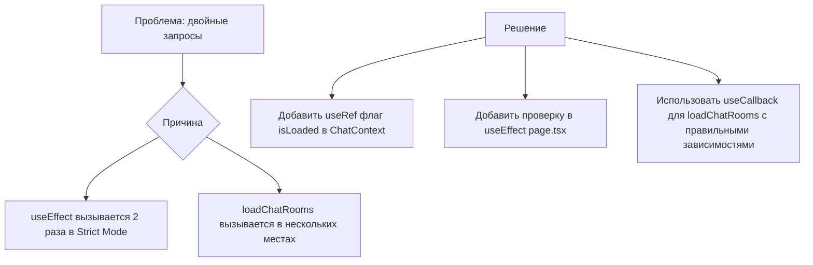
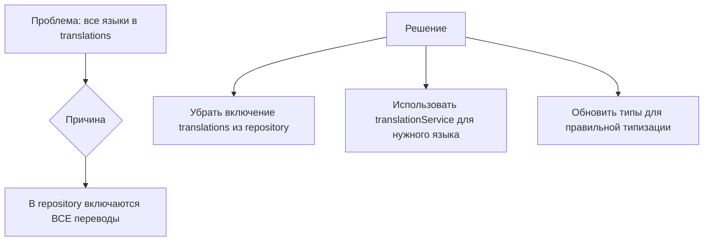

# План исправления проблем с чатом

## Проблема 1: Двойные HTTP-запросы

### Причины двойных запросов:

1. **В `front/src/app/[lang]/chat/page.tsx`**:
   - [`loadChatRooms()`](front/src/app/[lang]/chat/page.tsx:42) вызывается при монтировании (useEffect)
   - [`loadChatRooms()`](front/src/app/[lang]/chat/page.tsx:75) также вызывается после отправки сообщения
   - [`loadChatRooms()`](front/src/app/[lang]/chat/page.tsx:83) также вызывается после принятия/отклонения оффера

2. **В `front/src/context/chat/ChatContext.tsx`**:
   - [`selectRoom()`](front/src/context/chat/ChatContext.tsx:137) вызывает `chatApi.getChatRoom()` и `chatApi.getChatOffers()`

3. **React Strict Mode**: В dev-режиме React 18 вызывает useEffect дважды

### План исправления:



**Шаги:**

1. **В `front/src/context/chat/ChatContext.tsx`**:
   - Добавить `useRef` для отслеживания, был ли уже загружен чат
   - Модифицировать `loadChatRooms` для предотвращения повторных вызовов

2. **В `front/src/app/[lang]/chat/page.tsx`**:
   - Добавить проверку в useEffect для предотвращения повторной загрузки
   - Использовать `useCallback` для функций с правильными зависимостями

---

## Проблема 2: Переводы всех языков

### Корневая причина:

В [`server/src/chat/repositories/chat-room.repository.ts:80`](server/src/chat/repositories/chat-room.repository.ts:80):
```typescript
{ model: ProductTranslation, as: 'translations' }
```
Включает ВСЕ переводы, а не только нужный язык.

Попытка скрыть массив в [`chat.service.ts:193`](server/src/chat/chat.service.ts:193) работает некорректно.

### План исправления:



**Шаги:**

1. **В `server/src/chat/repositories/chat-room.repository.ts`**:
   - Убрать `{ model: ProductTranslation, as: 'translations' }` из include для Product

2. **В `server/src/chat/chat.service.ts`**:
   - Убедиться, что переводы берутся только для нужного языка через `translationService.getProductTranslation()`
   - Убрать код, который пытается скрыть массив translations (он больше не нужен)

3. **Обновить типы на сервере** (при необходимости):
   - [`server/src/chat/interfaces/chat.types.ts`](server/src/chat/interfaces/chat.types.ts) - убедиться что поля `translatedProductName`, `translatedProductDescription` задокументированы

---

## План использования переделанных полей на фронте

### Текущее состояние:

На сервере возвращаются следующие поля (после исправления):
- `translatedProductName` - переведенное название товара
- `translatedProductDescription` - переведенное описание товара  
- `mainImage` - главное изображение товара
- `licenseTypeName` - название типа лицензии
- `price` - цена

### Где используются на фронте:

1. **[`front/src/components/chat/ChatList.tsx`](front/src/components/chat/ChatList.tsx)**:
   - Строка 42-45: Используется `room.product?.translatedName` для отображения названия
   - Строка 79-86: Используется `room.product?.media[0]?.url` для обложки товара
   - Строка 118: Используется `room.product?.name`

2. **[`front/src/components/chat/ChatWindow.tsx`](front/src/components/chat/ChatWindow.tsx)**:
   - Строка 111-118: Используется `room.product?.media[0]?.url` для обложки
   - Строка 135: Используется `room.product?.translatedName || room.product?.name`

### Что нужно обновить:

1. **[`front/src/types/chat/index.ts`](front/src/types/chat/index.ts)**:
   - Обновить тип `ChatRoom.product`:
     ```typescript
     product?: {
       id: number;
       name: string;  // оригинальное название (может быть удалено после миграции)
       translatedName?: string; // переведенное название
       translatedDescription?: string; // переведенное описание
       mainImage?: string; // главное изображение (из is_cover)
       licenseTypeName?: string; // название типа лицензии
       price?: number; // цена
       media?: Array<{
         id: number;
         url: string;
         is_cover: boolean;
       }>;
     };
     ```

2. **[`front/src/components/chat/ChatList.tsx`](front/src/components/chat/ChatList.tsx)**:
   - Использовать `room.mainImage` вместо `room.product?.media?.[0]?.url` (более надежно)
   - Убедиться что `translatedName` используется правильно

3. **[`front/src/components/chat/ChatWindow.tsx`](front/src/components/chat/ChatWindow.tsx)**:
   - Использовать `room.mainImage` вместо `room.product?.media?.[0]?.url`

---

## Итоговый чеклист

### Бэкенд:
- [ ] Убрать `translations` из include в `chat-room.repository.ts`
- [ ] Проверить что `chat.service.ts` корректно использует `translationService.getProductTranslation()`

### Фронтенд:
- [ ] Исправить двойные запросы в `ChatContext.tsx`
- [ ] Исправить двойные запросы в `chat/page.tsx`
- [ ] Обновить типы в `front/src/types/chat/index.ts`
- [ ] Обновить использование полей в `ChatList.tsx`
- [ ] Обновить использование полей в `ChatWindow.tsx`

---

## Тестирование

После исправлений проверить:
1. Запрос `/chat/rooms?page=1&limit=20` отправляется только 1 раз
2. Запрос `/chat/rooms/5?page=1&limit=50` отправляется только 1 раз  
3. Запрос `/chat/rooms/5/offers` отправляется только 1 раз
4. В ответе нет массива `translations` с несколькими языками
5. Поля `translatedProductName`, `mainImage` корректно отображаются в UI
