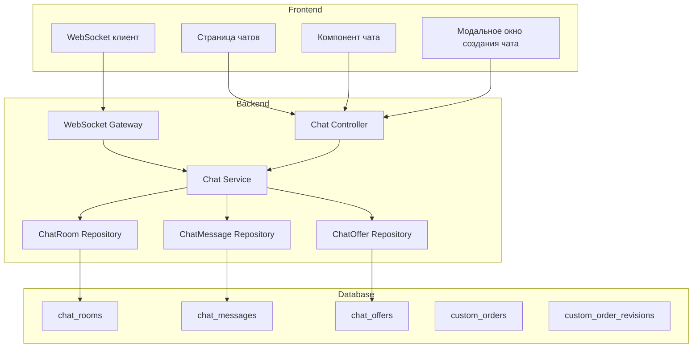
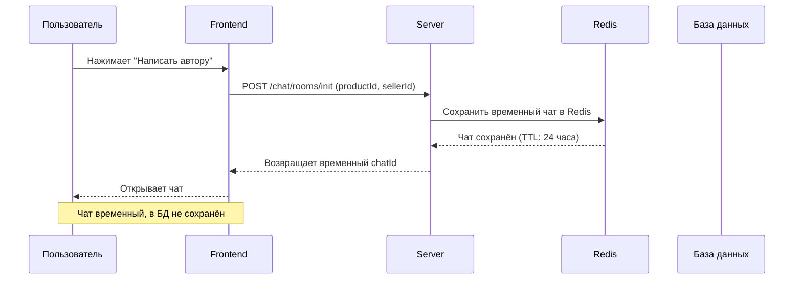
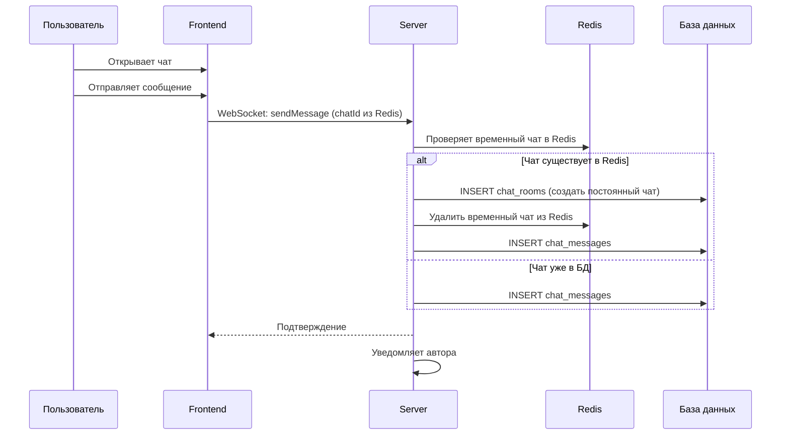
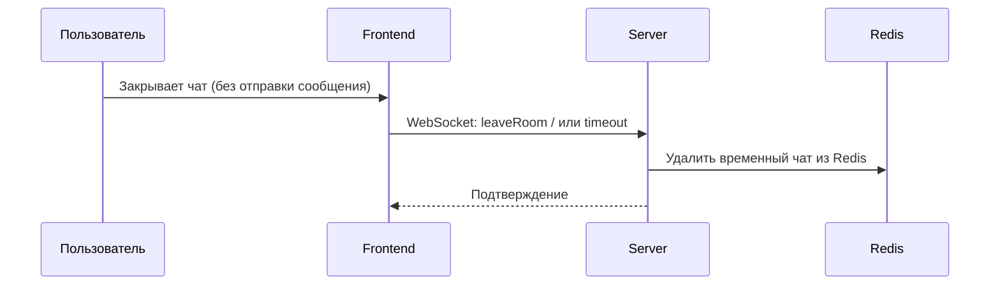
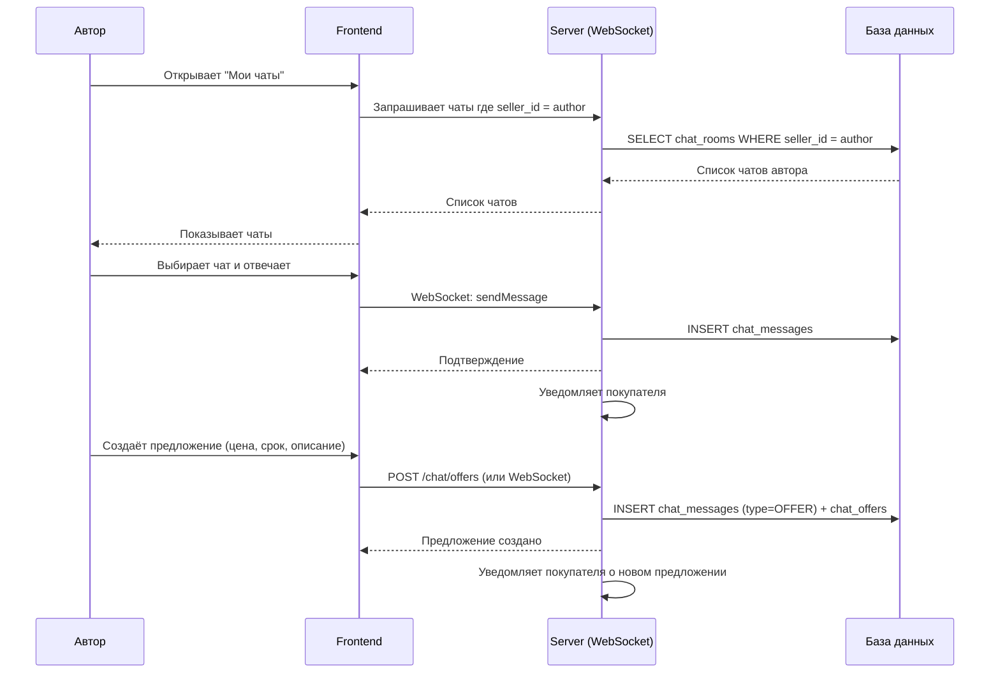
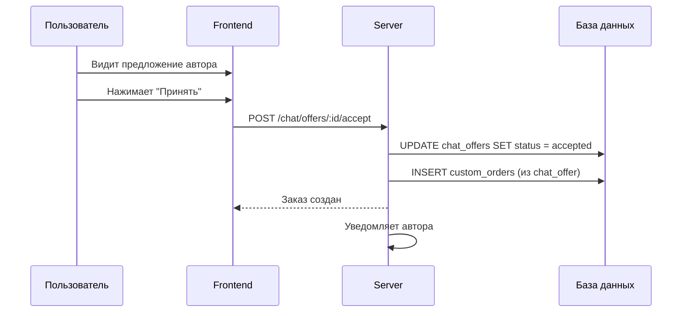
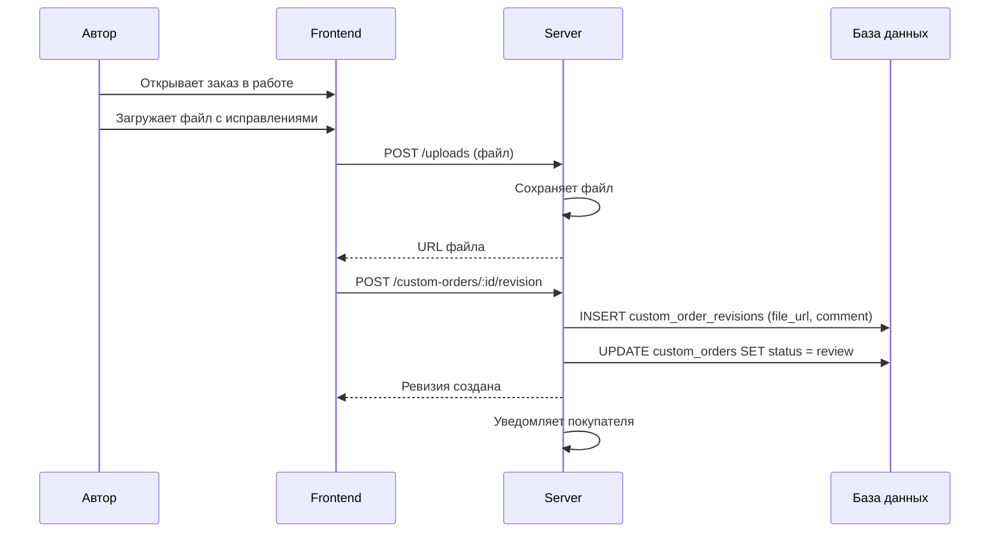

# План модуля отправки сообщений с WebSocket

## Общее описание

Модуль предназначен для коммуникации между покупателями и авторами товаров. Покупатель может написать автору:
- По конкретному купленному товару с просьбой редактирования
- Без привязки к товару (общий чат)

Каждый купленный товар имеет отдельный чат с автором. Чаты создаются с привязкой к пользователю, автору и товару (товар не обязателен).

---

## Архитектура системы



---

## Основные сценарии

## Сценарий 1: Покупатель открывает чат (временный в Redis)



### Сценарий 2: Покупатель отправляет первое сообщение → создание чата в БД



### Сценарий 3: Пользователь закрыл чат без отправки сообщения



### Сценарий 4: Автор отвечает и создаёт предложение



### Сценарий 3: Покупатель принимает предложение



### Сценарий 4: Автор загружает файл с исправлениями



---

## Этапы реализации

### Этап 1: Backend - Установка зависимостей и базовая инфраструктура

1. **Установить WebSocket зависимости**
   - Добавить `@nestjs/websockets` и `@nestjs/platform-socket.io`
   - Добавить `socket.io` и `socket.io-client`

2. **Создать ChatModule**
   - Создать `chat.module.ts`
   - Зарегистрировать модели: ChatRoom, ChatMessage, ChatOffer, CustomOrder, CustomOrderRevision

3. **Создать ChatGateway (WebSocket)**
   - Настроить WebSocket namespace `/chat`
   - Реализовать аутентификацию через JWT
   - Обработка событий: `joinRoom`, `leaveRoom`, `sendMessage`, `typing`

4. **Создать Redis Temp Chat Service**
   - Создать сервис для работы с временными чатами в Redis
   - Методы: `createTempChat`, `getTempChat`, `deleteTempChat`
   - Использовать TTL 24 часа

### Этап 2: Backend - Расширение ChatService

1. **Создать ChatService**
   - Методы для создания чатов
   - Методы для отправки сообщений
   - Методы для работы с предложениями (offers)
   - Методы для создания custom orders из предложений
   - Методы для загрузки ревизий с файлами

2. **Создать ChatController (REST API)**
   - `GET /chat/rooms` - список чатов пользователя
   - `GET /chat/rooms/:id` - получить чат с сообщениями
   - `POST /chat/rooms` - создать чат
   - `POST /chat/messages` - отправить сообщение (fallback для REST)
   - `POST /chat/offers` - создать предложение
   - `POST /chat/offers/:id/accept` - принять предложение
   - `POST /chat/offers/:id/decline` - отклонить предложение
   - `GET /custom-orders` - список заказов пользователя
   - `POST /custom-orders/:id/revision` - добавить ревизию с файлом

3. **Расширить репозитории**
   - Добавить методы для поиска чатов по user-product
   - Добавить методы для пагинации сообщений

### Этап 3: Backend - Интеграция с UserProduct

1. **Добавить связь ChatRoom с UserProduct**
   - Опциональное поле `user_product_id` в ChatRoom
   - При создании чата по товару - связывать с UserProduct

2. **Создать методы для работы с купленными товарами**
   - Получить список купленных товаров с информацией об авторе
   - Проверить, что товар куплен пользователем
   - Создать чат только для купленных товаров

### Этап 4: Frontend - UI компоненты

1. **Создать страницу чатов** (`/chat` или `/messages`)
   - Список чатов с разделением на "Мои чаты" и "Чаты покупателей"
   - Фильтрация по товарам

2. **Создать компонент ChatWindow**
   - Отображение сообщений
   - Отправка сообщений
   - Индикация "печатает..."
   - Предложения (offers) - карточки

3. **Создать компонент ChatList**
   - Список чатов с последним сообщением
   - Индикация новых сообщений
   - Привязка к товарам

4. **Создать модальное окно "Написать автору"**
   - Доступно на странице купленных товаров
   - Выбор товара (если несколько)
   - Ввод сообщения и предложения цены

5. **Создать страницу "Мои заказы" (Custom Orders)**
   - Список активных заказов
   - Статусы заказов
   - Загрузка файлов автором

### Этап 5: Frontend - WebSocket интеграция

1. **Создать ChatContext**
   - Управление WebSocket соединением
   - Подписка на события
   - Методы отправки сообщений

2. **Интегрировать WebSocket в компоненты**
   - Автоматическое обновление при новых сообщениях
   - Уведомления

---

## Структура файлов

### Backend

```
server/src/chat/
├── chat.module.ts                 # Модуль чата
├── chat.gateway.ts               # WebSocket Gateway
├── chat.controller.ts            # REST API контроллер
├── chat.service.ts               # Бизнес-логика
├── temp-chat.service.ts          # Сервис для временных чатов в Redis
├── chat-offers.service.ts        # Работа с предложениями
├── custom-order.service.ts       # Работа с заказами
├── dto/
│   ├── create-chat-room.dto.ts   # (уже есть)
│   ├── create-chat-message.dto.ts # (уже есть)
│   ├── update-chat-room.dto.ts   # (уже есть)
│   ├── init-temp-chat.dto.ts     # Новое: инициализация временного чата
│   ├── create-offer.dto.ts       # Новое: создание предложения
│   ├── create-custom-order.dto.ts # Новое: создание заказа
│   └── create-revision.dto.ts    # Новое: создание ревизии
├── repositories/
│   ├── chat-room.repository.ts   # (уже есть)
│   ├── chat-message.repository.ts # (уже есть)
│   └── chat-offer.repository.ts  # Новое
└── interfaces/
    └── chat.types.ts             # Типы для WebSocket
```

### Frontend

```
front/src/
├── app/[lang]/chat/
│   └── page.tsx                  # Страница чатов
├── app/[lang]/orders/
│   └── page.tsx                  # Страница заказов
├── components/
│   ├── chat/
│   │   ├── ChatList.tsx          # Список чатов
│   │   ├── ChatWindow.tsx        # Окно чата
│   │   ├── MessageBubble.tsx     # Сообщение
│   │   ├── OfferCard.tsx         # Карточка предложения
│   │   ├── OrderCard.tsx         # Карточка заказа
│   │   └── CreateChatModal.tsx   # Мода создания чата
│   └── profile/
│       └── PurchasedProducts.tsx # (уже есть, добавить кнопку)
├── lib/
│   ├── api-chat.ts               # API для чатов
│   └── socket.ts                 # WebSocket клиент
├── context/
│   └── chat/
│       └── ChatContext.tsx       # Контекст чата
└── types/
    └── chat/
        └── index.ts              # Типы для чатов
```

---

## Redis - Временные чаты (до первого сообщения)

### Концепция

Чат создаётся в БД только после отправки первого сообщения. До этого момента данные о чате хранятся в Redis.

### Структура данных в Redis

```
Key: chat:temp:{uuid}
Value: JSON
{
  "buyerId": number,
  "sellerId": number,
  "productId": number | null,
  "userProductId": number | null,
  "createdAt": "ISO date",
  "updatedAt": "ISO date"
}
TTL: 24 часа (86400 сек)
```

### API Endpoints

| Метод | URL | Описание |
|-------|-----|----------|
| POST | `/chat/rooms/init` | Создать временный чат в Redis |
| GET | `/chat/rooms/temp/:id` | Получить временный чат |
| DELETE | `/chat/rooms/temp/:id` | Удалить временный чат (если закрыли без отправки) |

### Chat Rooms

| Метод | URL | Описание |
|-------|-----|----------|
| GET | `/chat/rooms` | Получить все чаты пользователя |
| GET | `/chat/rooms/:id` | Получить чат с сообщениями |
| POST | `/chat/rooms` | Создать новый чат (только для постоянных чатов) |
| PATCH | `/chat/rooms/:id` | Обновить чат (закрыть/открыть) |

### Messages

| Метод | URL | Описание |
|-------|-----|----------|
| GET | `/chat/rooms/:id/messages` | Получить сообщения чата |
| POST | `/chat/messages` | Отправить сообщение (REST) |

### Offers

| Метод | URL | Описание |
|-------|-----|----------|
| POST | `/chat/offers` | Создать предложение |
| POST | `/chat/offers/:id/accept` | Принять предложение |
| POST | `/chat/offers/:id/decline` | Отклонить предложение |

### Custom Orders

| Метод | URL | Описание |
|-------|-----|----------|
| GET | `/custom-orders` | Получить заказы пользователя |
| GET | `/custom-orders/:id` | Получить заказ с ревизиями |
| POST | `/custom-orders/:id/revision` | Добавить ревизию с файлом |
| POST | `/custom-orders/:id/approve` | Одобрить результат |
| POST | `/custom-orders/:id/revision-request` | Запросить доработку |

---

## WebSocket События

### Client -> Server

| Событие | Параметры | Описание |
|---------|-----------|----------|
| `initChat` | `{ productId, sellerId }` | Создать временный чат в Redis |
| `joinRoom` | `{ roomId: number }` | Присоединиться к чату (постоянному) |
| `leaveRoom` | `{ roomId: number }` | Покинуть чат (удаляет temp чат) |
| `sendMessage` | `{ roomId, tempChatId?, content, type }` | Отправить сообщение |
| `typing` | `{ roomId, isTyping }` | Индикация печатания |

### Server -> Client

| Событие | Параметры | Описание |
|---------|-----------|----------|
| `newMessage` | `{ message: ChatMessage }` | Новое сообщение |
| `messageUpdated` | `{ message: ChatMessage }` | Сообщение обновлено |
| `offerCreated` | `{ offer: ChatOffer }` | Новое предложение |
| `offerUpdated` | `{ offer: ChatOffer }` | Предложение принято/отклонено |
| `userTyping` | `{ roomId, userId, isTyping }` | Пользователь печатает |
| `orderUpdated` | `{ order: CustomOrder }` | Заказ обновлён |

---

## Модели данных (расширение)

### ChatRoom (существующая модель)

```typescript
// Добавить поле для связи с UserProduct
product_id: number | null;       // Уже есть
user_product_id: number | null;  // НОВОЕ - связь с купленным товаром
```

### ChatOffer (существующая модель)

```typescript
// Уже есть все необходимые поля
chat_room_id: number;
message_id: number;
seller_id: number;
description: string;
price: number;
deadline: Date;
status: ChatOfferStatus;
```

### CustomOrder (существующая модель)

```typescript
// Уже есть все необходимые поля
chat_offer_id: number;
buyer_id: number;
seller_id: number;
chat_room_id: number;
description: string;
price: number;
status: CustomOrderStatus;
deadline: Date;
```

### CustomOrderRevision (существующая модель)

```typescript
// Уже есть все необходимые поля
custom_order_id: number;
file_url: string;
comment: string | null;
is_approved: boolean;
```

---

## Логика создания пустых чатов (важное требование)

### Ключевое правило
**Пустой чат НЕ должен создаваться в базе данных.** Чат создаётся в БД только в момент отправки первого сообщения.

### Почему это важно
1. Избежание захламления БД пустыми чатами
2. Экономия ресурсов на пустых записях
3. Улучшение производительности запросов
4. Чистота интерфейса (не показывать пустые чаты)

### Поток данных

```mermaid
flowchart LR
    A[Пользователь нажимает "Написать автору"] --> B{Чат уже существует в БД?}
    B -->|Да| C[Получить существующий чат]
    B -->|Нет| D[Создать временный чат в Redis]
    D --> E[Вернуть временный ID чата]
    E --> F[Пользователь открывает чат]
    F --> G{Пользователь отправил сообщение?}
    G -->|Да| H[Создать чат в БД из Redis данных]
    H --> I[Удалить временный чат из Redis]
    G -->|Нет| J[Чат остаётся в Redis]
    J --> K[TTL 24 часа]
```

### Реализация на бэкенде

#### TempChatService (Redis)

```typescript
interface TempChat {
  id: string;           // UUID
  buyerId: number;
  sellerId: number;
  productId: number | null;
  userProductId: number | null;
  createdAt: Date;
  updatedAt: Date;
}
```

Методы:
- `createTempChat(dto)` - создаёт временный чат в Redis с TTL 24 часа
- `getTempChat(id)` - получает временный чат
- `deleteTempChat(id)` - удаляет временный чат
- `getTempChatByUserProduct(buyerId, sellerId, userProductId)` - ищет существующий временный чат

#### ChatService - логика отправки сообщения

```typescript
async sendMessage(chatId: string | number, content: string) {
  // Проверяем, временный это чат или постоянный
  const isTempChat = this.isTempChatId(chatId);
  
  if (isTempChat) {
    // 1. Получаем данные временного чата из Redis
    const tempChat = await this.tempChatService.getTempChat(chatId);
    
    // 2. Проверяем, не создан ли уже постоянный чат параллельно
    const existingRoom = await this.chatRoomRepository.findByUniqueKey(
      tempChat.buyerId, 
      tempChat.sellerId, 
      tempChat.productId
    );
    
    if (existingRoom) {
      // Чат уже создан другим пользователем - используем его
      room = existingRoom;
    } else {
      // 3. Создаём постоянный чат в БД
      room = await this.chatRoomRepository.create({
        buyer_id: tempChat.buyerId,
        seller_id: tempChat.sellerId,
        product_id: tempChat.productId,
        user_product_id: tempChat.userProductId,
      });
    }
    
    // 4. Удаляем временный чат из Redis
    await this.tempChatService.deleteTempChat(chatId);
    
    // 5. Используем ID постоянного чата для сообщения
    chatId = room.id;
  }
  
  // 6. Создаём сообщение в БД
  const message = await this.chatMessageRepository.create({
    chat_room_id: chatId,
    sender_id: userId,
    content,
  });
}
```

### Сценарии поведения пользователя

| Действие пользователя | Результат |
|----------------------|-----------|
| Нажал "Написать автору" | Временный чат в Redis |
| Закрыл чат без отправки | Чать удаляется из Redis (TTL 24ч или при явном закрытии) |
| Вернулся позже (до 24ч) | Восстанавливается из Redis |
| Отправил сообщение | Чат создаётся в БД, данные из Redis мигрируют |
| Автор открыл пустой чат | Не видит чат (он ещё в Redis, не в БД) |
| Автор открыл чат после сообщения | Видит чат в БД |

### Обработка дубликатов

При создании чата нужно обрабатывать случай, когда два пользователя одновременно пытаются создать чат по одному товару:

```typescript
async createOrGetChat(buyerId: number, sellerId: number, productId: number) {
  // 1. Пробуем найти существующий чат в БД
  const existingChat = await this.chatRoomRepository.findByBuyersSellerProduct(
    buyerId, 
    sellerId, 
    productId
  );
  
  if (existingChat) {
    return existingChat; // Чат уже существует
  }
  
  // 2. Пробуем создать (с блокировкой на уровне БД)
  try {
    return await this.chatRoomRepository.createWithLock(...);
  } catch (error) {
    if (error.code === '23505') { // Unique violation
      // Другой запрос уже создал чат - получаем его
      return await this.chatRoomRepository.findByBuyersSellerProduct(...);
    }
    throw error;
  }
}
```

### API для фронтенда

| Метод | URL | Описание |
|-------|-----|----------|
| POST | `/chat/rooms/init` | Создать временный чат (чат ещё НЕ в БД) |
| GET | `/chat/rooms` | Получить только постоянные чаты (из БД) |
| GET | `/chat/rooms/:id` | Получить чат (работает и с временным ID) |
| WebSocket | `sendMessage` | При отправке первого сообщения - создаётся чат в БД |

### Frontend логика

1. **При нажатии "Написать автору"**:
   - Вызвать `/chat/rooms/init`
   - Получить временный `tempChatId` (формат: `temp_xxxxxxxx`)
   - Открыть чат с этим ID

2. **При отправке сообщения**:
   - Отправить через WebSocket с `tempChatId`
   - Сервер автоматически создаст чат в БД и вернёт постоянный ID
   - Обновить локальный ID чата на постоянный

3. **При закрытии чата без отправки**:
   - Вызвать DELETE `/chat/rooms/temp/:id`
   - Или ничего не делать - TTL сам удалит через 24ч

---

## Требования к безопасности

1. **Аутентификация WebSocket**
   - JWT токен передаётся при подключении
   - Проверка токена на каждом событии

2. **Авторизация**
   - Проверка что пользователь участник чата
   - Проверка что автор - seller_id в чате
   - Проверка что товар куплен пользователем

3. **Валидация**
   - Проверка цены (не отрицательная)
   - Проверка срока (не в прошлом)
   - Проверка типа файла при загрузке

---

## Связь с существующим кодом

Модуль использует:
- `UserProduct` - для получения списка купленных товаров
- `Product` - для получения информации о товаре и авторе
- `User` - для получения информации об участниках
- `ChatRoom`, `ChatMessage`, `ChatOffer` - существующие модели
- `CustomOrder`, `CustomOrderRevision` - существующие модели
- `UploadsModule` - для загрузки файлов

---

## Примечание

В проекте уже существуют:
- Модели: `chat-room.model.ts`, `chat-message.model.ts`, `chat-offer.model.ts`
- DTO: `create-chat-room.dto.ts`, `create-chat-message.dto.ts`, `update-chat-room.dto.ts`
- Репозитории: `chat-room.repository.ts`, `chat-message.repository.ts`
- Схема БД описана в `plans/chat-schema.md`

Требуется создать:
- ChatService, ChatController, ChatGateway
- Расширить репозитории
- Frontend компоненты
- WebSocket клиент
