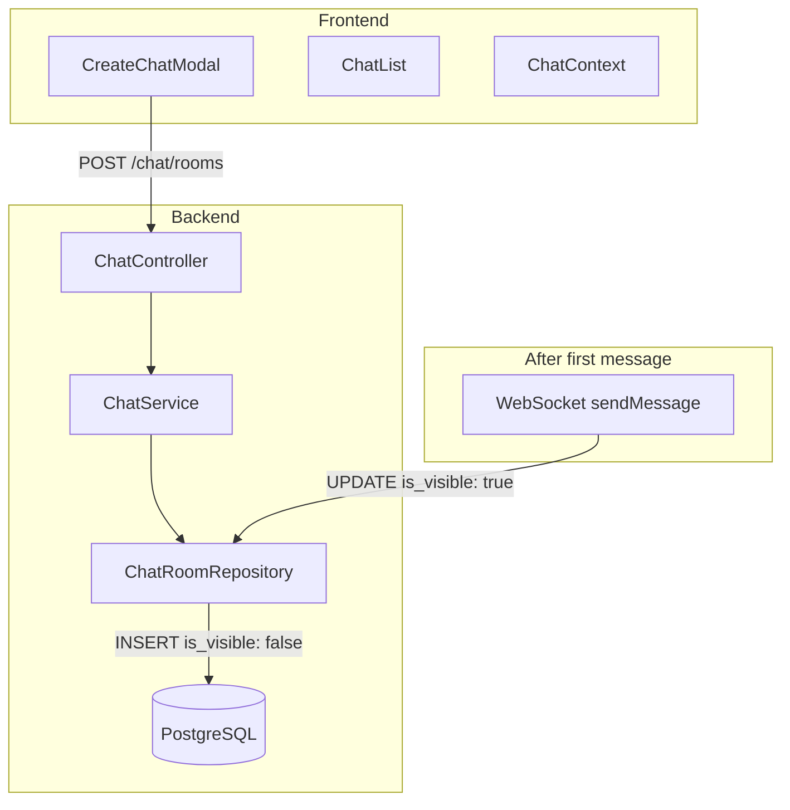
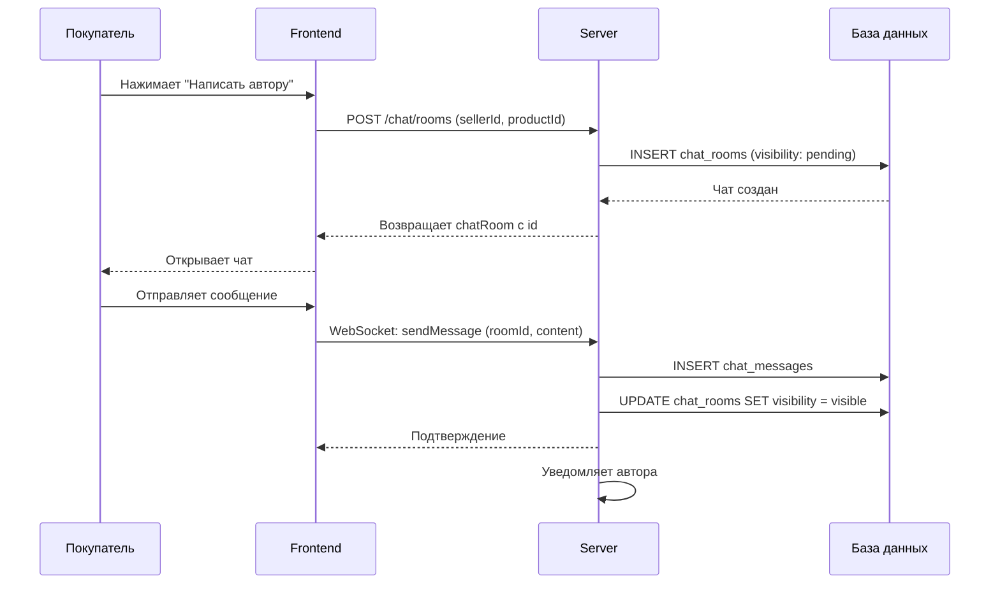
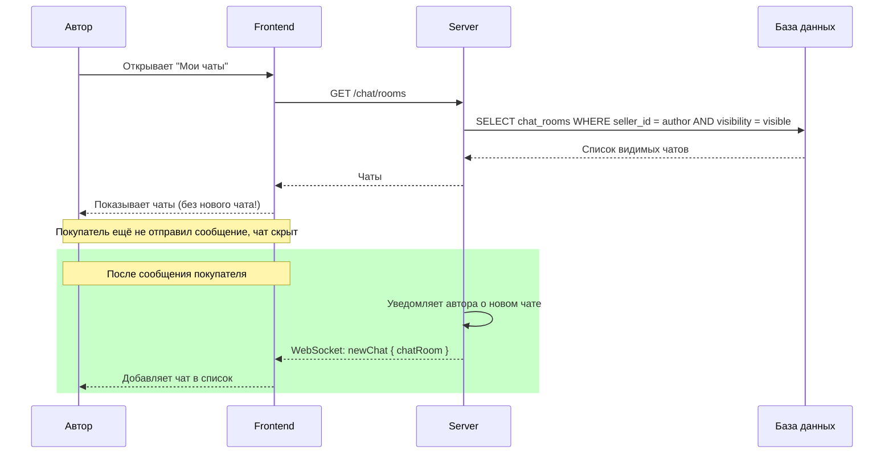

# План исправления логики создания чатов

## Текущая проблема

Сейчас чат создаётся как временный в Redis (`temp_id`). Когда покупатель нажимает "Написать автору":
1. Создаётся временный чат в Redis с TTL 24 часа
2. Покупатель видит чат и может написать сообщение
3. При отправке первого сообщения чат создаётся в БД
4. **Автор НЕ видит чат**, пока покупатель не отправит сообщение

## Требуемое поведение

Чат должен создаваться **сразу в БД**, но быть скрытым для автора до первого сообщения от покупателя:

1. Покупатель нажимает "Написать автору"
2. Чат создаётся в БД с флагом `is_visible: false` (для автора) / `is_visible: true` (для покупателя)
3. Покупатель видит чат и может написать сообщение
4. Автор НЕ видит чат в списке до первого сообщения
5. При отправке первого сообщения флаг `is_visible` меняется на `true` для обеих сторон
6. Автор видит чат в списке

---

## Архитектура решения



---

## Этапы реализации

### Этап 1: Модель данных

#### 1.1 Добавить поле `is_visible` в ChatRoom

```typescript
// server/src/db/models/chat-room.model.ts

// Добавить enum для статуса видимости
export enum ChatRoomVisibility {
  PENDING = 'pending',    // Ожидает первого сообщения
  VISIBLE = 'visible',    // Виден обеим сторонам
}

// В модели ChatRoom:
@Default(ChatRoomVisibility.PENDING)
@Column(DataType.ENUM(...Object.values(ChatRoomVisibility)))
declare visibility: ChatRoomVisibility;
```

**Альтернатива**: использовать поле `first_message_id` (nullable). Если `null` - чат скрыт для автора.

#### 1.2 Обновить DTO

```typescript
// server/src/chat/dto/create-chat-room.dto.ts
export class CreateChatRoomDto {
  buyerId: number;
  sellerId: number;
  productId?: number;
  userProductId?: number;
  visibility?: ChatRoomVisibility; // По умолчанию PENDING
}
```

---

### Этап 2: Backend - Repository

#### 2.1 Обновить ChatRoomRepository

Добавить методы для фильтрации по visibility:

```typescript
// server/src/chat/repositories/chat-room.repository.ts

// Новые методы:
async findVisibleByUserId(userId: number): Promise<ChatRoom[]> {
  return this.chatRoomModel.findAll({
    where: {
      [Op.or]: [{ buyer_id: userId }, { seller_id: userId }],
      visibility: ChatRoomVisibility.VISIBLE,
    },
  });
}

async findPendingForSeller(sellerId: number): Promise<ChatRoom[]> {
  // Находит чаты, где продавец - автор, но чат ещё невидим
  return this.chatRoomModel.findAll({
    where: {
      seller_id: sellerId,
      visibility: ChatRoomVisibility.PENDING,
    },
  });
}
```

#### 2.2 Обновить метод getUserChatRooms

При получении чатов для пользователя:
- Для покупателя: возвращать все чаты (он видит свои)
- Для продавца: возвращать только VISIBLE чаты

---

### Этап 3: Backend - Service

#### 3.1 Обновить ChatService

```typescript
// server/src/chat/chat.service.ts

// Изменить createTempChat - теперь создаёт чат в БД сразу
async createChatRoom(
  buyerId: number,
  sellerId: number,
  productId?: number,
  userProductId?: number,
): Promise<ChatRoom> {
  // Проверить, существует ли уже чат
  const existingChat = await this.findExistingChat(buyerId, sellerId, productId);
  if (existingChat) {
    return existingChat;
  }

  // Создать новый чат в БД
  const chat = await this.chatRoomRepository.create({
    buyerId,
    sellerId,
    productId,
    userProductId,
    visibility: ChatRoomVisibility.PENDING,
  });

  return chat;
}

// При отправке первого сообщения - сделать чат видимым
async makeChatVisible(chatRoomId: number): Promise<void> {
  await this.chatRoomRepository.update(chatRoomId, {
    visibility: ChatRoomVisibility.VISIBLE,
  });
}
```

#### 3.2 Удалить TempChatService

После изменений `TempChatService` больше не нужен - временные чаты в Redis не создаются.

---

### Этап 4: Backend - Controller

#### 4.1 Изменить ChatController

```typescript
// server/src/chat/chat.controller.ts

// POST /chat/rooms - создать чат (сразу в БД)
@Post('rooms')
@HttpCode(HttpStatus.CREATED)
async createChatRoom(
  @CurrentUserId() userId: number,
  @Body() dto: InitChatDto,  // Переименовать из InitTempChatDto
) {
  return this.chatService.createChatRoom(
    userId,
    dto.sellerId!,
    dto.productId,
    dto.userProductId,
  );
}

// Удалить или изменить эндпоинты temp чатов
// DELETE /chat/rooms/temp/:id - больше не нужен
```

---

### Этап 5: Backend - WebSocket Gateway

#### 5.1 Обновить ChatGateway

```typescript
// server/src/chat/chat.gateway.ts

@SubscribeMessage('sendMessage')
async handleSendMessage(
  client: Socket,
  payload: { roomId: number; content: string; type?: string },
) {
  const userId = client.data.userId;
  
  // Получить чат
  const chatRoom = await this.chatService.getChatRoomById(payload.roomId);
  
  // Если это первое сообщение (чат ещё PENDING)
  if (chatRoom.visibility === ChatRoomVisibility.PENDING) {
    // Сделать чат видимым
    await this.chatService.makeChatVisible(payload.roomId);
  }
  
  // Отправить сообщение
  const message = await this.chatService.sendMessage(...);
  
  // Рассылка...
}
```

---

### Этап 6: Frontend - API

#### 6.1 Обновить api-chat.ts

```typescript
// front/src/lib/api-chat.ts

// Изменить initTempChat -> createChat
export const chatApi = {
  // Вместо временного чата - создаём сразу в БД
  createChat: async (sellerId: number, productId?: number, userProductId?: number): Promise<ChatRoom> => {
    const response = await api.post(`${CHAT_API}/rooms`, {
      sellerId,
      productId,
      userProductId,
    });
    return response.data;
  },
  
  // Удалить методы temp чатов
  // getTempChat, deleteTempChat - больше не нужны
};
```

---

### Этап 7: Frontend - Context

#### 7.1 Обновить ChatContext

```typescript
// front/src/context/chat/ChatContext.tsx

// Убрать логику tempChat и tempRooms
// Теперь есть только rooms и messages

interface ChatContextType {
  rooms: ChatRoom[];           // Все видимые чаты
  currentRoom: ChatRoom | null;
  sendMessage: (content: string, type?: string) => Promise<void>;
  // Убрать: tempChat, tempRooms, initTempChat, clearTempChat, selectTempRoom
}

// При отправке первого сообщения - обновить rooms
const handleSendMessage = async (content: string, type = 'text') => {
  await sendMessage(content, type);
  await loadChatRooms();  // Перезагрузить чаты после первого сообщения
};
```

---

### Этап 8: Frontend - Компоненты

#### 8.1 Обновить CreateChatModal

```typescript
// front/src/components/chat/CreateChatModal.tsx

const handleSubmit = async (e: React.FormEvent) => {
  // Вместо initTempChat использовать createChat
  const chat = await chatApi.createChat(
    selectedProduct.sellerId,
    selectedProduct.productId,
    selectedProduct.id
  );

  // Перейти на страницу чата с roomId
  router.push(`/chat?roomId=${chat.id}`);
};
```

#### 8.2 Обновить ChatList

```typescript
// front/src/components/chat/ChatList.tsx

// Убрать логику tempRooms
// Теперь отображаем только rooms (уже видимые для пользователя)

// Убрать проверки:
// - room.isTemp
// - tempRooms
// - room.tempId
```

---

## API Изменения

### Новые эндпоинты

| Метод | URL | Описание |
|-------|-----|----------|
| POST | `/chat/rooms` | Создать чат сразу в БД |
| PATCH | `/chat/rooms/:id/visible` | Сделать чат видимым (для WebSocket) |

### Удалённые эндпоинты

| Метод | URL | Причина |
|-------|-----|----------|
| POST | `/chat/rooms/init` | Заменён на `/chat/rooms` |
| GET | `/chat/rooms/temp/:id` | Больше не нужен |
| DELETE | `/chat/rooms/temp/:id` | Больше не нужен |

---

## Миграция базы данных

```sql
-- Добавить поле visibility в chat_rooms
ALTER TABLE chat_rooms 
ADD COLUMN visibility VARCHAR(20) DEFAULT 'pending' 
CHECK (visibility IN ('pending', 'visible'));

-- Сделать все существующие чаты видимыми
UPDATE chat_rooms SET visibility = 'visible' WHERE visibility = 'pending';
```

---

## Сценарии использования

### Сценарий 1: Покупатель пишет автору



### Сценарий 2: Автор видит чат



---

## Todo List для реализации

- [ ] Добавить поле visibility в модель ChatRoom
- [ ] Создать миграцию для нового поля
- [ ] Обновить CreateChatRoomDto
- [ ] Обновить ChatRoomRepository - добавить методы фильтрации
- [ ] Обновить ChatService - создавать чат сразу в БД
- [ ] Удалить TempChatService
- [ ] Обновить ChatController - изменить эндпоинты
- [ ] Обновить ChatGateway - логика первого сообщения
- [ ] Обновить фронтенд API (api-chat.ts)
- [ ] Обновить ChatContext - убрать temp чаты
- [ ] Обновить CreateChatModal
- [ ] Обновить ChatList
- [ ] Обновить план модуля

---

## Примечание

После реализации этих изменений:
- Убираем `temp_id` из URL и логики
- Чаты создаются сразу в БД
- Для автора чат скрыт до первого сообщения
- После первого сообщения чат становится видимым для всех
