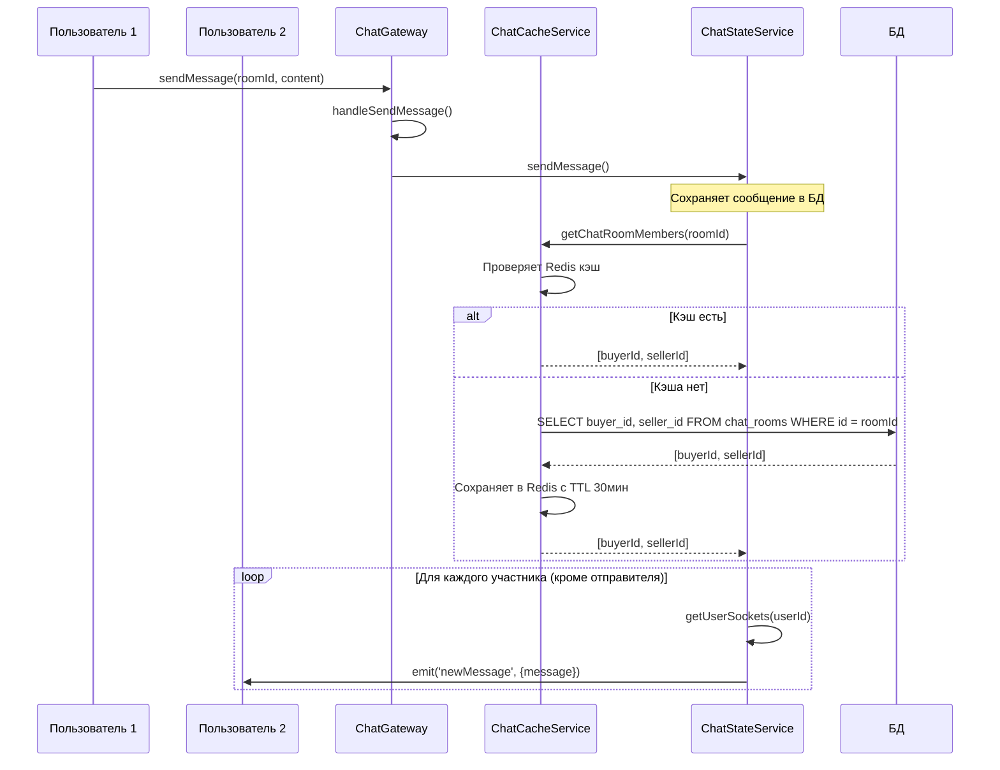
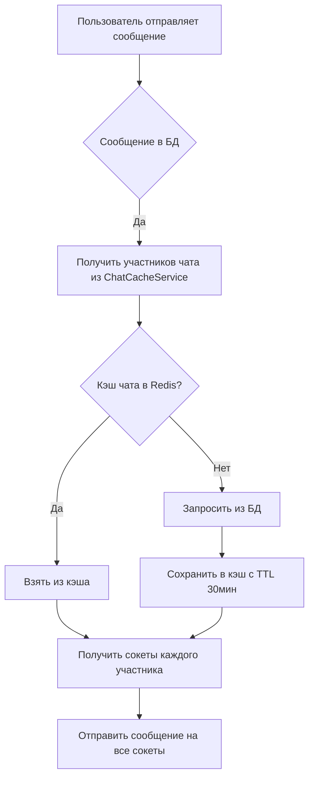

# План исправления системы уведомлений о сообщениях в чате

## Проблема
Сообщения добавляются в непрочитанные только если пользователь до этого открывал чат. При отправке сообщения оно рассылается через Socket.IO room (`client.join('chat:1')`), и если пользователь не заходил в чат, он не получает сообщение.

## Требуемое поведение
1. Пользователь пишет сообщение в чат
2. Если у другого пользователя есть WebSocket соединение, ему приходит уведомление
3. Уведомление должно приходить даже если пользователь не заходил в чат

## Решение

### 1. Создание ChatCacheService
**Файл:** `server/src/chat/services/chat-cache.service.ts`

```typescript
// Методы:
// - getChatRoomMembers(roomId: number): Promise<number[]> - получить участников чата
//   * Сначала проверяет Redis кэш
//   * Если нет - берет из БД через ChatRoomRepository (buyer_id, seller_id)
//   * Сохраняет в кэш с TTL 30 минут
// - cacheChatRoomMembers(roomId: number, userIds: number[]): Promise<void>
// - invalidateChatRoomCache(roomId: number): Promise<void>
```

### 2. Обновление ChatStateService
**Файл:** `server/src/chat/services/chat-state.service.ts`

```typescript
// Добавить методы:
// - addUserToRoom(userId: number, roomId: number, socketId: string): Promise<void>
//   * Кэширует: roomId → set(userIds)
//   * Добавляет TTL 30 минут (сбрасывается при активности)
// - removeUserFromRoom(userId: number, roomId: number, socketId: string): Promise<void>
//   * Если в комнате никого не осталось - удалить кэш
// - getRoomActiveUsers(roomId: number): Promise<number[]>
// - isUserInAnyRoom(userId: number): Promise<boolean>
```

### 3. Обновление ChatMessageService
**Файл:** `server/src/chat/services/chat-message.service.ts`

```typescript
// В методе sendMessage:
// - После сохранения сообщения в БД:
//   * Получить участников через ChatCacheService.getChatRoomMembers()
//   * Для каждого участника (кроме отправителя):
//     - Получить все его сокеты через ChatStateService.getUserSockets()
//     - Отправить сообщение на каждый сокет
```

### 4. Обновление ChatGateway
**Файл:** `server/src/chat/chat.gateway.ts`

```typescript
// handleJoinRoom:
// - client.join('chat:' + roomId) - оставить для обратной совместимости
// - Вызвать ChatStateService.addUserToRoom(userId, roomId, client.id)

// handleLeaveRoom:
// - client.leave('chat:' + roomId)
// - Вызвать ChatStateService.removeUserFromRoom(userId, roomId, client.id)
// - Если никого не осталось - удалить кэш чата

// handleDisconnect:
// - Очистка маппинга socketId → userId
```

### 5. Обновление ChatModule
**Файл:** `server/src/chat/chat.module.ts`

```typescript
// Добавить ChatCacheService в providers и exports
```

## Архитектура взаимодействия



## Поток данных при отправке сообщения



## Redis ключи

| Ключ | Описание | TTL |
|------|----------|-----|
| `chat:room:members:{roomId}` | Участники чата | 30 мин |
| `chat:room:active:{roomId}` | Активные пользователи в чате | 30 мин |
| `chat:user:active_rooms:{userId}` | Активные комнаты пользователя | 24 часа |
| `chat:user:sockets:{userId}` | Маппинг socketId → userId | 24 часа |

## Пример изменения логики

### До (текущая логика)
```
1. Пользователь заходит в чат → client.join('chat:1')
2. Другой пользователь отправляет сообщение
3. Сообщение рассылается через this.server.to('chat:1')
4. Если пользователь не делал client.join - он не получит сообщение
```

### После (новая логика)
```
1. Пользователь заходит в чат → сохраняем в Redis room:1 → [userId1, userId2]
2. При отправке сообщения:
   a. Сохраняем в БД
   b. Получаем участников (buyer_id, seller_id) из БД/кэша
   c. Для каждого участника находим все его сокеты
   d. Отправляем сообщение на каждый сокет
3. Пользователь получает сообщение даже если он не заходил в чат
```

## Файлы для изменения

1. `server/src/chat/services/chat-cache.service.ts` - создать
2. `server/src/chat/services/chat-state.service.ts` - обновить
3. `server/src/chat/services/chat-message.service.ts` - обновить
4. `server/src/chat/chat.gateway.ts` - обновить
5. `server/src/chat/chat.module.ts` - обновить

## TODO

- [x] Создать ChatCacheService
- [x] Добавить метод getChatRoomMembers в ChatCacheService
- [x] Реализовать TTL 30 минут для кэша чатов
- [x] Инвалидация кэша при выходе последнего пользователя
- [x] Обновить ChatMessageService для отправки на все сокеты участников
- [x] Обновить ChatGateway handleJoinRoom/handleLeaveRoom
- [x] Обновить ChatModule
- [ ] Тестирование
