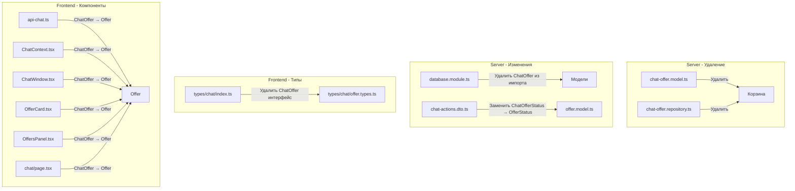

# План миграции с ChatOffer на Offer

## Анализ

### Текущее состояние
На бэкенде существуют две модели:
- **offer.model.ts** (новая) - полноценная модель с OfferStatus, полями для оплаты, файлами
- **chat-offer.model.ts** (старая) - упрощённая модель с ChatOfferStatus

### Найденные ссылки на ChatOffer (25 мест):

#### Бэкенд (server):
3. `server/src/db/database.module.ts` - строка 27, 53 (УДАЛИТЬ импорт)
4. `server/src/chat/dto/chat-actions.dto.ts` - строка 2 (ЗАМЕНИТЬ на OfferStatus)

#### Фронтенд (front) - 28 мест:
1. `front/src/types/chat/index.ts` - интерфейс ChatOffer (УДАЛИТЬ/ПЕРЕИМЕНОВАТЬ)
2. `front/src/lib/api-chat.ts` - импорт ChatOffer (ЗАМЕНИТЬ на Offer)
3. `front/src/context/chat/ChatContext.tsx` - типы и использование (ЗАМЕНИТЬ)
4. `front/src/components/chat/ChatWindow.tsx` - типы (ЗАМЕНИТЬ)
5. `front/src/components/chat/OfferCard.tsx` - типы (ЗАМЕНИТЬ)
6. `front/src/components/chat/OffersPanel.tsx` - типы (ЗАМЕНИТЬ)
7. `front/src/app/[lang]/chat/page.tsx` - типы (ЗАМЕНИТЬ)

---

## План выполнения

### Этап 1: Удаление старых файлов (server)

- [ ] 1.1 Удалить `server/src/db/models/chat-offer.model.ts`
- [ ] 1.2 Удалить `server/src/chat/repositories/chat-offer.repository.ts`

### Этап 2: Обновление server/src/db

- [ ] 2.1 `database.module.ts` - удалить ChatOffer из импорта и массива models
- [ ] 2.2 Проверить `models/index.ts` - убедиться что ChatOffer не экспортируется

### Этап 3: Обновление server/src/chat

- [ ] 3.1 `chat-actions.dto.ts` - заменить `ChatOfferStatus` на `OfferStatus` из `offer.model.ts`
- [ ] 3.2 Проверить импорты в chat.service.ts (ссылается на ChatOfferStatus в chat-actions.dto.ts)

### Этап 4: Обновление фронтенда (front)

#### Типы
- [ ] 4.1 `front/src/types/chat/index.ts`:
  - Удалить интерфейс ChatOffer (строки 66-96)
  - Обновить импорт OfferStatus с 'offer.types' на использование из локального enum или импорт
  - Обновить OfferCreatedPayload, OfferUpdatedPayload использовать Offer вместо ChatOffer

- [ ] 4.2 `front/src/types/chat/offer.types.ts`:
  - Убедиться что все необходимые поля есть (уже содержит полный Offer)

#### API
- [ ] 4.3 `front/src/lib/api-chat.ts`:
  - Строка 2: убрать ChatOffer из импорта
  - Строка 6: убрать ChatOffer из re-export
  - Строки 177-205: все возвращаемые типы ChatOffer заменить на Offer

#### Context
- [ ] 4.4 `front/src/context/chat/ChatContext.tsx`:
  - Строка 8: убрать ChatOffer из импорта
  - Строки 32, 77: типы offers: ChatOffer[] заменить на Offer[]
  - Строка 159-195: все payload содержащие ChatOffer заменить на Offer

#### Компоненты
- [ ] 4.5 `front/src/components/chat/ChatWindow.tsx`:
  - Убрать импорт ChatOffer
  - Заменить типы на Offer

- [ ] 4.6 `front/src/components/chat/OfferCard.tsx`:
  - Убрать импорт ChatOffer
  - Заменить типы на Offer

- [ ] 4.7 `front/src/components/chat/OffersPanel.tsx`:
  - Убрать импорт ChatOffer
  - Заменить типы на Offer

- [ ] 4.8 `front/src/app/[lang]/chat/page.tsx`:
  - Убрать импорт ChatOffer
  - Заменить типы на Offer

---

## Схема изменений

---

## Важные замечания

1. **OfferStatus из offer.model.ts** содержит статусы: WAITING_AUTHOR, WAITING_USER, REJECTED, IN_PROGRESS, AWAITING_PAYMENT, COMPLETED
2. **ChatOfferStatus** из chat-offer.model.ts содержал: PENDING, ACCEPTED, DECLINED, CANCELLED
3. При миграции нужно учесть что статус PENDING из старой модели соответствует WAITING_AUTHOR или WAITING_USER в новой
4. Поле `deadline` существует только в ChatOffer, в Offer его нужно добавить или использовать из CustomOrder
5. Поле `message_id` из ChatOffer не нужно - новая модель не использует его

---

## Проверка после миграции

1. Запустить `npm run build` на сервере
2. Запустить `npm run build` на фронтенде
3. Проверить что все эндпоинты работают корректно
4. Проверить WebSocket события