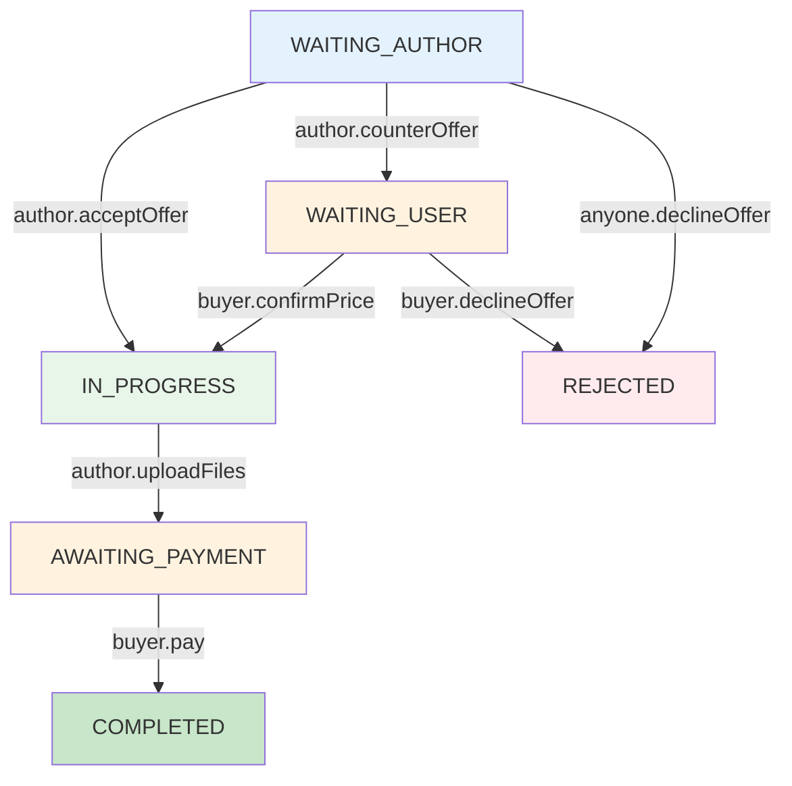

# План: Реализация статуса WAITING_USER и методов для работы с ценой

## Текущее состояние

Модель Offer уже содержит все необходимые статусы:

```typescript
export enum OfferStatus {
  WAITING_AUTHOR = 'waiting_author',    // Ожидает реакции автора
  WAITING_USER = 'waiting_user',       // Автор изменил цену, ожидает подтверждения
  REJECTED = 'rejected',                // Отклонён
  IN_PROGRESS = 'in_progress',         // В работе
  AWAITING_PAYMENT = 'awaiting_payment',// Ожидает оплаты
  COMPLETED = 'completed',              // Завершён
}
```

## Недостающие методы

Для полноценной работы со статусом `WAITING_USER` необходимы методы:

| Метод | Описание | Кто вызывает | Переход статуса |
|-------|----------|--------------|-----------------|
| `counterOffer()` | Автор меняет цену | Продавец | WAITING_AUTHOR → WAITING_USER |
| `confirmPrice()` | Покупатель подтверждает новую цену | Покупатель | WAITING_USER → IN_PROGRESS |
| `declineOffer()` | Отклонение (расширить для WAITING_USER) | Покупатель | WAITING_USER → REJECTED |

---

## План реализации

### ЭТАП 1: Добавить метод counterOffer() в ChatService

**Файл:** `server/src/chat/chat.service.ts`

**Логика:**
1. Проверить что offer существует
2. Проверить что userId = author_id (только продавец может менять цену)
3. Проверить что текущий статус WAITING_AUTHOR
4. Сохранить старую цену в original_price
5. Обновить цену и перевести в статус WAITING_USER
6. Вернуть обновлённый offer

---

### ЭТАП 2: Добавить метод confirmPrice() в ChatService

**Файл:** `server/src/chat/chat.service.ts`

**Логика:**
1. Проверить что offer существует
2. Проверить что userId = creator_id (только покупатель может подтвердить)
3. Проверить что текущий статус WAITING_USER
4. Перевести в статус IN_PROGRESS
5. Вернуть обновлённый offer

---

### ЭТАП 3: Обновить метод declineOffer() для WAITING_USER

**Файл:** `server/src/chat/chat.service.ts`

**Логика:**
1. Проверить что offer существует
2. Проверить что userId = creator_id (только покупатель может отклонить на этом этапе)
3. Проверить что текущий статус WAITING_USER
4. Перевести в статус REJECTED
5. Опционально: восстановить original_price

---

### ЭТАП 4: Добавить эндпоинты в ChatController

**Файл:** `server/src/chat/chat.controller.ts`

**Эндпоинты:**
- `POST /chat/offers/:id/counter` - изменить цену (автор)
- `POST /chat/offers/:id/confirm-price` - подтвердить цену (покупатель)

---

### ЭТАП 5: Обновить DTO

**Файл:** `server/src/chat/dto/chat-actions.dto.ts` или новый файл

**DTO:**
- `CounterOfferDto`: { newPrice: number }

---

## Диаграмма переходов статусов



---

## Защита доступа

| Метод | Разрешённые роли | Проверка |
|-------|-----------------|----------|
| `counterOffer()` | Только автор (продавец) | `offer.author_id === userId` |
| `confirmPrice()` | Только создатель (покупатель) | `offer.creator_id === userId` |
| `declineOffer()` | Участники сделки | `offer.author_id === userId \|\| offer.creator_id === userId` |

---

## Файлы для изменения

1. **server/src/chat/chat.service.ts**
   - Добавить counterOffer()
   - Добавить confirmPrice()
   - Обновить declineOffer()

2. **server/src/chat/chat.controller.ts**
   - Добавить POST /offers/:id/counter
   - Добавить POST /offers/:id/confirm-price

3. **server/src/chat/dto/chat-actions.dto.ts**
   - Добавить CounterOfferDto
