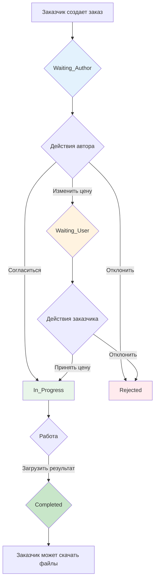

# Архитектура системы заказов на редактирование в чате

## Версия 1.0 — Минимальная (5 статусов)

---

## 1. Состояния (States)

Система использует ровно **5 ключевых статусов**:

| Статус | Описание | Кто создал |
|--------|----------|------------|
| `Waiting_Author` | Заказ создан, ожидает реакции автора | Заказчик |
| `Waiting_User` | Автор изменил цену, ожидает подтверждения заказчика | Автор |
| `Rejected` | Заказ отклонён одной из сторон | Любой |
| `In_Progress` | Цена согласована, работа началась | Система |
| `Completed` | Работа завершена, файлы переданы | Система / Заказчик |

---

## 2. Диаграмма переходов состояний

---

## 3. Схема БД (Таблица Offers)

### Таблица `offers`

| Колонка | Тип | Обязательно | Описание |
|---------|-----|-------------|----------|
| `id` | INTEGER | Да | Primary Key, Auto Increment |
| `chat_room_id` | INTEGER | Да | Связь с чатом |
| `creator_id` | INTEGER | Да | ID заказчика (создателя) |
| `author_id` | INTEGER | Да | ID автора (исполнителя) |
| `description` | TEXT | Да | Описание заказа |
| `price` | DECIMAL(10,2) | Да | Предложенная цена |
| `original_price` | DECIMAL(10,2) | Нет | Исходная цена (если была изменена) |
| `status` | ENUM | Да | waiting_author, waiting_user, rejected, in_progress, completed |
| `files_urls` | JSON | Нет | Массив URL файлов |
| `created_at` | DATETIME | Да | Дата создания |
| `updated_at` | DATETIME | Да | Дата обновления |

---

## 4. Этапы реализации

### ЭТАП 1: Сервер — Модель БД и DTO

**Цель:** Создать модель данных и транспортные объекты

**Файлы для работы:**
- [`server/src/db/models/`](server/src/db/models/) — директория моделей
- [`server/src/chat/dto/`](server/src/chat/dto/) — директория DTO

**Действия:**

1. **Создать модель [`server/src/db/models/offer.model.ts`](server/src/db/models/offer.model.ts)**
   - Наследовать от Sequelize Model
   - Определить поля: id, chat_room_id, creator_id, author_id, description, price, original_price, status, files_urls
   - Добавить enum OfferStatus с 5 значениями
   - Настроить связи с User и ChatRoom

2. **Создать DTO [`server/src/chat/dto/offer.dto.ts`](server/src/chat/dto/offer.dto.ts)**
   - CreateOfferDto: chatRoomId, authorId, description, price
   - CounterOfferDto: newPrice
   - UploadFilesDto: files (массив)

3. **Добавить модель в модуль**
   - Зарегистрировать в `server/src/db/models/index.ts`

**Результат этапа:** Модель Offer доступна в приложении

---

### ЭТАП 2: Сервис и Repository

**Цель:** Реализовать бизнес-логику работы с заказами

**Файлы для работы:**
- [`server/src/chat/repositories/`](server/src/chat/repositories/) — директория репозиториев
- [`server/src/chat/services/`](server/src/chat/services/) — директория сервисов

**Действия:**

1. **Создать [`server/src/chat/repositories/offer.repository.ts`](server/src/chat/repositories/offer.repository.ts)**
   - Методы: create, findById, findByChatRoom, updateStatus, updatePrice, setFiles
   - Использует Sequelize для запросов

2. **Создать [`server/src/chat/services/offer.service.ts`](server/src/chat/services/offer.service.ts)**
   - createOffer: создание заказа (статус Waiting_Author)
   - acceptOffer: принятие заказа (статус In_Progress)
   - rejectOffer: отклонение (статус Rejected)
   - counterOffer: изменить цену (статус Waiting_User)
   - confirmPrice: подтвердить цену (статус In_Progress)
   - uploadFiles: загрузить файлы (статус Completed)
   - Интеграция с ChatGateway для WebSocket уведомлений

3. **Зарегистрировать в модуле**
   - Добавить в `server/src/chat/chat.module.ts`

**Результат этапа:** Логика работы с заказами готова

---

### ЭТАП 3: Контроллер и API

**Цель:** Создать REST API эндпоинты

**Файлы для работы:**
- [`server/src/chat/chat.controller.ts`](server/src/chat/chat.controller.ts) — существующий контроллер

**Действия:**

1. **Добавить методы в ChatController**
   - `POST /chat/offers` — создать заказ
   - `GET /chat/:roomId/offers` — получить заказы чата
   - `POST /chat/offers/:id/accept` — принять заказ
   - `POST /chat/offers/:id/reject` — отклонить заказ
   - `POST /chat/offers/:id/counter` — изменить цену
   - `POST /chat/offers/:id/confirm-price` — подтвердить цену
   - `POST /chat/offers/:id/upload` — загрузить файлы
   - `GET /chat/offers/:id/files` — скачать файлы

2. **Добавить Guards**
   - Использовать существующий JwtAuthGuard
   - Проверка author_id для действий исполнителя
   - Проверка creator_id для действий заказчика

**Результат этапа:** API доступен для фронтенда

---

### ЭТАП 4: Интеграция FileService

**Цель:** Настроить загрузку и хранение файлов

**Файлы для работы:**
- [`server/src/common/services/file.service.ts`](server/src/common/services/file.service.ts)
- [`server/src/types/base/file.types.ts`](server/src/types/base/file.types.ts)

**Действия:**

1. **Расширить FileService**
   - Добавить методы saveOfferFile и saveOfferPreview
   - Настроить пути: `files/offers/{id}/` и `public/media/offers/{id}/`
   - Добавить enum FileFolder.OFFERS и MediaFolder.OFFERS

2. **Создать контроллер загрузки**
   - `POST /chat/offers/:id/upload` — multipart/form-data
   - Сохранение в temp, затем перемещение в permanent
   - Генерация URL для файлов

3. **Создать эндпоинт скачивания**
   - `GET /chat/offers/:id/files` — проверка прав
   - Проверка статуса Completed
   - Проверка что пользователь участник заказа

**Результат этапа:** Файлы загружаются и скачиваются корректно

---

### ЭТАП 5: WebSocket (ChatGateway)

**Цель:** Уведомления в реальном времени

**Файлы для работы:**
- [`server/src/chat/chat.gateway.ts`](server/src/chat/chat.gateway.ts)

**Действия:**

1. **Добавить методы уведомлений**
   - notifyOfferCreated(offer) — новый заказ
   - notifyStatusChanged(offer) — изменение статуса
   - notifyPriceChanged(offer) — изменена цена
   - notifyFilesUploaded(offer) — файлы загружены

2. **Интегрировать в OfferService**
   - Вызывать методы gateway после каждого изменения

**Результат этапа:** Клиент получает уведомления о изменениях

---

### ЭТАП 6: Фронтенд — API клиент

**Цель:** Создать функции для работы с API

**Файлы для работы:**
- [`front/src/lib/api-chat.ts`](front/src/lib/api-chat.ts) — существующий файл

**Действия:**

1. **Добавить функции в api-chat.ts**
   - createOffer(data)
   - getOffersByRoom(roomId)
   - acceptOffer(offerId)
   - rejectOffer(offerId)
   - counterOffer(offerId, newPrice)
   - confirmPrice(offerId)
   - uploadFiles(offerId, files)
   - downloadFiles(offerId)

2. **Создать TypeScript типы**
   - [`front/src/types/chat/`](front/src/types/chat/) — директория типов чата
   - Offer, OfferStatus, CreateOfferPayload и т.д.

**Результат этапа:** Фронтенд может вызывать серверные методы

---

### ЭТАП 7: Фронтенд — Компоненты UI

**Цель:** Создать визуальные компоненты

**Файлы для работы:**
- [`front/src/components/chat/`](front/src/components/chat/) — директория компонентов чата

**Действия:**

1. **Создать [`front/src/components/chat/OfferCard.tsx`](front/src/components/chat/OfferCard.tsx)**
   - Отображение карточки заказа
   - Показ статуса, цены, описания
   - Кнопки действий (в зависимости от роли и статуса)
   - Превью изображений (при клике — модальное окно)

2. **Создать [`front/src/components/chat/CreateOfferModal.tsx`](front/src/components/chat/CreateOfferModal.tsx)**
   - Форма создания заказа
   - Поля: description, price
   - Валидация

3. **Создать [`front/src/components/chat/PriceChangeModal.tsx`](front/src/components/chat/PriceChangeModal.tsx)**
   - Модальное окно изменения цены (для автора)
   - Ввод новой цены

4. **Создать [`front/src/components/chat/FileUploader.tsx`](front/src/components/chat/FileUploader.tsx)**
   - Интерфейс загрузки файлов
   - Drag & drop
   - Прогресс загрузки

5. **Создать [`front/src/components/chat/ImageModal.tsx`](front/src/components/chat/ImageModal.tsx)**
   - Модальное окно просмотра изображений
   - Галерея с навигацией

**Результат этапа:** Все UI компоненты готовы

---

### ЭТАП 8: Интеграция в ChatWindow

**Цель:** Встроить компоненты в окно чата

**Файлы для работы:**
- [`front/src/components/chat/ChatWindow.tsx`](front/src/components/chat/ChatWindow.tsx) — существующий компонент

**Действия:**

1. **Добавить OfferCard в начало чата**
   - При наличии активных заказов — показать карточку сверху

2. **Добавить кнопку создания заказа**
   - Кнопка "Создать заказ" внизу чата (только для заказчика)
   - Открывает CreateOfferModal

3. **Обработка WebSocket событий**
   - Обновление состояния при получении уведомлений
   - Перерисовка карточки заказа

**Результат этапа:** Заказы интегрированы в чат

---

### ЭТАП 9: ChatContext обновление

**Цель:** Добавить управление заказами в контекст

**Файлы для работы:**
- [`front/src/context/chat/ChatContext.tsx`](front/src/context/chat/ChatContext.tsx)

**Действия:**

1. **Добавить состояние**
   - `offers: Offer[]` — массив заказов текущего чата

2. **Добавить методы**
   - createOffer()
   - acceptOffer()
   - rejectOffer()
   - counterOffer()
   - confirmPrice()
   - uploadFiles()

3. **Интегрировать WebSocket**
   - Слушать события offer:*
   - Обновлять состояние offers

**Результат этапа:** Управление заказами через контекст

---

### ЭТАП 10: Тестирование и Polishing

**Цель:** Проверить работу и исправить ошибки

**Действия:**

1. **Функциональное тестирование**
   - Создание заказа
   - Принятие/отклонение
   - Изменение цены
   - Загрузка файлов
   - Скачивание файлов

2. **Тестирование прав доступа**
   - Проверка что нельзя принять чужой заказ
   - Проверка скачивания файлов только участниками

3. **UI тестирование**
   - Отображение статусов
   - Доступность кнопок
   - Модальные окна

4. **Polishing**
   - Локализация (i18n)
   - Обработка ошибок
   - Индикация загрузки

**Результат этапа:** Система готова к использованию

---

## 5. Краткое резюме по файлам

### Сервер (новые)
| Файл | Описание |
|------|----------|
| `server/src/db/models/offer.model.ts` | Модель БД |
| `server/src/chat/dto/offer.dto.ts` | DTO |
| `server/src/chat/repositories/offer.repository.ts` | Repository |
| `server/src/chat/services/offer.service.ts` | Business Logic |

### Сервер (изменяемые)
| Файл | Изменения |
|------|-----------|
| `server/src/chat/chat.controller.ts` | Добавить endpoints |
| `server/src/chat/chat.module.ts` | Зарегистрировать сервисы |
| `server/src/chat/chat.gateway.ts` | Добавить уведомления |
| `server/src/common/services/file.service.ts` | Методы для offers |
| `server/src/types/base/file.types.ts` | Добавить OFFERS enum |

### Фронтенд (новые)
| Файл | Описание |
|------|----------|
| `front/src/types/chat/offer.types.ts` | TypeScript типы |
| `front/src/components/chat/OfferCard.tsx` | Карточка заказа |
| `front/src/components/chat/CreateOfferModal.tsx` | Создание заказа |
| `front/src/components/chat/PriceChangeModal.tsx` | Изменение цены |
| `front/src/components/chat/FileUploader.tsx` | Загрузка файлов |
| `front/src/components/chat/ImageModal.tsx` | Просмотр изображений |

### Фронтенд (изменяемые)
| Файл | Изменения |
|------|-----------|
| `front/src/lib/api-chat.ts` | Добавить API функции |
| `front/src/context/chat/ChatContext.tsx` | Добавить offers state |
| `front/src/components/chat/ChatWindow.tsx` | Интегрировать компоненты |