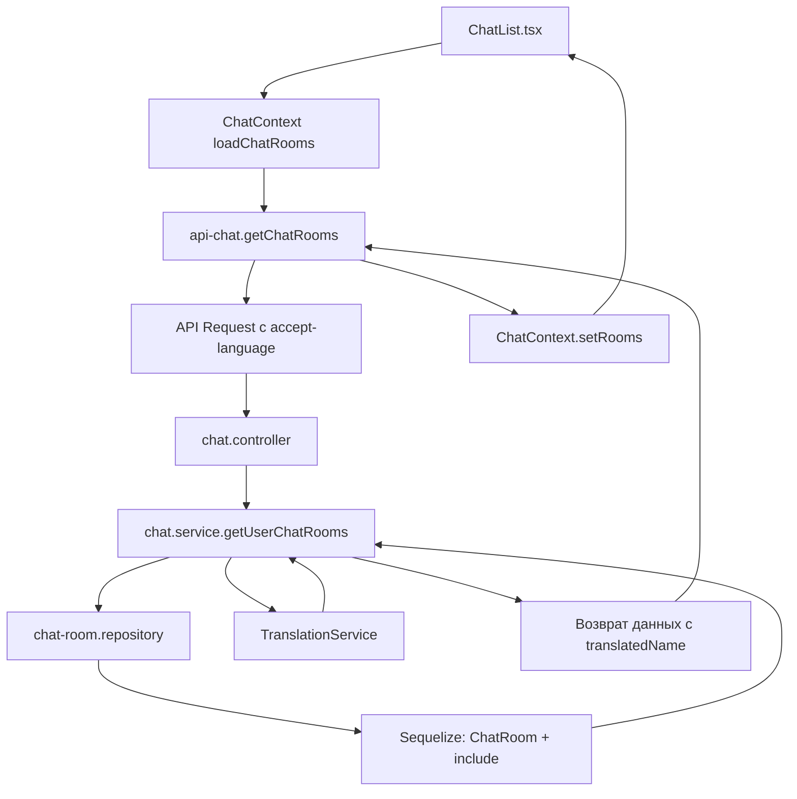

# План: Добавление product.name с учётом перевода в чат-комнатах

## Проблема

В текущей реализации [`ChatList.tsx`](front/src/components/chat/ChatList.tsx:58) получает неполные данные - `console.log(rooms)` показывает только базовые поля чата:

```json
{
    "id": 1,
    "buyer_id": 18,
    "seller_id": 6,
    "product_id": 24,
    ...
}
```

А должно содержать связанные данные: `product`, `buyer`, `seller` + перевод названия товара.

## Анализ

Цепочка вызовов:
1. **Frontend**: [`ChatContext.tsx:111-118`](front/src/context/chat/ChatContext.tsx:111) → `loadChatRooms()` → `chatApi.getChatRooms()`
2. **Frontend API**: [`api-chat.ts:22-24`](front/src/lib/api-chat.ts:22) → GET `/chat/rooms` (БЕЗ locale)
3. **Server Controller**: [`chat.controller.ts:52-63`](server/src/chat/chat.controller.ts:52) → НЕ принимает locale
4. **Server Service**: [`chat.service.ts:157-168`](server/src/chat/chat.service.ts:157) → НЕ включает product/buyer/seller, НЕ использует locale
5. **Server Repository**: [`chat-room.repository.ts:56-67`](server/src/chat/repositories/chat-room.repository.ts:56) → НЕ включает связанные модели

## План реализации

### 1. Frontend: Добавить заголовок accept-language в API

**Файл:** [`front/src/lib/api.ts`](front/src/lib/api.ts)

Добавить interceptor для установки заголовка `accept-language` на основе текущей locale:

```typescript
// В request interceptor (строка ~36)
config.headers['accept-language'] = locale; // нужно получить из контекста
```

### 2. Frontend: Передавать locale в api-chat.ts

**Файл:** [`front/src/lib/api-chat.ts`](front/src/lib/api-chat.ts:22)

Модифицировать `getChatRooms` для передачи locale:

```typescript
getChatRooms: async (locale?: string, page = 1, limit = 20) => {
  const response = await api.get(`${CHAT_API}/rooms`, { 
    params: { page, limit },
    headers: locale ? { 'accept-language': locale } : {}
  });
  return response.data;
},
```

### 3. Frontend: ChatContext передаёт locale

**Файл:** [`front/src/context/chat/ChatContext.tsx`](front/src/context/chat/ChatContext.tsx:111)

Модифицировать `loadChatRooms`:

```typescript
import { useI18n } from '@/context/i18n/I18nContext';

const { locale } = useI18n();

const loadChatRooms = useCallback(async () => {
  try {
    const result = await chatApi.getChatRooms(locale);  // передаём locale
    setRooms(result.rows);
  } catch (error) {
    console.error('Error loading chat rooms:', error);
  }
}, [locale]);
```

### 4. Server: Controller принимает locale из заголовков

**Файл:** [`server/src/chat/chat.controller.ts`](server/src/chat/chat.controller.ts:52)

```typescript
@Get('rooms')
async getUserChatRooms(
  @CurrentUserId() userId: number,
  @Query('page') page?: string,
  @Query('limit') limit?: string,
  @Headers('accept-language') locale?: string,
) {
  return this.chatService.getUserChatRooms(
    userId,
    page ? parseInt(page, 10) : 1,
    limit ? parseInt(limit, 10) : 20,
    locale,
  );
}
```

### 5. Server: Repository включает связанные данные

**Файл:** [`server/src/chat/repositories/chat-room.repository.ts`](server/src/chat/repositories/chat-room.repository.ts:56)

Модифицировать `findVisibleByUserId` для включения include:

```typescript
async findVisibleByUserId(
  userId: number,
  options?: FindOptions,
): Promise<ChatRoom[]> {
  return this.chatRoomModel.findAll({
    where: {
      [Op.or]: [{ buyer_id: userId }, { seller_id: userId }],
      visibility: ChatRoomVisibility.VISIBLE,
    },
    include: [
      { model: User, as: 'buyer', attributes: ['id', 'name', 'avatar_url'] },
      { model: User, as: 'seller', attributes: ['id', 'name', 'avatar_url'] },
      {
        model: Product,
        as: 'product',
        include: [
          {
            model: ProductMedia,
            where: { is_cover: true },
            required: false,
            attributes: ['id', 'url', 'is_cover'],
          },
        ],
      },
    ],
    ...options,
  });
}
```

### 6. Server: Service добавляет переводы

**Файл:** [`server/src/chat/chat.service.ts`](server/src/chat/chat.service.ts:157)

```typescript
async getUserChatRooms(userId: number, page = 1, limit = 20, locale?: string) {
  const chats = await this.chatRoomRepository.findVisibleByUserId(userId, {
    order: [['created_at', 'DESC']],
    limit,
    offset: (page - 1) * limit,
  });
  
  // Получаем переводы для всех продуктов
  const productIds = chats
    .map(chat => chat.product_id)
    .filter((id): id is number => id !== null && id !== undefined);
  
  const translations = await this.translationService.getProductTranslationsBatch(
    productIds,
    locale,
  );
  
  // Добавляем переводы к продуктам
  for (const chat of chats) {
    if (chat.product_id && chat.product) {
      const translation = translations.get(chat.product_id);
      if (translation) {
        (chat.product as any).translatedName = translation.name;
      }
    }
  }
  
  const count = chats.length;
  return { rows: chats, count };
}
```

## Mermaid диаграмма потока данных



## Ожидаемый результат

После изменений API будет возвращать полные данные:

```json
{
    "id": 1,
    "buyer_id": 18,
    "seller_id": 6,
    "product_id": 24,
    "buyer": { "id": 18, "name": "taofi.stop.lego", "avatar_url": null },
    "seller": { "id": 6, "name": "Demo", "avatar_url": "/user/6/avatar.png" },
    "product": {
        "id": 24,
        "name": "Original Name",
        "translatedName": "Переведенное название",
        "media": [{ "id": 15, "url": "media/...", "is_cover": true }]
    },
    "last_message_at": "2026-03-24T10:21:40.581Z",
    "created_at": "2026-03-24T09:49:34.621Z"
}
```

## Файлы для изменения

| Файл | Изменение |
|------|-----------|
| `front/src/lib/api.ts` | Добавить interceptor для accept-language |
| `front/src/lib/api-chat.ts` | Передавать locale в заголовках |
| `front/src/context/chat/ChatContext.tsx` | Передавать locale при загрузке комнат |
| `server/src/chat/chat.controller.ts` | Принимать locale из заголовков |
| `server/src/chat/chat.service.ts` | Включить product/buyer/seller + переводы |
| `server/src/chat/repositories/chat-room.repository.ts` | Добавить include для связанных моделей |

## Приоритет выполнения

1. Frontend: api.ts + api-chat.ts + ChatContext
2. Server: controller + service + repository
3. Тестирование
