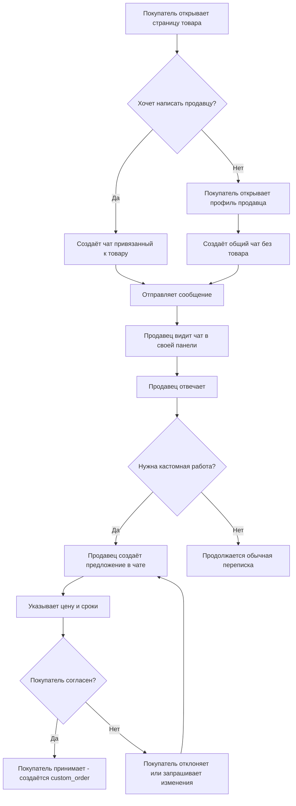
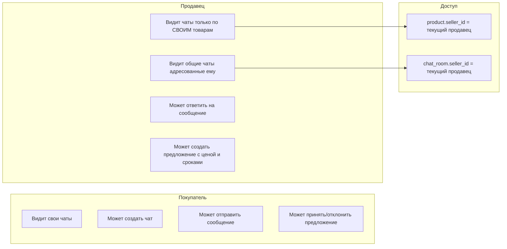
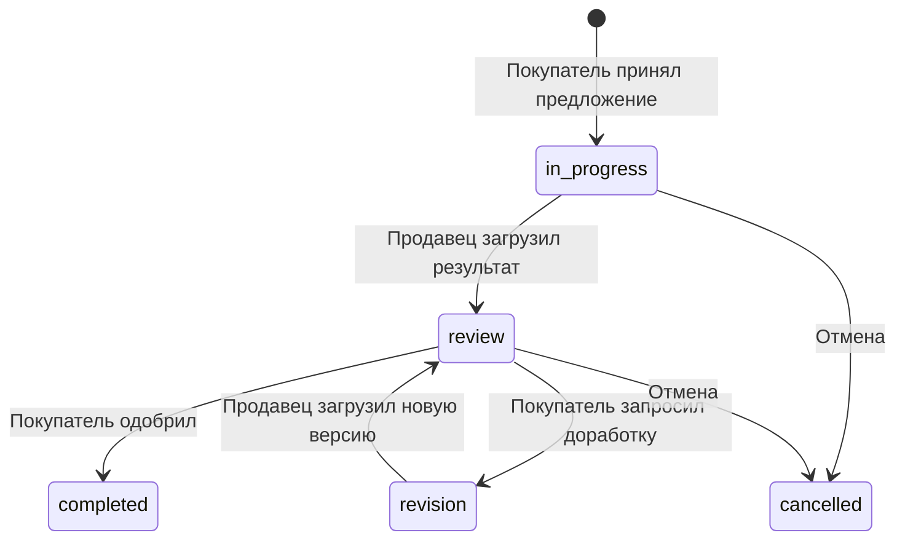
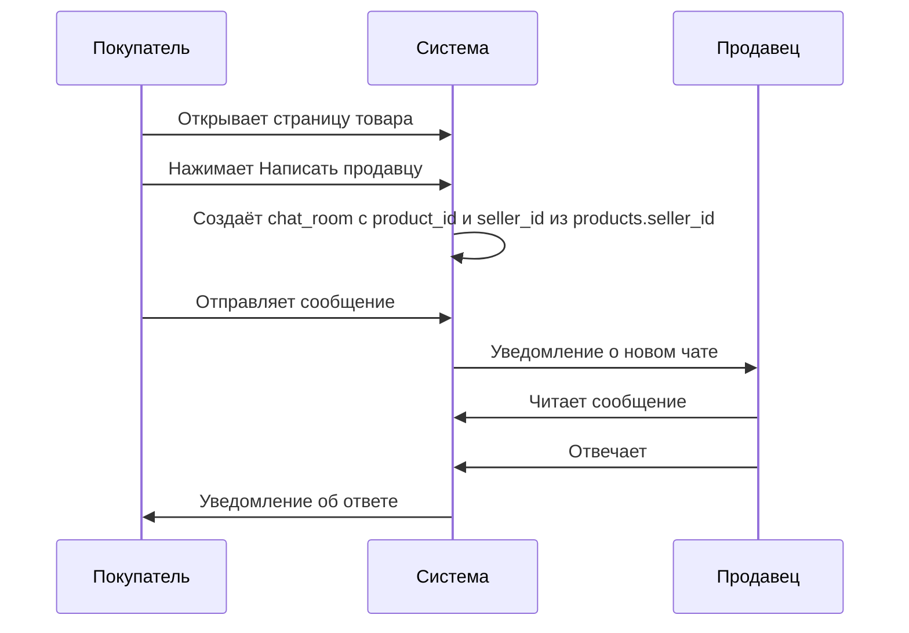
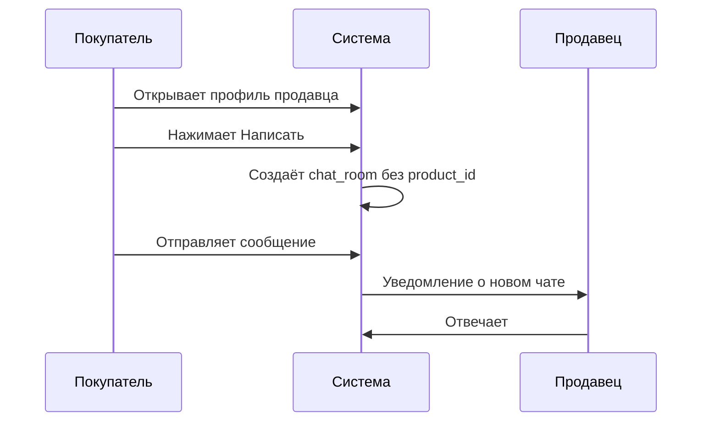
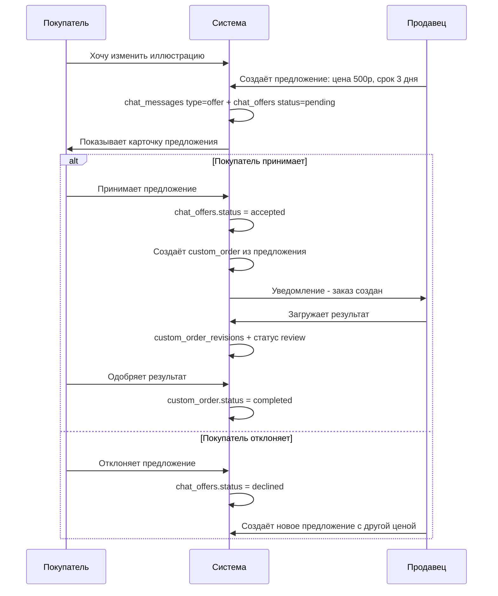

# Схема работы чатов

## Общее описание

Система чатов связывает покупателя с продавцом (художником). Чат может быть:
- **Привязан к товару** — покупатель пишет по конкретному товару
- **Без привязки к товару** — покупатель просто пишет продавцу

Из чата можно **создать заказ на кастомную работу / изменение товара** — продавец устанавливает цену и сроки.

> **Важно:** Каждый товар имеет `seller_id` — ID продавца, который его добавил. Только этот продавец видит чаты, привязанные к его товарам.

> Схема БД для чатов описана в [database-schema.md](database-schema.md) — таблицы 21-25.

---

## Диаграмма потоков

---

## Схема доступа

---

## Жизненный цикл кастомного заказа

---

## Сценарии использования

### Сценарий 1: Покупатель пишет по товару

### Сценарий 2: Покупатель пишет продавцу напрямую

### Сценарий 3: Создание заказа из чата

