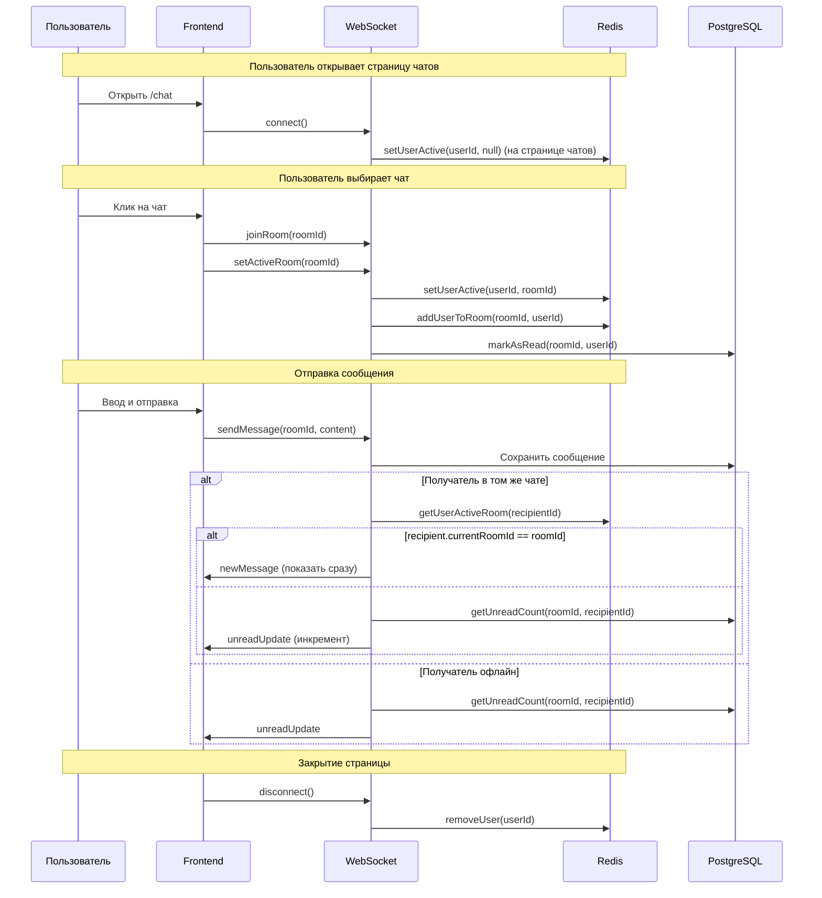

# План: Исправление отправки сообщений и реализация непрочитанных сообщений

## Анализ проблемы

### Текущее поведение (баг)
1. Пользователь открывает чат А
2. Переключается на чат Б
3. Отправляет сообщение - оно отображается в чате А (неверно)
4. Причина: нет проверки `roomId` при добавлении сообщения в локальное состояние

### Корневые причины
1. **Frontend**: Сообщение добавляется в массив `messages` без проверки `chat_room_id`
2. **Backend**: Сервер рассылает сообщение всем в комнате, но frontend не валидирует roomId
3. **Нет**: Отслеживания открытого чата, подсчёта непрочитанных, Redis-трекинга

---

## Часть 1: Backend - Redis сервис для отслеживания состояния

### 1.1 Создание Redis модуля (с поддержкой множественных вкладок)

**Файл**: `server/src/chat/services/chat-state.service.ts` (новый)

```typescript
// Поддержка множественных вкладок пользователя
// Ключ: chat:user:{userId}:active_rooms
// Тип: Redis Hash
// Поле (Field): {socketId}
// Значение (Value): {roomId}
//
// Пример:
// chat:user:123:active_rooms = {
//   'socket_abc': '5',    // вкладка 1 - чат 5
//   'socket_def': '8',    // вкладка 2 - чат 8
//   'socket_xyz': null   // вкладка 3 - страница чатов
// }
```

**Методы**:
- `setUserActiveRoom(userId: number, socketId: string, roomId: number | null)` - записать активный чат для вкладки
- `setUserInactive(userId: number, socketId: string)` - удалить вкладку
- `getUserActiveRooms(userId: number)` - получить все активные чаты пользователя (Map<socketId, roomId>)
- `getUserMainRoom(userId: number)` - получить "главный" активный чат (первый не-null)
- `getOnlineUsersInRoom(roomId: number)` - получить онлайн пользователей в чате
- `isUserOnline(userId: number)` - проверить онлайн статус (есть хотя бы одна активная вкладка)
- `onUserDisconnect(userId: number, socketId: string)` - обработка закрытия вкладки

---

### 1.2 Рефакторинг ChatGateway

**Файл**: `server/src/chat/chat.gateway.ts`

Оставить только:
- `handleConnection(client)` - аутентификация, сохранение userId + socketId в Redis
- `handleDisconnect(client)` - удаление только своей записи из Redis (по socketId)
- `joinRoom` - присоединение к комнате + обновление active room
- `leaveRoom` - покидание комнаты
- `setActiveRoom` - пользователь открыл конкретный чат (обновляет Hash)
- `clearActiveRoom` - пользователь закрыл чат (но остался на странице)

**Важно**: При отправке сообщения использовать `getUserActiveRooms(userId)` чтобы определить, находится ли получатель в целевом чате.

Вынести в отдельные сервисы:
- Логика отправки сообщений → `chat-message.service.ts`
- Логика уведомлений → `chat-notification.service.ts`

---

### 1.3 Сервис сообщений

**Файл**: `server/src/chat/services/chat-message.service.ts` (новый)

```typescript
// Отвечает за:
// - sendMessage - отправка и сохранение сообщения
// - getUnreadCount - подсчёт непрочитанных
// - markAsRead - пометить прочитанными
// - getAllUnreadCounts - карта всех непрочитанных
```

**Методы**:
- `processNewMessage(roomId, senderId, content, type)` - обработать новое сообщение
- `getUnreadCountForRoom(roomId: number, userId: number)` - непрочитанные в чате
- `getAllUnreadCounts(userId: number)` - все непрочитанные для пользователя
- `markRoomAsRead(roomId: number, userId: number)` - пометить чат прочитанным

---

### 1.4 Сервис уведомлений

**Файл**: `server/src/chat/services/chat-notification.service.ts` (новый)

```typescript
// Отвечает за:
// - Отправка уведомлений о непрочитанных
// - Определение кому отправлять сообщение
// - Трансляция событий
```

**Методы**:
- `notifyRecipient(message, recipientId)` - отправить уведомление получателю
- `sendUnreadUpdate(userId: number, roomId: number, count: number)` - отправить счётчик
- `broadcastMessageToRoom(message, roomId)` - рассылка внутри комнаты

---

### 1.5 Рефакторинг ChatService

**Файл**: `server/src/chat/chat.service.ts`

Изменения:
- Убрать логику отправки сообщений (перенести в chat-message.service.ts)
- Добавить `getUserChatRooms` возврат `unreadCount` для каждого чата

---

### 1.6 Обновление контроллера

**Файл**: `server/src/chat/chat.controller.ts`

Новые эндпоинты:
- `GET /chat/rooms/unread` - получить все непрочитанные ({ roomId: count })
- `POST /chat/rooms/:id/read` - пометить чат прочитанным

---

## Часть 2: Frontend - ChatContext улучшения

### 2.1 Расширение типов

**Файл**: `front/src/types/chat/index.ts`

Добавить:
```typescript
export interface ChatRoom {
  // ... существующее
  unreadCount?: number;
  isOnline?: boolean;  // онлайн статус собеседника
}

// Новое: роль пользователя в чате
export type UserRoleInChat = 'buyer' | 'seller' | null;
```

---

### 2.2 Улучшение ChatContext

**Файл**: `front/src/context/chat/ChatContext.tsx`

Новое состояние:
```typescript
interface ChatContextType {
  // ... существующее
  activeRoomId: number | null;        // Какой чат сейчас открыт
  currentUserRole: UserRoleInChat;     // Роль пользователя в текущем чате
  totalUnreadCount: number;            // Общее количество непрочитанных
  onlineUsers: Set<number>;            // ID онлайн пользователей

  // Методы
  setActiveRoom: (roomId: number | null, role: UserRoleInChat) => void;
  markRoomAsRead: (roomId: number) => Promise<void>;
  refreshUnreadCounts: () => Promise<void>;
  updateOnlineUsers: (roomId: number, userIds: number[]) => void;
}
```

**Изменения в `sendMessage`**:
- Использовать `activeRoomId` для отправки
- Добавлять сообщение ТОЛЬКО если `message.chat_room_id === activeRoomId`

**Изменения в обработке `newMessage`**:
```typescript
socketClient.on('newMessage', (data: unknown) => {
  const payload = data as { message: ChatMessage };
  // Проверяем что сообщение для текущего чата
  if (payload.message.chat_room_id === activeRoomId) {
    setMessages(prev => [...prev, payload.message]);
  }
  // Иначе - инкрементируем непрочитанные
});
```

---

### 2.3 Socket клиент изменения (с поддержкой множественных вкладок)

**Файл**: `front/src/lib/socket.ts`

Новые методы:
```typescript
// Генерировать уникальный ID для каждой вкладки
getTabId(): string {
  let tabId = sessionStorage.getItem('chat_tab_id');
  if (!tabId) {
    tabId = `tab_${Date.now()}_${Math.random().toString(36).substr(2, 9)}`;
    sessionStorage.setItem('chat_tab_id', tabId);
  }
  return tabId;
}

setActiveRoom(roomId: number) {
  this.emit('setActiveRoom', { 
    roomId, 
    socketId: this.getTabId()  // передаём ID вкладки
  });
}

clearActiveRoom() {
  this.emit('clearActiveRoom', { 
    socketId: this.getTabId() 
  });
}
```

**При отправке сообщения**: сервер проверяет по всем активным вкладкам получателя (через Redis Hash).

onUnreadUpdate(callback: (data: { roomId: number; count: number }) => void) {
  this.on('unreadUpdate', callback);
}

onUsersOnline(callback: (data: { roomId: number; userIds: number[] }) => void) {
  this.on('usersOnline', callback);
}

onUserOnlineStatus(callback: (data: { userId: number; isOnline: boolean }) => void) {
  this.on('userOnlineStatus', callback);
}
```

---

### 2.4 ChatList - отображение непрочитанных

**Файл**: `front/src/components/chat/ChatList.tsx`

Уже поддерживает `unreadCount` - проверить корректность отображения

---

### 2.5 ChatWindow - отображение онлайн статуса и имени

**Файл**: `front/src/components/chat/ChatWindow.tsx`

Текущий код:
```typescript
const otherUser = room?.seller || room?.buyer;
```

Изменить на:
```typescript
// Определяем собеседника на основе роли
const otherUser = currentUserRole === 'seller' ? room?.buyer : room?.seller;

// Показываем "Чат с: {имя}" независимо от роли
{otherUser && (
  <p className="text-sm text-gray-500">
    {t('chat.chatWith')}: {otherUser.name}
    {otherUser.isOnline && <span className="text-green-500 ml-1">●</span>}
  </p>
)}
```

---

### 2.6 ChatPage интеграция

**Файл**: `front/src/app/[lang]/chat/page.tsx`

При выборе чата:
```typescript
const handleSelectRoom = useCallback((room: ChatRoom) => {
  const role = room.seller_id === user.id ? 'seller' : 'buyer';
  setSelectedRoomId(room.id);
  selectRoom(room.id, role);  // передаём роль
}, [selectRoom]);
```

При размонтировании:
```typescript
useEffect(() => {
  return () => {
    clearActiveRoom();  // покинуть текущий чат
    socketClient.disconnect();  // отключить сокет - удалит из Redis
  };
}, []);
```

---

## Часть 3: Онлайн статус (с поддержкой множественных вкладок)

### 3.1 Логика определения онлайн

Пользователь считается онлайн если:
- Есть хотя бы одна активная вкладка (запись в Redis Hash `chat:user:{userId}:active_rooms` не пуста)
- Для проверки: `isUserOnline(userId)` - возвращает true если Hash не пустой

### 3.2 Отображение в ChatWindow

```typescript
// В ChatWindow
const isOtherUserOnline = room 
  ? (currentUserRole === 'seller' ? room.buyer?.isOnline : room.seller?.isOnline)
  : false;

// Отображение
<span className={`text-sm ${isOtherUserOnline ? 'text-green-500' : 'text-gray-400'}`}>
  {isOtherUserOnline ? t('chat.online') : t('chat.offline')}
</span>
```

---

## Поток данных



---

## Детальные этапы реализации

### Этап 1: Redis сервис
- [ ] Создать `server/src/chat/services/chat-state.service.ts`
- [ ] Настроить RedisModule в `chat.module.ts`

### Этап 2: Рефакторинг Gateway
- [ ] Оставить ключевые обработчики в `chat.gateway.ts`
- [ ] Создать `server/src/chat/services/chat-message.service.ts`
- [ ] Создать `server/src/chat/services/chat-notification.service.ts`
- [ ] Обновить `chat.module.ts`

### Этап 3: ChatService и Controller
- [ ] Обновить `chat.service.ts` - возврат unreadCount
- [ ] Добавить эндпоинты в `chat.controller.ts`

### Этап 4: Frontend - Socket
- [ ] Обновить `front/src/lib/socket.ts`
- [ ] Добавить обработчики событий

### Этап 5: Frontend - ChatContext
- [ ] Расширить типы в `front/src/types/chat/index.ts`
- [ ] Обновить `ChatContext.tsx`
- [ ] Исправить логику добавления сообщений

### Этап 6: Frontend - Компоненты
- [ ] Обновить `ChatWindow.tsx` - отображение онлайн статуса
- [ ] Обновить `ChatPage.tsx` - передача роли
- [ ] Проверить `ChatList.tsx`

### Этап 7: Тестирование
- [ ] Баг: переключение между чатами
- [ ] Unread: счётчик непрочитанных
- [ ] Online: статус онлайн/офлайн
- [ ] Disconnect: очистка Redis
