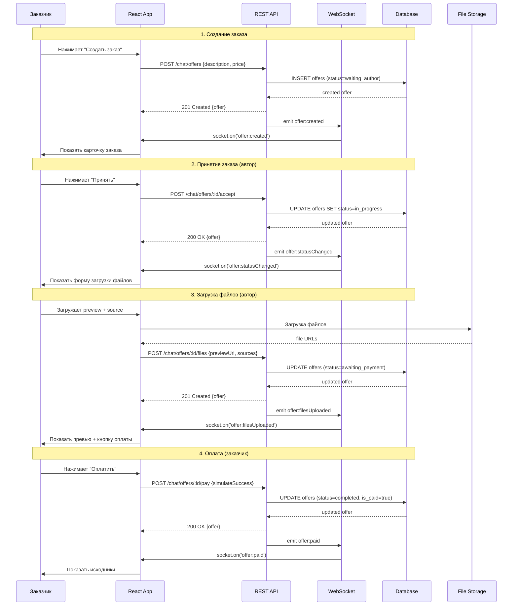

# Взаимодействие фронтенда и сервера

## Обзор взаимодействия

Система использует гибридную архитектуру коммуникации:
1. **REST API** — для создания, обновления, загрузки файлов
2. **WebSocket** — для real-time уведомлений об изменениях

---

## 1. Диаграмма взаимодействия



---

## 2. REST API точки

### Базовый URL: `/api/chat/offers`

| Метод | URL | Тело | Ответ | Описание |
|-------|-----|------|-------|----------|
| POST | `/` | `{chatRoomId, authorId, description, price}` | `{offer}` | Создать заказ |
| GET | `/:id` | — | `{offer}` | Получить заказ |
| POST | `/:id/accept` | — | `{offer}` | Принять (автор) |
| POST | `/:id/reject` | — | `{offer}` | Отклонить |
| POST | `/:id/counter` | `{newPrice}` | `{offer}` | Изменить цену (автор) |
| POST | `/:id/confirm-price` | — | `{offer}` | Подтвердить цену (заказчик) |
| POST | `/:id/files` | `{previewUrl, sourceFilesUrls[]}` | `{offer}` | Загрузить файлы |
| POST | `/:id/pay` | `{simulateSuccess?}` | `{offer}` | Оплатить |
| GET | `/:id/files` | — | `{preview_url, source_files_urls}` | Получить доступные файлы |
| GET | `/rooms/:roomId/offers` | — | `[{offer}, ...]` | Заказы комнаты |

---

## 3. WebSocket события

### Namespace: `/chat`

Подключение:
```typescript
// front/src/lib/socket.ts
import { io } from 'socket.io-client';

const socket = io('http://localhost:3001/chat', {
  auth: { token: userToken },
  transports: ['websocket'],
});
```

### События от сервера к клиенту:

| Событие | Payload | Описание |
|---------|---------|----------|
| `offer:created` | `{offer: Offer}` | Новый заказ создан |
| `offer:statusChanged` | `{offer: Offer}` | Изменён статус |
| `offer:priceChanged` | `{offer: Offer}` | Изменена цена |
| `offer:filesUploaded` | `{offer: Offer}` | Файлы загружены |
| `offer:paid` | `{offer: Offer}` | Оплата прошла |

### Подписка на комнату:

```typescript
// При открытии чата
socket.emit('joinRoom', roomId);

// При закрытии чата
socket.emit('leaveRoom', roomId);
```

---

## 4. Поток данных

### 4.1 Инициализация чата

```
1. Пользователь открывает чат /chat?roomId=123
2. Frontend:
   - Загружает историю сообщений (GET /chat/rooms/123/messages)
   - Загружает заказы (GET /chat/offers/rooms/123/offers)
   - Подключается к WebSocket комнате
3. Server возвращает данные + подписывает на events
```

### 4.2 Создание заказа (из чата)

```
1. Пользователь нажимает "Создать заказ"
2. Открывается модалка CreateOrderModal
3. Пользователь заполняет форму
4. При сабмите: POST /chat/offers
5. Сервер:
   - Валидирует данные
   - Создаёт запись в БД
   - Отправляет WebSocket в комнату
6. Frontend:
   - Получает ответ
   - Закрывает модалку
   - Добавляет заказ в список (через socket event или рефреш)
```

### 4.3 Обновление статуса (через WebSocket)

```
1. Автор нажимает "Принять"
2. POST /chat/offers/:id/accept
3. Сервер обновляет статус в БД
4. Сервер отправляет socket event 'offer:statusChanged'
5. Все клиенты комнаты:
   - Обновляют локальное состояние
   - Перерисовывают UI
```

---

## 5. Обработка ошибок

### Типы ошибок и реакция:

| Код | Сообщение | Реакция UI |
|-----|-----------|------------|
| 400 | Validation failed | Показать ошибки полей |
| 401 | Unauthorized | Редирект на логин |
| 403 | Forbidden (not your offer) | Показать toast "Нет доступа" |
| 404 | Offer not found | Показать "Заказ не найден" |
| 409 | Invalid status transition | Показать toast с причиной |
| 500 | Server error | Показать "Ошибка сервера" |

### Пример обработки:

```typescript
// front/src/components/chat/CreateOrderModal.tsx

const handleSubmit = async (data: CreateOfferData) => {
  try {
    setIsLoading(true);
    await offerApi.create(data);
    toast.success('Заказ создан');
    onClose();
    onSuccess?.();
  } catch (error: any) {
    if (error.response?.status === 400) {
      // Валидация
      setErrors(error.response.data);
    } else if (error.response?.status === 403) {
      toast.error('Нет доступа к этому пользователю');
    } else {
      toast.error('Ошибка при создании заказа');
    }
  } finally {
    setIsLoading(false);
  }
};
```

---

## 6. Optimistic Updates

Для улучшения UX используем оптимистичные обновления:

```typescript
// При нажатии "Принять"
const handleAccept = async () => {
  // 1. Сразу обновляем UI (optimistic)
  setOffers(prev => prev.map(o => 
    o.id === offer.id ? { ...o, status: OfferStatus.IN_PROGRESS } : o
  ));

  try {
    // 2. Делаем запрос
    await offerApi.accept(offer.id);
    // 3. Подтверждаем (socket получит event)
  } catch (error) {
    // 4. Откатываем UI при ошибке
    setOffers(prev => prev.map(o => 
      o.id === offer.id ? { ...o, status: offer.status } : o
    ));
    toast.error('Не удалось принять заказ');
  }
};
```

---

## 7. Защита файлов

### Схема доступа:

```
                    GET /chat/offers/:id/files
                           │
                           ▼
                    ┌──────────────┐
                    │  Проверка    │
                    │  авторизации │
                    └──────────────┘
                           │
              ┌────────────┴────────────┐
              │                         │
              ▼                         ▼
        user = creator            user = author
        OR user = author          OR user = author
              │                         │
      ┌──────┴──────┐           ┌──────┴──────┐
      ▼             ▼           ▼             ▼
  status in       is_paid    status in      status in
  [awaiting_     = true      [awaiting_     [waiting_,
  payment,       AND         payment,        waiting_user]
  completed]     status=     completed]
                 completed
      │             │             │             │
      ▼             ▼             ▼             ▼
  preview_url   all files    preview_url    403
  returned      returned     returned      Forbidden
```

### Реализация на фронтенде:

```typescript
// front/src/components/chat/ProtectedFilesViewer.tsx

useEffect(() => {
  async function loadFiles() {
    try {
      const files = await offerApi.getFiles(offerId);
      setPreview(files.preview_url);
      
      if (files.source_files_urls) {
        // Есть доступ к исходникам
        setSources(files.source_files_urls);
      } else {
        // Нет доступа - показать блок
        setLocked(true);
      }
    } catch (error) {
      if (error.status === 403) {
        setLocked(true);
      }
    }
  }
  
  loadFiles();
}, [offerId]);

// Рендер
return (
  <div>
    {preview && }
    
    {locked && (
      <div className="locked-overlay">
        <span>🔒 {t('chat.filesBlocked')}</span>
      </div>
    )}
    
    {sources && (
      <div className="source-files">
        {sources.map(url => (
          <a href={url} download>Скачать</a>
        ))}
      </div>
    )}
  </div>
);
```

---

## 8. Полифилы и Fallback

### Если WebSocket недоступен:

```typescript
// front/src/lib/socket.ts

import { io } from 'socket.io-client';

export function createSocket(token: string) {
  const socket = io('http://localhost:3001/chat', {
    auth: { token },
    transports: ['websocket', 'polling'], // Fallback на polling
    reconnection: true,
    reconnectionAttempts: 5,
    reconnectionDelay: 1000,
  });

  socket.on('connect_error', (error) => {
    console.error('Socket connection error:', error);
    // Показываем warning пользователю
    toast.warning('Нет real-time обновлений, используйте polling');
  });

  return socket;
}
```

### Polling fallback:

```typescript
// Если socket не работает - периодически опрашиваем API
useEffect(() => {
  if (!socket?.connected) {
    const interval = setInterval(async () => {
      const offers = await offerApi.getByRoom(roomId);
      setOffers(offers);
    }, 10000); // Каждые 10 секунд

    return () => clearInterval(interval);
  }
}, [socket?.connected, roomId]);
```

---

## 9. Кэширование

### Client-side кэш:

```typescript
// React Query / SWR для кэширования API ответов
// front/src/lib/queryClient.ts

import { QueryClient } from '@tanstack/react-query';

export const queryClient = new QueryClient({
  defaultOptions: {
    queries: {
      staleTime: 5000, // 5 секунд
      refetchOnWindowFocus: false,
    },
  },
});

// Использование:
// const { data } = useQuery(['offer', id], () => offerApi.get(id));
```

### Инвалидация:

```typescript
// После успешного socket event
socket.on('offer:statusChanged', ({ offer }) => {
  // Обновить кэш
  queryClient.setQueryData(['offer', offer.id], offer);
});
```

---

## 10. Сводная таблица интеграции

| Компонент | Фронтенд | Сервер | Протокол |
|-----------|----------|--------|----------|
| Создание заказа | CreateOrderModal | POST /offers | REST |
| Принятие заказа | OfferCard (кнопка) | POST /offers/:id/accept | REST + WS |
| Загрузка файлов | FileUploadForm | POST /offers/:id/files | REST |
| Оплата | PaymentButton | POST /offers/:id/pay | REST + WS |
| Просмотр файлов | ProtectedFilesViewer | GET /offers/:id/files | REST |
| Real-time updates | useSocket + hooks | chat.gateway.ts | WebSocket |

---

## 11. Checklist интеграции

### Серверная часть:
- [ ] Создать модель Offer
- [ ] Создать OfferRepository
- [ ] Создать OfferService
- [ ] Создать ChatOffersController
- [ ] Обновить ChatModule
- [ ] Обновить ChatGateway (новые events)
- [ ] Написать миграцию БД

### Клиентская часть:
- [ ] Добавить типы Offer, OfferStatus
- [ ] Создать api-offer.ts
- [ ] Создать компоненты (CreateOrderModal, OrderCard, FileUploadForm, PaymentButton, ProtectedFilesViewer)
- [ ] Создать хуки (useOffer, useOffers)
- [ ] Обновить ChatWindow для показа заказов
- [ ] Добавить i18n строки

### Интеграция:
- [ ] Протестировать создание заказа
- [ ] Протестировать переходы статусов
- [ ] Протестировать загрузку файлов
- [ ] Протестировать оплату
- [ ] Протестировать WebSocket events
- [ ] Протестировать защиту файлов