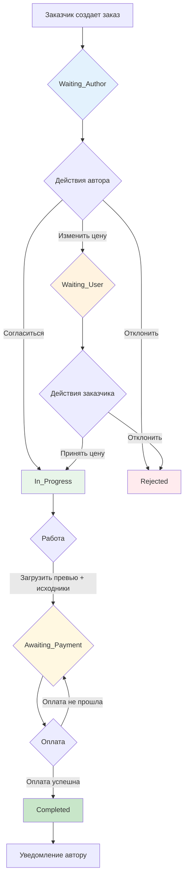

# Архитектура системы заказов на редактирование в чате

## Версия 2.0 — С защитой интеллектуальной собственности

---

## 1. Состояния (States)

Система использует 6 ключевых статусов:

| Статус | Описание | Кто создал |
|--------|----------|------------|
| `Waiting_Author` | Заказ создан, ожидает реакции автора | Заказчик |
| `Waiting_User` | Автор изменил цену, ожидает подтверждения заказчика | Автор |
| `Rejected` | Заказ отклонён одной из сторон | Любой |
| `In_Progress` | Цена согласована, работа началась | Система |
| `Awaiting_Payment` | Результат готов, ожидание оплаты | Автор (после загрузки файлов) |
| `Completed` | Оплата получена, исходники выданы | Система (после оплаты) |

---

## 2. Диаграмма переходов состояний (State Machine)



---

## 3. Схема БД (Таблица Offers)

### Таблица `offers`

| Колонка | Тип | Обязательно | Описание |
|---------|-----|-------------|----------|
| `id` | INTEGER | Да | Primary Key, Auto Increment |
| `chat_room_id` | INTEGER | Да | Связь с чатом |
| `creator_id` | INTEGER | Да | ID заказчика (создателя) |
| `author_id` | INTEGER | Да | ID автора (исполнителя) |
| `description` | TEXT | Да | Описание заказа |
| `price` | DECIMAL(10,2) | Да | Предложенная цена |
| `original_price` | DECIMAL(10,2) | Нет | Исходная цена (если была изменена) |
| `status` | ENUM | Да | Статус: waiting_author, waiting_user, rejected, in_progress, awaiting_payment, completed |
| `preview_url` | VARCHAR(500) | Нет | Ссылка на превью (картинка с водяным знаком/низкое качество) |
| `source_files_urls` | JSON | Нет | Массив защищённых ссылок на исходники |
| `is_paid` | BOOLEAN | Нет | Флаг оплаты (по умолчанию false) |
| `paid_at` | DATETIME | Нет | Дата оплаты |
| `created_at` | DATETIME | Да | Дата создания |
| `updated_at` | DATETIME | Да | Дата обновления |

---

## 4. Логика работы с файлами и защита ссылок

### Загрузка файлов (Автор в статусе In_Progress)

1. Автор нажимает «Загрузить результат»
2. Форма загрузки с **двумя полями**:
   - «Загрузить превью» — картинка (водяной знак / низкое качество)
   - «Загрузить исходники» — архив или файлы (защищённые)
3. После загрузки:
   - `preview_url` сохраняется как обычная ссылка
   - `source_files_urls` сохраняется как JSON массив защищённых ссылок
4. Статус переходит в `Awaiting_Payment`

### Серверная проверка доступа к файлам

```typescript
// Псевдокод проверки в контроллере
async function getOrderFiles(orderId: number, userId: number) {
  const order = await findOrder(orderId);
  
  // 1. Превью доступно всегда в статусе Awaiting_Payment и Completed
  if (order.status === 'awaiting_payment' || order.status === 'completed') {
    return { preview_url: order.preview_url };
  }
  
  // 2. Исходники доступны ТОЛЬКО при completed И is_paid = true
  if (order.status === 'completed' && order.is_paid === true) {
    return { source_files_urls: order.source_files_urls };
  }
  
  // 3. Во всех остальных случаях — 403 Forbidden
  throw new ForbiddenException('Files not available until payment');
}
```

### Логика защиты исходников

1. **Хранение**: Исходники хранятся в защищённом хранилище (private bucket)
2. **Доступ**: Генерируются временные signed URLs только после проверки условий
3. **Скрытие**: При GET /offers/:id/files исходники возвращаются только если:
   - `status === 'completed'` 
   - `is_paid === true`
4. **Превью**: Отображается всегда (даже с водяным знаком) для мотивации оплаты

---

## 5. Интерфейс кнопок по статусам

### Статус: Waiting_Author (Ожидание автора)

**Заказчик:**
- Описание, цена
- Кнопка «Отменить заказ» → Rejected

**Автор:**
- Описание, цена
- Кнопка «Принять» → In_Progress
- Кнопка «Отклонить» → Rejected
- Кнопка «Изменить цену» → Waiting_User

### Статус: Waiting_User (Ожидание подтверждения цены)

**Заказчик:**
- Описание, старая/новая цена
- Кнопка «Принять цену» → In_Progress
- Кнопка «Отклонить» → Rejected

**Автор:**
- Информация «Ожидается подтверждение»
- Кнопка «Отозвать предложение» → Waiting_Author

### Статус: In_Progress (В работе)

**Заказчик:**
- Описание, согласованная цена
- Кнопки: нет (только просмотр чата)

**Автор:**
- Описание, согласованная цена
- **Форма загрузки:**
  - Поле «Загрузить превью» (картинка)
  - Поле «Загрузить исходники» (архив/файлы)
  - Кнопка «Загрузить результат» → Awaiting_Payment

### Статус: Awaiting_Payment (Ожидание оплаты)

**Заказчик:**
- **Превью** (размытое или с водяным знаком) — видно
- **Исходники** — скрыты, показ «Заблокировано до оплаты»
- **Кнопка «Оплатить заказ»** → инициирует оплату
- Информация о сумме

**Автор:**
- Информация «Ожидание оплаты»
- Кнопка «Отменить заказ» → Rejected

### Статус: Completed (Завершён — после оплаты)

**Заказчик:**
- Превью (полное качество)
- **Исходники доступны** — кнопка «Скачать все»
- Статус «Оплачено» (зелёная метка)
- Дата оплаты

**Автор:**
- Уведомление «Оплата прошла, работа завершена»
- Статус «Завершён»

---

## 6. API Endpoints (обновлённые)

| Метод | Путь | Описание |
|-------|------|----------|
| POST | `/chat/offers` | Создать заказ |
| GET | `/chat/offers/:id` | Получить заказ (без исходников) |
| PUT | `/chat/offers/:id/accept` | Автор принимает |
| PUT | `/chat/offers/:id/reject` | Отклонить |
| PUT | `/chat/offers/:id/counter` | Автор предлагает новую цену |
| PUT | `/chat/offers/:id/confirm-price` | Заказчик подтверждает цену |
| POST | `/chat/offers/:id/files` | Автор загружает превью + исходники |
| POST | `/chat/offers/:id/pay` | Оплатить заказ (имитация/эквайринг) |
| GET | `/chat/offers/:id/files` | Получить ссылки на файлы |
| GET | `/chat/rooms/:roomId/offers` | Все заказы в чате |

### Особенности API `/pay`:

```typescript
// POST /chat/offers/:id/pay
// Тело: { paymentMethodId?: string } // для реального эквайринга
// Ответ: { success: true, order: UpdatedOrder }

// Логика:
// 1. Проверить что status === 'awaiting_payment'
// 2. Проверить что пользователь = creator_id
// 3. Вызвать платёжный провайдер (имитация или Stripe/ЮKassa)
// 4. При success: update is_paid = true, status = 'completed', paid_at = now()
// 5. Вернуть обновлённый заказ
```

---

## 7. Frontend компоненты

### Изменённые/новые компоненты:

1. **OrderCreationModal** — создание заказа (без изменений)

2. **FileUploadForm** — форма загрузки с двумя полями:
   - Input type="file" accept="image/*" → превью
   - Input type="file" (архивы, документы) → исходники
   - Валидация: оба поля обязательны

3. **OrderCard** — карточка с защищённым контентом:
   - В Awaiting_Payment: превью размыто через CSS filter blur(10px)
   - Баннер «Заблокировано до оплаты» поверх исходников
   - Кнопка «Оплатить заказ» (яркая, привлекающая внимание)

4. **PaymentModal** — модальное окно оплаты:
   - Показ суммы, превью работы
   - Кнопка «Оплатить» (имитация или перенаправление на платёжную систему)

---

## 8. WebSocket события

| Событие | Описание |
|---------|----------|
| `order:created` | Новый заказ |
| `order:statusChanged` | Изменение статуса |
| `order:priceChanged` | Изменение цены |
| `order:filesUploaded` | Файлы загружены (переход в Awaiting_Payment) |
| `order:paid` | Оплата прошла (переход в Completed) |

---

## 9. Автоматизация процессов

### Что изменилось:

1. **Убрано ручное подтверждение**: Заказчик больше не нажимает «Подтвердить完成»
2. **Автоматический переход в Completed**: Только после факта оплаты (is_paid = true)
3. **Уведомления**:
   - При переходе в Awaiting_Payment → уведомление заказчику
   - При successful payment → уведомление автору

### Пример flow:

```
1. Автор загружает preview + source_files
2. Status: waiting_payment -> awaiting_payment
3. WS: order:filesUploaded
4. Заказчик видит превью + кнопку "Оплатить"
5. Заказчик нажимает "Оплатить"
6. API /pay -> проверка -> is_paid = true, status = completed
7. WS: order:paid
8. Заказчик видит исходники, автор получает уведомление
```

---

## 10. Миграция с существующей системы

Удаляемые таблицы:
- `chat_offers`
- `custom_orders`  
- `custom_order_revisions`

Новая таблица:
- `offers` (с расширенными полями для защиты IP)

---

## 11. Безопасность и защита

### Меры защиты авторского контента:

1. **Разделение контента**: Превью (публичное) vs Исходники (приватные)
2. **Серверная валидация**: Проверка is_paid перед выдачей ссылок
3. **Временные ссылки**: Source files URLs — signed URLs с TTL
4. **Водяной знак**: При загрузке превью автоматически добавляется watermark
5. **Логирование**: Запись попыток доступа к защищённым файлам