# Схема базы данных — Магазин цифровых товаров

## ER-диаграмма

```mermaid
erDiagram
    users {
        INTEGER id PK "AUTO_INCREMENT"
        VARCHAR_255 email UK "NOT NULL"
        VARCHAR_255 password_hash "NOT NULL"
        VARCHAR_255 name "NOT NULL"
        VARCHAR_500 avatar_url "NULL"
        ENUM role "admin или user, DEFAULT user"
        VARCHAR_5 locale "ru или en, DEFAULT ru"
        TIMESTAMP created_at "DEFAULT NOW"
        TIMESTAMP updated_at "DEFAULT NOW"
    }

    products {
        INTEGER id PK "AUTO_INCREMENT"
        INTEGER seller_id FK "NOT NULL -> users.id"
        ENUM type "brush или illustration, NOT NULL"
        VARCHAR_500 file_url "NOT NULL, ссылка на скачивание"
        BOOLEAN is_active "DEFAULT true"
        TIMESTAMP created_at "DEFAULT NOW"
        TIMESTAMP updated_at "DEFAULT NOW"
    }

    product_media {
        INTEGER id PK "AUTO_INCREMENT"
        INTEGER product_id FK "NOT NULL -> products.id"
        ENUM media_type "image или video, NOT NULL"
        VARCHAR_500 url "NOT NULL"
        INTEGER sort_order "DEFAULT 0"
        BOOLEAN is_cover "DEFAULT false"
    }

    product_translations {
        INTEGER id PK "AUTO_INCREMENT"
        INTEGER product_id FK "NOT NULL -> products.id"
        VARCHAR_5 locale "ru или en, NOT NULL"
        VARCHAR_255 title "NOT NULL"
        TEXT description "NULL"
    }

    license_types {
        INTEGER id PK "AUTO_INCREMENT"
        VARCHAR_50 slug UK "individual/commercial/extended"
    }

    license_type_translations {
        INTEGER id PK "AUTO_INCREMENT"
        INTEGER license_type_id FK "NOT NULL -> license_types.id"
        VARCHAR_5 locale "ru или en, NOT NULL"
        VARCHAR_255 name "NOT NULL"
        TEXT description "NULL"
    }

    product_licenses {
        INTEGER id PK "AUTO_INCREMENT"
        INTEGER product_id FK "NOT NULL -> products.id"
        INTEGER license_type_id FK "NOT NULL -> license_types.id"
        DECIMAL_10_2 price "NOT NULL"
    }

    categories {
        INTEGER id PK "AUTO_INCREMENT"
        TIMESTAMP created_at "DEFAULT NOW"
    }

    category_translations {
        INTEGER id PK "AUTO_INCREMENT"
        INTEGER category_id FK "NOT NULL -> categories.id"
        VARCHAR_5 locale "ru или en, NOT NULL"
        VARCHAR_255 name "NOT NULL"
    }

    product_categories {
        INTEGER product_id FK "NOT NULL -> products.id"
        INTEGER category_id FK "NOT NULL -> categories.id"
    }

    cart_items {
        INTEGER id PK "AUTO_INCREMENT"
        INTEGER user_id FK "NOT NULL -> users.id"
        INTEGER product_license_id FK "NOT NULL -> product_licenses.id"
        TIMESTAMP created_at "DEFAULT NOW"
    }

    orders {
        INTEGER id PK "AUTO_INCREMENT"
        INTEGER user_id FK "NULL -> users.id"
        VARCHAR_255 guest_email "NULL"
        DECIMAL_10_2 total_amount "NOT NULL"
        DECIMAL_10_2 discount_amount "DEFAULT 0"
        ENUM status "pending/paid/completed/cancelled"
        INTEGER promo_code_id FK "NULL -> promo_codes.id"
        TIMESTAMP created_at "DEFAULT NOW"
        TIMESTAMP updated_at "DEFAULT NOW"
    }

    order_items {
        INTEGER id PK "AUTO_INCREMENT"
        INTEGER order_id FK "NOT NULL -> orders.id"
        INTEGER product_license_id FK "NOT NULL -> product_licenses.id"
        DECIMAL_10_2 price_at_purchase "NOT NULL"
    }

    promo_codes {
        INTEGER id PK "AUTO_INCREMENT"
        VARCHAR_50 code UK "NOT NULL"
        ENUM discount_type "percent или fixed, NOT NULL"
        DECIMAL_10_2 discount_value "NOT NULL"
        INTEGER max_uses "NULL = безлимит"
        INTEGER current_uses "DEFAULT 0"
        TIMESTAMP valid_from "NOT NULL"
        TIMESTAMP valid_until "NOT NULL"
        BOOLEAN is_active "DEFAULT true"
    }

    promo_code_usages {
        INTEGER id PK "AUTO_INCREMENT"
        INTEGER promo_code_id FK "NOT NULL -> promo_codes.id"
        INTEGER order_id FK "NOT NULL -> orders.id"
        INTEGER user_id FK "NULL -> users.id"
        TIMESTAMP used_at "DEFAULT NOW"
    }

    payments {
        INTEGER id PK "AUTO_INCREMENT"
        INTEGER order_id FK "NOT NULL -> orders.id"
        VARCHAR_50 provider "stripe/yookassa"
        VARCHAR_255 provider_payment_id "NOT NULL"
        DECIMAL_10_2 amount "NOT NULL"
        ENUM status "pending/success/failed"
        TIMESTAMP created_at "DEFAULT NOW"
    }

    user_products {
        INTEGER id PK "AUTO_INCREMENT"
        INTEGER user_id FK "NOT NULL -> users.id"
        INTEGER product_license_id FK "NOT NULL -> product_licenses.id"
        INTEGER order_id FK "NOT NULL -> orders.id"
        TIMESTAMP purchased_at "DEFAULT NOW"
    }

    chat_rooms {
        INTEGER id PK "AUTO_INCREMENT"
        INTEGER buyer_id FK "NOT NULL -> users.id"
        INTEGER seller_id FK "NOT NULL -> users.id"
        INTEGER product_id FK "NULL -> products.id"
        ENUM status "open/closed, DEFAULT open"
        TIMESTAMP last_message_at "NULL"
        TIMESTAMP created_at "DEFAULT NOW"
        TIMESTAMP updated_at "DEFAULT NOW"
    }

    chat_messages {
        INTEGER id PK "AUTO_INCREMENT"
        INTEGER chat_room_id FK "NOT NULL -> chat_rooms.id"
        INTEGER sender_id FK "NOT NULL -> users.id"
        ENUM message_type "text/image/file/offer"
        TEXT message "NULL"
        VARCHAR_500 attachment_url "NULL"
        BOOLEAN is_read "DEFAULT false"
        TIMESTAMP created_at "DEFAULT NOW"
    }

    chat_offers {
        INTEGER id PK "AUTO_INCREMENT"
        INTEGER chat_room_id FK "NOT NULL -> chat_rooms.id"
        INTEGER message_id FK "NOT NULL -> chat_messages.id"
        INTEGER seller_id FK "NOT NULL -> users.id"
        TEXT description "NOT NULL, описание работы"
        DECIMAL_10_2 price "NOT NULL"
        TIMESTAMP deadline "NOT NULL, срок выполнения"
        ENUM status "pending/accepted/declined/cancelled"
        TIMESTAMP responded_at "NULL"
        TIMESTAMP created_at "DEFAULT NOW"
    }

    custom_orders {
        INTEGER id PK "AUTO_INCREMENT"
        INTEGER chat_offer_id FK "NOT NULL -> chat_offers.id"
        INTEGER buyer_id FK "NOT NULL -> users.id"
        INTEGER seller_id FK "NOT NULL -> users.id"
        INTEGER chat_room_id FK "NOT NULL -> chat_rooms.id"
        TEXT description "NOT NULL"
        DECIMAL_10_2 price "NOT NULL"
        ENUM status "in_progress/review/revision/completed/cancelled"
        TIMESTAMP deadline "NOT NULL"
        TIMESTAMP created_at "DEFAULT NOW"
        TIMESTAMP updated_at "DEFAULT NOW"
    }

    custom_order_revisions {
        INTEGER id PK "AUTO_INCREMENT"
        INTEGER custom_order_id FK "NOT NULL -> custom_orders.id"
        VARCHAR_500 file_url "NOT NULL"
        TEXT comment "NULL"
        BOOLEAN is_approved "DEFAULT false"
        TIMESTAMP created_at "DEFAULT NOW"
    }

    users ||--o{ cart_items : "имеет корзину"
    product_licenses ||--o{ cart_items : "добавлен в корзину"

    products ||--o{ product_media : "имеет медиа"
    products ||--o{ product_translations : "имеет переводы"
    products ||--o{ product_licenses : "имеет лицензии"
    license_types ||--o{ product_licenses : "тип лицензии"
    license_types ||--o{ license_type_translations : "имеет переводы"

    categories ||--o{ category_translations : "имеет переводы"
    products ||--o{ product_categories : "принадлежит категориям"
    categories ||--o{ product_categories : "содержит товары"

    users ||--o{ orders : "создаёт заказы"
    orders ||--o{ order_items : "содержит позиции"
    product_licenses ||--o{ order_items : "лицензия в заказе"
    promo_codes ||--o{ orders : "применён к заказу"
    promo_codes ||--o{ promo_code_usages : "история использований"
    orders ||--o{ promo_code_usages : "использован в заказе"
    orders ||--|| payments : "оплачивается"

    users ||--o{ user_products : "владеет товарами"
    product_licenses ||--o{ user_products : "купленная лицензия"
    orders ||--o{ user_products : "из заказа"

    products ||--o{ chat_rooms : "привязан к чату"
    users ||--o{ chat_rooms : "покупатель"
    users ||--o{ chat_rooms : "продавец"
    chat_rooms ||--o{ chat_messages : "содержит сообщения"
    users ||--o{ chat_messages : "отправитель"
    chat_rooms ||--o{ chat_offers : "предложения"
    chat_messages ||--|| chat_offers : "сообщение-предложение"
    chat_offers ||--o| custom_orders : "создаёт заказ"
    custom_orders ||--o{ custom_order_revisions : "ревизии"
```

---

## Описание таблиц

### 1. `users` — Пользователи

| Поле | Тип | Ограничения | Описание |
|------|-----|-------------|----------|
| `id` | `INTEGER` | PK, AUTO_INCREMENT | Уникальный идентификатор |
| `email` | `VARCHAR(255)` | UNIQUE, NOT NULL | Email для входа |
| `password_hash` | `VARCHAR(255)` | NOT NULL | Хешированный пароль (bcrypt) |
| `name` | `VARCHAR(255)` | NOT NULL | Имя пользователя |
| `avatar_url` | `VARCHAR(500)` | NULL | Ссылка на аватар |
| `role` | `ENUM('admin', 'user')` | DEFAULT 'user' | Роль пользователя |
| `locale` | `VARCHAR(5)` | DEFAULT 'ru' | Язык интерфейса (ru/en) |
| `created_at` | `TIMESTAMP` | DEFAULT NOW() | Дата регистрации |
| `updated_at` | `TIMESTAMP` | DEFAULT NOW() | Дата обновления |

---

### 2. `products` — Товары

| Поле | Тип | Ограничения | Описание |
|------|-----|-------------|----------|
| `id` | `INTEGER` | PK, AUTO_INCREMENT | Уникальный идентификатор |
| `seller_id` | `INTEGER` | FK -> `users.id`, NOT NULL | Продавец, добавивший товар |
| `type` | `ENUM('brush', 'illustration')` | NOT NULL | Тип товара |
| `file_url` | `VARCHAR(500)` | NOT NULL | Ссылка на файл для скачивания |
| `is_active` | `BOOLEAN` | DEFAULT true | Активен ли товар |
| `created_at` | `TIMESTAMP` | DEFAULT NOW() | Дата создания |
| `updated_at` | `TIMESTAMP` | DEFAULT NOW() | Дата обновления |

> **Примечание:** Цена убрана из `products` — она привязана к лицензии в таблице `product_licenses`.

---

### 3. `product_media` — Медиафайлы товара (галерея)

| Поле | Тип | Ограничения | Описание |
|------|-----|-------------|----------|
| `id` | `INTEGER` | PK, AUTO_INCREMENT | Уникальный идентификатор |
| `product_id` | `INTEGER` | FK -> `products.id`, NOT NULL, ON DELETE CASCADE | Товар |
| `media_type` | `ENUM('image', 'video')` | NOT NULL | Тип медиа |
| `url` | `VARCHAR(500)` | NOT NULL | Ссылка на файл |
| `sort_order` | `INTEGER` | DEFAULT 0 | Порядок отображения |
| `is_cover` | `BOOLEAN` | DEFAULT false | Является ли обложкой |

---

### 4. `product_translations` — Переводы товаров

| Поле | Тип | Ограничения | Описание |
|------|-----|-------------|----------|
| `id` | `INTEGER` | PK, AUTO_INCREMENT | Уникальный идентификатор |
| `product_id` | `INTEGER` | FK -> `products.id`, NOT NULL, ON DELETE CASCADE | Товар |
| `locale` | `VARCHAR(5)` | NOT NULL | Язык: 'ru' или 'en' |
| `title` | `VARCHAR(255)` | NOT NULL | Название товара |
| `description` | `TEXT` | NULL | Описание товара |

**UNIQUE constraint:** (`product_id`, `locale`)

---

### 5. `license_types` — Типы лицензий

| Поле | Тип | Ограничения | Описание |
|------|-----|-------------|----------|
| `id` | `INTEGER` | PK, AUTO_INCREMENT | Уникальный идентификатор |
| `slug` | `VARCHAR(50)` | UNIQUE, NOT NULL | Идентификатор: `individual`, `commercial`, `extended` |

> Три типа лицензий:
> - **individual** — индивидуальная (для личного использования)
> - **commercial** — коммерческая (для коммерческих проектов)
> - **extended** — расширенная (без ограничений)

---

### 6. `license_type_translations` — Переводы типов лицензий

| Поле | Тип | Ограничения | Описание |
|------|-----|-------------|----------|
| `id` | `INTEGER` | PK, AUTO_INCREMENT | Уникальный идентификатор |
| `license_type_id` | `INTEGER` | FK -> `license_types.id`, NOT NULL, ON DELETE CASCADE | Тип лицензии |
| `locale` | `VARCHAR(5)` | NOT NULL | Язык: 'ru' или 'en' |
| `name` | `VARCHAR(255)` | NOT NULL | Название (Индивидуальная / Individual) |
| `description` | `TEXT` | NULL | Описание условий лицензии |

**UNIQUE constraint:** (`license_type_id`, `locale`)

---

### 7. `product_licenses` — Лицензии товара (цена привязана к лицензии)

| Поле | Тип | Ограничения | Описание |
|------|-----|-------------|----------|
| `id` | `INTEGER` | PK, AUTO_INCREMENT | Уникальный идентификатор |
| `product_id` | `INTEGER` | FK -> `products.id`, NOT NULL, ON DELETE CASCADE | Товар |
| `license_type_id` | `INTEGER` | FK -> `license_types.id`, NOT NULL | Тип лицензии |
| `price` | `DECIMAL(10,2)` | NOT NULL | Цена за данную лицензию |

**UNIQUE constraint:** (`product_id`, `license_type_id`) — одна цена за каждый тип лицензии для товара

> **Пример:** Иллюстрация #1 может иметь:
> - Индивидуальная: $10
> - Коммерческая: $25
> - Расширенная: $50

---

### 8. `categories` — Категории

| Поле | Тип | Ограничения | Описание |
|------|-----|-------------|----------|
| `id` | `INTEGER` | PK, AUTO_INCREMENT | Уникальный идентификатор |
| `created_at` | `TIMESTAMP` | DEFAULT NOW() | Дата создания |

---

### 9. `category_translations` — Переводы категорий

| Поле | Тип | Ограничения | Описание |
|------|-----|-------------|----------|
| `id` | `INTEGER` | PK, AUTO_INCREMENT | Уникальный идентификатор |
| `category_id` | `INTEGER` | FK -> `categories.id`, NOT NULL, ON DELETE CASCADE | Категория |
| `locale` | `VARCHAR(5)` | NOT NULL | Язык: 'ru' или 'en' |
| `name` | `VARCHAR(255)` | NOT NULL | Название категории |

**UNIQUE constraint:** (`category_id`, `locale`)

---

### 10. `product_categories` — Связь товар-категория (M2M)

| Поле | Тип | Ограничения | Описание |
|------|-----|-------------|----------|
| `product_id` | `INTEGER` | FK -> `products.id`, ON DELETE CASCADE | Товар |
| `category_id` | `INTEGER` | FK -> `categories.id`, ON DELETE CASCADE | Категория |

**PRIMARY KEY:** (`product_id`, `category_id`)

---

### 11. `cart_items` — Корзина

| Поле | Тип | Ограничения | Описание |
|------|-----|-------------|----------|
| `id` | `INTEGER` | PK, AUTO_INCREMENT | Уникальный идентификатор |
| `user_id` | `INTEGER` | FK -> `users.id`, NOT NULL, ON DELETE CASCADE | Пользователь |
| `product_license_id` | `INTEGER` | FK -> `product_licenses.id`, NOT NULL, ON DELETE CASCADE | Лицензия на товар |
| `created_at` | `TIMESTAMP` | DEFAULT NOW() | Дата добавления |

**UNIQUE constraint:** (`user_id`, `product_license_id`) — одна лицензия в корзине один раз

> В корзину добавляется конкретная лицензия товара (не просто товар).

---

### 12. `orders` — Заказы

| Поле | Тип | Ограничения | Описание |
|------|-----|-------------|----------|
| `id` | `INTEGER` | PK, AUTO_INCREMENT | Уникальный идентификатор |
| `user_id` | `INTEGER` | FK -> `users.id`, NULL, ON DELETE SET NULL | Авторизованный пользователь (NULL для гостя) |
| `guest_email` | `VARCHAR(255)` | NULL | Email гостя (NULL для авториз. пользователя) |
| `total_amount` | `DECIMAL(10,2)` | NOT NULL | Итоговая сумма |
| `discount_amount` | `DECIMAL(10,2)` | DEFAULT 0 | Сумма скидки |
| `status` | `ENUM('pending', 'paid', 'completed', 'cancelled')` | DEFAULT 'pending' | Статус заказа |
| `promo_code_id` | `INTEGER` | FK -> `promo_codes.id`, NULL | Применённый промокод |
| `created_at` | `TIMESTAMP` | DEFAULT NOW() | Дата создания |
| `updated_at` | `TIMESTAMP` | DEFAULT NOW() | Дата обновления |

**CHECK constraint:** `user_id IS NOT NULL OR guest_email IS NOT NULL`

> **Нет поля количества** — цифровые товары покупаются по одному экземпляру лицензии.

---

### 13. `order_items` — Позиции заказа

| Поле | Тип | Ограничения | Описание |
|------|-----|-------------|----------|
| `id` | `INTEGER` | PK, AUTO_INCREMENT | Уникальный идентификатор |
| `order_id` | `INTEGER` | FK -> `orders.id`, NOT NULL, ON DELETE CASCADE | Заказ |
| `product_license_id` | `INTEGER` | FK -> `product_licenses.id`, NOT NULL | Лицензия на товар |
| `price_at_purchase` | `DECIMAL(10,2)` | NOT NULL | Цена лицензии на момент покупки |

> Хранится `product_license_id` (не `product_id`), чтобы знать какая именно лицензия была куплена.

---

### 14. `promo_codes` — Промокоды

| Поле | Тип | Ограничения | Описание |
|------|-----|-------------|----------|
| `id` | `INTEGER` | PK, AUTO_INCREMENT | Уникальный идентификатор |
| `code` | `VARCHAR(50)` | UNIQUE, NOT NULL | Код промокода |
| `discount_type` | `ENUM('percent', 'fixed')` | NOT NULL | Тип скидки |
| `discount_value` | `DECIMAL(10,2)` | NOT NULL | Значение скидки |
| `max_uses` | `INTEGER` | NULL | Макс. число использований (NULL = безлимитный) |
| `current_uses` | `INTEGER` | DEFAULT 0 | Текущее число использований |
| `valid_from` | `TIMESTAMP` | NOT NULL | Начало действия |
| `valid_until` | `TIMESTAMP` | NOT NULL | Конец действия |
| `is_active` | `BOOLEAN` | DEFAULT true | Активен ли |

> **Безлимитные промокоды:** если `max_uses = NULL` — промокод можно использовать неограниченное число раз.
> **Отслеживание использований:** `current_uses` инкрементируется при каждом использовании, детали в `promo_code_usages`.

---

### 15. `promo_code_usages` — История использований промокодов

| Поле | Тип | Ограничения | Описание |
|------|-----|-------------|----------|
| `id` | `INTEGER` | PK, AUTO_INCREMENT | Уникальный идентификатор |
| `promo_code_id` | `INTEGER` | FK -> `promo_codes.id`, NOT NULL | Промокод |
| `order_id` | `INTEGER` | FK -> `orders.id`, NOT NULL | Заказ |
| `user_id` | `INTEGER` | FK -> `users.id`, NULL | Пользователь (NULL для гостя) |
| `used_at` | `TIMESTAMP` | DEFAULT NOW() | Дата использования |

> Хранит полную историю: кто, когда и в каком заказе использовал промокод.

---

### 16. `payments` — Платежи

| Поле | Тип | Ограничения | Описание |
|------|-----|-------------|----------|
| `id` | `INTEGER` | PK, AUTO_INCREMENT | Уникальный идентификатор |
| `order_id` | `INTEGER` | FK -> `orders.id`, NOT NULL | Заказ |
| `provider` | `VARCHAR(50)` | NOT NULL | Платёжная система |
| `provider_payment_id` | `VARCHAR(255)` | NOT NULL | ID платежа в системе провайдера |
| `amount` | `DECIMAL(10,2)` | NOT NULL | Сумма платежа |
| `status` | `ENUM('pending', 'success', 'failed')` | DEFAULT 'pending' | Статус |
| `created_at` | `TIMESTAMP` | DEFAULT NOW() | Дата платежа |

---

### 17. `user_products` — Купленные товары (библиотека пользователя)

| Поле | Тип | Ограничения | Описание |
|------|-----|-------------|----------|
| `id` | `INTEGER` | PK, AUTO_INCREMENT | Уникальный идентификатор |
| `user_id` | `INTEGER` | FK -> `users.id`, NOT NULL, ON DELETE CASCADE | Владелец |
| `product_license_id` | `INTEGER` | FK -> `product_licenses.id`, NOT NULL | Купленная лицензия |
| `order_id` | `INTEGER` | FK -> `orders.id`, NOT NULL | Заказ |
| `purchased_at` | `TIMESTAMP` | DEFAULT NOW() | Дата покупки |

**UNIQUE constraint:** (`user_id`, `product_license_id`)

> В профиле пользователь видит свои товары с типом купленной лицензии.

---

### 18. `chat_rooms` — Комнаты чатов

| Поле | Тип | Ограничения | Описание |
|------|-----|-------------|----------|
| `id` | `INTEGER` | PK, AUTO_INCREMENT | Уникальный идентификатор |
| `buyer_id` | `INTEGER` | FK -> `users.id`, NOT NULL | Покупатель (инициатор чата) |
| `seller_id` | `INTEGER` | FK -> `users.id`, NOT NULL | Продавец (владелец товара или адресат) |
| `product_id` | `INTEGER` | FK -> `products.id`, NULL | Товар (NULL = общий чат без привязки к товару) |
| `status` | `ENUM('open', 'closed')` | DEFAULT 'open' | Статус чата |
| `last_message_at` | `TIMESTAMP` | NULL | Время последнего сообщения (для сортировки) |
| `created_at` | `TIMESTAMP` | DEFAULT NOW() | Дата создания |
| `updated_at` | `TIMESTAMP` | DEFAULT NOW() | Дата обновления |

**UNIQUE constraint:** (`buyer_id`, `seller_id`, `product_id`) — один чат на пару покупатель-продавец-товар

**Логика доступа:**
- **Покупатель** видит чаты где `buyer_id = текущий_пользователь`
- **Продавец** видит чаты где `seller_id = текущий_пользователь`
- Если чат привязан к товару — `seller_id` берётся из `products.seller_id`

---

### 22. `chat_messages` — Сообщения в чате

| Поле | Тип | Ограничения | Описание |
|------|-----|-------------|----------|
| `id` | `INTEGER` | PK, AUTO_INCREMENT | Уникальный идентификатор |
| `chat_room_id` | `INTEGER` | FK -> `chat_rooms.id`, NOT NULL, ON DELETE CASCADE | Комната чата |
| `sender_id` | `INTEGER` | FK -> `users.id`, NOT NULL | Отправитель (покупатель или продавец) |
| `message_type` | `ENUM('text', 'image', 'file', 'offer')` | DEFAULT 'text' | Тип сообщения |
| `message` | `TEXT` | NULL | Текст сообщения (NULL для изображений/файлов) |
| `attachment_url` | `VARCHAR(500)` | NULL | Ссылка на прикреплённый файл |
| `is_read` | `BOOLEAN` | DEFAULT false | Прочитано ли получателем |
| `created_at` | `TIMESTAMP` | DEFAULT NOW() | Дата отправки |

**Типы сообщений:**
- `text` — обычное текстовое сообщение
- `image` — изображение (url в `attachment_url`)
- `file` — файл (url в `attachment_url`)
- `offer` — предложение на кастомную работу (детали в `chat_offers`)

---

### 23. `chat_offers` — Предложения в чате (цена + сроки)

| Поле | Тип | Ограничения | Описание |
|------|-----|-------------|----------|
| `id` | `INTEGER` | PK, AUTO_INCREMENT | Уникальный идентификатор |
| `chat_room_id` | `INTEGER` | FK -> `chat_rooms.id`, NOT NULL | Чат |
| `message_id` | `INTEGER` | FK -> `chat_messages.id`, NOT NULL, UNIQUE | Сообщение типа offer |
| `seller_id` | `INTEGER` | FK -> `users.id`, NOT NULL | Продавец, создавший предложение |
| `description` | `TEXT` | NOT NULL | Описание работы |
| `price` | `DECIMAL(10,2)` | NOT NULL | Цена за работу |
| `deadline` | `TIMESTAMP` | NOT NULL | Срок выполнения |
| `status` | `ENUM('pending', 'accepted', 'declined', 'cancelled')` | DEFAULT 'pending' | Статус предложения |
| `responded_at` | `TIMESTAMP` | NULL | Дата ответа покупателя |
| `created_at` | `TIMESTAMP` | DEFAULT NOW() | Дата создания предложения |

---

### 24. `custom_orders` — Кастомные заказы (создаются из предложений)

| Поле | Тип | Ограничения | Описание |
|------|-----|-------------|----------|
| `id` | `INTEGER` | PK, AUTO_INCREMENT | Уникальный идентификатор |
| `chat_offer_id` | `INTEGER` | FK -> `chat_offers.id`, NOT NULL, UNIQUE | Принятое предложение |
| `buyer_id` | `INTEGER` | FK -> `users.id`, NOT NULL | Заказчик |
| `seller_id` | `INTEGER` | FK -> `users.id`, NOT NULL | Исполнитель-продавец |
| `chat_room_id` | `INTEGER` | FK -> `chat_rooms.id`, NOT NULL | Чат, из которого создан заказ |
| `description` | `TEXT` | NOT NULL | Описание работы (из предложения) |
| `price` | `DECIMAL(10,2)` | NOT NULL | Стоимость (из предложения) |
| `status` | `ENUM('in_progress', 'review', 'revision', 'completed', 'cancelled')` | DEFAULT 'in_progress' | Статус |
| `deadline` | `TIMESTAMP` | NOT NULL | Дедлайн (из предложения) |
| `created_at` | `TIMESTAMP` | DEFAULT NOW() | Дата создания |
| `updated_at` | `TIMESTAMP` | DEFAULT NOW() | Дата обновления |

---

### 25. `custom_order_revisions` — Ревизии кастомных заказов

| Поле | Тип | Ограничения | Описание |
|------|-----|-------------|----------|
| `id` | `INTEGER` | PK, AUTO_INCREMENT | Уникальный идентификатор |
| `custom_order_id` | `INTEGER` | FK -> `custom_orders.id`, NOT NULL, ON DELETE CASCADE | Кастомный заказ |
| `file_url` | `VARCHAR(500)` | NOT NULL | Ссылка на файл-результат |
| `comment` | `TEXT` | NULL | Комментарий продавца |
| `is_approved` | `BOOLEAN` | DEFAULT false | Одобрена ли покупателем |
| `created_at` | `TIMESTAMP` | DEFAULT NOW() | Дата загрузки |

---

## Ключевые изменения по сравнению с предыдущей версией

| Изменение | Описание |
|-----------|----------|
| **Лицензии** | Добавлены `license_types`, `license_type_translations`, `product_licenses` — цена привязана к лицензии, не к товару |
| **Медиа товара** | Добавлена `product_media` — неограниченное кол-во изображений и видео для товара |
| **Промокоды** | `max_uses = NULL` = безлимитный; добавлена `promo_code_usages` для истории использований |
| **Корзина и заказ** | Привязаны к `product_license_id` (не `product_id`) |
| **Без количества** | В `order_items` и `cart_items` нет поля `quantity` — цифровые товары по 1 шт. |

---

## Индексы (рекомендуемые)

| Таблица | Индекс | Поля |
|---------|--------|------|
| `products` | `idx_products_type` | `type` |
| `products` | `idx_products_is_active` | `is_active` |
| `product_media` | `idx_pm_product_sort` | `product_id`, `sort_order` |
| `product_translations` | `idx_pt_product_locale` | `product_id`, `locale` |
| `product_licenses` | `idx_pl_product` | `product_id` |
| `orders` | `idx_orders_user_id` | `user_id` |
| `orders` | `idx_orders_status` | `status` |
| `order_items` | `idx_oi_order_id` | `order_id` |
| `user_products` | `idx_up_user_id` | `user_id` |
| `chat_rooms` | `idx_cr_buyer` | `buyer_id` |
| `chat_rooms` | `idx_cr_seller` | `seller_id` |
| `chat_rooms` | `idx_cr_product` | `product_id` |
| `chat_rooms` | `idx_cr_last_msg` | `last_message_at` |
| `chat_messages` | `idx_cm_room_created` | `chat_room_id`, `created_at` |
| `chat_messages` | `idx_cm_sender` | `sender_id` |
| `chat_messages` | `idx_cm_unread` | `chat_room_id`, `is_read` |
| `chat_offers` | `idx_co_room` | `chat_room_id` |
| `chat_offers` | `idx_co_status` | `status` |
| `custom_orders` | `idx_cust_buyer` | `buyer_id` |
| `custom_orders` | `idx_cust_seller` | `seller_id` |
| `custom_orders` | `idx_cust_status` | `status` |
| `promo_code_usages` | `idx_pcu_promo` | `promo_code_id` |
