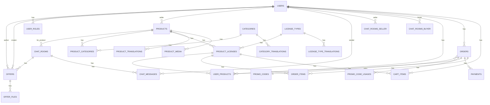

# Схема базы данных

## Обзор

Проект использует PostgreSQL с ORM Sequelize. База данных включает следующие основные сущности:

## Таблицы

### 1. users

Основная таблица пользователей.

| Колонка | Тип | Ограничения | Описание |
|---------|-----|-------------|----------|
| id | INTEGER | PK, AUTOINCREMENT | Уникальный идентификатор |
| email | VARCHAR(255) | UNIQUE, NOT NULL | Email пользователя |
| password_hash | VARCHAR(255) | NOT NULL | Хэш пароля |
| name | VARCHAR(255) | NOT NULL | Имя пользователя |
| avatar_url | VARCHAR(500) | NULL | URL аватара |
| locale | VARCHAR(5) | DEFAULT 'ru' | Язык пользователя |
| created_at | TIMESTAMP | | Дата создания |
| updated_at | TIMESTAMP | | Дата обновления |

### 2. user_roles

Роли пользователей (admin, user, author).

| Колонка | Тип | Ограничения | Описание |
|---------|-----|-------------|----------|
| id | INTEGER | PK, AUTOINCREMENT | Уникальный идентификатор |
| user_id | INTEGER | FK -> users.id, NOT NULL | Ссылка на пользователя |
| role | VARCHAR(50) | NOT NULL | Роль (admin/user/author) |
| created_at | TIMESTAMP | | Дата создания |
| updated_at | TIMESTAMP | | Дата обновления |

### 3. products

Товары продавцов.

| Колонка | Тип | Ограничения | Описание |
|---------|-----|-------------|----------|
| id | INTEGER | PK, AUTOINCREMENT | Уникальный идентификатор |
| seller_id | INTEGER | FK -> users.id, NOT NULL | ID продавца |
| type | ENUM('brush', 'illustration') | | Тип товара |
| file_url | VARCHAR(500) | NOT NULL | URL файла товара |
| price | DECIMAL(10,2) | NOT NULL, DEFAULT 0 | Цена |
| discount_price | DECIMAL(10,2) | NULL | Цена со скидкой |
| stock | INTEGER | DEFAULT 0 | Количество на складе |
| is_featured | BOOLEAN | DEFAULT false | Избранный товар |
| main_image | VARCHAR(500) | NULL | URL главного изображения |
| is_active | BOOLEAN | DEFAULT true | Активен/неактивен |
| created_at | TIMESTAMP | | Дата создания |
| updated_at | TIMESTAMP | | Дата обновления |

### 4. product_translations

Переводы товаров на разные языки.

| Колонка | Тип | Ограничения | Описание |
|---------|-----|-------------|----------|
| product_id | INTEGER | FK -> products.id, NOT NULL | Ссылка на товар |
| language | ENUM('en', 'ru') | NOT NULL | Язык перевода |
| name | VARCHAR | NOT NULL | Название товара |
| description | TEXT | NULL | Полное описание |
| shortDescription | TEXT | NULL | Краткое описание |

### 5. product_media

Медиафайлы товаров (изображения, видео).

| Колонка | Тип | Ограничения | Описание |
|---------|-----|-------------|----------|
| id | INTEGER | PK, AUTOINCREMENT | Уникальный идентификатор |
| product_id | INTEGER | FK -> products.id, NOT NULL | Ссылка на товар |
| media_type | ENUM('image', 'video') | | Тип медиа |
| url | VARCHAR(500) | NOT NULL | URL файла |
| sort_order | INTEGER | DEFAULT 0 | Порядок сортировки |
| is_cover | BOOLEAN | DEFAULT false | Является обложкой |

### 6. product_licenses

Лицензии товаров (связка товара с типом лицензии и ценой).

| Колонка | Тип | Ограничения | Описание |
|---------|-----|-------------|----------|
| id | INTEGER | PK, AUTOINCREMENT | Уникальный идентификатор |
| product_id | INTEGER | FK -> products.id, NOT NULL | Ссылка на товар |
| license_type_id | INTEGER | FK -> license_types.id, NOT NULL | Ссылка на тип лицензии |
| price | DECIMAL(10,2) | NOT NULL | Цена для данной лицензии |

### 7. categories

Категории товаров.

| Колонка | Тип | Ограничения | Описание |
|---------|-----|-------------|----------|
| id | INTEGER | PK, AUTOINCREMENT | Уникальный идентификатор |
| created_at | TIMESTAMP | | Дата создания |

### 8. category_translations

Переводы категорий.

| Колонка | Тип | Ограничения | Описание |
|---------|-----|-------------|----------|
| id | INTEGER | PK, AUTOINCREMENT | Уникальный идентификатор |
| category_id | INTEGER | FK -> categories.id, NOT NULL | Ссылка на категорию |
| locale | VARCHAR(5) | NOT NULL | Язык (ru/en) |
| name | VARCHAR(255) | NOT NULL | Название категории |

### 9. license_types

Типы лицензий.

| Колонка | Тип | Ограничения | Описание |
|---------|-----|-------------|----------|
| id | INTEGER | PK, AUTOINCREMENT | Уникальный идентификатор |
| slug | VARCHAR(50) | UNIQUE, NOT NULL | Идентификатор (individual/commercial/extended) |
| description | TEXT | NULL | Описание лицензии |

### 10. license_type_translations

Переводы типов лицензий.

| Колонка | Тип | Ограничения | Описание |
|---------|-----|-------------|----------|
| id | INTEGER | PK, AUTOINCREMENT | Уникальный идентификатор |
| license_type_id | INTEGER | FK -> license_types.id, NOT NULL | Ссылка на тип лицензии |
| locale | VARCHAR(5) | NOT NULL | Язык |
| name | VARCHAR(255) | NOT NULL | Название |
| description | TEXT | NULL | Описание |

### 11. product_categories

Связь многие-ко-многим между товарами и категориями.

| Колонка | Тип | Ограничения | Описание |
|---------|-----|-------------|----------|
| product_id | INTEGER | FK -> products.id, NOT NULL | Ссылка на товар |
| category_id | INTEGER | FK -> categories.id, NOT NULL | Ссылка на категорию |

### 12. orders

Заказы.

| Колонка | Тип | Ограничения | Описание |
|---------|-----|-------------|----------|
| id | INTEGER | PK, AUTOINCREMENT | Уникальный идентификатор |
| user_id | INTEGER | FK -> users.id, NULL | ID пользователя (может быть гость) |
| guest_email | VARCHAR(255) | NULL | Email гостя |
| total_amount | DECIMAL(10,2) | NOT NULL | Общая сумма |
| discount_amount | DECIMAL(10,2) | DEFAULT 0 | Сумма скидки |
| status | ENUM('pending','paid','completed','cancelled') | DEFAULT 'pending' | Статус заказа |
| promo_code_id | INTEGER | FK -> promo_codes.id, NULL | Применённый промокод |
| created_at | TIMESTAMP | | Дата создания |
| updated_at | TIMESTAMP | | Дата обновления |

### 13. order_items

Позиции заказа.

| Колонка | Тип | Ограничения | Описание |
|---------|-----|-------------|----------|
| id | INTEGER | PK, AUTOINCREMENT | Уникальный идентификатор |
| order_id | INTEGER | FK -> orders.id, NOT NULL | Ссылка на заказ |
| product_license_id | INTEGER | FK -> product_licenses.id, NOT NULL | Ссылка на лицензию товара |
| price_at_purchase | DECIMAL(10,2) | NOT NULL | Цена на момент покупки |
| quantity | INTEGER | DEFAULT 1 | Количество |

### 14. payments

Платежи.

| Колонка | Тип | Ограничения | Описание |
|---------|-----|-------------|----------|
| id | INTEGER | PK, AUTOINCREMENT | Уникальный идентификатор |
| order_id | INTEGER | FK -> orders.id, NOT NULL | Ссылка на заказ |
| provider | VARCHAR(50) | NOT NULL | Провайдер (stripe/yookassa) |
| provider_payment_id | VARCHAR(255) | NOT NULL | ID платежа у провайдера |
| amount | DECIMAL(10,2) | NOT NULL | Сумма платежа |
| status | ENUM('pending','success','failed') | DEFAULT 'pending' | Статус платежа |
| created_at | TIMESTAMP | | Дата создания |

### 15. user_products

Купленные пользователем товары.

| Колонка | Тип | Ограничения | Описание |
|---------|-----|-------------|----------|
| id | INTEGER | PK, AUTOINCREMENT | Уникальный идентификатор |
| user_id | INTEGER | FK -> users.id, NOT NULL | Ссылка на пользователя |
| product_license_id | INTEGER | FK -> product_licenses.id, NOT NULL | Ссылка на лицензию товара |
| order_id | INTEGER | FK -> orders.id, NOT NULL | Ссылка на заказ |
| purchased_at | DATE | | Дата покупки |
| count | INTEGER | DEFAULT 1 | Количество |

### 16. cart_items

Товары в корзине.

| Колонка | Тип | Ограничения | Описание |
|---------|-----|-------------|----------|
| id | INTEGER | PK, AUTOINCREMENT | Уникальный идентификатор |
| user_id | INTEGER | FK -> users.id, NOT NULL | Ссылка на пользователя |
| product_license_id | INTEGER | FK -> product_licenses.id, NOT NULL | Ссылка на лицензию товара |
| quantity | INTEGER | DEFAULT 1 | Количество |
| created_at | TIMESTAMP | | Дата добавления |

### 17. chat_rooms

Чаты между покупателем и продавцом.

| Колонка | Тип | Ограничения | Описание |
|---------|-----|-------------|----------|
| id | INTEGER | PK, AUTOINCREMENT | Уникальный идентификатор |
| buyer_id | INTEGER | FK -> users.id, NOT NULL | ID покупателя |
| seller_id | INTEGER | FK -> users.id, NOT NULL | ID продавца |
| product_id | INTEGER | FK -> products.id, NULL | Ссылка на товар (NULL = общий чат) |
| user_product_id | INTEGER | FK -> user_products.id, NULL | Ссылка на купленный товар |
| status | ENUM('open','closed') | DEFAULT 'open' | Статус чата |
| visibility | ENUM('pending','visible') | DEFAULT 'pending' | Видимость |
| last_message_at | DATE | NULL | Время последнего сообщения |
| created_at | TIMESTAMP | | Дата создания |
| updated_at | TIMESTAMP | | Дата обновления |

### 18. chat_messages

Сообщения в чатах.

| Колонка | Тип | Ограничения | Описание |
|---------|-----|-------------|----------|
| id | INTEGER | PK, AUTOINCREMENT | Уникальный идентификатор |
| chat_room_id | INTEGER | FK -> chat_rooms.id, NOT NULL | Ссылка на чат |
| sender_id | INTEGER | FK -> users.id, NOT NULL | ID отправителя |
| message_type | ENUM('text','image','file','offer') | DEFAULT 'text' | Тип сообщения |
| message | TEXT | NULL | Текст сообщения |
| attachment_url | VARCHAR(500) | NULL | URL вложения |
| is_read | BOOLEAN | DEFAULT false | Прочитано |
| created_at | TIMESTAMP | | Дата отправки |

### 19. offers

Предложения в чате (кастомные заказы).

| Колонка | Тип | Ограничения | Описание |
|---------|-----|-------------|----------|
| id | INTEGER | PK, AUTOINCREMENT | Уникальный идентификатор |
| chat_room_id | INTEGER | FK -> chat_rooms.id, NOT NULL | Ссылка на чат |
| creator_id | INTEGER | FK -> users.id, NOT NULL | Создатель предложения |
| author_id | INTEGER | FK -> users.id, NOT NULL | Автор (продавец) |
| description | TEXT | NOT NULL | Описание предложения |
| price | DECIMAL(10,2) | NOT NULL | Цена |
| original_price | DECIMAL(10,2) | NULL | Оригинальная цена |
| status | ENUM('waiting_author','waiting_user','rejected','in_progress','awaiting_payment','completed') | DEFAULT 'waiting_author' | Статус |
| preview_url | VARCHAR(500) | NULL | URL превью |
| source_files_urls | TEXT | NULL | JSON массив URL исходников |
| is_paid | BOOLEAN | DEFAULT false | Оплачено |
| paid_at | DATE | NULL | Дата оплаты |
| created_at | TIMESTAMP | | Дата создания |
| updated_at | TIMESTAMP | | Дата обновления |

### 20. offer_files

Файлы предложений (превью/исходники).

| Колонка | Тип | Ограничения | Описание |
|---------|-----|-------------|----------|
| id | INTEGER | PK, AUTOINCREMENT | Уникальный идентификатор |
| offer_id | INTEGER | FK -> offers.id, NOT NULL | Ссылка на предложение |
| type | ENUM('preview','source') | NOT NULL | Тип файла |
| original_name | VARCHAR(255) | NOT NULL | Оригинальное имя |
| filename | VARCHAR(255) | NOT NULL | Имя файла |
| url | VARCHAR(500) | NOT NULL | URL файла |
| size | INTEGER | NOT NULL | Размер в байтах |
| mime_type | VARCHAR(100) | | MIME тип |
| created_at | TIMESTAMP | | Дата загрузки |

### 21. promo_codes

Промокоды.

| Колонка | Тип | Ограничения | Описание |
|---------|-----|-------------|----------|
| id | INTEGER | PK, AUTOINCREMENT | Уникальный идентификатор |
| code | VARCHAR(50) | UNIQUE, NOT NULL | Код промокода |
| discount_type | ENUM('percent','fixed') | | Тип скидки |
| discount_value | DECIMAL(10,2) | NOT NULL | Значение скидки |
| max_uses | INTEGER | NULL | Максимум использований (NULL = безлимит) |
| current_uses | INTEGER | DEFAULT 0 | Текущее количество использований |
| valid_from | DATE | NOT NULL | Действителен с |
| valid_until | DATE | NOT NULL | Действителен до |
| is_active | BOOLEAN | DEFAULT true | Активен |

### 22. promo_code_usages

Использования промокодов.

| Колонка | Тип | Ограничения | Описание |
|---------|-----|-------------|----------|
| id | INTEGER | PK, AUTOINCREMENT | Уникальный идентификатор |
| promo_code_id | INTEGER | FK -> promo_codes.id, NOT NULL | Ссылка на промокод |
| order_id | INTEGER | FK -> orders.id, NOT NULL | Ссылка на заказ |
| user_id | INTEGER | FK -> users.id, NULL | Ссылка на пользователя |
| used_at | TIMESTAMP | | Дата использования |

## Индексы

### Основные индексы

- `users.email` - UNIQUE
- `license_types.slug` - UNIQUE
- `promo_codes.code` - UNINE
- `orders.user_id`
- `orders.status`
- `chat_rooms.buyer_id`
- `chat_rooms.seller_id`
- `chat_messages.chat_room_id`
- `chat_messages.created_at`

## Связи между таблицами

### Users (Пользователи)

- **user_roles** - один пользователь может иметь несколько ролей
- **products** - один пользователь может быть продавцом нескольких товаров
- **cart_items** - один пользователь имеет одну корзину
- **orders** - один пользователь может иметь несколько заказов
- **user_products** - один пользователь имеет много купленных товаров
- **chat_rooms** (buyer/seller) - участвует в чатах как покупатель или продавец
- **chat_messages** - отправляет сообщения
- **offers** - создаёт или является автором предложений

### Products (Товары)

- **product_translations** - множество переводов
- **product_media** - множество медиафайлов
- **product_licenses** - множество лицензий
- **product_categories** - множество категорий (M:N)
- **chat_rooms** - могут быть связаны с чатами

### ProductLicenses (Лицензии товаров)

- **cart_items** - используется в корзине
- **order_items** - используется в заказах
- **user_products** - предоставляется покупателю

### Orders (Заказы)

- **order_items** - содержит позиции
- **payments** - имеет платежи
- **user_products** - генерирует купленные товары
- **promo_code_usages** - может использовать промокод

### ChatRooms (Чаты)

- **chat_messages** - содержит сообщения
- **offers** - содержит предложения
