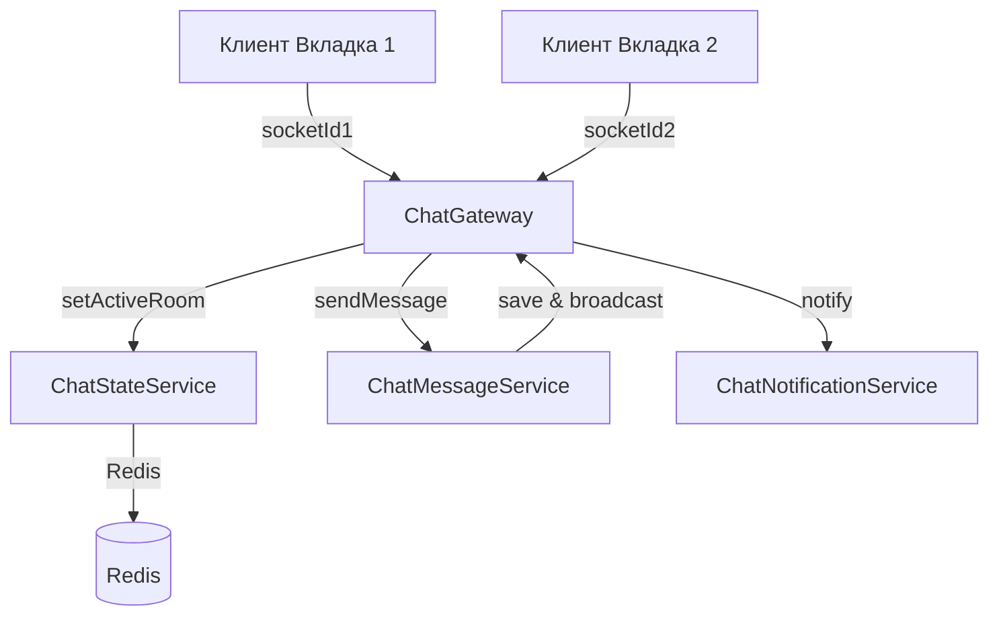

# Детальный план реализации: Этапы 1-2

## Этап 1: Redis сервис с поддержкой множественных вкладок

### Задачи:
1. **Создать RedisModule** (`server/src/redis/`)
   - redis.module.ts - основной модуль
   - redis.service.ts - сервис для работы с Redis (инициализация, подключение)
   - Интеграция с существующим redis.config.ts

2. **Создать ChatStateService** (`server/src/chat/services/chat-state.service.ts`)
   - `setUserActiveRoom(userId, socketId, roomId)` - установить активную комнату для пользователя
   - `getUserActiveRooms(userId)` - получить все активные комнаты пользователя
   - `isUserOnline(userId)` - проверить онлайн статус пользователя
   - `onUserDisconnect(userId, socketId)` - обработка отключения сокета
   - Использование Hash структуры: `chat:user:{userId}:active_rooms`
   - Хранение: socketId -> roomId mapping

3. **Интегрировать RedisModule в ChatModule**
   - Добавить импорт RedisModule в chat.module.ts
   - Добавить ChatStateService в providers

---

## Этап 2: Рефакторинг Gateway + новые сервисы

### Задачи:
1. **Создать ChatMessageService** (`server/src/chat/services/chat-message.service.ts`)
   - Перенести логику отправки сообщений из ChatGateway
   - `sendMessage(roomId, userId, content, type, attachmentUrl)` - создание и сохранение сообщения
   - `broadcastToRoom(roomId, message)` - рассылка сообщения в комнату
   - Исправить баг: добавить проверку roomId перед отправкой

2. **Создать ChatNotificationService** (`server/src/chat/services/chat-notification.service.ts`)
   - `notifyUser(userId, event, data)` - отправка уведомлений конкретному пользователю
   - `notifyRoomMembers(roomId, excludeSocketId, event, data)` - уведомление участников комнаты
   - `sendUnreadCountUpdate(userId, chatId, count)` - обновление счетчика непрочитанных

3. **Рефакторить ChatGateway** (`server/src/chat/chat.gateway.ts`)
   - Оставить только: handleConnection, handleDisconnect, joinRoom, leaveRoom
   - Добавить новые события: setActiveRoom, clearActiveRoom
   - Делегировать sendMessage в ChatMessageService
   - Делегировать уведомления в ChatNotificationService

4. **Обновить ChatModule**
   - Добавить новые сервисы в providers
   - Обновить импорты

---

## Технические детали:

### Структура Redis данных:
```
Ключ: chat:user:{userId}:active_rooms
Тип: Hash
Поле: {socketId}
Значение: {roomId}

Пример:
- socketId: "abc123" -> roomId: "5"
- socketId: "def456" -> roomId: "7"
```

### Mermaid диаграмма архитектуры:


### Новые файлы для создания:
1. `server/src/redis/redis.module.ts`
2. `server/src/redis/redis.service.ts`
3. `server/src/chat/services/chat-state.service.ts`
4. `server/src/chat/services/chat-message.service.ts`
5. `server/src/chat/services/chat-notification.service.ts`

### Файлы для модификации:
1. `server/src/chat/chat.gateway.ts` - рефакторинг
2. `server/src/chat/chat.module.ts` - добавить сервисы