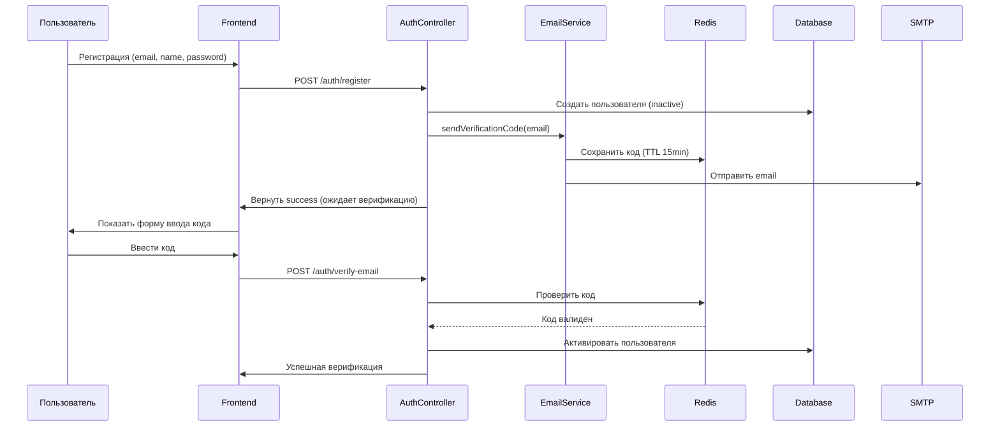
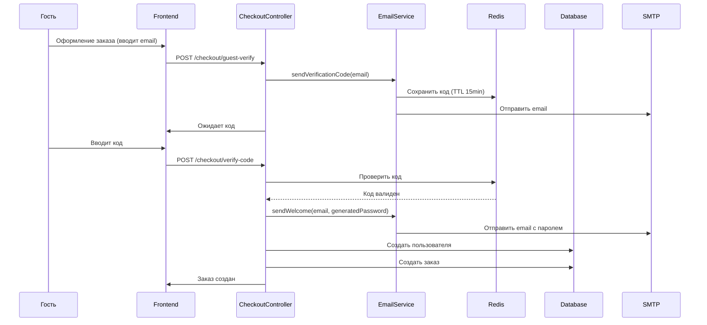

# План: Сервис отправки писем (Email Service)

## Обзор

Сервис для отправки электронных писем, используемый для:
- Регистрации новых пользователей
- Восстановления пароля
- Подтверждения email гостя при оформлении заказа
- Уведомлений о покупках

## Использование в системе

### 1. Регистрация пользователя

```
Пользователь регистрируется → Отправка письма с подтверждением → Активация аккаунта
```

### 2. Восстановление пароля

```
Пользователь забыл пароль → Ввод email → Отправка ссылки для сброса → Сброс пароля
```

### 3. Гость оформляет заказ

```
Гость вводит email → Отправка кода подтверждения → Подтверждение → Создание аккаунта с паролем на email
```

### 4. Покупка завершена

```
Оплата прошла → Отправка письма с подтверждением покупки → Данные для скачивания
```

---

## Архитектура

### Модуль Email (NestJS)

**Структура:**
```
server/src/email/
├── email.module.ts
├── email.service.ts
├── email.controller.ts
├── dto/
│   ├── send-email.dto.ts
│   ├── send-verification.dto.ts
│   └── send-password-reset.dto.ts
├── templates/
│   ├── verification-code.template.ts
│   ├── welcome.template.ts
│   ├── password-reset.template.ts
│   └── purchase-confirmation.template.ts
└── interfaces/
    ├── email-options.interface.ts
    └── email-templates.interface.ts
```

### Конфигурация

**Файл: [`server/src/config/email.config.ts`](server/src/config/email.config.ts)**

```typescript
export default registerAs('email', () => ({
  host: process.env.EMAIL_HOST || 'smtp.example.com',
  port: parseInt(process.env.EMAIL_PORT || '587', 10),
  user: process.env.EMAIL_USER || 'noreply@example.com',
  password: process.env.EMAIL_PASSWORD || '',
  from: process.env.EMAIL_FROM || 'Nadzin <noreply@example.com>',
}));
```

**Переменные окружения (.env):**
```
EMAIL_HOST=smtp.gmail.com
EMAIL_PORT=587
EMAIL_USER=your-email@gmail.com
EMAIL_PASSWORD=your-app-password
EMAIL_FROM=Nadzin <noreply@nadzinshop.com>
```

---

## Реализация

### 1. Конфигурация

**Создать:** [`server/src/config/email.config.ts`](server/src/config/email.config.ts)

**Обновить:** [`server/src/app.module.ts`](server/src/app.module.ts)
- Добавить `emailConfig` в `ConfigModule.forRoot`

### 2. Модуль Email Service

**Создать:**

- [`server/src/email/email.module.ts`](server/src/email/email.module.ts)
- [`server/src/email/email.service.ts`](server/src/email/email.service.ts)
- [`server/src/email/email.controller.ts`](server/src/email/email.controller.ts)

**Интерфейс EmailService:**

```typescript
interface IEmailService {
  sendEmail(to: string, subject: string, html: string): Promise<void>;
  sendVerificationCode(email: string, code: string): Promise<void>;
  sendPasswordReset(email: string, resetLink: string): Promise<void>;
  sendWelcome(email: string, password: string): Promise<void>;
  sendPurchaseConfirmation(email: string, orderDetails: OrderDetails): Promise<void>;
}
```

### 3. Шаблоны писем

**Создать:**

- [`server/src/email/templates/verification-code.template.ts`](server/src/email/templates/verification-code.template.ts)
- [`server/src/email/templates/welcome.template.ts`](server/src/email/templates/welcome.template.ts)
- [`server/src/email/templates/password-reset.template.ts`](server/src/email/templates/password-reset.template.ts)
- [`server/src/email/templates/purchase-confirmation.template.ts`](server/src/email/templates/purchase-confirmation.template.ts)

**Пример шаблона (verification-code):**
```html
<!DOCTYPE html>
<html>
<head>
  <style>
    body { font-family: Arial, sans-serif; }
    .code { font-size: 24px; font-weight: bold; color: #007bff; }
  </style>
</head>
<body>
  <h2>Подтверждение email</h2>
  <p>Ваш код подтверждения: <span class="code">{{code}}</span></p>
  <p>Код действителен в течение 15 минут.</p>
</body>
</html>
```

### 4. Интеграция с Auth модулем

**Обновить:** [`server/src/auth/auth.service.ts`](server/src/auth/auth.service.ts)
- После регистрации вызывать `emailService.sendWelcome()`
- При восстановлении пароля вызывать `emailService.sendPasswordReset()`

### 5. Интеграция с Checkout

**Обновить:** [`server/src/checkout/checkout.service.ts`](server/src/checkout/checkout.service.ts)
- При подтверждении email гостя вызывать `emailService.sendVerificationCode()`
- После успешной оплаты вызывать `emailService.sendPurchaseConfirmation()`

### 6. Хранение кодов в Redis

**Ключи Redis:**

```
Key: verification:{email}
Value: { code: string, expiresAt: Date }
TTL: 15 минут

Key: password_reset:{email}
Value: { token: string, expiresAt: Date }
TTL: 1 час
```

---

## API Endpoints (вспомогательные)

| Метод | Путь | Описание |
|-------|------|----------|
| POST | `/email/send-verification` | Отправить код подтверждения |
| POST | `/email/verify-code` | Проверить код подтверждения |
| POST | `/email/resend-verification` | Переотправить код |

---

## Диаграмма потока (Регистрация)



---

## Диаграмма потока (Гость оформляет заказ)



---

## Зависимости

### NPM пакеты

```bash
npm install @nestjs-modules/mailer nodemailer
npm install @types/nodemailer --save-dev
```

**Обновить:** [`server/package.json`](server/package.json)

---

## Следующие шаги

1. Создать конфигурацию email
2. Установить зависимости (nodemailer)
3. Создать EmailModule
4. Создать шаблоны писем
5. Интегрировать с AuthModule
6. Интегрировать с CheckoutModule

---

*Связанный план: [Cart and Purchases Plan](cart-and-purchases-plan.md)*
*Примечание: Требует настройки SMTP сервера для реальной отправки писем*