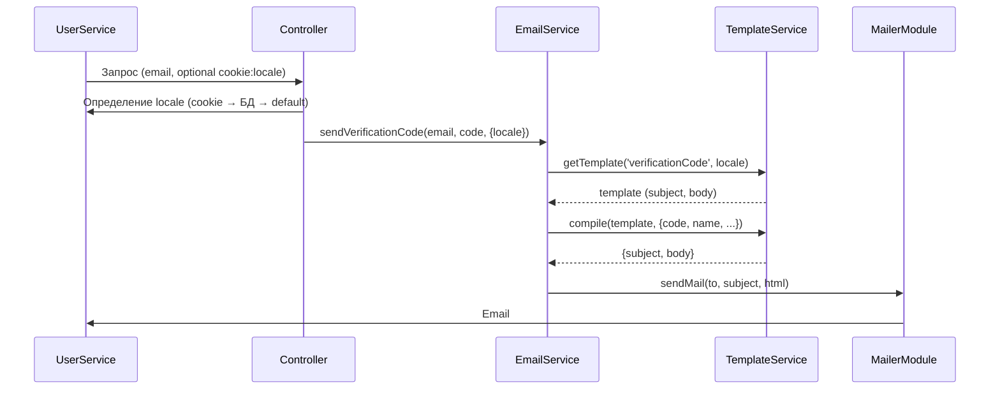

# План: Многоязычные шаблоны email-сообщений

## Обзор

Система шаблонов email-сообщений с поддержкой русского и английского языков. Язык письма определяется на основе:
1. Cookie `locale` (приоритет высокий)
2. Поле `locale` в БД у пользователя
3. По умолчанию `ru`

## Определение языка

### Алгоритм

```typescript
async function getUserLocale(
  email?: string,
  cookies?: Record<string, string>,
  userId?: number
): Promise<string> {
  // 1. Проверяем cookie
  if (cookies?.locale) {
    return normalizeLocale(cookies.locale);
  }

  // 2. Если есть userId, проверяем БД
  if (userId) {
    const user = await userService.findById(userId);
    if (user?.locale) {
      return user.locale;
    }
  }

  // 3. Если есть email (для гостей), проверяем БД
  if (email) {
    const user = await userService.findByEmail(email);
    if (user?.locale) {
      return user.locale;
    }
  }

  // 4. По умолчанию
  return 'ru';
}

function normalizeLocale(locale: string): string {
  const normalized = locale.toLowerCase();
  if (normalized === 'en' || normalized.startsWith('en-')) {
    return 'en';
  }
  return 'ru';
}
```

### Передачаlocale в сервисы

```typescript
// В контроллерах получаем locale из cookie или query
// И передаем в email сервис
emailService.sendVerificationCode(email, code, { locale: detectedLocale });
```

---

## Структура шаблонов

### Расположение файлов

```
server/src/email/
├── templates/
│   ├── locales/
│   │   ├── ru.json      # Русские шаблоны
│   │   └── en.json      # Английские шаблоны
│   ├── index.ts         # Экспорт всех шаблонов
│   └── types.ts         # Типы для шаблонов
```

### Формат шаблонов (JSON)

**Файл: `server/src/email/templates/locales/ru.json`**
```json
{
  "verificationCode": {
    "subject": "Код подтверждения",
    "body": "<!DOCTYPE html><html><body><h2>Подтверждение email</h2><p>Здравствуйте, {{name}}!</p><p>Ваш код подтверждения: <strong>{{code}}</strong></p><p>Код действителен в течение {{expires}} минут.</p><p>Если вы не запрашивали этот код, игнорируйте это письмо.</p></body></html>"
  },
  "welcome": {
    "subject": "Добро пожаловать в Nadzin",
    "body": "<!DOCTYPE html><html><body><h2>Добро пожаловать, {{name}}!</h2><p>Спасибо за регистрацию в магазине Nadzin.</p><p>Теперь вы можете:</p><ul><li>Покупать кисти и иллюстрации</li><li>Получать мгновенный доступ к файлам</li><li>Выбирать подходящие лицензии</li></ul><p>Если у вас есть вопросы, напишите нам на support@nadzin.com</p></body></html>"
  },
  "passwordReset": {
    "subject": "Сброс пароля",
    "body": "<!DOCTYPE html><html><body><h2>Сброс пароля</h2><p>Здравствуйте, {{name}}!</p><p>Для сброса пароля перейдите по ссылке:</p><p><a href=\"{{resetLink}}\">Сбросить пароль</a></p><p>Ссылка действительна в течение {{expires}} минут.</p><p>Если вы не запрашивали сброс пароля, игнорируйте это письмо.</p></body></html>"
  },
  "purchaseConfirmation": {
    "subject": "Подтверждение покупки",
    "body": "<!DOCTYPE html><html><body><h2>Спасибо за покупку, {{name}}!</h2><p>Заказ #{{orderId}} успешно оплачен.</p><h3>Детали заказа:</h3><ul>{{orderItems}}</ul><p>Итого: {{totalPrice}}</p><p>Вы можете скачать файлы в разделе \"Мои покупки\" на сайте.</p></body></html>"
  }
}
```

**Файл: `server/src/email/templates/locales/en.json`**
```json
{
  "verificationCode": {
    "subject": "Verification Code",
    "body": "<!DOCTYPE html><html><body><h2>Email Verification</h2><p>Hello, {{name}}!</p><p>Your verification code: <strong>{{code}}</strong></p><p>The code is valid for {{expires}} minutes.</p><p>If you did not request this code, please ignore this email.</p></body></html>"
  },
  "welcome": {
    "subject": "Welcome to Nadzin",
    "body": "<!DOCTYPE html><html><body><h2>Welcome, {{name}}!</h2><p>Thank you for registering at Nadzin store.</p><p>Now you can:</p><ul><li>Buy brushes and illustrations</li><li>Get instant access to files</li><li>Choose suitable licenses</li></ul><p>If you have any questions, contact us at support@nadzin.com</p></body></html>"
  },
  "passwordReset": {
    "subject": "Password Reset",
    "body": "<!DOCTYPE html><html><body><h2>Password Reset</h2><p>Hello, {{name}}!</p><p>To reset your password, click the link:</p><p><a href=\"{{resetLink}}\">Reset Password</a></p><p>The link is valid for {{expires}} minutes.</p><p>If you did not request a password reset, please ignore this email.</p></body></html>"
  },
  "purchaseConfirmation": {
    "subject": "Purchase Confirmation",
    "body": "<!DOCTYPE html><html><body><h2>Thank you for your purchase, {{name}}!</h2><p>Order #{{orderId}} has been successfully paid.</p><h3>Order Details:</h3><ul>{{orderItems}}</ul><p>Total: {{totalPrice}}</p><p>You can download your files in the \"My Purchases\" section on our website.</p></body></html>"
  }
}
```

---

## Сервис компиляции шаблонов

### Интерфейс

```typescript
// server/src/email/templates/types.ts

export interface EmailTemplate {
  subject: string;
  body: string;
}

export interface EmailTemplates {
  verificationCode: EmailTemplate;
  welcome: EmailTemplate;
  passwordReset: EmailTemplate;
  purchaseConfirmation: EmailTemplate;
}

export interface TemplateVariables {
  // Общие
  name?: string;
  email?: string;

  // verificationCode
  code?: string;
  expires?: string;

  // passwordReset
  resetLink?: string;

  // purchaseConfirmation
  orderId?: string;
  orderItems?: string;
  totalPrice?: string;
}
```

### Реализация

```typescript
// server/src/email/templates/template.service.ts
import { Injectable } from '@nestjs/common';
import ruTemplates from './locales/ru.json';
import enTemplates from './locales/en.json';
import type { EmailTemplates, TemplateVariables } from './types';

@Injectable()
export class TemplateService {
  private templates: Record<string, EmailTemplates> = {
    ru: ruTemplates as EmailTemplates,
    en: enTemplates as EmailTemplates,
  };

  /**
   * Получить шаблон по имени и языку
   */
  getTemplate(templateName: keyof EmailTemplates, locale: string): EmailTemplate {
    const normalizedLocale = this.normalizeLocale(locale);
    const template = this.templates[normalizedLocale]?.[templateName];

    if (!template) {
      // Fallback на русский
      return this.templates['ru'][templateName];
    }

    return template;
  }

  /**
   * Скомпилировать шаблон с переменными
   */
  compile(template: EmailTemplate, variables: TemplateVariables): {
    subject: string;
    body: string;
  } {
    let subject = template.subject;
    let body = template.body;

    // Заменяем все переменные вида {{variable}}
    for (const [key, value] of Object.entries(variables)) {
      if (value !== undefined) {
        const regex = new RegExp(`{{${key}}}`, 'g');
        subject = subject.replace(regex, value);
        body = body.replace(regex, value);
      }
    }

    return { subject, body };
  }

  /**
   * Получить скомпилированный шаблон
   */
  render(
    templateName: keyof EmailTemplates,
    locale: string,
    variables: TemplateVariables
  ): { subject: string; body: string } {
    const template = this.getTemplate(templateName, locale);
    return this.compile(template, variables);
  }

  private normalizeLocale(locale: string): string {
    const normalized = locale?.toLowerCase() || 'ru';
    if (normalized === 'en' || normalized.startsWith('en-')) {
      return 'en';
    }
    return 'ru';
  }
}
```

---

## Интеграция с EmailService

```typescript
// server/src/email/email.service.ts
import { Injectable } from '@nestjs/common';
import { MailerService } from '@nestjs-modules/mailer';
import { TemplateService } from './templates/template.service';
import type { TemplateVariables } from './templates/types';

@Injectable()
export class EmailService {
  constructor(
    private readonly mailerService: MailerService,
    private readonly templateService: TemplateService,
  ) {}

  /**
   * Отправить email с использованием шаблона
   */
  async sendTemplatedEmail(
    to: string,
    templateName: 'verificationCode' | 'welcome' | 'passwordReset' | 'purchaseConfirmation',
    variables: TemplateVariables,
    locale: string = 'ru'
  ): Promise<void> {
    const { subject, body } = this.templateService.render(templateName, locale, variables);

    await this.mailerService.sendMail({
      to,
      subject,
      html: body,
    });
  }

  /**
   * Отправить код подтверждения
   */
  async sendVerificationCode(
    email: string,
    code: string,
    options: { name?: string; expires?: number; locale?: string } = {}
  ): Promise<void> {
    await this.sendTemplatedEmail(email, 'verificationCode', {
      name: options.name || 'Пользователь',
      code,
      expires: String(options.expires || 15),
    }, options.locale);
  }

  /**
   * Отправить приветственное письмо
   */
  async sendWelcome(
    email: string,
    name: string,
    locale: string = 'ru'
  ): Promise<void> {
    await this.sendTemplatedEmail(email, 'welcome', { name }, locale);
  }

  /**
   * Отправить письмо для сброса пароля
   */
  async sendPasswordReset(
    email: string,
    name: string,
    resetLink: string,
    expires: number = 60,
    locale: string = 'ru'
  ): Promise<void> {
    await this.sendTemplatedEmail(email, 'passwordReset', {
      name,
      resetLink,
      expires: String(expires),
    }, locale);
  }

  /**
   * Отправить подтверждение покупки
   */
  async sendPurchaseConfirmation(
    email: string,
    name: string,
    orderDetails: {
      orderId: string;
      items: Array<{ name: string; price: string }>;
      total: string;
    },
    locale: string = 'ru'
  ): Promise<void> {
    const orderItems = orderDetails.items
      .map(item => `<li>${item.name} - ${item.price}</li>`)
      .join('');

    await this.sendTemplatedEmail(email, 'purchaseConfirmation', {
      name,
      orderId: orderDetails.orderId,
      orderItems,
      totalPrice: orderDetails.total,
    }, locale);
  }
}
```

---

## Определение locale в контроллерах

### AuthController

```typescript
// server/src/auth/auth.controller.ts
@Post('register')
async register(
  @Body() registerDto: RegisterDto,
  @Req() req: Request,
  @Cookie('locale') locale: string,
) {
  // ... создание пользователя ...

  // Определяем locale
  const userLocale = locale || registerDto.locale || user.locale || 'ru';

  // Отправляем письмо
  await this.emailService.sendVerificationCode(
    user.email,
    verificationCode,
    {
      name: user.name,
      expires: 15,
      locale: userLocale,
    }
  );
}
```

### Получение cookie на сервере

Для получения cookies в NestJS можно использовать декоратор `@Cookie()` из пакета `nestjs-cookie-parser` или извлекать вручную из `req.headers.cookie`.

---

## Диаграмма потока



---

## Следующие шаги

1. Создать структуру файлов шаблонов
2. Реализовать TemplateService
3. Обновить EmailService для использования шаблонов
4. Добавить передачу locale в контроллеры
5. Протестировать отправку писем на разных языках

---

## Примеры переменных для разных типов писем

| Тип письма | Переменные |
|------------|-------------|
| verificationCode | `{{name}}`, `{{code}}`, `{{expires}}` |
| welcome | `{{name}}` |
| passwordReset | `{{name}}`, `{{resetLink}}`, `{{expires}}` |
| purchaseConfirmation | `{{name}}`, `{{orderId}}`, `{{orderItems}}`, `{{totalPrice}}` |

---

*Связанный план: [Email Service Plan](email-service-plan.md)*