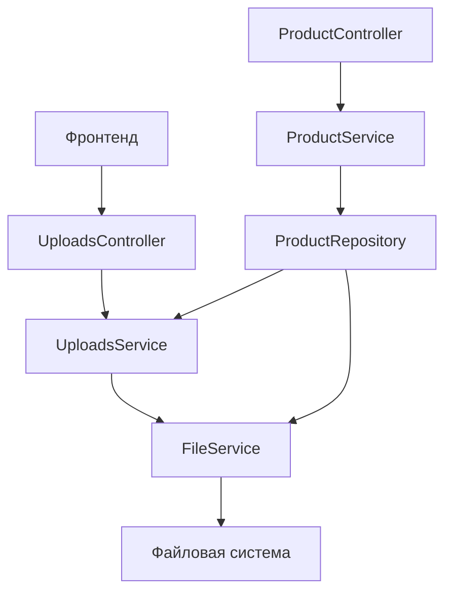

# План модуля загрузки файлов и управления ими

## 1. Обзор требований

### 1.1 Функциональность
- **Загрузка файлов** - общий функционал загрузки
- **Установка главного изображения для product** - возможность выбрать обложку из медиа
- **Загрузка файлов для product** - основной файл продукта (file_url)
- **Поддержка file_url и product_media** - два типа загрузки

### 1.2 Логика работы
```
Фронт → Сервер (temp) → Сервер (product/{id}) → БД
```

**流程:**
1. Файл загружается с фронта на сервер
2. Сервер сохраняет в `public/temp/{user_id}/media/` или `files/temp/{user_id}/`
3. Сервер возвращает URL временного файла
4. Фронт записывает URL в нужное поле
5. При создании product:
   - Создается product в БД
   - Файлы перемещаются из temp в `public/product/{product_id}` или `files/product/{product_id}`
   - URL в БД обновляются на новые
   - Создаются записи в product_media

### 1.3 Структура папок
```
public/
  temp/
    {user_id}/
      media/          # временные медиа (изображения)
  product/
    {product_id}/
      media/          # медиа продукта

files/
  temp/
    {user_id}/        # временные файлы (основной файл продукта)
  product/
    {product_id}/     # файлы продукта
```

### 1.4 Многоэтапное создание продукта
1. Получение от фронта данных (с временными URL)
2. Создание product в БД
3. Перемещение файлов и медиа по путям после получения ID
4. Смена product.file_url на новый после перемещения
5. Создание product_media

### 1.5 Удаление файлов
- При удалении product_media - удалить файл с диска
- При изменении product.file_url - удалить старый файл

---

## 2. Серверная часть

### 2.1 Архитектура



### 2.2 Типы (server/src/types/base)

**FileTypes** - перенести из file.service.ts:
```typescript
// server/src/types/base/file.types.ts
export interface FileUploadResult {
  filename: string;
  originalName: string;
  path: string;
  url: string;
  size: number;
  mimeType: string;
}

export interface FileDeleteResult {
  success: boolean;
  deletedPath?: string;
}

export interface MulterFile {
  originalname: string;
  buffer: Buffer;
  size: number;
  mimetype: string;
}

export interface FileInfo {
  size: number;
  createdAt: Date;
}

// Папки для медиа
export enum MediaFolder {
  PRODUCT = 'product',
  TEMP = 'temp',
}

// Папки для файлов
export enum FileFolder {
  PRODUCT = 'product',
  TEMP = 'temp',
}

// Тип файла
export enum FileType {
  MEDIA = 'media',   // Изображения/видео → public/
  FILE = 'file',    // Основные файлы → files/
}

// Путь для сохранения
export interface SavePathOptions {
  type: FileType;
  folder: MediaFolder | FileFolder;
  entityId?: number;  // Необязательно для temp
  userId: number;     // Для temp папки
}
```

### 2.3 Расширение FileService (низкоуровневые операции)

**Добавить методы:**
- `saveTempFile(file, userId)` - сохранение во временную папку
- `moveFile(fromPath, toPath)` - перемещение файла
- `moveTempToPermanent(tempUrl, type, entityId)` - перемещение из temp в permanent
- `getFilePath(url)` - получение полного пути из URL
- `getTempPath(userId, type)` - получение пути к temp папке
- `deleteTempFolder(userId)` - удаление temp папки пользователя

**Вынести в types:**
- `MediaFolder`, `FileFolder`, `FileType` enum
- `FileUploadResult`, `FileDeleteResult`, `MulterFile`, `FileInfo` interfaces
- `SavePathOptions` interface

### 2.4 UploadsModule (новый модуль)

**Структура:**
```
server/src/uploads/
├── uploads.module.ts
├── uploads.controller.ts
├── uploads.service.ts
└── dto/
    ├── upload-temp.dto.ts
    └── move-file.dto.ts
```

**Endpoints:**

| Method | Endpoint | Description |
|--------|----------|-------------|
| POST | /uploads/temp/media | Загрузить временное медиа |
| POST | /uploads/temp/file | Загрузить временный файл |
| POST | /uploads/temp/confirm | Подтвердить перемещение файлов (при создании product) |
| DELETE | /uploads/temp | Очистить temp папку пользователя |

**UploadsService:**
```typescript
class UploadsService {
  // Загрузить медиа во временную папку
  uploadTempMedia(userId: number, file: MulterFile): FileUploadResult
  
  // Загрузить файл во временную папку
  uploadTempFile(userId: number, file: MulterFile): FileUploadResult
  
  // Переместить все temp файлы product в permanent
  moveProductFiles(userId: number, productId: number): {
    media: FileUploadResult[];
    file: FileUploadResult | null;
  }
  
  // Очистить temp папку
  clearTempFolder(userId: number): void
}
```

### 2.5 Модификация ProductService

**Изменить CreateProductDto:**
```typescript
class CreateProductDto {
  // ... существующие поля
  
  // Временные URL (будут перемещены)
  tempFileUrl?: string;        // Для основного файла
  tempMediaUrls?: string[];   // Для медиа
  
  // Или можно передать сразу постоянные URL (для редактирования)
  fileUrl?: string;
  media?: AddMediaDto[];
}
```

**Новая логика создания продукта:**
```typescript
async create(sellerId: number, createProductDto: CreateProductDto) {
  // 1. Валидация данных
  
  // 2. Создание product с временным URL (если передан)
  const tempFileUrl = createProductDto.tempFileUrl;
  const tempMediaUrls = createProductDto.tempMediaUrls || [];
  
  const product = await this.productRepository.create({
    ...createProductDto,
    fileUrl: tempFileUrl || createProductDto.fileUrl,
  });
  
  // 3. Если есть временные файлы - переместить их
  if (tempFileUrl || tempMediaUrls.length > 0) {
    await this.uploadsService.moveProductFiles(
      sellerId, 
      product.id
    );
    
    // 4. Обновить file_url на новый путь
    if (tempFileUrl) {
      const newFileUrl = await this.getProductFileUrl(product.id);
      await product.update({ file_url: newFileUrl });
    }
    
    // 5. Создать product_media
    const newMediaUrls = await this.getProductMediaUrls(product.id);
    for (const url of newMediaUrls) {
      await this.productRepository.addMedia(product.id, {
        url,
        mediaType: this.detectMediaType(url),
      });
    }
  }
  
  return this.findByIdWithRelations(product.id);
}
```

### 2.6 Обновление ProductController

**Добавить endpoints:**

| Method | Endpoint | Description |
|--------|----------|-------------|
| POST | /products/create-with-files | Создать продукт с файлами (многоэтапно) |
| PATCH | /:id/file | Обновить file_url продукта |
| DELETE | /:id/file | Удалить file_url (и файл с диска) |
| POST | /:id/media | Добавить медиа |
| DELETE | /:id/media/:mediaId | Удалить медиа (и файл) |
| PATCH | /:id/media/:mediaId/cover | Установить главное изображение |

---

## 3. Фронтенд часть

### 3.1 Архитектура компонентов

**Важно:** Изображения отображаются ИЗ временных папок (`/temp/{user_id}/media/...`) сразу после загрузки, ДО создания продукта в БД.

```mermaid
graph TD
    A[ProductForm] --> B[MediaSection]
    A --> C[FileSection]
    B --> D[MediaUploader]
    D --> E[MediaThumbnail]
    C --> F[FileUploader]
    F --> G[FileCard]
    
    H[api-upload.ts] --> I[UploadService]
    I --> J[API]

    K[Загрузка] --> L[Server: /uploads/temp/media]
    L --> M[Server: сохраняет в /temp/{user_id}/media/]
    M --> N[Возвращает URL: /temp/{user_id}/media/filename.jpg]
    N --> O[Frontend: отображает изображение по этому URL]
    O --> P[При создании product: перемещение в /product/{id}/media/]
```

### 3.2 Компоненты

#### MediaUploader (загрузка медиа)
- Квадратная область для загрузки
- Drag & drop поддержка
- Отображение превью после загрузки
- Кнопка удаления
- Индикация главного изображения (is_cover)

```tsx
interface MediaUploaderProps {
  value: MediaItem[];           // Массив загруженных медиа
  onChange: (items: MediaItem[]) => void;
  onUpload: (file: File) => Promise<string>;  // URL после загрузки
  onRemove: (url: string) => Promise<void>;
  onSetCover?: (url: string) => void;
  maxItems?: number;
}

interface MediaItem {
  url: string;
  tempUrl?: string;    // Временный URL до подтверждения
  isCover: boolean;
  isNew: boolean;     // true - ещё не сохранено в БД
}
```

#### FileUploader (загрузка основного файла)
- Отображение текущего файла
- Загрузка нового файла
- Кнопка удаления
- Информация о файле (размер, имя)

```tsx
interface FileUploaderProps {
  value: string;                    // Текущий URL файла
  onChange: (url: string) => void;
  onUpload: (file: File) => Promise<string>;
  onRemove?: (url: string) => Promise<void>;
  accept?: string;                   // MIME типы
  maxSize?: number;                  // Макс размер в MB
}
```

### 3.3 API Сервис (front/src/lib/api-upload.ts)

```typescript
// Загрузить временное медиа
export async function uploadTempMedia(file: File): Promise<UploadResult>

// Загрузить временный файл
export async function uploadTempFile(file: File): Promise<UploadResult>

// Переместить файлы при создании продукта
export async function confirmProductFiles(
  productId: number,
  tempUrls: {
    file?: string;
    media: string[];
  }
): Promise<void>

// Очистить temp папку
export async function clearTempFiles(): Promise<void>

interface UploadResult {
  url: string;
  filename: string;
  size: number;
  mimeType: string;
}
```

### 3.4 Обновление ProductForm

**Новые пропсы:**
```tsx
interface ProductFormProps {
  // ... существующие
  
  // Медиа
  media: MediaItem[];
  onMediaChange: (items: MediaItem[]) => void;
  
  // Файл
  fileUrl: string;
  onFileUrlChange: (url: string) => void;
  
  // Загрузчики
  onUploadMedia: (file: File) => Promise<string>;
  onUploadFile: (file: File) => Promise<string>;
  onRemoveMedia: (url: string) => Promise<void>;
  onRemoveFile?: (url: string) => Promise<void>;
  onSetCover: (url: string) => void;
}
```

### 3.5 UI/UX Требования

**MediaUploader:**
- Квадратная область 150x150px
- Серый фон с пунктирной границей
- Иконка загрузки по центру
- При наведении - затемнение с иконкой удаления
- Для главного изображения - бейдж "Главное"
- Drag & drop зона

**FileUploader:**
- Карточка с информацией о файле
- Кнопка "Заменить"
- Кнопка "Удалить"
- Прогресс загрузки

---

## 4. База данных

### 4.1 Таблицы (существующие)

**products:**
- `id` - PRIMARY KEY
- `file_url` - VARCHAR(500) - URL основного файла

**product_media:**
- `id` - PRIMARY KEY
- `product_id` - FOREIGN KEY
- `media_type` - ENUM('image', 'video')
- `url` - VARCHAR(500)
- `sort_order` - INTEGER
- `is_cover` - BOOLEAN

### 4.2 Изменения не требуются
Структура БД уже поддерживает необходимые поля.

---

## 5. Реализация

### 5.1 Порядок реализации

1. **Server - Types**
   - Создать `server/src/types/base/file.types.ts`
   - Добавить экспорт в `server/src/types/base/index.ts`

2. **Server - FileService**
   - Расширить методы для поддержки temp папок
   - Добавить методы перемещения файлов
   - Вынести типы в отдельный файл

3. **Server - UploadsModule**
   - Создать модуль, контроллер, сервис
   - Реализовать endpoints для temp загрузки

4. **Server - Product**
   - Обновить DTO для приёма temp URLs
   - Модифицировать create/update сервис
   - Добавить endpoints для управления файлами

5. **Frontend - API**
   - Создать `api-upload.ts`

6. **Frontend - Components**
   - MediaUploader
   - FileUploader

7. **Frontend - Pages**
   - Обновить ProductForm
   - Обновить NewProductPage
   - Обновить EditProductPage (если есть)

---

## 6. Примеры API

### 6.1 Загрузка временного медиа
```
POST /uploads/temp/media
Authorization: Bearer <token>
Content-Type: multipart/form-data

Response: {
  "url": "/temp/1/media/abc123.jpg",
  "filename": "photo.jpg",
  "size": 102400,
  "mimeType": "image/jpeg"
}
```

### 6.2 Создание продукта с файлами
```
POST /products
Authorization: Bearer <token>
Content-Type: application/json

{
  "name": "My Product",
  "type": "brush",
  "tempFileUrl": "/temp/1/file/product.zip",
  "tempMediaUrls": [
    "/temp/1/media/img1.jpg",
    "/temp/1/media/img2.jpg"
  ],
  "licenses": [
    { "licenseTypeId": 1, "price": 100 }
  ]
}

Response: {
  "id": 42,
  "file_url": "/files/product/42/product.zip",
  "media": [
    { "id": 1, "url": "/media/product/42/img1.jpg", "is_cover": false },
    { "id": 2, "url": "/media/product/42/img2.jpg", "is_cover": true }
  ]
}
```

### 6.3 Обновление file_url
```
PATCH /products/42/file
Authorization: Bearer <token>
Content-Type: application/json

{
  "tempFileUrl": "/temp/1/file/new-version.zip"
}

Response: {
  "id": 42,
  "file_url": "/files/product/42/new-version.zip"
}
```

---

## 7. Обработка ошибок

### 7.1 Серверные ошибки
- Файл слишком большой - 413
- Неверный тип файла - 415
- Ошибка записи на диск - 500
- Файл не найден при перемещении - 404

### 7.2 Фронтенд ошибки
- Показывать toast с текстом ошибки
- Логировать в консоль
- Не блокировать форму при ошибке загрузки

---

## 8. Безопасность

### 8.1 Валидация
- Проверка MIME типа файла
- Ограничение размера файла (max 50MB для файлов, 5MB для медиа)
- Валидация расширений файлов

### 8.2 Доступ
- Только авторизованные пользователи могут загружать
- Проверка ownership при редактировании product
- Очистка temp папок старше 24 часов (cron job)

### 8.3 Пути
- Не допускать path traversal
- Использовать UUID для имен файлов
- Отделять temp от permanent папок
