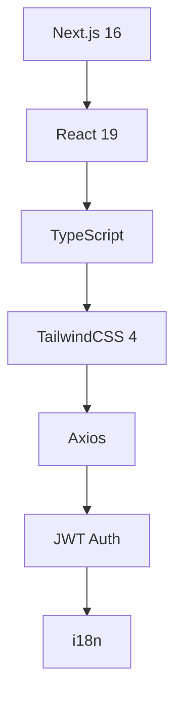
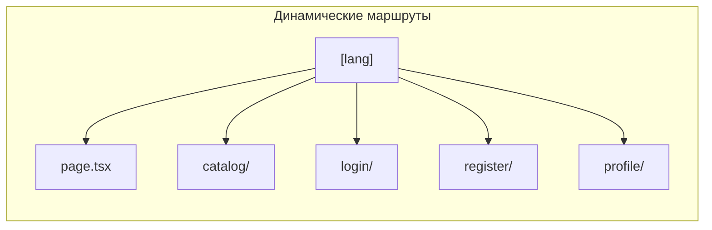
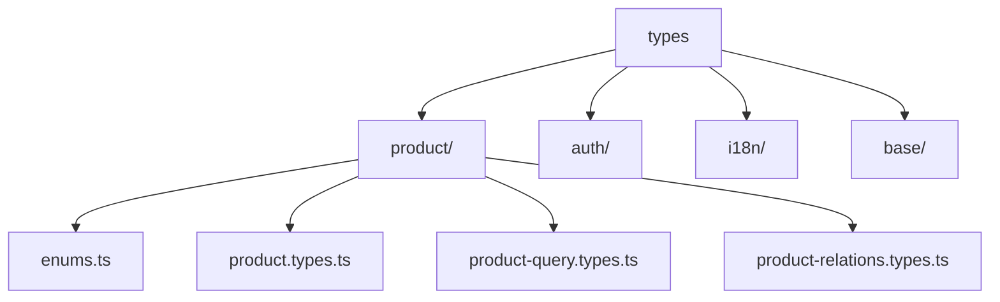
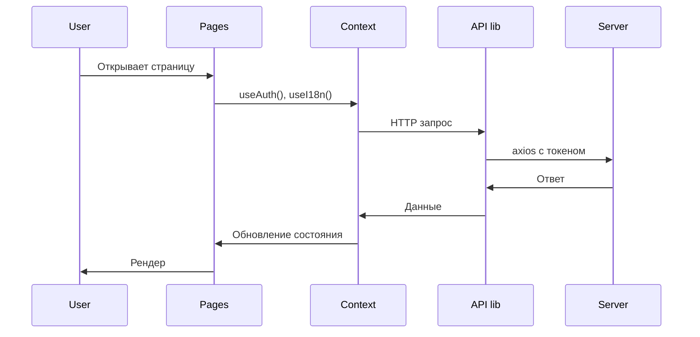
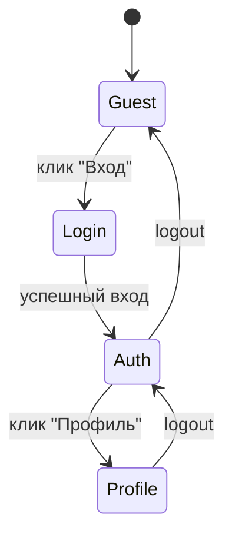
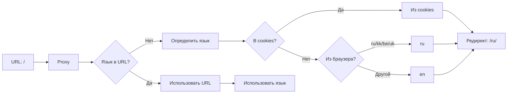

# Структура Frontend-приложения

## Обзор

Frontend-приложение построено на **Next.js 16** с использованием **React 19** и **TypeScript**. Это мультиязычный e-commerce сайт для художника с каталогом товаров (кисти, иллюстрации), системой авторизации и админ-панелью.

## Технологический стек



| Технология | Версия | Назначение |
|-----------|--------|------------|
| Next.js | 16.1.6 | Фреймворк с SSR/SSG |
| React | 19.2.3 | UI-библиотека |
| TypeScript | 5 | Типизация |
| TailwindCSS | 4 | Стилизация |
| Axios | 1.7.9 | HTTP-клиент |
| js-cookie | 3.0.5 | Работа с cookies |

---

## Директории и файлы

### Корневая конфигурация

#### `front/package.json`
**Назначение:** NPM-конфигурация с зависимостями и скриптами.

**Ключевые скрипты:**
- `dev` - запуск dev-сервера на порту 4000
- `build` - production сборка
- `lint` - проверка кода

#### `front/next.config.ts`
**Назначение:** Конфигурация Next.js. Включает React Compiler для оптимизации.

#### `front/tsconfig.json`
**Назначение:** Настройки TypeScript-компилятора с путями alias (@/).

#### `front/postcss.config.mjs`
**Назначение:** Конфигурация PostCSS для TailwindCSS.

---

### `front/src/app/` - Маршрутизация (App Router)



#### `front/src/app/layout.tsx`
**Назначение:** Корневой layout без HTML-обёртки. Перенаправляет всё в `[lang]/layout.tsx`.

#### `front/src/app/globals.css`
**Назначение:** Глобальные стили TailwindCSS с CSS-переменными для цветов и шрифтов.

#### `front/src/app/[lang]/layout.tsx`
**Назначение:** Локализованный layout с:
- Шрифтами Google Fonts (Noto Sans, Pinyon Script)
- Провайдерами (AuthProvider, I18nProvider)
- Header-компонентом
- Мета-тегами (title, description)

**Ключевые функции:**
- `generateStaticParams()` - генерирует статические параметры для `en` и `ru`
- Валидация языка (редирект на notFound при невалидном)

#### `front/src/app/[lang]/page.tsx` (Главная)
**Назначение:** Главная страница с Hero-баннером.

#### `front/src/app/[lang]/catalog/page.tsx` (Каталог)
**Назначение:** Страница каталога товаров с:
- Поиском по названию
- Фильтрацией по типу (brush/illustration)
- Фильтрацией по цене (min/max)
- Сортировкой (newest, price asc/desc)
- Пагинацией (12 товаров на страницу)
- Бесконечной загрузкой (Load More)

**Состояния:**
- `products` - массив товаров
- `loading` - индикатор загрузки
- `searchQuery`, `selectedType`, `minPrice`, `maxPrice`, `sortBy` - фильтры

#### `front/src/app/[lang]/login/page.tsx` (Вход)
**Назначение:** Форма входа с:
- Полями email/password
- Обработкой ошибок
- Перенаправлением в профиль после успеха

#### `front/src/app/[lang]/register/page.tsx` (Регистрация)
**Назначение:** Форма регистрации с:
- Полями name/email/password
- Валидацией (мин. 8 символов для пароля)
- Перенаправлением в профиль после успеха

#### `front/src/app/[lang]/profile/page.tsx` (Профиль)
**Назначение:** Приватная страница профиля пользователя с:
- Защитой через `ProtectedRoute`
- Отображением данных пользователя (name, email, role, locale)
- Кнопкой выхода (logout)

#### `front/src/app/[lang]/not-found.tsx`
**Назначение:** Кастомная страница 404 с:
- Переводом на текущий язык
- Кнопкой возврата на главную

#### `front/src/app/[...not-found]/page.tsx`
**Назначение:** Catch-all маршрут для несуществующих страниц.

---

### `front/src/components/` - UI-компоненты

#### `front/src/components/Providers.tsx`
**Назначение:** Объединяющий провайдер для:
- `AuthProvider` - управление авторизацией
- `I18nProvider` - интернационализация

#### `front/src/components/Header.tsx`
**Назначение:** Шапка сайта с:
- Логотипом (Logo)
- Навигацией (Navigation)
- Действиями пользователя (UserActions)
- Переключателем языка (LanguageSwitcher)

#### `front/src/components/Navigation.tsx`
**Назначение:** Навигационное меню с ссылками:
- Главная (`/`)
- Каталог (`/catalog`)
- Блог (`/blog`) - резервная
- Контакты (`/contacts`) - резервная

#### `front/src/components/Logo.tsx`
**Назначение:** Логотип сайта "NADZIN" со стилизованным шрифтом.

#### `front/src/components/NavButton.tsx`
**Назначение:** Кнопка навигационной ссылки с:
- href атрибутом
- Текстом
- Стилями active/inactive состояний

#### `front/src/components/LanguageSwitcher.tsx`
**Назначение:** Переключатель языка (RU/EN) с:
- Подсветкой активного языка
- Сохранением выбора в cookies
- Обновлением URL без перезагрузки
- Синхронизацией с I18nContext

#### `front/src/components/UserActions.tsx`
**Назначение:** Блок действий пользователя:
- Вход/Регистрация (для гостей)
- Профиль/Выход (для авторизованных)

#### `front/src/components/ProductCard.tsx`
**Назначение:** Карточка товара с:
- Изображением (ServerImage)
- Названием
- Ценой (с учётом скидки)

#### `front/src/components/Image.tsx` (ServerImage)
**Назначение:** Оптимизированный компонент изображений Next.js с fallback на placeholder.

#### `front/src/components/Hero.tsx`
**Назначение:** Баннер/hero-секция главной страницы.

#### `front/src/components/ProtectedRoute.tsx`
**Назначение:** Защитный wrapper для приватных маршрутов:
- Проверка авторизации через `useAuth`
- Редирект на `/login` для неавторизованных

---

### `front/src/context/` - React Context

#### `front/src/context/auth/AuthContext.tsx`
**Назначение:** Контекст авторизации с:
- `AuthProvider` - обёртка для всего приложения
- `useAuth()` - хук для доступа к состоянию

**Состояние:**
```typescript
interface AuthState {
  user: User | null;
  isAuthenticated: boolean;
  isLoading: boolean;
}
```

**Методы:**
- `login(email, password)` - вход
- `register(email, password, name)` - регистрация
- `logout()` - выход
- `updateUser(user)` - обновление данных

**Особенности:**
- Автоматическая проверка токена при загрузке
- Интеграция с cookies для хранения токенов
- Вызов API `/auth/me` для получения данных пользователя

#### `front/src/context/auth/types.ts`
**Назначение:** TypeScript-типы для auth:
- `User`, `UserRole`
- `AuthState`, `AuthResponse`
- `LoginDto`, `RegisterDto`

#### `front/src/context/i18n/I18nContext.tsx`
**Назначение:** Контекст интернационализации с:
- `I18nProvider` - обёртка для приложения
- `useI18n()` - хук для доступа к переводам

**Функции:**
- `locale` - текущий язык (en/ru)
- `setLocale(locale)` - смена языка
- `t(key)` - функция перевода (по ключу)

**Логика определения языка (приоритет):**
1. Из URL (`initialLocale`)
2. Из cookies
3. Из профиля пользователя (если авторизован)
4. По языку браузера

**Особенности:**
- Сохранение выбора в cookies (365 дней)
- Синхронизация с сервером для авторизованных

#### `front/src/context/i18n/types.ts`
**Назначение:** Типы для i18n:
- `Locale` - тип языка ('en' | 'ru')
- `Translations` - структура переводов
- `I18nState` - состояние

#### `front/src/context/i18n/utils.ts`
**Назначение:** Утилиты для i18n:
- `detectBrowserLocale()` - определение языка браузера

---

### `front/src/lib/` - Утилиты и API

#### `front/src/lib/api.ts`
**Назначение:** Настроенный axios-инстанс с:
- Базовым URL (`NEXT_PUBLIC_API_URL`)
- Интерцептором запросов (добавление токена, CSRF)
- Интерцептором ответов (авто-обновление токена при 401)

**Ключевые возможности:**
- Автоматическое добавление `Authorization: Bearer {token}`
- Добавление CSRF-токена для мутаций (POST/PUT/PATCH/DELETE)
- Автоматический refresh токена при истечении
- Queue запросов во время refresh
- Редирект на `/login` при неудачном refresh

**Переменные окружения:**
- `NEXT_PUBLIC_API_URL` - URL backend API (по умолчанию `http://localhost:3001`)

#### `front/src/lib/api-product.ts`
**Назначение:** Сервис для работы с товарами (386 строк).

**Публичные методы (доступны всем):**
- `getProducts(params)` - получить список с фильтрацией
- `getProductById(id, language)` - получить товар по ID
- `getFeaturedProducts(limit, language)` - рекомендуемые товары
- `getProductsByCategory(categoryId, params)` - по категории
- `getProductsByType(type, params)` - по типу
- `searchProducts(query, params)` - поиск
- `getProductMedia(productId)` - медиа товара
- `getProductLicenses(productId)` - лицензии товара

**Приватные методы (author/admin):**
- `getMyProducts(params)` - свои товары
- `createProduct(data, language)` - создать
- `updateProduct(id, data, language)` - обновить
- `deleteProduct(id)` - удалить
- `activateProduct(id)` / `deactivateProduct(id)` - активация
- `addProductMedia(productId, data)` - добавить медиа
- `deleteProductMedia(productId, mediaId)` - удалить медиа
- `addProductLicense(productId, data)` - добавить лицензию

#### `front/src/lib/cookies.ts`
**Назначение:** Утилиты для работы с cookies токенов.

**Функции:**
- `getAccessToken()` / `setAccessToken(token)` - access токен (15 мин)
- `getRefreshToken()` / `setRefreshToken(token)` - refresh токен (7 дней)
- `getCsrfToken()` / `setCsrfToken(token)` - CSRF токен
- `removeTokens()` - удалить все токены

#### `front/src/proxy.ts`
**Назначение:** Middleware для автоматического определения языка.

**Логика:**
1. Проверка наличия языка в URL
2. Определение языка из cookies или браузера
3. Rewrite на локализованный путь (`/` → `/ru/`)

---

### `front/src/types/` - TypeScript типы



#### `front/src/types/product/`
**Назначение:** Типы для товаров.

- **`enums.ts`** - `MediaType`, `ProductType`
- **`product.types.ts`** - Базовые типы: `ProductBase`, `CreateProductDto`, `UpdateProductDto`, `TranslationDto`, `LicenseDto`, `AddMediaDto`
- **`product-query.types.ts`** - `ProductQueryParams`, `ProductListResponse`
- **`product-relations.types.ts`** - Связанные типы: `SellerInfo`, `CategoryInfo`, `TranslationInfo`, `LicenseTypeInfo`, `LicenseInfo`, `MediaInfo`, `ProductResponse`

**Helper-функции:**
- `detectMediaType(url)` - определение типа медиа
- `extractYouTubeId(url)` - извлечение YouTube ID
- `getYouTubeThumbnail(videoId, quality)` - thumbnail URL
- `getYouTubeEmbedUrl(videoId)` - embed URL
- `createMediaFromUrl(url, options)` - создание DTO из URL

#### `front/src/types/auth/`
**Назначение:** Типы для авторизации.

- `User` - интерфейс пользователя
- `UserRole` - enum ролей (admin, user)
- `AuthResponse` - ответ авторизации
- `LoginDto`, `RegisterDto` - DTO входа/регистрации
- `AuthState` - состояние авторизации

#### `front/src/types/i18n/`
**Назначение:** Типы для интернационализации.

- `Locale` - тип языка ('en' | 'ru')
- `Translations` - структура переводов
- `I18nState` - состояние i18n

#### `front/src/types/base/`
**Назначение:** Базовые типы.

- `EntityBase` - базовые поля сущности (id)
- `Timestampable` - временные метки (createdAt, updatedAt)
- `PaginationParams` - параметры пагинации
- `PaginationMeta` - мета-данные пагинации
- `PaginatedResult` - результат с пагинацией
- `BaseQueryParams` - базовые параметры запросов

---

### `front/src/locales/` - Переводы

#### `front/src/locales/en.json`
#### `front/src/locales/ru.json`
**Назначение:** JSON-файлы переводов для английского и русского языков.

**Структура ключей:**
```
common.* - общие (loading, error, save, cancel...)
site.* - сайт (title)
nav.* - навигация (home, catalog, blog, contacts...)
auth.* - авторизация (login, register, logout...)
profile.* - профиль (title, name, email, role...)
catalog.* - каталог (search, filter, sort...)
errors.* - ошибки (invalidCredentials, networkError...)
home.* - главная (welcome, description...)
notFound.* - 404 (title, description...)
```

---

## Поток данных (Data Flow)



---

## Аутентификация



**Механизм:**
1. При входе - получение `accessToken` (15 мин) и `refreshToken` (7 дней)
2. AccessToken - в Authorization header
3. RefreshToken - в cookies, используется при 401
4. CSRF-токен - для защиты от CSRF-атак

---

## Интернационализация



---

## Страницы и их компоненты

| Страница | Компоненты | Контекст | Защита |
|----------|-----------|----------|--------|
| `/` | Hero | i18n | ✗ |
| `/catalog` | ProductCard, фильтры | i18n, auth | ✗ |
| `/login` | LanguageSwitcher | i18n, auth | ✓ (редирект если авторизован) |
| `/register` | LanguageSwitcher | i18n, auth | ✓ |
| `/profile` | ProtectedRoute | i18n, auth | ✓ |

---

## Переменные окружения

| Переменная | Значение по умолчанию | Назначение |
|-----------|----------------------|------------|
| `NEXT_PUBLIC_API_URL` | `http://localhost:3001` | Backend API |
| `NODE_ENV` | development | Режим (production для secure cookies) |

---

## Запуск

```bash
# Development
cd front
npm run dev     # http://localhost:4000

# Production
npm run build
npm run start
```

---

## Архитектурные решения

1. **App Router** - используется Next.js App Router с динамическими сегментами `[lang]`
2. **Server Components** - по умолчанию, клиентские только где нужно состояние
3. **Context API** - для auth и i18n (не требуют серверного состояния)
4. **Proxy middleware** - для автоматического определения языка
5. **Axios interceptors** - для centralized error handling и token refresh
6. **TailwindCSS 4** - без конфигурационного файла, использует CSS-переменные

