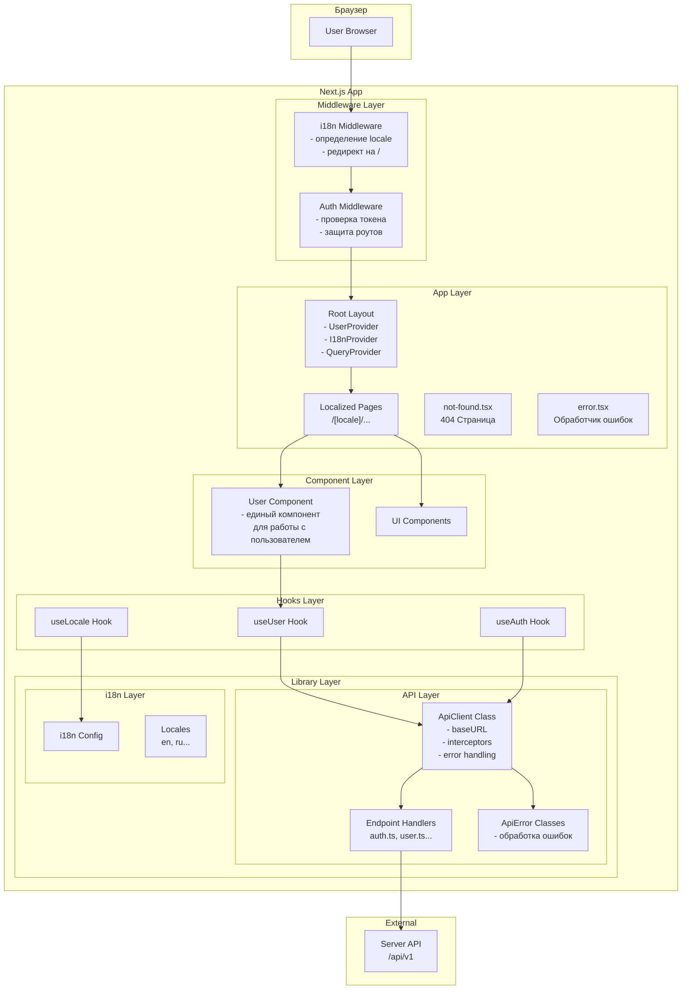

# Архитектура Frontend (Next.js)

## Общая структура проекта

```
front/
├── .env                          # Переменные окружения
├── .env.local                    # Локальные переменные (не в git)
├── .env.development              # Переменные для разработки
├── .env.production               # Переменные для продакшена
├── next.config.ts                # Конфигурация Next.js
├── next-i18next.config.ts        # Конфигурация i18n
├── middleware.ts                 # Middleware для i18n и auth
├── src/
│   ├── app/
│   │   ├── [locale]/             # Локализованные роуты
│   │   │   ├── layout.tsx        # Корневой layout с i18n
│   │   │   ├── page.tsx          # Главная страница
│   │   │   ├── login/
│   │   │   │   └── page.tsx
│   │   │   ├── register/
│   │   │   │   └── page.tsx
│   │   │   ├── dashboard/
│   │   │   │   └── page.tsx
│   │   │   └── ...
│   │   ├── api/                  # API роуты (если нужны)
│   │   ├── not-found.tsx         # Глобальная 404 страница
│   │   └── error.tsx             # Глобальный обработчик ошибок
│   ├── components/
│   │   ├── providers/
│   │   │   ├── UserProvider.tsx       # Провайдер пользователя
│   │   │   ├── I18nProvider.tsx       # Провайдер локализации
│   │   │   └── QueryProvider.tsx      # React Query провайдер
│   │   ├── ui/                   # UI компоненты
│   │   ├── auth/                 # Компоненты авторизации
│   │   └── shared/               # Общие компоненты
│   ├── lib/
│   │   ├── api/                  # API клиент
│   │   │   ├── ApiClient.ts      # Базовый класс API клиента
│   │   │   ├── endpoints/        # Обработчики эндпоинтов
│   │   │   │   ├── auth.ts
│   │   │   │   ├── user.ts
│   │   │   │   └── index.ts
│   │   │   └── errors/           # Обработка ошибок
│   │   │       ├── ApiError.ts
│   │   │       └── errorHandler.ts
│   │   ├── i18n/                 # Настройки i18n
│   │   │   ├── config.ts
│   │   │   └── locales/
│   │   │       ├── en/
│   │   │       │   └── common.json
│   │   │       └── ru/
│   │   │           └── common.json
│   │   ├── utils/
│   │   │   └── helpers.ts
│   │   └── constants/
│   │       └── index.ts
│   ├── hooks/
│   │   ├── useUser.ts            # Хук для работы с пользователем
│   │   ├── useAuth.ts            # Хук авторизации
│   │   └── useLocale.ts          # Хук для локализации
│   ├── types/
│   │   ├── api.ts                # Типы API
│   │   ├── user.ts               # Типы пользователя
│   │   └── index.ts
│   └── styles/
│       └── globals.css
└── public/
    └── locales/                  # JSON файлы переводов
        ├── en/
        │   └── common.json
        └── ru/
            └── common.json
```

## Диаграмма архитектуры



## Компоненты архитектуры

### 1. Environment Configuration (.env)

```env
# Server API
NEXT_PUBLIC_API_BASE_URL=http://localhost:3001/api/v1
NEXT_PUBLIC_SERVER_URL=http://localhost:3001

# Authentication
NEXT_PUBLIC_JWT_STORAGE_KEY=auth_token

# App Config
NEXT_PUBLIC_APP_NAME=MyApp
NEXT_PUBLIC_DEFAULT_LOCALE=ru
NEXT_PUBLIC_SUPPORTED_LOCALES=ru,en
```

### 2. API Client Architecture

**BaseApiClient** - абстрактный класс для всех API запросов:
- Интерцепторы запросов/ответов
- Централизованная обработка ошибок
- Автоматическое добавление токена авторизации
- Типизация запросов и ответов

**Endpoint Handlers** - классы-наследники для конкретных доменов:
- AuthApi - авторизация
- UserApi - работа с пользователем
- и т.д.

### 3. i18n (Internationalization)

Использование next-intl или next-i18next:
- Middleware для определения локали
- Автоматический редирект на `/{locale}/...`
- Хранение переводов в JSON файлах
- Поддержка SSR

### 4. UserProvider

Единый компонент для работы с пользователем:
- Хранение состояния пользователя (React Context)
- Методы: login, logout, updateUser, refreshToken
- Автоматическая синхронизация между вкладками

### 5. Error Handling

Единый формат ошибок между frontend и backend:
```typescript
interface ApiResponse<T> {
  success: boolean;
  data?: T;
  error?: {
    code: string;
    message: string;
    details?: Record<string, string[]>;
  };
  meta?: {
    timestamp: string;
    requestId: string;
  };
}
```

### 6. 404 Page

- Глобальный `not-found.tsx` в app/
- Локализованный контент через i18n
- Ссылки на главную страницу
