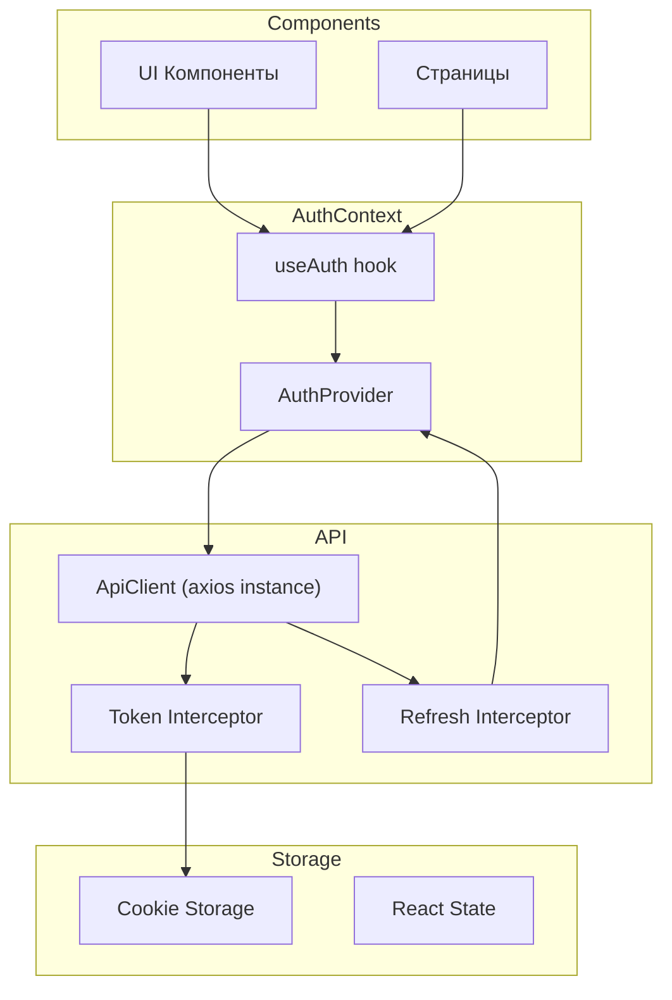
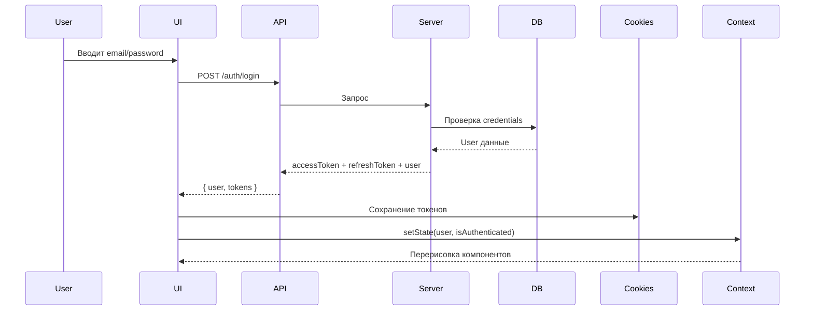
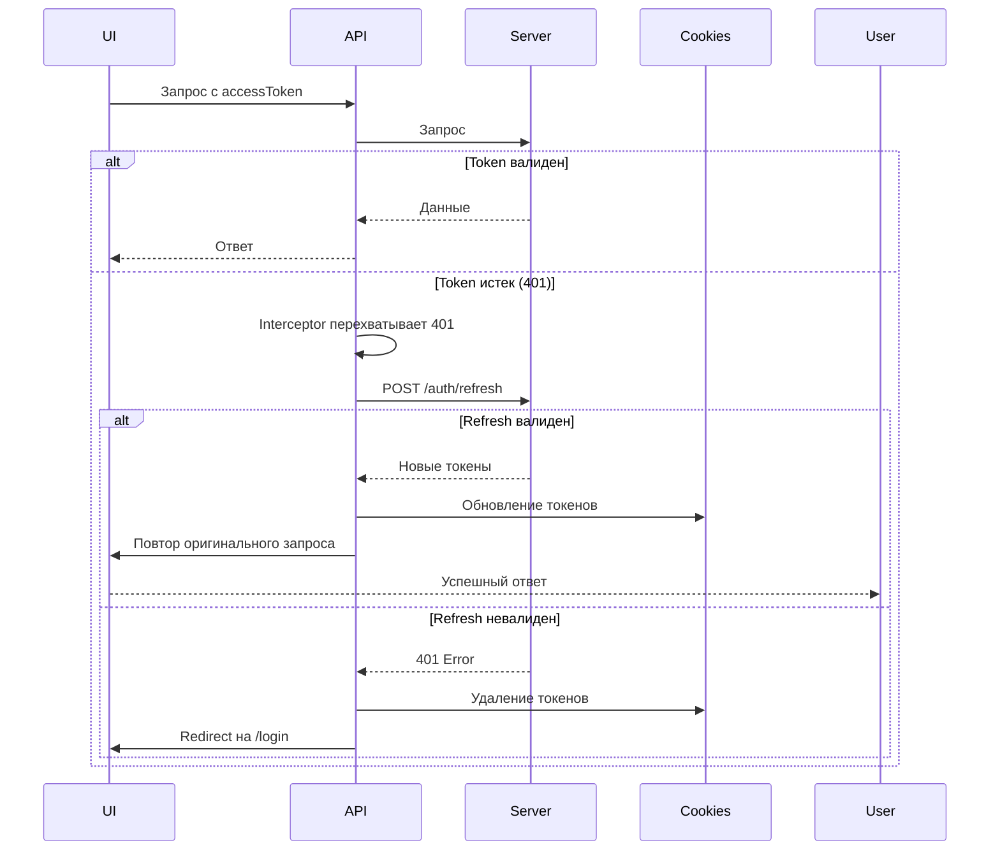
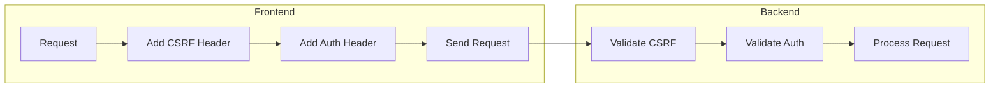

# Архитектура аутентификации на фронтенде

## Обзор

Фронтенд на Next.js с использованием React Context API для управления состоянием аутентификации. Архитектура обеспечивает:
- Единый API-клиент с автоматическим добавлением токенов
- Автоматическое обновление токенов при истечении срока
- Реактивное состояние пользователя через React Context

## Компоненты системы



## Хранение токенов

### Стратегия: HttpOnly Cookies vs LocalStorage

Рекомендуется использовать **Cookie-based** аутентификацию для безопасности:

| Вариант | Плюсы | Минусы |
|---------|-------|--------|
| HttpOnly Cookies | Защита от XSS | Сложнее в реализации, CSRF риски |
| LocalStorage | Простота | Уязвимость к XSS |

### Реализация с Cookies

```typescript
// front/src/lib/cookies.ts
import Cookies from 'js-cookie';

const TOKEN_KEY = 'access_token';
const REFRESH_KEY = 'refresh_token';

export const getAccessToken = () => Cookies.get(TOKEN_KEY);
export const setAccessToken = (token: string) => 
  Cookies.set(TOKEN_KEY, token, { expires: 1/96 }); // 15 минут

export const getRefreshToken = () => Cookies.get(REFRESH_KEY);
export const setRefreshToken = (token: string) => 
  Cookies.set(REFRESH_KEY, token, { expires: 7 }); // 7 дней

export const removeTokens = () => {
  Cookies.remove(TOKEN_KEY);
  Cookies.remove(REFRESH_KEY);
};
```

## API Клиент

### Базовая конфигурация axios

```typescript
// front/src/lib/api.ts
import axios from 'axios';

const api = axios.create({
  baseURL: process.env.NEXT_PUBLIC_API_URL || 'http://localhost:3001',
  headers: {
    'Content-Type': 'application/json',
  },
  withCredentials: true, // Для cookie
});

export default api;
```

### Interceptor для добавления токена

```typescript
// front/src/lib/api.ts (продолжение)
import { getAccessToken } from './cookies';

api.interceptors.request.use(
  (config) => {
    const token = getAccessToken();
    if (token) {
      config.headers.Authorization = `Bearer ${token}`;
    }
    return config;
  },
  (error) => Promise.reject(error)
);
```

## Автоматическое обновление токенов

### Interceptor для refresh

```typescript
// front/src/lib/api.ts (продолжение)
import { getRefreshToken, setAccessToken, setRefreshToken, removeTokens } from './cookies';

let isRefreshing = false;
let refreshSubscribers: Array<(token: string) => void> = [];

const subscribeTokenRefresh = (cb: (token: string) => void) => {
  refreshSubscribers.push(cb);
};

const onTokenRefreshed = (token: string) => {
  refreshSubscribers.forEach((cb) => cb(token));
  refreshSubscribers = [];
};

api.interceptors.response.use(
  (response) => response,
  async (error) => {
    const originalRequest = error.config;

    // Если 401 и еще не пробовали обновить
    if (error.response?.status === 401 && !originalRequest._retry) {
      if (isRefreshing) {
        // Ждем обновления токена
        return new Promise((resolve) => {
          subscribeTokenRefresh((token: string) => {
            originalRequest.headers.Authorization = `Bearer ${token}`;
            resolve(api(originalRequest));
          });
        });
      }

      originalRequest._retry = true;
      isRefreshing = true;

      const refreshToken = getRefreshToken();
      
      if (!refreshToken) {
        removeTokens();
        window.location.href = '/login';
        return Promise.reject(error);
      }

      try {
        const response = await axios.post(
          `${process.env.NEXT_PUBLIC_API_URL}/auth/refresh`,
          { refreshToken }
        );

        const { accessToken, refreshToken: newRefreshToken } = response.data;
        
        setAccessToken(accessToken);
        setRefreshToken(newRefreshToken);
        
        onTokenRefreshed(accessToken);
        
        originalRequest.headers.Authorization = `Bearer ${accessToken}`;
        return api(originalRequest);
      } catch (refreshError) {
        removeTokens();
        window.location.href = '/login';
        return Promise.reject(refreshError);
      } finally {
        isRefreshing = false;
      }
    }

    return Promise.reject(error);
  }
);
```

## Auth Context

### Типы данных

```typescript
// front/src/context/auth/types.ts
export interface User {
  id: number;
  email: string;
  name: string;
  role: 'admin' | 'user';
  locale: string;
  avatar_url: string | null;
  created_at: string;
}

export interface AuthResponse {
  user: User;
  accessToken: string;
  refreshToken: string;
}

export interface AuthState {
  user: User | null;
  isAuthenticated: boolean;
  isLoading: boolean;
}
```

### Auth Context Provider

```typescript
// front/src/context/auth/AuthContext.tsx
'use client';

import { createContext, useContext, useState, useEffect, ReactNode } from 'react';
import { User, AuthState } from './types';
import { getAccessToken, setAccessToken, setRefreshToken, removeTokens } from '@/lib/cookies';
import api from '@/lib/api';

interface AuthContextType extends AuthState {
  login: (email: string, password: string) => Promise<void>;
  register: (email: string, password: string, name: string) => Promise<void>;
  logout: () => Promise<void>;
  updateUser: (user: User) => void;
}

const AuthContext = createContext<AuthContextType | undefined>(undefined);

export function AuthProvider({ children }: { children: ReactNode }) {
  const [state, setState] = useState<AuthState>({
    user: null,
    isAuthenticated: false,
    isLoading: true,
  });

  // Проверка аутентификации при загрузке
  useEffect(() => {
    const initAuth = async () => {
      const token = getAccessToken();
      
      if (token) {
        try {
          const response = await api.get('/auth/me');
          setState({
            user: response.data,
            isAuthenticated: true,
            isLoading: false,
          });
        } catch {
          removeTokens();
          setState({
            user: null,
            isAuthenticated: false,
            isLoading: false,
          });
        }
      } else {
        setState((prev) => ({ ...prev, isLoading: false }));
      }
    };

    initAuth();
  }, []);

  const login = async (email: string, password: string) => {
    const response = await api.post('/auth/login', { email, password });
    const { user, accessToken, refreshToken } = response.data;
    
    setAccessToken(accessToken);
    setRefreshToken(refreshToken);
    
    setState({
      user,
      isAuthenticated: true,
      isLoading: false,
    });
  };

  const register = async (email: string, password: string, name: string) => {
    const response = await api.post('/auth/register', { email, password, name });
    const { user, accessToken, refreshToken } = response.data;
    
    setAccessToken(accessToken);
    setRefreshToken(refreshToken);
    
    setState({
      user,
      isAuthenticated: true,
      isLoading: false,
    });
  };

  const logout = async () => {
    try {
      await api.post('/auth/logout');
    } catch {
      // Игнорируем ошибку logout
    } finally {
      removeTokens();
      setState({
        user: null,
        isAuthenticated: false,
        isLoading: false,
      });
    }
  };

  const updateUser = (user: User) => {
    setState((prev) => ({ ...prev, user }));
  };

  return (
    <AuthContext.Provider value={{ ...state, login, register, logout, updateUser }}>
      {children}
    </AuthContext.Provider>
  );
}

export const useAuth = () => {
  const context = useContext(AuthContext);
  if (context === undefined) {
    throw new Error('useAuth must be used within an AuthProvider');
  }
  return context;
};
```

## Использование в компонентах

### Защищенные роуты

```typescript
// front/src/components/ProtectedRoute.tsx
'use client';

import { useRouter } from 'next/navigation';
import { useAuth } from '@/context/auth/AuthContext';
import { ReactNode } from 'react';

interface ProtectedRouteProps {
  children: ReactNode;
}

export function ProtectedRoute({ children }: ProtectedRouteProps) {
  const { isAuthenticated, isLoading } = useAuth();
  const router = useRouter();

  if (isLoading) {
    return <div>Loading...</div>;
  }

  if (!isAuthenticated) {
    router.push('/login');
    return null;
  }

  return <>{children}</>;
}
```

### Пример страницы с аутентификацией

```typescript
// front/src/app/profile/page.tsx
'use client';

import { useAuth } from '@/context/auth/AuthContext';

export default function ProfilePage() {
  const { user, logout, updateUser } = useAuth();

  if (!user) {
    return <div>Please login</div>;
  }

  return (
    <div>
      <h1>Profile</h1>
      <p>Name: {user.name}</p>
      <p>Email: {user.email}</p>
      <p>Role: {user.role}</p>
      <button onClick={logout}>Logout</button>
    </div>
  );
}
```

### Пример обновления профиля с реактивным обновлением

```typescript
// front/src/app/settings/page.tsx
'use client';

import { useState } from 'react';
import { useAuth } from '@/context/auth/AuthContext';
import api from '@/lib/api';

export default function SettingsPage() {
  const { user, updateUser } = useAuth();
  const [name, setName] = useState(user?.name || '');

  const handleSave = async () => {
    const response = await api.patch('/auth/profile', { name });
    updateUser(response.data); // Автоматически обновит все компоненты
  };

  return (
    <div>
      <input value={name} onChange={(e) => setName(e.target.value)} />
      <button onClick={handleSave}>Save</button>
    </div>
  );
}
```

## Структура файлов

```
front/src/
├── lib/
│   ├── api.ts              # Axios instance с interceptors
│   └── cookies.ts          # Утилиты для работы с cookies
├── context/
│   └── auth/
│       ├── AuthContext.tsx # Auth Provider
│       └── types.ts        # TypeScript типы
├── components/
│   └── ProtectedRoute.tsx  # Защищенный роут
└── app/
    └── (authenticated)/    # Группа защищенных страниц
        └── dashboard/
            └── page.tsx
```

## API эндпоинты сервера

| Метод | Эндпоинт | Описание |
|-------|----------|----------|
| POST | /auth/register | Регистрация |
| POST | /auth/login | Вход |
| POST | /auth/refresh | Обновление токенов |
| POST | /auth/logout | Выход |
| POST | /auth/logout-all | Выход со всех устройств |
| GET | /auth/me | Получить текущего пользователя |

## Flow диаграммы

### Вход пользователя



### Автоматическое обновление токена



## Защита от CSRF

### Проблема CSRF

CSRF (Cross-Site Request Forgery) - атака, при которой злоумышленник заставляет пользователя выполнить нежелательное действие на другом сайте.

### Решения

#### 1. Double Submit Cookie (рекомендуемое)

При этом подходе CSRF токен отправляется одновременно в cookie и в заголовке запроса. Сервер сравнивает оба значения.

```typescript
// front/src/lib/csrf.ts
import Cookies from 'js-cookie';

const CSRF_KEY = 'csrf_token';

export const getCsrfToken = () => Cookies.get(CSRF_KEY);

// Функция для получения CSRF токена от сервера
export const fetchCsrfToken = async () => {
  const response = await api.get('/auth/csrf-token');
  const csrfToken = response.data.csrfToken;
  Cookies.set(CSRF_KEY, csrfToken, { sameSite: 'strict' });
  return csrfToken;
};
```

```typescript
// Обновленный interceptor
api.interceptors.request.use(
  (config) => {
    const token = getAccessToken();
    const csrfToken = getCsrfToken();
    
    if (token) {
      config.headers.Authorization = `Bearer ${token}`;
    }
    
    // Добавляем CSRF токен для методов, которые изменяют данные
    if (['POST', 'PUT', 'PATCH', 'DELETE'].includes(config.method?.toUpperCase())) {
      config.headers['X-CSRF-Token'] = csrfToken;
    }
    
    return config;
  },
  (error) => Promise.reject(error)
);
```

#### 2. SameSite Cookie

Установка атрибута `SameSite` для cookie предотвращает отправку cookie в кросс-сайтовых запросах.

```typescript
// front/src/lib/cookies.ts
import Cookies from 'js-cookie';

const options = {
  sameSite: 'strict', // или 'lax' для менее строгой защиты
  secure: process.env.NODE_ENV === 'production',
  path: '/',
};

export const setAccessToken = (token: string) => 
  Cookies.set(TOKEN_KEY, token, { ...options, expires: 1/96 });
```

#### 3. Custom Header (современное решение)

Браузеры блокируют только "простые" заголовки для кросс-сайтовых запросов. Добавление кастомного заголовка требует preflight запроса.

```typescript
// Сервер должен принимать кастомный заголовок
api.interceptors.request.use(
  (config) => {
    config.headers['X-Requested-With'] = 'XMLHttpRequest';
    return config;
  },
  (error) => Promise.reject(error)
);
```

### Рекомендуемая архитектура

Комбинируем подходы для максимальной защиты:



### Серверная часть (NestJS)

Для полной защиты нужно добавить CSRF guard на сервере:

1. Установить `csurf` или использовать `nikku/csrf-sync`
2. Создать endpoint для получения CSRF токена
3. Добавить middleware для валидации
