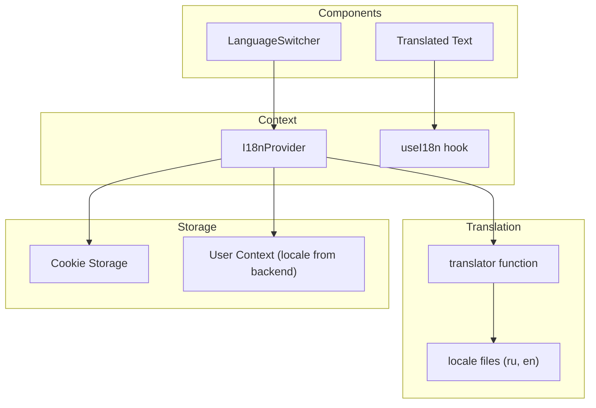
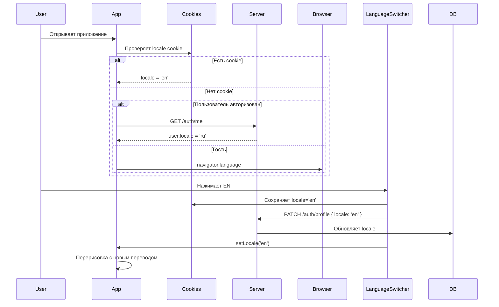

# Архитектура интернационализации (i18n)

## Обзор

Система интернационализации для Next.js с поддержкой русского и английского языков. Использует React Context для управления состоянием языка с сохранением в cookies и синхронизацией с сервером.

## Компоненты системы



## Структура файлов

```
front/src/
├── locales/
│   ├── en.json
│   └── ru.json
├── context/
│   └── i18n/
│       ├── I18nContext.tsx
│       ├── types.ts
│       └── utils.ts          # Утилита определения языка
├── lib/
│   └── i18n.ts              # Утилиты для перевода
└── components/
    └── LanguageSwitcher.tsx  # Переключатель языков
```

## Типы данных

```typescript
// front/src/context/i18n/types.ts
export type Locale = 'en' | 'ru';

export interface Translations {
  [key: string]: string | Translations;
}

export interface I18nState {
  locale: Locale;
  translations: Translations;
  isLoading: boolean;
}
```

## Файлы переводов

```json
// front/src/locales/ru.json
{
  "common": {
    "loading": "Загрузка...",
    "error": "Ошибка",
    "save": "Сохранить",
    "cancel": "Отмена"
  },
  "auth": {
    "login": "Вход",
    "register": "Регистрация",
    "logout": "Выход",
    "email": "Email",
    "password": "Пароль",
    "name": "Имя"
  },
  "nav": {
    "dashboard": "Панель управления",
    "profile": "Профиль",
    "settings": "Настройки"
  }
}
```

```json
// front/src/locales/en.json
{
  "common": {
    "loading": "Loading...",
    "error": "Error",
    "save": "Save",
    "cancel": "Cancel"
  },
  "auth": {
    "login": "Login",
    "register": "Register",
    "logout": "Logout",
    "email": "Email",
    "password": "Password",
    "name": "Name"
  },
  "nav": {
    "dashboard": "Dashboard",
    "profile": "Profile",
    "settings": "Settings"
  }
}
```

## Определение языка браузера

```typescript
// front/src/context/i18n/utils.ts
import { Locale } from './types';

// Языки, которые переключаются на русский
const RUSSIAN_LANGUAGES = ['ru', 'kk', 'be', 'uk'];

export function detectBrowserLocale(): Locale {
  if (typeof window === 'undefined') {
    return 'en';
  }

  const browserLang = navigator.language.split('-')[0].toLowerCase();
  
  if (RUSSIAN_LANGUAGES.includes(browserLang)) {
    return 'ru';
  }
  
  return 'en';
}
```

## Обновлённый I18n Context

```typescript
// front/src/context/i18n/I18nContext.tsx
'use client';

import { createContext, useContext, useState, useEffect, ReactNode } from 'react';
import Cookies from 'js-cookie';
import { Locale, Translations } from './types';
import en from '@/locales/en.json';
import ru from '@/locales/ru.json';
import { useAuth } from '@/context/auth/AuthContext';
import { detectBrowserLocale } from './utils';

const translations: Record<Locale, Translations> = { en, ru };
const LOCALE_KEY = 'locale';

interface I18nContextType {
  locale: Locale;
  setLocale: (locale: Locale) => void;
  t: (key: string) => string;
}

const I18nContext = createContext<I18nContextType | undefined>(undefined);

export function I18nProvider({ children }: { children: ReactNode }) {
  const { user, isAuthenticated } = useAuth();
  const [locale, setLocaleState] = useState<Locale>('en');
  const [isLoaded, setIsLoaded] = useState(false);

  // Определение языка при инициализации
  useEffect(() => {
    // Приоритет: cookie → user.locale → browser → en
    const savedLocale = Cookies.get(LOCALE_KEY) as Locale | undefined;
    
    if (savedLocale && (savedLocale === 'en' || savedLocale === 'ru')) {
      setLocaleState(savedLocale);
    } else if (isAuthenticated && user?.locale) {
      // Язык из профиля пользователя
      const userLocale = user.locale as Locale;
      if (userLocale === 'en' || userLocale === 'ru') {
        setLocaleState(userLocale);
      } else {
        // Язык не поддерживается, определяем по браузеру
        setLocaleState(detectBrowserLocale());
      }
    } else {
      // Определяем по браузеру
      setLocaleState(detectBrowserLocale());
    }
    
    setIsLoaded(true);
  }, [user, isAuthenticated]);

  // Синхронизация с сервером при изменении языка
  const setLocale = async (newLocale: Locale) => {
    setLocaleState(newLocale);
    Cookies.set(LOCALE_KEY, newLocale, { 
      path: '/',
      sameSite: 'strict',
      expires: 365 
    });

    // Отправляем на сервер если авторизован
    if (isAuthenticated) {
      try {
        await api.patch('/auth/profile', { locale: newLocale });
      } catch (error) {
        console.error('Failed to sync locale with server');
      }
    }
  };

  // Функция перевода
  const t = (key: string): string => {
    const keys = key.split('.');
    let value: unknown = translations[locale];

    for (const k of keys) {
      if (value && typeof value === 'object' && k in value) {
        value = (value as Record<string, unknown>)[k];
      } else {
        return key;
      }
    }

    return typeof value === 'string' ? value : key;
  };

  if (!isLoaded) {
    return null;
  }

  return (
    <I18nContext.Provider value={{ locale, setLocale, t }}>
      {children}
    </I18nContext.Provider>
  );
}

export const useI18n = () => {
  const context = useContext(I18nContext);
  if (!context) {
    throw new Error('useI18n must be used within I18nProvider');
  }
  return context;
};
```

## Компонент переключения языков

```typescript
// front/src/components/LanguageSwitcher.tsx
'use client';

import { useI18n } from '@/context/i18n/I18nContext';
import { Locale } from '@/context/i18n/types';

export function LanguageSwitcher() {
  const { locale, setLocale } = useI18n();

  const toggleLocale = () => {
    const newLocale: Locale = locale === 'ru' ? 'en' : 'ru';
    setLocale(newLocale);
  };

  return (
    <button
      onClick={toggleLocale}
      className="px-3 py-1 text-sm font-medium rounded-md bg-gray-200 hover:bg-gray-300"
    >
      {locale === 'ru' ? 'EN' : 'RU'}
    </button>
  );
}
```

## Использование в компонентах

```typescript
// Пример использования
import { useI18n } from '@/context/i18n/I18nContext';

function MyComponent() {
  const { t, locale, setLocale } = useI18n();

  return (
    <div>
      <h1>{t('nav.dashboard')}</h1>
      <p>{t('auth.email')}</p>
      <button>{t('common.save')}</button>
      
      <LanguageSwitcher />
    </div>
  );
}
```

## Обновление Providers

```typescript
// front/src/components/Providers.tsx
'use client';

import { ReactNode } from 'react';
import { AuthProvider } from '@/context/auth/AuthContext';
import { I18nProvider } from '@/context/i18n/I18nContext';

interface ProvidersProps {
  children: ReactNode;
}

export function Providers({ children }: ProvidersProps) {
  return (
    <AuthProvider>
      <I18nProvider>{children}</I18nProvider>
    </AuthProvider>
  );
}
```

## Flow диаграмма



## Серверная часть (для синхронизации)

На сервере уже есть поле `locale` в модели User. При регистрации устанавливается значение по умолчанию 'ru'.

Эндпоинт для обновления профиля:
- `PATCH /auth/profile` - обновить профиль пользователя (нужно добавить)

## Рекомендации

1. **_next-intl** - для продакшена рекомендуется использовать библиотеку next-intl
2. **namespaces** - для больших приложений разделить переводы на файлы (auth, common, dashboard, etc.)
3. ** interpolation** - добавить поддержку переменных в переводах `{name}`
4. **pluralization** - добавить поддержку множественных форм
