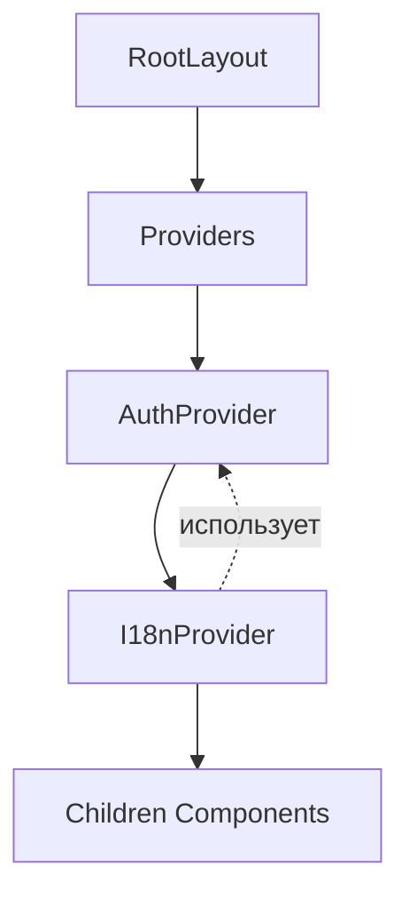

# Правила написания компонентов с локализацией

## 1. Все слова должны использовать локализацию

### Основные принципы

- **Все пользовательские тексты** (заголовки, метки, кнопки, сообщения, ошибки) **должны** быть получены через функцию перевода `t()`
- **Никогда не использовать** хардкодированные строки в коде компонентов
- **Исключение**: технические тексты, которые не видны пользователю (ключи объектов, внутренние переменные)

### Примеры

```typescript
// ❌ Плохо - хардкодированный текст
<h1>Welcome</h1>
<button>Click here</button>
<p>Error occurred</p>

// ✅ Хорошо - локализованный текст
<h1>{t('home.welcome')}</h1>
<button>{t('common.submit')}</button>
<p>{t('errors.unknownError')}</p>
```

### Когда использовать локализацию

- Заголовки страниц и секций
- Метки полей ввода (labels)
- Текст кнопок
- Сообщения об ошибках и успехе
- Подсказки (placeholders)
- Навигационные ссылки
- Всплывающие уведомления (toast messages)
- Текст загрузки

## 2. Правильное использование зависимостей

### Подключение хуков

Для использования локализации необходимо подключить `useI18n`:

```typescript
'use client';

import { useI18n } from '@/context/i18n/I18nContext';

export function MyComponent() {
  const { t } = useI18n();
  
  return <h1>{t('key.path')}</h1>;
}
```

### Порядок подключения в Providers

I18nProvider должен быть внутри AuthProvider, так как он зависит от контекста авторизации:

```typescript
// front/src/components/Providers.tsx
'use client';

import { ReactNode } from 'react';
import { AuthProvider } from '@/context/auth/AuthContext';
import { I18nProvider } from '@/context/i18n/I18nContext';

interface ProvidersProps {
  children: ReactNode;
}

export function Providers({ children }: ProvidersProps) {
  return (
    <AuthProvider>
      <I18nProvider>{children}</I18nProvider>
    </AuthProvider>
  );
}
```

### Зависимости между провайдерами



### Ограничения

- **useI18n** может использоваться только в компонентах, которые являются потомками `I18nProvider`
- Компоненты, использующие `useI18n`, должны быть клиентскими (`'use client'`)
- Нельзя использовать `useI18n` в серверных компонентах напрямую

## 3. Правильное использование контекстов

### Структура i18n контекста

```typescript
interface I18nContextType {
  locale: Locale;           // 'en' | 'ru'
  setLocale: (locale: Locale) => void;
  t: (key: string) => string;
}
```

### Использование в компонентах

```typescript
// Полная деструктуризация
const { t, locale, setLocale } = useI18n();

// Только перевод
const { t } = useI18n();
```

### Вложенность ключей

Используйте точечную нотацию для организации переводов:

```json
{
  "common": {
    "save": "Save",
    "cancel": "Cancel"
  },
  "auth": {
    "login": "Login",
    "register": "Register"
  },
  "profile": {
    "title": "Profile",
    "email": "Email"
  }
}
```

```typescript
// Вызов
t('common.save')
t('auth.login')
t('profile.email')
```

### Обработка отсутствующих ключей

Функция `t()` возвращает сам ключ, если перевод не найден:

```typescript
// Если ключ 'auth.login' не найден, вернётся 'auth.login'
const text = t('auth.login');
```

## 4. Структура файлов переводов

### Организация по доменам

```
front/src/locales/
├── en.json
└── ru.json
```

### Рекомендуемая структура

```json
{
  "common": {
    "loading": "Loading...",
    "error": "Error",
    "save": "Save",
    "cancel": "Cancel",
    "delete": "Delete",
    "edit": "Edit"
  },
  "auth": {
    "login": "Login",
    "register": "Register",
    "logout": "Logout",
    "email": "Email",
    "password": "Password"
  },
  "nav": {
    "dashboard": "Dashboard",
    "profile": "Profile",
    "settings": "Settings"
  },
  "errors": {
    "invalidCredentials": "Invalid credentials",
    "networkError": "Network error"
  },
  "home": {
    "welcome": "Welcome",
    "description": "Description"
  },
  "profile": {
    "title": "Profile",
    "information": "Profile Information"
  }
}
```

## 5. Чек-лист для компонента

При создании нового компонента проверьте:

- [ ] Добавлен `'use client'` если используется локализация
- [ ] Импортирован `useI18n` из `@/context/i18n/I18nContext`
- [ ] Все пользовательские тексты используют `t('key')`
- [ ] Ключи добавлены в `en.json` и `ru.json`
- [ ] Нет хардкодированных строк
- [ ] Компонент обёрнут в Providers

## 6. Пример нового компонента

```typescript
'use client';

import { useI18n } from '@/context/i18n/I18nContext';

interface ProfileCardProps {
  name: string;
  email: string;
}

export function ProfileCard({ name, email }: ProfileCardProps) {
  const { t } = useI18n();

  return (
    <div className="card">
      <h2>{t('profile.information')}</h2>
      <p>
        <span className="label">{t('profile.name')}:</span> {name}
      </p>
      <p>
        <span className="label">{t('profile.email')}:</span> {email}
      </p>
      <button>{t('common.edit')}</button>
    </div>
  );
}
```
