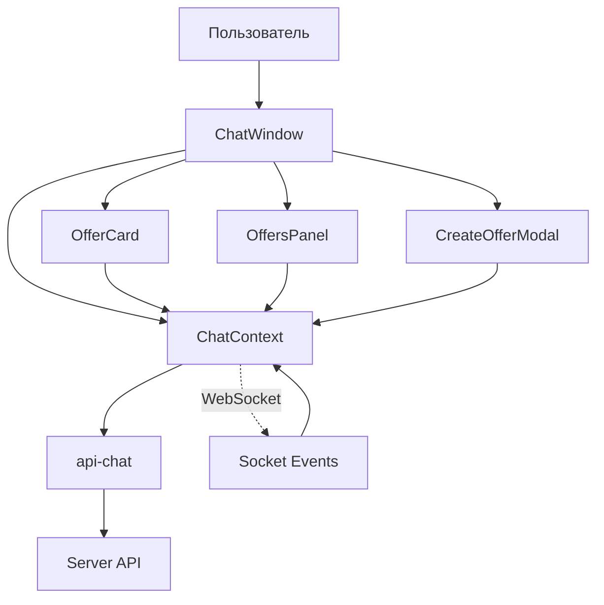

# План изменений фронтенда для поддержки новой модели Offer

## Анализ изменений

Новая модель `Offer` на сервере (`server/src/db/models/offer.model.ts`) содержит следующие поля:

| Поле | Тип | Описание |
|------|-----|----------|
| `id` | number | ID заказа |
| `chat_room_id` | number | ID чат-комнаты |
| `creator_id` | number | ID создателя (покупатель) |
| `author_id` | number | ID автора (продавец) |
| `description` | text | Описание заказа |
| `price` | decimal(10,2) | Цена |
| `original_price` | decimal(10,2) | Оригинальная цена (для отображения скидки) |
| `status` | enum | Статус: WAITING_AUTHOR, WAITING_USER, REJECTED, IN_PROGRESS, AWAITING_PAYMENT, COMPLETED |
| `preview_url` | string | URL превью работы |
| `source_files_urls` | text | URL исходных файлов |
| `is_paid` | boolean | Оплачен или нет |
| `paid_at` | date | Дата оплаты |
| `created_at` | timestamp | Дата создания |
| `updated_at` | timestamp | Дата обновления |

Также добавлена модель `OfferFile` для хранения файлов превью и исходников.

---

## Необходимые изменения

### 1. Types (front/src/types/chat/offer.types.ts)

**Добавить/обновить:**
- [ ] Интерфейс `OfferFile` для работы с файлами
- [ ] Интерфейс `IOfferFile` (с сервера)
- [ ] Типы для связей: `creator`, `author` (уже частично есть)
- [ ] Добавить поле `preview_url` в Offer интерфейс
- [ ] Добавить поле `source_files_urls` как массив или null
- [ ] Добавить поле `is_paid` и `paid_at`
- [ ] Обновить логику полей цены:
  - `price` — финальная цена
  - `original_price` — цена заказчика (creator)
  - При отображении: если `original_price` !== `price` — показывать обе

### 2. Components/chat (front/src/components/chat/)

#### OfferCard.tsx
- [ ] Обновить отображение статуса — добавить `AWAITING_PAYMENT`, `COMPLETED`
- [ ] Обновить отображение цен:
  - Если `original_price` !== `price` — показывать обе цены
  - `original_price` = цена заказчика
  - `price` = финальная цена (предложенная автором)
- [ ] Добавить отображение превью (`preview_url`) если доступно
- [ ] Обновить логику `isAccepted` — добавить `awaiting_payment` и `completed`
- [ ] Добавить кнопку оплаты для статуса `AWAITING_PAYMENT`
- [ ] Обновить определение `isSeller` — использовать `author_id` вместо `seller_id`

#### OrderCard.tsx
- [ ] Проверить совместимость с новой моделью Offer (связь через `offer` поле)
- [ ] Возможно, потребуется обновить работу с revision-ами

#### CreateOfferModal.tsx
- [ ] Обновить отправку данных — использовать новый API (уже есть алиасы)
- [ ] Проверить работу с deadline (на сервере поля нет, но в интерфейсе было)

#### PriceChangeModal.tsx
- [ ] Обновить работу с API — уже использует правильные методы

#### OffersPanel.tsx
- [ ] Добавить фильтрацию/сортировку по статусам
- [ ] Добавить отображение количества по статусам

#### ChatWindow.tsx
- [ ] Добавить отображение превью работ в сообщениях
- [ ] Обновить логику кнопки создания заказа

#### MessageBubble.tsx
- [ ] Обновить отображение offer-сообщений (тип 'offer')

### 3. Context (front/src/context/chat/ChatContext.tsx)

**Обновить:**
- [ ] Метод `createOffer` — добавить работу с deadline (если нужно)
- [ ] Метод `acceptOffer` — возвращает CustomOrder, но может измениться
- [ ] Добавить методы для работы с файлами:
  - `uploadOfferFiles`
  - `getOfferFiles`
- [ ] Добавить методы для оплаты:
  - `payOrder`
- [ ] Обновить WebSocket listeners — добавить обработку новых событий для файлов
- [ ] Обновить логику определения роли — использовать `author_id` и `creator_id`

### Backend - OfferService

**Файл:** `server/src/chat/services/offer.service.ts`

**Исправлено:**
- [x] `createOffer` — при создании устанавливать `original_price = price` (строка 24)
- [x] `acceptOffer` — при принятии, если есть `original_price`, устанавливать `price = original_price` (строки 47-50)
- [x] `getOfferFiles` — исправить безопасный парсинг `source_files_urls` (строки 221-232)
- [x] `getRoomOffers` — добавлен метод для получения заказов комнаты
- [x] `getOfferById` — добавлен метод для получения заказа по ID

**Файл:** `server/src/chat/repositories/offer.repository.ts`

**Исправлено:**
- [x] Добавить метод `updatePriceOnly` — для обновления только цены без original_price (строки 69-79)
- [x] Добавить метод `findByIdOrFail` — для получения с исключением

---

## WebSocket события для Offers

### Сервер (ChatGateway) — УЖЕ РЕАЛИЗОВАНО:

| Событие | Метод | Описание |
|---------|-------|----------|
| `offer:created` | `notifyOfferCreated` | Новый заказ создан |
| `offer:statusChanged` | `notifyStatusChanged` | Изменён статус заказа |
| `offer:priceChanged` | `notifyPriceChanged` | Изменена цена |
| `offer:filesUploaded` | `notifyFilesUploaded` | Загружены файлы |
| `offer:paid` | `notifyPaymentCompleted` | Заказ оплачен |

### Фронтенд (ChatContext) — УЖЕ РЕАЛИЗОВАНО:

Все события обрабатываются в ChatContext:
- `offer:created` — добавляет новый offer в массив
- `offer:statusChanged` — обновляет offer в массиве
- `offer:priceChanged` — обновляет offer
- `offer:filesUploaded` — обновляет offer
- `offer:paid` — обновляет offer

### Рекомендация по OfferContext:

Создание отдельного `OfferContext` НЕ требуется! Текущий `ChatContext` уже включает:
- Массив `offers`
- Методы `createOffer`, `acceptOffer`, `declineOffer`, `counterOffer`, `confirmPrice`
- WebSocket listeners для обновления offers

Логика работы:
1. При создании/изменении заказа на сервере — вызывается соответствующий `notify*` метод в ChatGateway
2. ChatGateway отправляет WebSocket событие в комнату `chat:{roomId}`
3. Фронтенд (все участники чата) получает событие и обновляет локальный массив `offers`

**Уже есть:**
- [x] `createOffer` — алиас для `createEditOffer`
- [x] `acceptOffer` — алиас для `acceptEditOffer`
- [x] `declineOffer` — алиас для `rejectOffer`
- [x] `counterOffer` — работает через `CounterOfferDto`
- [x] `confirmPrice` — работает
- [x] `getChatOffers` — алиас для `getRoomOffers`

**Добавить методы:**
- [ ] `uploadOfferFiles` — загрузка файлов (уже есть в api-chat.ts строки 147-150)
- [ ] `payOrder` — оплата заказа (уже есть в api-chat.ts строки 155-158)
- [ ] `getOfferFiles` — получение файлов (уже есть в api-chat.ts строки 163-166)

### 5. Locales (front/src/locales/)

**Добавить переводы:**
- [ ] `chat.offerAwaitingPayment` — "Ожидает оплаты"
- [ ] `chat.offerCompleted` — "Завершён"
- [ ] `chat.payOrder` — "Оплатить заказ"
- [ ] `chat.downloadFiles` — "Скачать файлы"
- [ ] `chat.previewAvailable` — "Доступно превью"
- [ ] `chat.originalPrice` — "Старая цена"

---

## Приоритеты

### Высокий приоритет
1. Обновить типы в `offer.types.ts` — добавить новые поля
2. Обновить `OfferCard.tsx` — добавить отображение статусов и оплаты
3. Обновить `ChatContext.tsx` — добавить методы оплаты и работы с файлами

### Средний приоритет
1. Обновить `CreateOfferModal.tsx` — проверить работу
2. Обновить `OffersPanel.tsx` — добавить фильтрацию
3. Обновить `MessageBubble.tsx` — добавить отображение превью

### Низкий приоритет
1. Обновить локали
2. Добавить сортировку и фильтрацию

---

## Схема взаимодействия



---

## Резюме

Основные изменения требуются в:

1. **Types** — добавить поля `original_price`, `preview_url`, `is_paid`, `paid_at`, `OfferFile`
2. **OfferCard** — обновить отображение статусов, добавить кнопку оплаты
3. **ChatContext** — добавить методы `uploadOfferFiles`, `payOrder`, обновить WebSocket listeners
4. **API** — все необходимые методы уже есть, проверить алиасы

Большинство API методов уже существуют в `api-chat.ts`. Основная работа — обновить типы и компоненты для корректного отображения новых полей и статусов.

---

## План реализации на фронтенде

### Этап 1: Типы данных

**Файл:** `front/src/types/chat/offer.types.ts`

```typescript
// Добавить интерфейс OfferFile
export interface OfferFile {
  id: number;
  offer_id: number;
  type: OfferFileType; // 'preview' | 'source'
  original_name: string;
  filename: string;
  url: string;
  size: number;
  mime_type: string;
  created_at: string | Date;
}

// Обновить интерфейс Offer
export interface Offer {
  id: number;
  chat_room_id: number;
  creator_id: number;
  author_id: number;
  description: string;
  price: number;
  original_price: number | null;  // Цена заказчика
  status: OfferStatus;
  preview_url: string | null;      // URL превью работы
  source_files_urls: string[] | null; // Массив URL исходников
  is_paid: boolean;
  paid_at: Date | null;
  created_at: string | Date;
  updated_at: string | Date;
  // Связанные данные
  creator?: { id: number; username: string; avatar_url?: string };
  author?: { id: number; username: string; avatar_url?: string };
}

// Обновить CreateOfferDto (убрать deadline - на сервере нет)
export interface CreateOfferDto {
  chatRoomId: number;
  authorId: number;
  description: string;
  price: number;
}
```

### Этап 2: API методы

**Файл:** `front/src/lib/api-chat.ts`

Методы уже существуют:
- [x] `getChatOffers` / `getRoomOffers` — получение заказов комнаты
- [x] `createOffer` — создание заказа
- [x] `acceptOffer` — принятие заказа
- [x] `declineOffer` — отклонение заказа
- [x] `counterOffer` — изменение цены
- [x] `confirmPrice` — подтверждение цены
- [x] `uploadOfferFiles` — загрузка файлов
- [x] `payOrder` — оплата заказа
- [x] `getOfferFiles` — получение файлов

### Этап 3: ChatContext

**Файл:** `front/src/context/chat/ChatContext.tsx`

```typescript
interface ChatContextType {
  // Существующие методы
  offers: Offer[];
  createOffer: (...) => Promise<void>;
  acceptOffer: (offerId: number) => Promise<CustomOrder>;
  declineOffer: (offerId: number) => Promise<void>;
  counterOffer: (offerId: number, newPrice: number) => Promise<void>;
  confirmPrice: (offerId: number) => Promise<void>;
  
  // Добавить:
  uploadOfferFiles: (offerId: number, previewUrl: string, sourceFilesUrls: string[]) => Promise<void>;
  payOrder: (offerId: number, simulateSuccess?: boolean) => Promise<void>;
  getOfferFiles: (offerId: number) => Promise<{ preview_url: string | null; source_files_urls: string[] | null }>;
}
```

### Этап 4: Компонент OfferCard

**Файл:** `front/src/components/chat/OfferCard.tsx`

```typescript
export function OfferCard({ offer, currentUserId, onAccept, onDecline, onCounterOffer, onConfirmPrice, isLoading }: OfferCardProps) {
  const { t } = useI18n();
  const [loading, setLoading] = useState(false);
  
  // Определение роли
  const isCreator = offer.creator_id === currentUserId;  // Заказчик
  const isAuthor = offer.author_id === currentUserId;     // Автор
  const isPending = offer.status === 'waiting_author' || offer.status === 'waiting_user';
  const isInProgress = offer.status === 'in_progress';
  const isAwaitingPayment = offer.status === 'awaiting_payment';
  const isCompleted = offer.status === 'completed';
  const isRejected = offer.status === 'rejected';
  
  // Логика отображения цен
  const showBothPrices = offer.original_price !== null && offer.original_price !== offer.price;
  
  return (
    <Card className="p-4 bg-blue-50 border border-blue-200">
      {/* Заголовок с информацией о заказе */}
      <div className="flex justify-between items-start mb-3">
        <div>
          <h4 className="font-semibold text-gray-900">{t('chat.offer')}</h4>
          <p className="text-sm text-gray-500">
            {isCreator ? t('chat.from') + ' ' + t('chat.buyer') : t('chat.from') + ' ' + t('chat.seller')}
          </p>
        </div>
        {getStatusBadge()}
      </div>

      {/* Описание */}
      <div className="space-y-2 mb-4">
        <p className="text-gray-700">{offer.description}</p>
        
        {/* Отображение цен */}
        <div className="flex items-center gap-4 text-sm">
          {showBothPrices ? (
            <>
              {/* Цена заказчика */}
              <div className="flex items-center gap-1">
                <span className="text-gray-500 line-through">
                  {formatPrice(offer.original_price)}
                </span>
                <span className="text-xs text-gray-400">({t('chat.buyerPrice')})</span>
              </div>
              {/* Финальная цена */}
              <div className="flex items-center gap-1">
                <span className="font-semibold text-green-600">
                  {formatPrice(offer.price)}
                </span>
                <span className="text-xs text-gray-400">({t('chat.finalPrice')})</span>
              </div>
            </>
          ) : (
            <span className="font-semibold text-green-600">{formatPrice(offer.price)}</span>
          )}
        </div>
        
        {/* Превью */}
        {offer.preview_url && (
          <div className="mt-2">
            
          </div>
        )}
      </div>

      {/* Кнопки действий */}
      {/* Статус WAITING_AUTHOR - автор может принять или отклонить */}
      {offer.status === 'waiting_author' && isAuthor && (
        <div className="flex gap-2">
          <Button onClick={handleAccept} disabled={loading}>
            {t('chat.acceptOffer')}
          </Button>
          <Button onClick={handleDecline} variant="secondary" disabled={loading}>
            {t('chat.declineOffer')}
          </Button>
        </div>
      )}

      {/* Статус WAITING_USER - заказчик может согласиться или предложить свою цену */}
      {offer.status === 'waiting_user' && isCreator && (
        <div className="flex gap-2">
          <Button onClick={() => onConfirmPrice?.(offer)} disabled={loading}>
            {t('chat.confirmPrice')}
          </Button>
          <Button onClick={() => onCounterOffer?.(offer)} variant="secondary" disabled={loading}>
            {t('chat.counterOffer')}
          </Button>
        </div>
      )}

      {/* Статус IN_PROGRESS - автор загружает файлы */}
      {offer.status === 'in_progress' && isAuthor && (
        <Button onClick={handleUploadFiles} disabled={loading}>
          {t('chat.uploadFiles')}
        </Button>
      )}

      {/* Статус AWAITING_PAYMENT - заказчик оплачивает */}
      {offer.status === 'awaiting_payment' && isCreator && (
        <Button onClick={handlePay} disabled={loading}>
          {t('chat.payOrder')} - {formatPrice(offer.price)}
        </Button>
      )}

      {/* Статус COMPLETED - показать исходники */}
      {offer.status === 'completed' && (
        <div className="text-sm text-green-600">
          ✓ {t('chat.orderCompleted')}
          {offer.source_files_urls && (
            <Button variant="link" onClick={handleDownloadFiles}>
              {t('chat.downloadFiles')}
            </Button>
          )}
        </div>
      )}
    </Card>
  );
}
```

### Этап 5: OffersPanel

**Файл:** `front/src/components/chat/OffersPanel.tsx`

```typescript
export function OffersPanel({
  offers,
  currentUserId,
  onAccept,
  onDecline,
  onCounterOffer,
  onConfirmPrice,
  onUploadFiles,
  onPay,
  onDownloadFiles,
  isLoading = false,
}: OffersPanelProps) {
  // Добавить фильтрацию по статусам
  const [filter, setFilter] = useState<'all' | OfferStatus>('all');
  
  const filteredOffers = filter === 'all' 
    ? offers 
    : offers.filter(o => o.status === filter);
  
  return (
    <div className="bg-white rounded-lg shadow overflow-hidden h-full flex flex-col">
      {/* Заголовок с фильтрами */}
      <div className="p-4 border-b border-gray-200">
        <h2 className="text-lg font-semibold text-gray-900">{t('chat.offers')}</h2>
        <div className="flex gap-2 mt-2">
          <button onClick={() => setFilter('all')}>{t('chat.filterAll')}</button>
          <button onClick={() => setFilter(OfferStatus.WAITING_AUTHOR)}>{t('chat.filterWaiting')}</button>
          <button onClick={() => setFilter(OfferStatus.IN_PROGRESS)}>{t('chat.filterInProgress')}</button>
          <button onClick={() => setFilter(OfferStatus.AWAITING_PAYMENT)}>{t('chat.filterAwaitingPayment')}</button>
        </div>
      </div>
      
      {/* Список заказов */}
      <div className="flex-1 overflow-y-auto p-4">
        {filteredOffers.map(offer => (
          <OfferCard
            key={offer.id}
            offer={offer}
            currentUserId={currentUserId}
            onAccept={onAccept}
            onDecline={onDecline}
            onCounterOffer={onCounterOffer}
            onConfirmPrice={onConfirmPrice}
          />
        ))}
      </div>
    </div>
  );
}
```

### Этап 6: Локализация

**Файл:** `front/src/locales/ru.json` и `front/src/locales/en.json`

```json
{
  "chat": {
    "buyerPrice": "Цена заказчика",
    "finalPrice": "Финальная цена",
    "confirmPrice": "Подтвердить цену",
    "counterOffer": "Предложить свою цену",
    "uploadFiles": "Загрузить файлы",
    "payOrder": "Оплатить заказ",
    "downloadFiles": "Скачать файлы",
    "offerAwaitingPayment": "Ожидает оплаты",
    "offerCompleted": "Завершён",
    "filterAll": "Все",
    "filterWaiting": "Ожидают",
    "filterInProgress": "В работе",
    "filterAwaitingPayment": "Ожидают оплаты"
  }
}
```