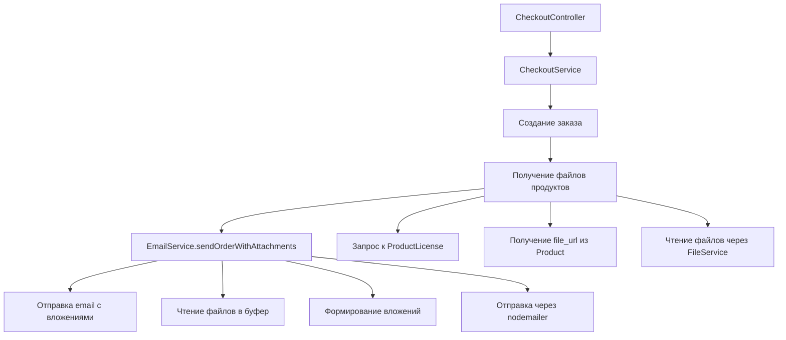

# План: Отправка заказа на почту с файлами

## Цель
После оформления заказа отправить пользователю email с информацией о заказе и прикреплёнными файлами (по одному файлу на каждый товар).

## Анализ текущей системы

### Существующие компоненты
- **CheckoutService** - создаёт заказ из корзины, создаёт UserProduct для авторизованных пользователей
- **EmailService** - имеет метод `sendPurchaseConfirmation` для отправки подтверждения покупки
- **FileService** - управляет файлами продуктов, хранящимися в `files/product/{id}/`
- **UserProductService** - позволяет получить информацию о файлах для скачивания

### Поток данных
1. Пользователь оформляет заказ → CheckoutController → CheckoutService
2. CheckoutService создаёт Order, OrderItem, UserProduct
3. После создания заказа нужно отправить email с файлами

## Архитектура решения



## Реализация

### Шаг 1: Расширить EmailService для поддержки вложений

**Файл:** `server/src/email/email.service.ts`

Добавить новый метод:
```typescript
interface Attachment {
  filename: string;
  path: string;       // Путь к файлу на диске (относительно server/src)
  contentType: string;
}

interface OrderEmailOptions {
  to: string;
  subject?: string;
  html?: string;
  attachments?: Attachment[];
}

async sendOrderWithAttachments(
  options: OrderEmailOptions
): Promise<void>
```

### Шаг 2: Добавить метод для получения файлов заказа

**Файл:** `server/src/email/email.service.ts`

Создать метод для получения файлов из заказа:
```typescript
async getOrderAttachments(orderId: number): Promise<Attachment[]>
```

Метод должен:
1. Получить Order с OrderItem через OrderService
2. Для каждого OrderItem получить ProductLicense → Product
3. Проверить наличие file_url
4. Прочитать файл через FileService
5. Сформировать вложение с правильным именем

### Шаг 3: Интегрировать отправку email в CheckoutService

**Файл:** `server/src/checkout/checkout.service.ts`

Добавить вызов отправки email после создания заказа:
```typescript
// В методе createOrder после успешного создания:
await this.emailService.sendOrderConfirmationEmail({
  orderId: newOrder.id,
  userEmail: userContext.guestEmail || userEmail,
  locale: dto.locale || 'ru',
});
```

### Шаг 4: Обновить CheckoutModule

**Файл:** `server/src/checkout/checkout.module.ts`

Добавить импорт EmailModule:
```typescript
import { EmailModule } from '../email/email.module';

@Module({
  imports: [
    // ... существующие импорты
    EmailModule,
  ],
  // ...
})
export class CheckoutModule {}
```

### Шаг 5: Обновить шаблон письма (опционально)

**Файл:** `server/src/email/templates/locales/ru.json`

Добавить информацию о том, что файлы прикреплены к письму.

## Детали реализации

### Получение файлов продукта
```typescript
// Через Order -> OrderItem -> ProductLicense -> Product
const order = await this.orderService.getOrderById(orderId);
const attachments: Attachment[] = [];

for (const item of order.items) {
  const productLicense = await this.productLicenseModel.findByPk(item.productLicenseId, {
    include: [Product]
  });
  
  if (productLicense.product.file_url) {
    // file_url хранится как 'files/product/{id}/filename.ext'
    // Нужно преобразовать в путь относительно server/src
    const relativePath = productLicense.product.file_url;  // например: 'files/product/123/file.zip'
    
    // Проверяем существование файла
    const fullPath = path.join(process.cwd(), relativePath);
    if (fs.existsSync(fullPath)) {
      attachments.push({
        filename: relativePath.split('/').pop() || 'file',
        path: relativePath,  // Путь относительно server/src
        contentType: this.getMimeType(relativePath)
      });
    }
  }
}
```

### Отправка email с вложениями
```typescript
await this.mailerService.sendMail({
  to: options.to,
  subject: options.subject || 'Ваш заказ',
  html: options.html,
  attachments: options.attachments?.map(att => ({
    filename: att.filename,
    path: att.path,  // Путь к файлу на диске
    contentType: att.contentType
  }))
});
```

### Пример интерфейса для вложений
```typescript
interface Attachment {
  filename: string;
  path: string;       // Путь к файлу относительно server/src
  contentType: string;
}
```

## Обработка ошибок

1. **Файл не найден** - продолжить отправку email без этого файла, залогировать предупреждение
2. **Ошибка чтения файла** - залогировать ошибку, продолжить с другими файлами
3. **Ошибка отправки email** - залогировать ошибку, не блокировать успешный checkout

## Тестирование

1. Проверить отправку email с одним файлом
2. Проверить отправку email с несколькими файлами
3. Проверить случай, когда у товара нет файла
4. Проверить случай для гостевого заказа
5. Проверить случай для авторизованного пользователя
