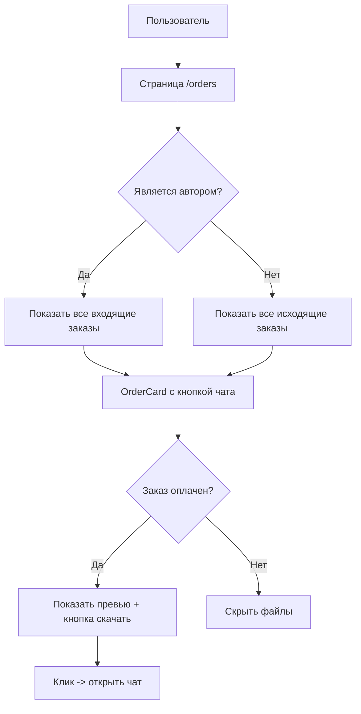

# План реализации страницы заказов (Orders Page)

## Цель
Обновить страницу `/orders` для отображения всех Custom Orders пользователя:
- Если пользователь - автор: показать все заказы, поступившие автору
- Если пользователь - покупатель: показать все заказы пользователя
- При клике на заказ открывается чат с этим заказом
- Для оплаченных заказов - возможность скачать файлы и просмотреть превью

## Текущее состояние
- Страница `/orders` уже отображает Custom Orders из чата
- Загружает данные через `chatApi.getUserOrders()` -> `/chat/orders`
- OrderCard отображает основную информацию о заказе

## Что нужно сделать

### 1. Серверная часть (Backend)

#### 1.1 Новый endpoint для получения всех заказов автора
- Создать `GET /chat/orders/all` - возвращает все заказы пользователя включая COMPLETED
- Включить данные: is_paid, preview_url, source_files_urls
- Защищенный (требует JWT авторизации)

#### 1.2 Endpoint для скачивания файлов заказа
- `GET /chat/orders/:id/download` - скачать исходные файлы (только для оплаченных заказов)
- `GET /chat/orders/:id/preview` - получить превью (публичный или для участников)

### 2. Фронтенд часть (Frontend)

#### 2.1 API клиент
- Обновить `chatApi.getUserOrders()` или добавить `chatApi.getAllOrders()`
- Добавить методы для скачивания файлов

#### 2.2 Типы данных
- Обновить интерфейс `CustomOrder`:
  - Добавить `is_paid?: boolean`
  - Добавить `preview_url?: string | null`
  - Добавить `source_files_urls?: string[] | null`
  - Добавить `chat_room_id` для навигации в чат

#### 2.3 Компонент OrderCard
- Добавить обработчик клика -> открытие чата
- Для оплаченных заказов:
  - Показать превью (если есть)
  - Кнопка "Скачать файлы"
  - Кнопка "Просмотр превью"
- Добавить модальное окно просмотра превью

#### 2.4 Страница orders/page.tsx
- При клике на заказ -> переход в чат с этим заказом
- URL: `/chat?room=<chat_room_id>` или `/chat/<chat_room_id>`

### 3. Локализация
- Добавить ключи для новых элементов интерфейса

## Архитектура данных

## Файлы для изменения

### Сервер (server/)
- `server/src/chat/chat.controller.ts` - добавить endpoints
- `server/src/chat/chat.service.ts` - добавить логику

### Фронтенд (front/)
- `front/src/lib/api-chat.ts` - добавить API методы
- `front/src/types/chat/index.ts` - обновить типы
- `front/src/components/chat/OrderCard.tsx` - обновить компонент
- `front/src/app/[lang]/orders/page.tsx` - обновить страницу
- `front/src/locales/ru.json` - добавить переводы
- `front/src/locales/en.json` - добавить переводы

## Статусы заказов (Custom Orders)
- `waiting_author` - ожидает принятия автором
- `waiting_user` - автор предложил цену, ожидает подтверждения пользователя
- `rejected` - отклонён
- `in_progress` - в работе
- `awaiting_payment` - ожидает оплаты
- `completed` - завершён (оплачен)