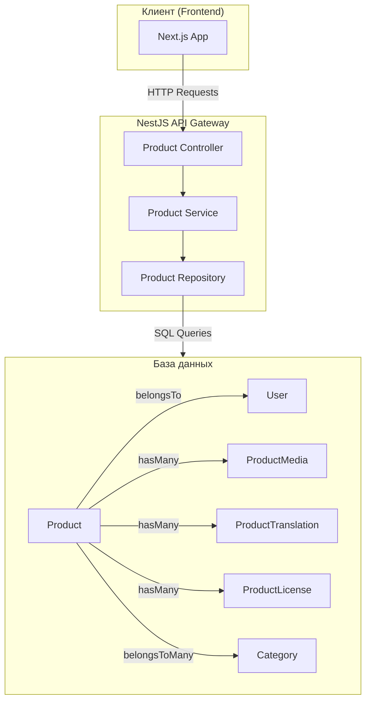

# План API для Product (CRUD)

## Обзор

Данный план описывает API для управления продуктами в системе. Продукт представляет собой цифровой товар (кисть, иллюстрация) с поддержкой переводов, медиа-файлов и типов лицензий.

---

## 1. Расширение модели Product

### Текущая модель (необходимо добавить поля)

```typescript
// Добавить в server/src/db/models/product.model.ts

@Table({ tableName: 'products', timestamps: true })
export class Product extends Model {
  // Существующие поля
  @PrimaryKey
  @AutoIncrement
  @Column(DataType.INTEGER)
  declare id: number;

  @ForeignKey(() => User)
  @Column({ type: DataType.INTEGER, allowNull: false })
  declare seller_id: number;

  @Column(DataType.ENUM(...Object.values(ProductType)))
  declare type: ProductType;

  @Column({ type: DataType.STRING(500), allowNull: false })
  declare file_url: string;

  @Default(true)
  @Column(DataType.BOOLEAN)
  declare is_active: boolean;

  // === НОВЫЕ ПОЛЯ ===
  
  @Column({ type: DataType.STRING(255), allowNull: false })
  declare name: string;

  @Column({ type: DataType.TEXT, allowNull: true })
  declare description: string;

  @Column({ type: DataType.DECIMAL(10, 2), allowNull: false })
  declare price: number;

  @Column({ type: DataType.DECIMAL(10, 2), allowNull: true })
  declare discount_price: number;

  @Column({ type: DataType.STRING(100), allowNull: true })
  declare sku: string;

  @Default(0)
  @Column({ type: DataType.INTEGER, allowNull: false })
  declare stock: number;

  @Default(false)
  @Column(DataType.BOOLEAN)
  declare is_featured: boolean;

  @Column({ type: DataType.STRING(500), allowNull: true })
  declare main_image: string;

  // Связи
  @BelongsTo(() => User, 'seller_id')
  declare seller: User;

  @HasMany(() => ProductMedia, 'product_id')
  declare media: ProductMedia[];

  @HasMany(() => ProductTranslation, 'product_id')
  declare translations: ProductTranslation[];

  @HasMany(() => ProductLicense, 'product_id')
  declare licenses: ProductLicense[];

  @BelongsToMany(() => Category, () => ProductCategory)
  declare categories: Category[];
}
```

---

## 2. Endpoint'ы API

### Базовый URL: `/api/products`

| Метод | Endpoint | Описание | Доступ |
|-------|----------|----------|--------|
| GET | `/products` | Получить список продуктов | Public |
| GET | `/products/:id` | Получить продукт по ID | Public |
| POST | `/products` | Создать новый продукт | Seller/Admin |
| PATCH | `/products/:id` | Обновить продукт | Seller/Admin |
| DELETE | `/products/:id` | Удалить продукт | Seller/Admin |
| GET | `/products/:id/media` | Получить медиа продукта | Public |
| POST | `/products/:id/media` | Добавить медиа к продукту | Seller/Admin |
| DELETE | `/products/:id/media/:mediaId` | Удалить медиа | Seller/Admin |
| GET | `/products/:id/licenses` | Получить лицензии продукта | Public |
| POST | `/products/:id/licenses` | Добавить лицензию | Seller/Admin |
| GET | `/products/my` | Получить продукты текущего продавца | Seller |
| PATCH | `/products/:id/activate` | Активировать продукт | Seller/Admin |
| PATCH | `/products/:id/deactivate` | Деактивировать продукт | Seller/Admin |

---

## 3. Детали запросов

### 3.1 GET /products - Получение списка продуктов

**Query Parameters:**

| Параметр | Тип | Обязательный | Описание |
|----------|-----|--------------|----------|
| page | number | Нет | Номер страницы (по умолчанию: 1) |
| limit | number | Нет | Количество на странице (по умолчанию: 10) |
| search | string | Нет | Поиск по name, description, sku |
| categoryId | number | Нет | Фильтр по категории |
| type | string | Нет | Фильтр по типу (brush, illustration) |
| isActive | boolean | Нет | Фильтр по активности |
| isFeatured | boolean | Нет | Фильтр по избранному |
| minPrice | number | Нет | Минимальная цена |
| maxPrice | number | Нет | Максимальная цена |
| sortBy | string | Нет | Поле для сортировки (price, created_at, name) |
| sortOrder | string | Нет | Направление сортировки (asc, desc) |

**Пример запроса:**
```http
GET /api/products?page=1&limit=10&categoryId=2&type=brush&sortBy=price&sortOrder=asc
```

**Ответ (200):**
```json
{
  "data": [
    {
      "id": 1,
      "name": "Кисть для акварели",
      "description": "Профессиональная кисть",
      "price": 29.99,
      "discountPrice": 19.99,
      "sku": "BRUSH-001",
      "type": "brush",
      "isActive": true,
      "isFeatured": true,
      "mainImage": "https://...",
      "sellerId": 1,
      "createdAt": "2024-01-15T10:30:00Z",
      "updatedAt": "2024-01-15T10:30:00Z",
      "categories": [...],
      "translations": [...],
      "licenses": [...]
    }
  ],
  "meta": {
    "total": 100,
    "page": 1,
    "limit": 10,
    "totalPages": 10
  }
}
```

---

### 3.2 GET /products/:id - Получение продукта по ID

**Path Parameters:**

| Параметр | Тип | Описание |
|----------|-----|----------|
| id | number | ID продукта |

**Пример запроса:**
```http
GET /api/products/1
```

**Ответ (200):**
```json
{
  "id": 1,
  "name": "Кисть для акварели",
  "description": "Профессиональная кисть для акварельной живописи",
  "price": 29.99,
  "discountPrice": 19.99,
  "sku": "BRUSH-001",
  "type": "brush",
  "fileUrl": "https://storage.example.com/files/brush-001.zip",
  "stock": 100,
  "isActive": true,
  "isFeatured": true,
  "mainImage": "https://storage.example.com/images/brush-001-main.jpg",
  "sellerId": 1,
  "seller": {
    "id": 1,
    "username": "artist1"
  },
  "categories": [
    { "id": 1, "name": "Кисти" }
  ],
  "translations": [
    { "language": "en", "name": "Watercolor Brush", "description": "..." }
  ],
  "media": [
    { "id": 1, "url": "https://...", "mediaType": "image", "isCover": true }
  ],
  "licenses": [
    { "id": 1, "licenseType": "personal", "price": 19.99 },
    { "id": 2, "licenseType": "commercial", "price": 49.99 }
  ],
  "createdAt": "2024-01-15T10:30:00Z",
  "updatedAt": "2024-01-15T10:30:00Z"
}
```

**Ответ (404) - если продукт не найден:**
```json
{
  "statusCode": 404,
  "message": "Product not found",
  "error": "Not Found"
}
```

---

### 3.3 POST /products - Создание продукта

**Headers:**
```
Authorization: Bearer <access_token>
Content-Type: application/json
```

**Body:**
```json
{
  "name": "Кисть для акварели",
  "description": "Профессиональная кисть для акварельной живописи",
  "price": 29.99,
  "discountPrice": 19.99,
  "sku": "BRUSH-001",
  "type": "brush",
  "fileUrl": "https://storage.example.com/files/brush-001.zip",
  "stock": 100,
  "isActive": true,
  "isFeatured": true,
  "mainImage": "https://storage.example.com/images/brush-001-main.jpg",
  "categoryIds": [1, 2],
  "translations": [
    {
      "language": "en",
      "name": "Watercolor Brush",
      "description": "Professional watercolor brush",
      "shortDescription": "Pro brush"
    },
    {
      "language": "ru",
      "name": "Кисть для акварели",
      "description": "Профессиональная кисть"
    }
  ],
  "licenses": [
    { "licenseTypeId": 1, "price": 19.99 },
    { "licenseTypeId": 2, "price": 49.99 }
  ]
}
```

**Описание полей:**

| Поле | Тип | Обязательное | Описание |
|------|-----|--------------|----------|
| name | string | Да | Название продукта |
| description | string | Нет | Полное описание |
| price | number | Да | Цена |
| discountPrice | number | Нет | Цена со скидкой |
| sku | string | Нет | Артикул |
| type | string | Да | Тип продукта (brush, illustration) |
| fileUrl | string | Да | URL файла продукта |
| stock | number | Нет | Количество на складе |
| isActive | boolean | Нет | Активен |
| isFeatured | boolean | Нет | Избранный |
| mainImage | string | Нет | Главное изображение |
| categoryIds | number[] | Нет | ID категорий |
| translations | object[] | Нет | Переводы |
| licenses | object[] | Нет | Типы лицензий |

**Ответ (201):**
```json
{
  "id": 1,
  "name": "Кисть для акварели",
  "description": "Профессиональная кисть для акварельной живописи",
  "price": 29.99,
  "discountPrice": 19.99,
  "sku": "BRUSH-001",
  "type": "brush",
  "fileUrl": "https://storage.example.com/files/brush-001.zip",
  "stock": 100,
  "isActive": true,
  "isFeatured": true,
  "mainImage": "https://storage.example.com/images/brush-001-main.jpg",
  "sellerId": 1,
  "createdAt": "2024-01-15T10:30:00Z",
  "updatedAt": "2024-01-15T10:30:00Z"
}
```

**Ответы ошибок:**
- 400: Ошибка валидации
- 401: Не авторизован
- 403: Нет доступа (не продавец)
- 409: Продукт с таким SKU уже существует

---

### 3.4 PATCH /products/:id - Обновление продукта

**Headers:**
```
Authorization: Bearer <access_token>
Content-Type: application/json
```

**Path Parameters:**

| Параметр | Тип | Описание |
|----------|-----|----------|
| id | number | ID продукта |

**Body (все поля опциональны):**
```json
{
  "name": "Новое название",
  "description": "Новое описание",
  "price": 39.99,
  "discountPrice": 29.99,
  "sku": "NEW-SKU",
  "stock": 50,
  "isActive": false,
  "isFeatured": true,
  "mainImage": "https://...",
  "categoryIds": [1, 3]
}
```

**Ответ (200):**
```json
{
  "id": 1,
  "name": "Новое название",
  "description": "Новое описание",
  "price": 39.99,
  "discountPrice": 29.99,
  "sku": "NEW-SKU",
  "type": "brush",
  "fileUrl": "https://storage.example.com/files/brush-001.zip",
  "stock": 50,
  "isActive": false,
  "isFeatured": true,
  "mainImage": "https://...",
  "sellerId": 1,
  "updatedAt": "2024-01-16T15:00:00Z"
}
```

**Ответы ошибок:**
- 400: Ошибка валидации
- 401: Не авторизован
- 403: Нет доступа (не владелец или не админ)
- 404: Продукт не найден

---

### 3.5 DELETE /products/:id - Удаление продукта

**Headers:**
```
Authorization: Bearer <access_token>
```

**Path Parameters:**

| Параметр | Тип | Описание |
|----------|-----|----------|
| id | number | ID продукта |

**Ответ (204):** No Content

**Ответы ошибок:**
- 401: Не авторизован
- 403: Нет доступа
- 404: Продукт не найден

---

### 3.6 GET /products/my - Продукты текущего продавца

**Headers:**
```
Authorization: Bearer <access_token>
```

**Query Parameters:** аналогично GET /products

**Пример запроса:**
```http
GET /api/products/my?page=1&limit=10
```

**Ответ (200):**
```json
{
  "data": [...],
  "meta": {
    "total": 5,
    "page": 1,
    "limit": 10,
    "totalPages": 1
  }
}
```

---

### 3.7 POST /products/:id/media - Добавление медиа

**Headers:**
```
Authorization: Bearer <access_token>
Content-Type: application/json
```

**Body:**
```json
{
  "url": "https://storage.example.com/images/brush-001-2.jpg",
  "mediaType": "image",
  "isCover": false,
  "sortOrder": 1
}
```

**Ответ (201):**
```json
{
  "id": 2,
  "productId": 1,
  "url": "https://storage.example.com/images/brush-001-2.jpg",
  "mediaType": "image",
  "isCover": false,
  "sortOrder": 1
}
```

---

### 3.8 DELETE /products/:id/media/:mediaId - Удаление медиа

**Headers:**
```
Authorization: Bearer <access_token>
```

**Ответ (204):** No Content

---

### 3.9 POST /products/:id/licenses - Добавление лицензии

**Headers:**
```
Authorization: Bearer <access_token>
Content-Type: application/json
```

**Body:**
```json
{
  "licenseTypeId": 3,
  "price": 99.99
}
```

**Ответ (201):**
```json
{
  "id": 3,
  "productId": 1,
  "licenseTypeId": 3,
  "price": 99.99
}
```

---

## 4. Диаграмма архитектуры API



---

## 5. Роли и права доступа

| Операция | Admin | Seller | User (покупатель) |
|----------|-------|--------|-------------------|
| Просмотр всех продуктов | ✓ | ✓ | ✓ |
| Просмотр своего продукта | ✓ | ✓ | ✗ |
| Создание продукта | ✓ | ✓ | ✗ |
| Редактирование своего продукта | ✓ | ✓ (свой) | ✗ |
| Редактирование любого продукта | ✓ | ✗ | ✗ |
| Удаление своего продукта | ✓ | ✓ (свой) | ✗ |
| Удаление любого продукта | ✓ | ✗ | ✗ |
| Добавление медиа | ✓ | ✓ (свой) | ✗ |
| Удаление медиа | ✓ | ✓ (свой) | ✗ |
| Добавление лицензий | ✓ | ✓ (свой) | ✗ |

---

## 6. Файлы для создания

| Файл | Описание |
|------|----------|
| `server/src/product/product.controller.ts` | Контроллер с CRUD операциями |
| `server/src/product/product.service.ts` | Бизнес-логика |
| `server/src/product/product.module.ts` | Модуль продукта |
| `server/src/product/dto/product-response.dto.ts` | DTO для ответа |
| `server/src/product/dto/product-query.dto.ts` | DTO для query параметров |
| `server/src/product/dto/add-media.dto.ts` | DTO для добавления медиа |
| `server/src/product/dto/add-license.dto.ts` | DTO для добавления лицензии |
| `server/src/product/exceptions/product-not-found.exception.ts` | Исключение "не найден" |
| `server/src/product/exceptions/product-access-denied.exception.ts` | Исключение "нет доступа" |

---

## 7. Примеры интеграции с Frontend

### Использование API в фронтенде (api.ts)

```typescript
// front/src/lib/api.ts

export const productApi = {
  // Получить список продуктов
  getProducts: (params?: ProductQueryParams) => 
    get<ProductListResponse>('/products', params),
  
  // Получить продукт по ID
  getProduct: (id: number) => 
    get<ProductDetailResponse>(`/products/${id}`),
  
  // Создать продукт
  createProduct: (data: CreateProductDto) => 
    post<ProductDetailResponse>('/products', data),
  
  // Обновить продукт
  updateProduct: (id: number, data: UpdateProductDto) => 
    patch<ProductDetailResponse>(`/products/${id}`, data),
  
  // Удалить продукт
  deleteProduct: (id: number) => 
    delete<void>(`/products/${id}`),
  
  // Мои продукты
  getMyProducts: (params?: ProductQueryParams) => 
    get<ProductListResponse>('/products/my', params),
  
  // Добавить медиа
  addMedia: (productId: number, data: AddMediaDto) => 
    post<ProductMedia>(`/products/${productId}/media`, data),
  
  // Удалить медиа
  deleteMedia: (productId: number, mediaId: number) => 
    delete<void>(`/products/${productId}/media/${mediaId}`),
  
  // Добавить лицензию
  addLicense: (productId: number, data: AddLicenseDto) => 
    post<ProductLicense>(`/products/${productId}/licenses`, data),
};
```

---

## 8. Следующие шаги

1. Расширить модель Product новыми полями
2. Обновить DTO для соответствия модели
3. Создать ProductController с эндпоинтами
4. Создать ProductService с бизнес-логикой
5. Создать ProductModule и зарегистрировать в AppModule
6. Добавить guards для проверки ролей
7. Обновить frontend API клиент
