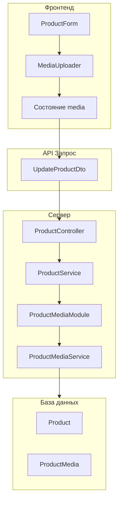

# План: Обработка изменений isCover и удаления картинок

## Обзор задачи

Необходимо реализовать механизм передачи на сервер информации об изменении `isCover` для картинок продукта и их удалении. При изменении `isCover` у одной картинки, у остальных картинок того же продукта значение `isCover` должно становиться `false`.

---

## Архитектура решения



---

## Часть 1: Серверная реализация

### 1.1 Создание DTO для обновления медиа

**Файл:** `server/src/product/dto/update-media.dto.ts`

```typescript
import { IsOptional, IsNumber, IsBoolean, IsArray } from 'class-validator';

/**
 * DTO для обновления одной записи медиа
 */
export class UpdateMediaItemDto {
  @IsNumber({}, { message: 'ID медиа должен быть числом' })
  id: number;

  @IsOptional()
  @IsBoolean({ message: 'isCover должен быть boolean' })
  isCover?: boolean;
}

/**
 * DTO для массового обновления медиа при редактировании продукта
 */
export class UpdateProductMediaDto {
  @IsArray({ message: 'updatedMedia должен быть массивом' })
  @IsOptional()
  updatedMedia?: UpdateMediaItemDto[];

  @IsArray({ message: 'deletedMediaIds должен быть массивом' })
  @IsOptional()
  deletedMediaIds?: number[];
}
```

### 1.2 Обновление UpdateProductDto

**Файл:** `server/src/product/dto/update-product.dto.ts`

Добавить поля:

```typescript
// Обновленные медиа (изменение isCover)
@IsArray({ message: 'Updated media must be an array' })
@IsOptional()
updatedMedia?: { id: number; isCover?: boolean }[];

// ID удаленных медиа
@IsArray({ message: 'Deleted media IDs must be an array' })
@IsOptional()
@IsNumber({}, { each: true })
deletedMediaIds?: number[];
```

### 1.3 Создание ProductMediaService

Создать как сервис внутри папки product (не отдельный модуль):

**Файл:** `server/src/product/product-media.service.ts`

```typescript
import { Injectable, NotFoundException } from '@nestjs/common';
import { InjectModel } from '@nestjs/sequelize';
import { ProductMedia } from '../db/models/product-media.model';

/**
 * Сервис для работы с медиа файлами продуктов
 * Содержит вспомогательные функции для управления медиа
 */
@Injectable()
export class ProductMediaService {
  constructor(
    @InjectModel(ProductMedia)
    private readonly productMediaModel: typeof ProductMedia,
  ) {}

  /**
   * Установить медиа как обложку продукта
   * При установке - сбрасывает isCover у всех остальных медиа этого продукта
   */
  async setMediaAsCover(productId: number, mediaId: number): Promise<ProductMedia> {
    const media = await this.productMediaModel.findOne({
      where: { id: mediaId, product_id: productId },
    });

    if (!media) {
      throw new NotFoundException(`Media with ID ${mediaId} not found for product ${productId}`);
    }

    // Сбросить все обложки и установить новую
    await this.productMediaModel.update(
      { is_cover: false },
      { where: { product_id: productId } },
    );

    await this.productMediaModel.update(
      { is_cover: true },
      { where: { id: mediaId } },
    );

    return this.productMediaModel.findByPk(mediaId);
  }

  /**
   * Обновить isCover для массива медиа
   * Если устанавливается isCover=true для одного, сбрасывается у остальных
   */
  async updateMediaCovers(
    productId: number,
    updates: { id: number; isCover?: boolean }[],
  ): Promise<void> {
    if (!updates || updates.length === 0) return;

    // Найти все медиа для продукта
    const allMedia = await this.productMediaModel.findAll({
      where: { product_id: productId },
    });

    // Проверить, есть ли хотя бы одно isCover=true в updates
    const hasNewCover = updates.some((u) => u.isCover === true);

    // Если есть новая обложка - сбрасываем все существующие
    if (hasNewCover) {
      await this.productMediaModel.update(
        { is_cover: false },
        { where: { product_id: productId } },
      );
    }

    // Обновить указанные медиа
    for (const update of updates) {
      const media = allMedia.find((m) => m.id === update.id);
      if (media) {
        await this.productMediaModel.update(
          { is_cover: update.isCover ?? media.is_cover },
          { where: { id: update.id } },
        );
      }
    }
  }

  /**
   * Удалить медиа по ID
   */
  async deleteMedia(productId: number, mediaId: number): Promise<void> {
    const media = await this.productMediaModel.findOne({
      where: { id: mediaId, product_id: productId },
    });

    if (!media) {
      throw new NotFoundException(`Media with ID ${mediaId} not found for product ${productId}`);
    }

    await this.productMediaModel.destroy({ where: { id: mediaId } });
  }

  /**
   * Удалить массив медиа
   */
  async deleteMediaBatch(productId: number, mediaIds: number[]): Promise<void> {
    if (!mediaIds || mediaIds.length === 0) return;

    await this.productMediaModel.destroy({
      where: {
        id: { $in: mediaIds },
        product_id: productId,
      },
    });
  }

  /**
   * Получить все медиа продукта
   */
  async getMediaByProduct(productId: number): Promise<ProductMedia[]> {
    return this.productMediaModel.findAll({
      where: { product_id: productId },
    });
  }

  /**
   * Найти медиа по ID
   */
  async findById(mediaId: number): Promise<ProductMedia | null> {
    return this.productMediaModel.findByPk(mediaId);
  }
}
```

### 1.4 Обновление ProductModule

**Файл:** `server/src/product/product.module.ts`

Добавить импорт ProductMedia и SequelizeModule:

```typescript
import { Module } from '@nestjs/common';
import { SequelizeModule } from '@nestjs/sequelize';
import { ProductMedia } from '../db/models/product-media.model';
import { ProductMediaService } from './product-media.service';

@Module({
  imports: [SequelizeModule.forFeature([ProductMedia])],
  providers: [ProductMediaService],
  // ... остальная конфигурация
})
export class ProductModule {}
```

### 1.5 Обновление ProductService

**Файл:** `server/src/product/product.service.ts`

Добавить импорт и использование ProductMediaService:

```typescript
import { ProductMediaService } from '../product-media/product-media.service';

constructor(
  private readonly productRepository: ProductRepository,
  private readonly uploadsService: UploadsService,
  private readonly productMediaService: ProductMediaService,
) {}

// В методе update():
async update(id: number, sellerId: number, updateProductDto: UpdateProductDto) {
  // ... существующая логика ...

  // Обработка обновления медиа (isCover)
  if (updateProductDto.updatedMedia && updateProductDto.updatedMedia.length > 0) {
    await this.productMediaService.updateMediaCovers(id, updateProductDto.updatedMedia);
  }

  // Обработка удаления медиа
  if (updateProductDto.deletedMediaIds && updateProductDto.deletedMediaIds.length > 0) {
    await this.productMediaService.deleteMediaBatch(id, updateProductDto.deletedMediaIds);
  }

  // ... остальная логика ...
}
```

---

## Часть 2: Фронтенд реализация

### 2.1 Обновление типов Product

**Файл:** `front/src/types/product/product.types.ts`

```typescript
/**
 * DTO для обновления медиа при редактировании продукта
 */
export interface UpdateMediaItem {
  id: number;
  isCover?: boolean;
}

/**
 * DTO для создания продукта
 */
export interface CreateProductDto {
  // ... существующие поля ...
}

/**
 * DTO для обновления продукта
 */
export type UpdateProductDto = Partial<CreateProductDto> & {
  categoryIds?: number[];
  translations?: TranslationDto[];
  // Обновленные медиа (изменение isCover)
  updatedMedia?: UpdateMediaItem[];
  // ID удаленных медиа
  deletedMediaIds?: number[];
};
```

### 2.2 Обновление MediaUploader

**Файл:** `front/src/components/admin/MediaUploader.tsx`

Добавить отслеживание изменений:

```typescript
// Добавить проп для колбека изменений
interface MediaUploaderProps {
  value: MediaItem[];
  onChange: (items: MediaItem[]) => void;
  onMediaChange?: (changes: { updatedMedia: UpdateMediaItem[]; deletedMediaIds: number[] }) => void;
  // ... остальные пропы
}

// Обновить handleRemove для отслеживания удаленных медиа
const handleRemove = useCallback(
  (index: number) => {
    const removedItem = value[index];
    const newItems = value.filter((_, i) => i !== index);
    
    // Если удалили cover, сделать первое изображение cover
    if (removedItem.isCover && newItems.length > 0 && !newItems[0].isCover) {
      newItems[0].isCover = true;
    }
    
    onChange(newItems);
    
    // Вызвать колбек изменений для существующих медиа
    if (onMediaChange && !removedItem.isNew) {
      onMediaChange({
        updatedMedia: [],
        deletedMediaIds: [removedItem.id],
      });
    }
  },
  [value, onChange, onMediaChange],
);

// Обновить handleSetCover для отслеживания изменений isCover
const handleSetCover = useCallback(
  (index: number) => {
    const newItems = value.map((item, i) => ({
      ...item,
      isCover: i === index,
    }));
    onChange(newItems);

    // Вызвать колбек изменений для существующих медиа
    if (onMediaChange) {
      const updatedMedia = value
        .filter((item, i) => item.isCover !== (i === index))
        .map((item, i) => ({
          id: item.id,
          isCover: i === index,
        }));
      
      if (updatedMedia.length > 0) {
        onMediaChange({
          updatedMedia,
          deletedMediaIds: [],
        });
      }
    }
  },
  [value, onChange, onMediaChange],
);
```

### 2.3 Обновление ProductForm

**Файл:** `front/src/components/admin/ProductForm.tsx`

```typescript
// Добавить состояние для отслеживания изменений медиа
const [mediaChanges, setMediaChanges] = useState<{
  updatedMedia: UpdateMediaItem[];
  deletedMediaIds: number[];
}>({
  updatedMedia: [],
  deletedMediaIds: [],
});

// Обработчик изменений медиа
const handleMediaChange = useCallback((changes: {
  updatedMedia: UpdateMediaItem[];
  deletedMediaIds: number[];
}) => {
  setMediaChanges((prev) => ({
    updatedMedia: [
      ...prev.updatedMedia,
      ...changes.updatedMedia.filter(
        (u) => !prev.updatedMedia.some((p) => p.id === u.id),
      ),
    ],
    deletedMediaIds: [
      ...prev.deletedMediaIds,
      ...changes.deletedMediaIds.filter(
        (d) => !prev.deletedMediaIds.includes(d),
      ),
    ],
  }));
}, []);

// В handleSubmit добавить отправку изменений
const updateData: UpdateProductDto = {
  // ... остальные поля ...
  updatedMedia: mediaChanges.updatedMedia.length > 0
    ? mediaChanges.updatedMedia
    : undefined,
  deletedMediaIds: mediaChanges.deletedMediaIds.length > 0
    ? mediaChanges.deletedMediaIds
    : undefined,
};

// Передать handleMediaChange в FileStockSection
<FileStockSection
  fileUrl={fileUrl}
  onFileUrlChange={setFileUrl}
  media={media}
  onMediaChange={setMedia}
  onMediaChangeWithTracking={handleMediaChange}
/>
```

### 2.4 Обновление FileStockSection

**Файл:** `front/src/components/admin/FileStockSection.tsx`

```typescript
interface FileStockSectionProps {
  // ... существующие пропы ...
  onMediaChangeWithTracking?: (changes: {
    updatedMedia: UpdateMediaItem[];
    deletedMediaIds: number[];
  }) => void;
}

// Передать проп в MediaUploader
<MediaUploader
  value={media}
  onChange={onMediaChange}
  onMediaChange={onMediaChangeWithTracking}
/>
```

---

## Список файлов для создания/изменения

### Новые файлы (сервер)
- `server/src/product/product-media.service.ts` - Сервис для работы с медиа (в папке product)

### Изменяемые файлы (сервер)
- `server/src/product/dto/update-product.dto.ts` - Добавить поля updatedMedia и deletedMediaIds
- `server/src/product/product.module.ts` - Добавить импорт ProductMediaService
- `server/src/product/product.service.ts` - Интегрировать ProductMediaService

### Изменяемые файлы (фронтенд)
- `front/src/types/product/product.types.ts` - Добавить типы UpdateMediaItem, updatedMedia, deletedMediaIds
- `front/src/components/admin/MediaUploader.tsx` - Добавить отслеживание изменений isCover и удалений
- `front/src/components/admin/ProductForm.tsx` - Добавить отправку updatedMedia и deletedMediaIds
- `front/src/components/admin/FileStockSection.tsx` - Прокинуть колбек изменений медиа

---

## Готово к реализации

План готов. Переключитесь в режим `code` для начала реализации.
