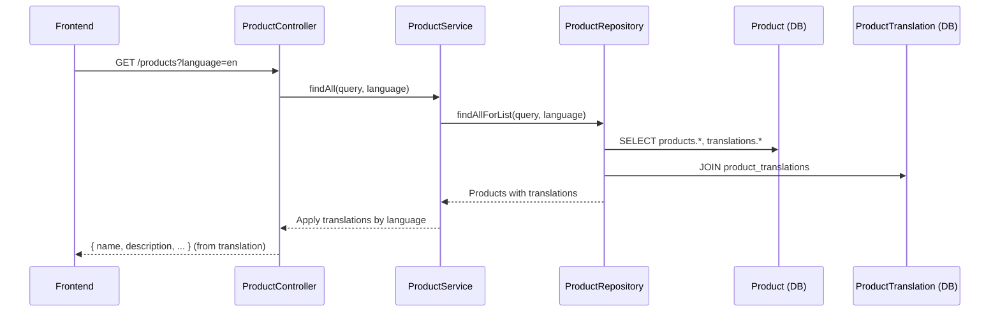

# План миграции: Удаление полей name, description, sku из таблицы products

## Цель
Перенести поля `name`, `description` и удалить `sku` из основной таблицы `products` в таблицу переводов `product_translations`.

## Анализ текущего состояния

### Текущая структура таблиц

**products:**
- id, seller_id, name, description, price, discount_price, **sku**, type, file_url, stock, is_active, is_featured, main_image, timestamps

**product_translations:**
- id, product_id, name, description, shortDescription, language, timestamps

### Где используются поля

**На сервере:**
- `product.model.ts` - определение полей
- `product.repository.ts` - создание/обновление/поиск
- `product.service.ts` - бизнес-логика, применение переводов
- `product.types.ts` - TypeScript типы
- `product-response.types.ts` - функции создания ответов
- `create-product.dto.ts`, `update-product.dto.ts` - DTO для API

**На фронте:**
- `product.types.ts` - типы ProductBase, CreateProductDto
- `api-product.ts` - API функции
- `ProductCard.tsx` - отображение карточки товара

---

## План выполнения

### Этап 1: Обновление модели Product

**Файл:** `server/src/db/models/product.model.ts`

Удалить:
```typescript
@Column({ type: DataType.STRING(255), allowNull: false })
declare name: string;

@Column({ type: DataType.TEXT, allowNull: true })
declare description: string;

@Column({ type: DataType.STRING(100), allowNull: true })
declare sku: string;
```

### Этап 2: Миграция базы данных

**Файл:** `server/src/db/migrations/20240319000000-remove-product-name-description-sku.js`

```javascript
module.exports = {
  async up(queryInterface, Sequelize) {
    await queryInterface.removeColumn('products', 'name');
    await queryInterface.removeColumn('products', 'description');
    await queryInterface.removeColumn('products', 'sku');
  },

  async down(queryInterface, Sequelize) {
    await queryInterface.addColumn('products', 'name', {
      type: Sequelize.STRING(255),
      allowNull: false,
      defaultValue: ''
    });
    await queryInterface.addColumn('products', 'description', {
      type: Sequelize.TEXT,
      allowNull: true
    });
    await queryInterface.addColumn('products', 'sku', {
      type: Sequelize.STRING(100),
      allowNull: true
    });
  }
};
```


### Этап 3: Обновление типов сервера

**Файл:** `server/src/types/product/product.types.ts`

1. Удалить из `ProductFields`:
   - `name: string`
   - `description: string | null`
   - `sku: string | null`

2. Удалить из `CreateProductDto`:
   - `name?: string`
   - `description?: string`
   - `sku?: string`

**Файл:** `server/src/types/product/product-response.types.ts`

1. Удалить из `ProductFieldsResponse`:
   - `name: string`
   - `description: string | null`
   - `sku: string | null`

2. Удалить из `ProductListItemResponse`:
   - `name: string`
   - `description: string | null`
   - `sku: string | null`

3. Удалить из `ProductDetailResponse`:
   - `name: string`
   - `description: string | null`
   - `sku: string | null`

### Этап 4: Обновление DTO

**Файл:** `server/src/product/dto/create-product.dto.ts`

- Удалить поле `name` (оставить только в TranslationDto)
- Удалить поле `description` (оставить только в TranslationDto)
- Удалить поле `sku`

**Файл:** `server/src/product/dto/update-product.dto.ts`

- Аналогичные изменения

### Этап 5: Обновление repository

**Файл:** `server/src/product/repositories/product.repository.ts`

1. Обновить `ProductCreateData` - удалить name, description, sku
2. Обновить `ProductUpdateData` - удалить name, description, sku
3. Обновить `findAllForList`:
   - Добавить включение `ProductTranslation` в запрос
   - Модифицировать where для поиска в translations по языку
   - После получения результатов, применить переводы для name/description

4. Обновить `findByIdWithFullRelations` - убедиться что translations загружаются

5. Обновить методы create/update - работать только с translations для name/description

### Этап 6: Обновление service

**Файл:** `server/src/product/product.service.ts`

1. Обновить `findAll`:
   - Передавать язык в repository
   - Применять переводы к каждому продукту

2. Убрать код который перезаписывает product.name и product.description (он уже будет работать через repository)

### Этап 7: Обновление фронтенда

**Файл:** `front/src/types/product/product.types.ts`

- Удалить из `ProductBase`: name, description, sku
- Обновить `CreateProductDto` - убрать name, description, sku из корня

**Файлы для проверки использования:**
- `ProductCard.tsx` - проверить как используется name
- Другие компоненты использующие product.name, product.description

---

## Поток данных после миграции

### GET /products?language=en

1. `findAllForList` запрашивает products + translations
2. Для каждого продукта находится перевод по языку
3. name и description берутся из translation
4. В ответе: name, description без sku

### GET /products/:id?language=en

1. `findByIdWithFullRelations` загружает product + translations
2. Находится перевод по языку
3. name, description из translation
4. Ответ содержит все translations для админ-панели

### POST /products (отправка с фронтенда)

При создании/обновлении товара, поля **name** и **description** должны отправляться в массиве **translations**:

```json
{
  "type": "brush",
  "translations": [
    { "language": "RU", "name": "Кисть 1", "description": "Описание" },
    { "language": "EN", "name": "Brush 1", "description": "Description" }
  ],
  "licenses": [...]
}
```

**Важно:**
- Поля `name`, `description`, `sku` **не должны** быть на корневом уровне DTO
- Они должны передаваться только в массиве `translations`
- Repository при создании товара должен сохранять переводы в таблицу `product_translations`

---

## Диаграмма последовательности



---

## Обратная совместимость

- После миграции старые данные в name/description будут потеряны
- Нужно убедиться что переводы существуют для всех продуктов
- SKU удаляется полностью

---

## Риски и проверки

1. **Проверить что все продукты имеют переводы** - иначе name будет пустым
2. **Поиск** - должен искать в translations по языку
3. **Админ-панель** - должна показывать все переводы
4. **Создание/обновление** - DTO должны требовать translations
