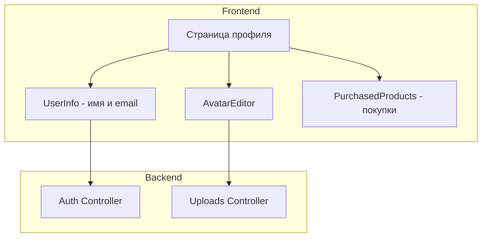

# План: Редактирование профиля пользователя

## Цель
Обновить страницу профиля:
- Убрать поле роли и язык
- Добавить аватар с функцией смены
- Добавить изменение имени

## Архитектура



## Этапы реализации

### 1. Серверная часть (NestJS)

#### 1.1 Добавить DTO для обновления профиля
- Файл: `server/src/auth/dto/update-profile.dto.ts`
- Поля: name (опционально), avatar_url (опционально)

#### 1.2 Добавить эндпоинт обновления профиля
- Файл: `server/src/auth/auth.controller.ts`
- Метод: PATCH `/auth/profile`
- Защита: JwtAuthGuard
- Логика: обновляет имя и/или аватар текущего пользователя

#### 1.3 Добавить эндпоинт загрузки аватара
- Файл: `server/src/uploads/uploads.controller.ts`
- Метод: POST `/uploads/avatar`
- Защита: JwtAuthGuard
- Логика: загружает изображение в папку `public/user/{userId}/`
- Возвращает URL аватара

#### 1.4 Обновить auth.service.ts
- Метод: `updateProfile(userId, data)` - обновляет профиль пользователя

### 2. Фронтенд часть (Next.js)

#### 2.1 Установить зависимость
```bash
npm install react-avatar-editor
```

#### 2.2 Обновить API
- Файл: `front/src/lib/api-auth.ts`
- Добавить: `updateProfile(data)` - обновление профиля
- Добавить: `uploadAvatar(file)` - загрузка аватара

#### 2.3 Создать компонент AvatarEditor
- Файл: `front/src/components/profile/AvatarEditor.tsx`
- Использует react-avatar-editor
- Функции:
  - Загрузка изображения
  - Масштабирование (zoom)
  - Поворот
  - Сохранение

#### 2.4 Создать компонент UserInfo
- Файл: `front/src/components/profile/UserInfo.tsx`
- Отображение: имя, email
- Функции:
  - Редактирование имени (inline или по клику)
  - Сохранение при изменении

#### 2.5 Обновить страницу профиля
- Файл: `front/src/app/[lang]/profile/page.tsx`
- Структура:
  ```
  ┌─────────────────────────────────────────┐
  │           Основная колонка               │
  │  ┌─────────┐                            │
  │  │ Аватар  │  Имя (редактируемое)       │
  │  │[Фото]   │  email@example.com        │
  │  └─────────┘                            │
  └─────────────────────────────────────────┘
  ┌─────────────────────────────────────────┐
  │           Правая колонка                 │
  │         Мои покупки                      │
  └─────────────────────────────────────────┘
  ```

#### 2.6 Обновить типы
- Файл: `front/src/types/auth/index.ts`
- Обновить интерфейс User - убрать role и locale (для отображения профиля)

### 3. Разделение на компоненты

```
front/src/components/profile/
├── index.ts                 # Экспорт всех компонентов
├── AvatarEditor.tsx         # Компонент редактирования аватара
├── UserInfo.tsx             # Информация о пользователе (имя, email)
└── ProfileLayout.tsx        # Компонент layout профиля
```

## Детали реализации

### Загрузка аватара
1. Пользователь выбирает файл
2. Отправляется на сервер POST `/uploads/avatar`
3. Сервер сохраняет в `public/user/{userId}/avatar.{ext}`
4. Возвращает URL: `/user/{userId}/avatar.{ext}`
5. Клиент обновляет профиль PATCH `/auth/profile` с avatar_url

### Редактирование имени
1. Пользователь кликает на имя
2. Появляется input для редактирования
3. При сохранении - PATCH `/auth/profile` с name
4. Обновляется контекст авторизации

### Структура БД
Поле `avatar_url` уже существует в модели User:
```typescript
@Column({ type: DataType.STRING(500), allowNull: true })
declare avatar_url: string | null;
```

## Файлы для изменения

### Сервер (NestJS)
1. `server/src/auth/dto/update-profile.dto.ts` - создать
2. `server/src/auth/auth.controller.ts` - добавить PATCH /profile
3. `server/src/auth/auth.service.ts` - добавить updateProfile
4. `server/src/uploads/uploads.controller.ts` - добавить POST /avatar

### Фронтенд (Next.js)
1. `front/src/lib/api-auth.ts` - добавить функции API
2. `front/src/types/auth/index.ts` - обновить типы
3. `front/src/components/profile/AvatarEditor.tsx` - создать
4. `front/src/components/profile/UserInfo.tsx` - создать
5. `front/src/components/profile/ProfileLayout.tsx` - создать
6. `front/src/components/profile/index.ts` - создать
7. `front/src/app/[lang]/profile/page.tsx` - обновить

## Ожидаемый результат

После реализации страница профиля будет иметь:
- Аватар с возможностью редактирования (zoom, rotate)
- Имя пользователя (редактируемое)
- Email пользователя (только чтение)
- Секция "Мои покупки" справа

Поля "роль" и "язык" будут убраны из отображения профиля.