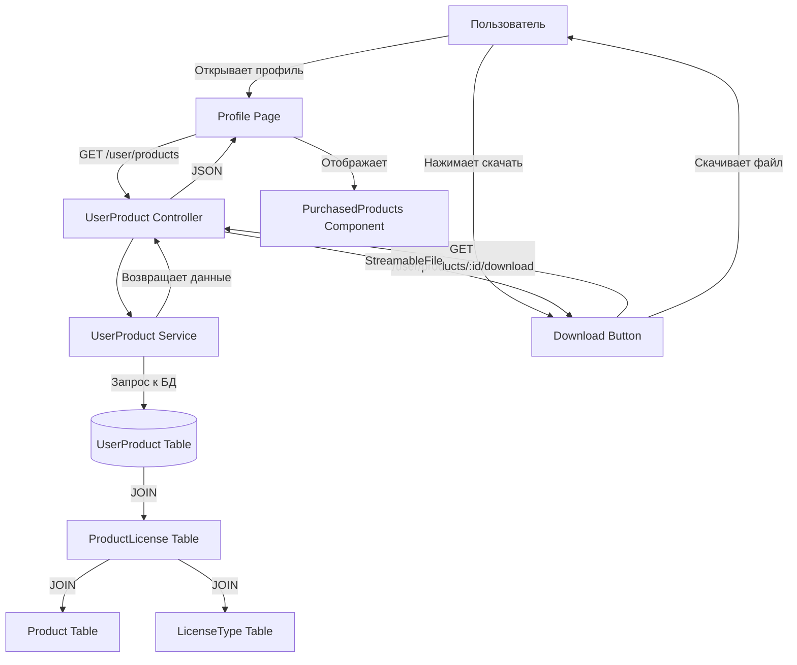

# План: Отображение купленных товаров в профиле

## Текущее состояние

### Существующая инфраструктура
- **Модель `UserProduct`** ([`server/src/db/models/user-product.model.ts`](server/src/db/models/user-product.model.ts)) - уже создана и содержит:
  - `user_id` - ID пользователя
  - `product_license_id` - ID лицензии продукта
  - `order_id` - ID заказа
  - `purchased_at` - дата покупки

- **Модель `Product`** ([`server/src/db/models/product.model.ts`](server/src/db/models/product.model.ts:44)) - содержит `file_url` для хранения пути к файлу

- **Модель `ProductLicense`** ([`server/src/db/models/product-license.model.ts`](server/src/db/models/product-license.model.ts)) - связывает Product с LicenseType

- **Страница профиля**: [`front/src/app/[lang]/profile/page.tsx`](front/src/app/[lang]/profile/page.tsx) - только базовая информация о пользователе

### Проблемы
1. В [`checkout.service.ts`](server/src/checkout/checkout.service.ts:102) при создании заказа **НЕ создаются записи UserProduct**
2. Нет API для получения списка купленных товаров
3. Нет фронтенд-компонента для отображения покупок

---

## Этапы реализации

### Этап 1: Backend - Создание UserProduct при оформлении заказа

**Задача**: Добавить создание записей `UserProduct` в [`checkout.service.ts`](server/src/checkout/checkout.service.ts) при успешной оплате заказа

**Изменения**:

1. **Добавить импорт UserProduct** в [`checkout.module.ts`](server/src/checkout/checkout.module.ts):
```typescript
import { UserProduct } from '../db/models/user-product.model';
// Добавить в SequelizeModule.forFeature
```

2. **Модифицировать метод `createOrder()`** в [`checkout.service.ts`](server/src/checkout/checkout.service.ts:102):
   - Добавить `@InjectModel(UserProduct)`
   - В цикле создания OrderItem добавить создание UserProduct для авторизованных пользователей

```typescript
// После создания OrderItem (строка ~136)
if (userContext.userId && productLicense) {
  await this.userProductModel.create({
    user_id: userContext.userId,
    product_license_id: productLicense.id,
    order_id: newOrder.id,
  }, { transaction });
}
```

**Файлы для изменения**:
- `server/src/checkout/checkout.module.ts` - добавить UserProduct
- `server/src/checkout/checkout.service.ts` - добавить логику создания UserProduct

---

### Этап 2: Backend - API для получения купленных товаров

**Задача**: Создать API эндпоинты для работы с купленными товарами

**Создать новые файлы**:

1. **DTO** - [`server/src/user-product/dto/user-product.dto.ts`](server/src/user-product/dto/user-product.dto.ts):
```typescript
export class UserProductResponse {
  id: number;
  productId: number;
  productName: string;
  productImage: string;
  licenseTypeId: number;
  licenseTypeName: string;
  price: number;
  purchasedAt: Date;
  fileUrl: string;
}
```

2. **Service** - [`server/src/user-product/user-product.service.ts`](server/src/user-product/user-product.service.ts):
```typescript
@Injectable()
export class UserProductService {
  constructor(
    @InjectModel(UserProduct)
    private readonly userProductModel: typeof UserProduct,
  ) {}

  async getUserProducts(userId: number, locale: string = 'en'): Promise<UserProductResponse[]> {
    const products = await this.userProductModel.findAll({
      where: { user_id: userId },
      include: [
        { 
          model: ProductLicense, 
          include: [
            { model: Product, include: [ProductTranslation] },
            { model: LicenseType, include: [LicenseTypeTranslation] }
          ]
        },
        { model: Order }
      ],
      order: [['purchased_at', 'DESC']]
    });
    
    // Трансформировать в UserProductResponse с учётом locale
  }

  async getUserProductById(userId: number, productId: number): Promise<UserProduct | null> {
    return this.userProductModel.findOne({
      where: { id: productId, user_id: userId },
      include: [ProductLicense, Order]
    });
  }

  async downloadProduct(userId: number, userProductId: number): Promise<StreamableFile> {
    // Проверить ownership
    // Вернуть файл
  }
}
```

3. **Controller** - [`server/src/user-product/user-product.controller.ts`](server/src/user-product/user-product.controller.ts):
```typescript
@Controller('user/products')
@UseGuards(JwtAuthGuard)
export class UserProductController {
  constructor(private readonly userProductService: UserProductService) {}

  @Get()
  async getMyProducts(
    @CurrentUserId() userId: number,
    @Headers('accept-language') locale?: string,
  ): Promise<UserProductResponse[]> {
    return this.userProductService.getUserProducts(userId, locale || 'en');
  }

  @Get(':id/download')
  async downloadProduct(
    @CurrentUserId() userId: number,
    @Param('id', ParseIntPipe) productId: number,
  ): Promise<StreamableFile> {
    return this.userProductService.downloadProduct(userId, productId);
  }
}
```

4. **Module** - [`server/src/user-product/user-product.module.ts`](server/src/user-product/user-product.module.ts):
```typescript
@Module({
  imports: [
    SequelizeModule.forFeature([
      UserProduct, 
      ProductLicense, 
      Product, 
      ProductTranslation,
      LicenseType,
      LicenseTypeTranslation,
      Order
    ]),
  ],
  controllers: [UserProductController],
  providers: [UserProductService],
  exports: [UserProductService],
})
export class UserProductModule {}
```

5. **Добавить в app.module.ts** - импортировать UserProductModule

**Файлы для создания**:
- `server/src/user-product/user-product.controller.ts`
- `server/src/user-product/user-product.service.ts`
- `server/src/user-product/user-product.module.ts`
- `server/src/user-product/dto/user-product.dto.ts`

**Файлы для изменения**:
- `server/src/app.module.ts` - добавить импорт UserProductModule

---

### Этап 3: Frontend - Отображение купленных товаров

**Задача**: Добавить секцию "Мои покупки" на страницу профиля

**Изменения**:

1. **Создать API клиент** - [`front/src/lib/api-user-products.ts`](front/src/lib/api-user-products.ts):
```typescript
import api from './api';

export interface UserProductResponse {
  id: number;
  productId: number;
  productName: string;
  productImage: string;
  licenseTypeId: number;
  licenseTypeName: string;
  price: number;
  purchasedAt: string;
  fileUrl: string;
}

export async function getUserProducts(): Promise<UserProductResponse[]> {
  const response = await api.get<UserProductResponse[]>('/user/products');
  return response.data;
}

export async function downloadProduct(productId: number): Promise<Blob> {
  const response = await api.get(`/user/products/${productId}/download`, {
    responseType: 'blob',
  });
  return response.data;
}
```

2. **Создать компонент** - [`front/src/components/profile/PurchasedProducts.tsx`](front/src/components/profile/PurchasedProducts.tsx):
```typescript
'use client';

import { useEffect, useState } from 'react';
import { getUserProducts, downloadProduct, UserProductResponse } from '@/lib/api-user-products';
import { useI18n } from '@/context/i18n/I18nContext';
import { Card, Button, Spinner } from '@/components/ui';

export function PurchasedProducts() {
  const { t } = useI18n();
  const [products, setProducts] = useState<UserProductResponse[]>([]);
  const [loading, setLoading] = useState(true);

  useEffect(() => {
    getUserProducts()
      .then(setProducts)
      .finally(() => setLoading(false));
  }, []);

  const handleDownload = async (product: UserProductResponse) => {
    const blob = await downloadProduct(product.id);
    const url = window.URL.createObjectURL(blob);
    const a = document.createElement('a');
    a.href = url;
    a.download = `${product.productName}.zip`;
    a.click();
    window.URL.revokeObjectURL(url);
  };

  if (loading) return <Spinner />;

  return (
    <Card padding="lg" className="mt-6">
      <h3 className="text-xl font-bold mb-4">{t('profile.myPurchases')}</h3>
      
      {products.length === 0 ? (
        <p className="text-gray-500">{t('profile.noPurchases')}</p>
      ) : (
        <div className="space-y-4">
          {products.map((product) => (
            <div key={product.id} className="flex items-center justify-between border-b pb-4">
              <div className="flex items-center gap-4">
                {product.productImage && (
                  
                )}
                <div>
                  <h4 className="font-medium">{product.productName}</h4>
                  <p className="text-sm text-gray-500">
                    {t('profile.license')}: {product.licenseTypeName}
                  </p>
                  <p className="text-xs text-gray-400">
                    {t('profile.purchased')}: {new Date(product.purchasedAt).toLocaleDateString()}
                  </p>
                </div>
              </div>
              <Button onClick={() => handleDownload(product)}>
                {t('profile.download')}
              </Button>
            </div>
          ))}
        </div>
      )}
    </Card>
  );
}
```

3. **Обновить страницу профиля** - [`front/src/app/[lang]/profile/page.tsx`](front/src/app/[lang]/profile/page.tsx):
```typescript
// Добавить импорт
import { PurchasedProducts } from '@/components/profile/PurchasedProducts';

// Добавить в компонент после Card с информацией о пользователе
<PurchasedProducts />
```

4. **Добавить переводы** в [`front/src/locales/ru.json`](front/src/locales/ru.json) и [`front/src/locales/en.json`](front/src/locales/en.json):

```json
{
  "profile": {
    "myPurchases": "Мои покупки",
    "noPurchases": "У вас пока нет покупок",
    "license": "Лицензия",
    "purchased": "Приобретено",
    "download": "Скачать"
  }
}
```

**Файлы для создания**:
- `front/src/lib/api-user-products.ts`
- `front/src/components/profile/PurchasedProducts.tsx`

**Файлы для изменения**:
- `front/src/app/[lang]/profile/page.tsx`
- `front/src/locales/ru.json`
- `front/src/locales/en.json`

---

## Диаграмма потока данных



---

## Чеклист выполнения

### Backend
- [ ] Добавить UserProduct в checkout.module.ts
- [ ] Обновить checkout.service.ts - создавать UserProduct для авторизованных
- [ ] Создать user-product.controller.ts
- [ ] Создать user-product.service.ts
- [ ] Создать user-product.module.ts
- [ ] Создать user-product.dto.ts
- [ ] Добавить UserProductModule в app.module.ts

### Frontend
- [ ] Создать api-user-products.ts
- [ ] Создать компонент PurchasedProducts.tsx
- [ ] Обновить profile/page.tsx
- [ ] Добавить переводы в ru.json
- [ ] Добавить переводы в en.json

---

## Notes

- Модель UserProduct уже существует и содержит все необходимые поля
- При оформлении заказа UserProduct создается ТОЛЬКО для авторизованных пользователей
- Для гостей заказы хранятся только в таблице Order с guest_email
- При скачивании нужно проверять ownership - пользователь должен быть владельцем
- Файлы хранятся через file_url в модели Product
