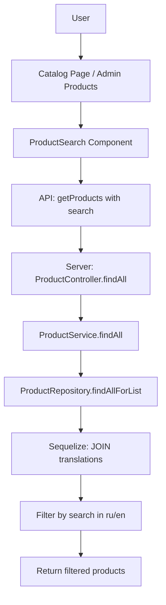

# План: Рефакторинг поиска товаров

## Анализ проблемы

### Текущее состояние

1. **Фронтенд** (`front/src/app/[lang]/catalog/page.tsx`):
   - Есть поисковая строка с `searchQuery` и `Input`
   - Параметр `search` передается в API: `params.search = searchQuery`
   - Debounce отсутствует (搜索 без задержки)

2. **Фронтенд** (`front/src/app/[lang]/admin/products/page.tsx`):
   - Использует компонент `ProductFilters` с debounce 500ms
   - Поиск передается в API

3. **Бэкенд** (`server/src/product/repositories/product.repository.ts`):
   - Метод `findAllForList` (строки 181-284) - используется для каталога
   - **ПРОБЛЕМА**: Параметр `search` НЕ используется! (строка 189: "search убран - нужно искать через translations")
   - Метод `findAndCountAll` (строки 286-385) - для админки
   - Search ищет по полям `name`, `description`, `sku` в таблице product, которые БОЛЬШЕ НЕ СУЩЕСТВУЮТ

4. **Сущности БД**:
   - `ProductTranslation` содержит `name`, `description`, `shortDescription`, `language` (ru/en)
   - Нужен поиск ПО ОБОИМ языкам

---

## Задачи

### 1. Исправить серверный поиск (ProductRepository)

**Файл**: `server/src/product/repositories/product.repository.ts`

Нужно добавить поиск в метод `findAllForList`:

```typescript
// Добавить в начало метода
if (search) {
  // Ищем по translations для обоих языков через subquery
  // Sequelize не поддерживает directly JOIN с условием OR, поэтому используем include с where
}
```

Альтернативный подход - использовать `Op.or` с `Sequelize.literal`:

```typescript
where[Op.or] = [
  Sequelize.literal(`
    EXISTS (
      SELECT 1 FROM product_translations pt 
      WHERE pt.product_id = Product.id 
      AND pt.name ILIKE '%${search}%'
      AND pt.language IN ('ru', 'en')
    )
  `),
  Sequelize.literal(`
    EXISTS (
      SELECT 1 FROM product_translations pt 
      WHERE pt.product_id = Product.id 
      AND pt.description ILIKE '%${search}%'
      AND pt.language IN ('ru', 'en')
    )
  `),
];
```

### 2. Создать единый компонент ProductSearch

**Новый файл**: `front/src/components/product/ProductSearch.tsx`

Компонент должен:
- Принимать проп `categories` (массив категорий)
- Принимать проп `onSearch` (callback при изменении фильтров)
- Включать:
  - Поле поиска по названию (с debounce 500ms)
  - Выбор типа товара (brush/illustration)
  - Выбор категории
  - Кнопку сброса фильтров
- Выглядеть как sidebar на странице каталога

```typescript
interface ProductSearchProps {
  categories: CategoryResponse[];
  onSearch: (filters: SearchFilters) => void;
  initialValues?: SearchFilters;
}

interface SearchFilters {
  search: string;
  type: ProductType | '';
  categoryId: number | '';
}
```

### 3. Интегрировать в страницу каталога

**Файл**: `front/src/app/[lang]/catalog/page.tsx`

- Заменить локальные фильтры на `ProductSearch`
- Передавать результаты поиска в URL (для шеринга)
- Использовать categories из API

### 4. Интегрировать в админ-панель

**Файл**: `front/src/app/[lang]/admin/products/page.tsx`

- Заменить `ProductFilters` на `ProductSearch`
- Убрать лишние поля (status) для админки если нужно

### 5. Обновить API функции (опционально)

**Файл**: `front/src/lib/api-product.ts`

Можно добавить специальную функцию для поиска:

```typescript
export async function searchProducts(
  query: string,
  categoryId?: number,
  type?: ProductType
): Promise<ProductListResponse> {
  return getProducts({
    search: query,
    categoryId,
    type,
    isActive: true,
  });
}
```

---

## Диаграмма архитектуры



---

## Файлы для изменения

### Сервер (бэкенд)
1. `server/src/product/repositories/product.repository.ts` - добавить поиск по translations

### Клиент (фронтенд)
1. `front/src/components/product/ProductSearch.tsx` - НОВЫЙ компонент
2. `front/src/app/[lang]/catalog/page.tsx` - использовать ProductSearch
3. `front/src/app/[lang]/admin/products/page.tsx` - использовать ProductSearch

---

## Критерии приемки

1. ✅ Поиск работает по названию товара на русском языке
2. ✅ Поиск работает по названию товара на английском языке
3. ✅ Компонент ProductSearch переиспользуется на двух страницах
4. ✅ Поиск с debounce 500ms
5. ✅ Можно фильтровать по категории и типу товара
