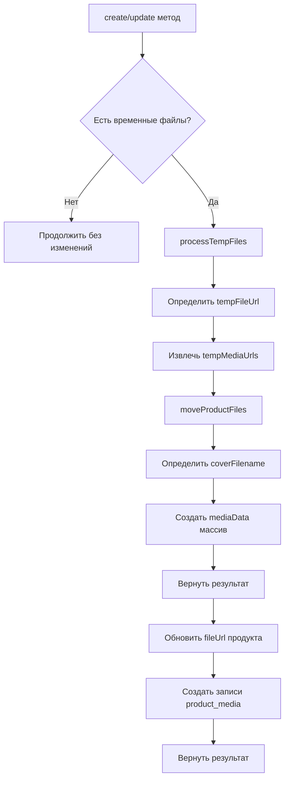

# План рефакторинга: Унифицированная функция обработки временных файлов

## Цель
Создать единый приватный метод `processTempFiles` в `ProductService` для обработки временных файлов и создания записей `product_media` в БД, используемый в методах `create` и `update`.

## Анализ текущего состояния

### Дублирующийся код в `product.service.ts`:

**В методе `create` (строки 82-195):**
- Проверка временных файлов: строки 101-107
- Определение tempFileUrl: строки 131-138
- Вызов moveProductFiles: строки 145-153
- Обновление fileUrl: строки 157-161
- Определение coverFilename: строки 168-176
- Цикл создания media: строки 178-191

**В методе `update` (строки 197-301):**
- Проверка временных файлов: строки 222-229
- Определение tempFileUrl: строки 236-243
- Вызов moveProductFiles: строки 249-257
- Обновление fileUrl: строки 261-263
- Определение coverFilename: строки 268-276
- Цикл создания media: строки 277-290

---

## План реализации

### Шаг 1: Создать тип для результата обработки файлов

```typescript
interface ProcessedFilesResult {
  fileUrl: string | null;
  mediaData: { url: string; isCover: boolean }[];
}
```

### Шаг 2: Создать приватный метод processTempFiles

```typescript
/**
 * Обработать временные файлы и переместить их в постоянное хранилище
 * @param sellerId - ID продавца
 * @param productId - ID продукта (для нового продукта может быть null)
 * @param dto - DTO с временными файлами (tempFileUrl, tempMediaUrls, fileUrl)
 * @returns Promise с информацией о перемещенных файлах
 */
private async processTempFiles(
  sellerId: number,
  productId: number,
  dto: { tempFileUrl?: string; tempMediaUrls?: { url: string; isCover?: boolean }[]; fileUrl?: string }
): Promise<ProcessedFilesResult> {
  // 1. Проверить наличие временных файлов
  const isTempFileUrl = dto.tempFileUrl || dto.fileUrl?.includes('/temp/');
  const hasTempMedia = dto.tempMediaUrls && dto.tempMediaUrls.length > 0;
  
  if (!isTempFileUrl && !hasTempMedia) {
    return { fileUrl: null, mediaData: [] };
  }

  // 2. Определить tempFileUrl
  const tempFileUrl = dto.tempFileUrl || (dto.fileUrl?.includes('/temp/') ? dto.fileUrl : undefined);
  
  // 3. Извлечь массив URL из tempMediaUrls
  const tempMediaUrls = dto.tempMediaUrls?.map(m => m.url) || [];
  
  console.log('[processTempFiles] tempFileUrl:', tempFileUrl);
  console.log('[processTempFiles] tempMediaUrls:', tempMediaUrls);

  // 4. Переместить файлы
  const movedFiles = this.uploadsService.moveProductFiles(
    sellerId,
    productId,
    tempFileUrl,
    tempMediaUrls,
  );

  // 5. Определить coverFilename из входных данных
  let coverFilename: string | undefined;
  if (dto.tempMediaUrls) {
    const coverItem = dto.tempMediaUrls.find(m => m.isCover);
    if (coverItem) {
      coverFilename = coverItem.url.split('/').pop();
    }
  }

  // 6. Создать массив mediaData с определением isCover
  const mediaData = movedFiles.media.map(media => {
    const mediaFilename = media.url.split('/').pop();
    const isCover = coverFilename
      ? mediaFilename?.includes(coverFilename.split('/').pop() || '')
      : movedFiles.media[0]?.url === media.url;
    
    return { url: media.url, isCover };
  });

  return {
    fileUrl: movedFiles.file?.url || null,
    mediaData,
  };
}
```

### Шаг 3: Обновить метод create

1. Удалить дублирующийся код (строки 97-192)
2. После создания продукта вызвать `processTempFiles`
3. Обновить fileUrl если файл был перемещен
4. Создать записи media на основе возвращенных данных

### Шаг 4: Обновить метод update

1. Удалить дублирующийся код (строки 222-298)
2. Вызвать `processTempFiles`
3. Обновить fileUrl если файл был перемещен
4. Создать записи media на основе возвращенных данных

---

## Ожидаемый результат

- Elimination дублирования кода (~100 строк)
- Единая точка входа для обработки временных файлов
- Упрощение поддержки и развития кода
- Легче тестирование

---

## Mermaid диаграмма



---

## Файлы для изменения

1. `server/src/product/product.service.ts` - основные изменения
