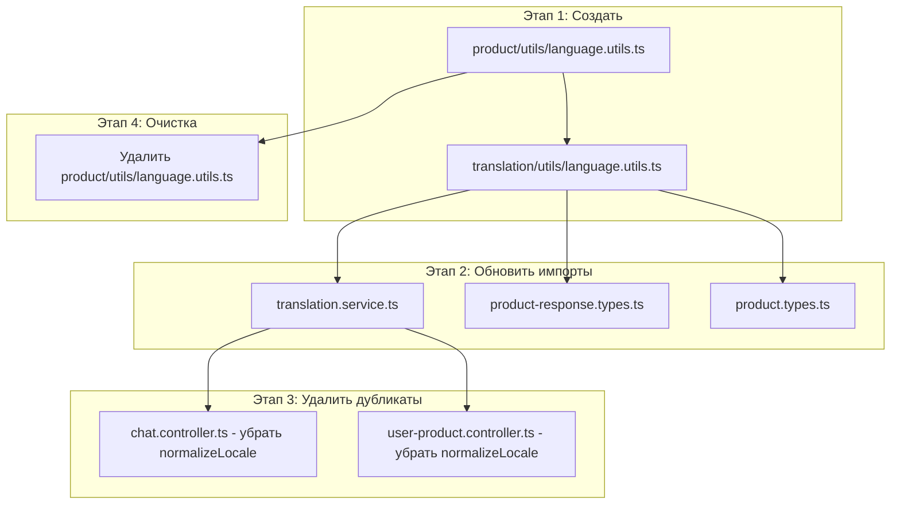

# План: Рефакторинг языковых утилит и удаление дубликатов

## Текущее состояние

### Проблема
В проекте существует несколько мест с дублирующей логикой нормализации языка:

| Файл | Метод | Поведение |
|------|-------|-----------|
| `product/utils/language.utils.ts` | `normalizeLanguage()` | `language?.toLowerCase() \|\| 'ru'` |
| `chat.controller.ts` | `normalizeLocale()` | возвращает 'ru' по умолчанию |
| `user-product.controller.ts` | `normalizeLocale()` | возвращает 'en' по умолчанию |

### Использование normalizeLanguage
- `translation.service.ts` - 4 использования
- `product-response.types.ts` - 6 использований
- `product.types.ts` - 3 использования

## Задача

1. Перенести функции `normalizeLanguage` и `findTranslationByLanguage` из `product/utils/language.utils.ts` в `translation/utils/language.utils.ts`
2. Обновить все импорты
3. Удалить дублирующие методы `normalizeLocale` из контроллеров
4. Удалить старый файл `product/utils/language.utils.ts`

---

## ЭТАП 1: Создать translation/utils/language.utils.ts

### Файл: `server/src/translation/utils/language.utils.ts`

Создать новый файл с функциями:

```typescript
import { Language } from '../../common/enums/language.enum';

/**
 * Нормализовать язык для поиска в базе данных
 */
export function normalizeLanguage(language?: string): string {
  return language?.toLowerCase() || Language.RUSSIAN;
}

/**
 * Получить перевод из массива переводов по языку
 */
export function findTranslationByLanguage(
  translations: unknown[] | undefined,
  language?: string,
): unknown | undefined {
  if (!translations || translations.length === 0) {
    return undefined;
  }

  const normalizedLang = normalizeLanguage(language);

  const translation = translations.find((t) => {
    const obj = t as { dataValues?: { language?: string }; language?: string };
    const lang = obj.dataValues?.language || obj.language;
    return String(lang).toLowerCase() === normalizedLang.toLowerCase();
  });

  return translation || translations[0];
}
```

### Файл: `server/src/translation/utils/index.ts`

Создать индексный файл:

```typescript
export * from './language.utils';
```

---

## ЭТАП 2: Обновить translation.service.ts

### Изменения в `server/src/translation/translation.service.ts`

**Было:**
```typescript
import { normalizeLanguage } from '../product/utils/language.utils';
```

**Стало:**
```typescript
import { normalizeLanguage } from './utils/language.utils';
```

---

## ЭТАП 3: Обновить импорты в product модуле

### Изменения в `server/src/types/product/product-response.types.ts`

**Было:**
```typescript
import { normalizeLanguage } from '../../product/utils/language.utils';
```

**Стало:**
```typescript
import { normalizeLanguage } from '../../translation/utils/language.utils';
```

### Изменения в `server/src/types/product/product.types.ts`

**Было:**
```typescript
import { normalizeLanguage } from '../../product/utils/language.utils';
```

**Стало:**
```typescript
import { normalizeLanguage } from '../../translation/utils/language.utils';
```

---

## ЭТАП 4: Удалить дубликаты из контроллеров

### Изменения в `server/src/chat/chat.controller.ts`

Удалить метод `normalizeLocale` и использовать импортированную функцию:

```typescript
// Удалить этот метод:
private normalizeLocale(locale?: string): string {
  if (!locale) return 'ru';
  return locale.split(',')[0].split('-')[0];
}

// Изменить вызов:
const normalizedLocale = normalizeLanguage(locale);
```

**Было:**
```typescript
import { normalizeLanguage } from '../product/utils/language.utils'; // добавить импорт
// или использовать локальную функцию
const normalizedLocale = this.normalizeLocale(locale);
```

**Стало:**
```typescript
import { normalizeLanguage } from '../translation/utils/language.utils';
// ...
const normalizedLocale = normalizeLanguage(locale);
```

### Изменения в `server/src/user-product/user-product.controller.ts`

Удалить метод `normalizeLocale`:

```typescript
// Удалить этот метод:
private normalizeLocale(locale?: string): string {
  if (!locale) return 'en';
  return locale.split(',')[0].split('-')[0];
}

// Использовать импортированную функцию:
import { normalizeLanguage } from '../translation/utils/language.utils';
const normalizedLocale = normalizeLanguage(locale);
```

---

## ЭТАП 5: Удалить старый файл

Удалить `server/src/product/utils/language.utils.ts`

---

## Mermaid диаграмма изменений



---

## Файлы для изменения

| Файл | Изменение |
|------|-----------|
| `server/src/translation/utils/language.utils.ts` | Создать (новый) |
| `server/src/translation/utils/index.ts` | Создать (новый) |
| `server/src/translation/translation.service.ts` | Изменить импорт |
| `server/src/types/product/product-response.types.ts` | Изменить импорт |
| `server/src/types/product/product.types.ts` | Изменить импорт |
| `server/src/chat/chat.controller.ts` | Удалить normalizeLocale, использовать импорт |
| `server/src/user-product/user-product.controller.ts` | Удалить normalizeLocale, использовать импорт |
| `server/src/product/utils/language.utils.ts` | Удалить файл |
