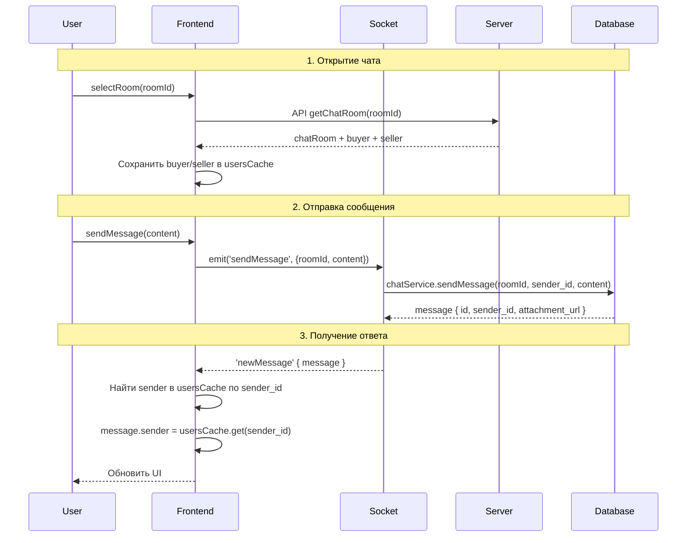

# План исправления: WebSocket чат - неизвестный пользователь и картинка

## Текущие проблемы

1. **Неизвестный пользователь** - при отправке сообщения не отображается имя и аватар отправителя
2. **Не отображается картинка** - `attachment_url` не передается в сообщении

## Корневые причины

### Проблема 1: Неизвестный пользователь

**Server-side** (`server/src/chat/chat.service.ts`, строка 495):
```typescript
const message = await this.chatMessageRepository.create(messageData);
// message.sender = undefined (данные sender не загружаются)
```

**Client-side** (`front/src/components/chat/MessageBubble.tsx`, строка 86-88):
```typescript
<span className="text-sm font-medium text-gray-700">
  {sender?.name || t('chat.unknownUser')}  // <- "Неизвестный пользователь"
</span>
```

### Проблема 2: Не отображается картинка

- При отправке изображения `attachment_url` должен передаваться от сервера
- Нужно проверить, что при создании сообщения с типом `image` передается `attachment_url`

---

## Решение (по требованию пользователя)

**Архитектура**: Передавать только `sender_id`, данные (имя, аватар) подставлять на фронте из кэша.

### Этап 1: Добавить кэш пользователей в ChatContext

**Файл**: `front/src/context/chat/ChatContext.tsx`

**Изменения**:
1. Добавить state:
   ```typescript
   const [usersCache, setUsersCache] = useState<Map<number, ChatUser>>(new Map());
   ```

2. В `selectRoom` - при загрузке чата сохранять buyer и seller в кэш:
   ```typescript
   // После получения chatRoom
   if (result.chatRoom.buyer) {
     usersCache.set(result.chatRoom.buyer.id, result.chatRoom.buyer);
   }
   if (result.chatRoom.seller) {
     usersCache.set(result.chatRoom.seller.id, result.chatRoom.seller);
   }
   ```

3. В обработчике `newMessage` - подставлять sender из кэша:
   ```typescript
   socketClient.on('newMessage', (data: unknown) => {
     const payload = data as { message: ChatMessage };
     // Добавляем sender данные из кэша
     const sender = usersCache.get(payload.message.sender_id);
     if (sender) {
       payload.message.sender = sender;
     }
     setMessages(prev => [...prev, payload.message]);
   });
   ```

### Этап 2: Проверить attachment_url

**Файл**: `server/src/chat/chat.service.ts`

Метод `sendMessage` должен сохранять `attachmentUrl` в БД. Проверить:
1. При отправке изображения передается ли `attachmentUrl`?
2. Сохраняется ли он в поле `attachment_url`?

---

## Файлы для изменения

| # | Файл | Изменение |
|---|------|-----------|
| 1 | `front/src/context/chat/ChatContext.tsx` | Добавить usersCache, подставлять sender при newMessage |
| 2 | `server/src/chat/chat.service.ts` | (Опционально) Проверить сохранение attachment_url |

---

## Схема работы



---

## TODOs для реализации

- [ ] Добавить `usersCache` state в ChatContext
- [ ] В `selectRoom` сохранять участников чата в кэш
- [ ] В обработчике `newMessage` подставлять sender из кэша
- [ ] Проверить сохранение `attachment_url` на сервере
- [ ] Протестировать отправку сообщений
- [ ] Протестировать отправку картинок
